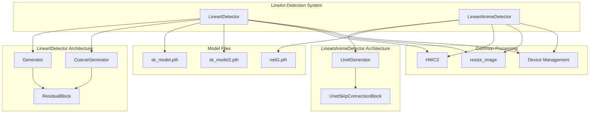
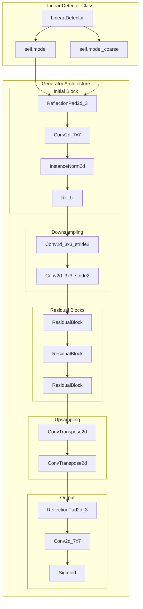
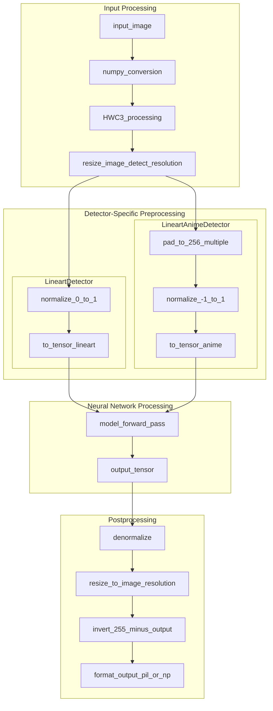
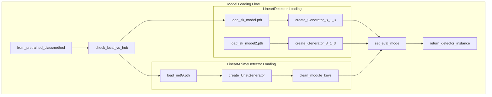

<!-- source: DeepWiki mcp.deepwiki.com · repo huggingface/controlnet_aux · extra page LineArt Detectors · fetched 2026-10-26 -->

# LineArt Detectors

<details>
<summary>Relevant source files</summary>

The following files were used as context for generating this wiki page:

- [src/controlnet_aux/leres/__init__.py](src/controlnet_aux/leres/__init__.py)
- [src/controlnet_aux/lineart/__init__.py](src/controlnet_aux/lineart/__init__.py)
- [src/controlnet_aux/lineart_anime/__init__.py](src/controlnet_aux/lineart_anime/__init__.py)

</details>


This page documents the line art generation detectors in controlnet_aux, which convert photographs and complex images into clean line art representations. These detectors use neural networks to extract line-based features suitable for ControlNet conditioning.

For line segment detection (MLSD), see [Line Segment Detection](#4.4.2). For edge detection systems, see [Edge Detection](#4.1).

## Architecture Overview

The line art detection system provides two specialized detectors with different neural network architectures and use cases:



Sources: [src/controlnet_aux/lineart/__init__.py:94-119](), [src/controlnet_aux/lineart_anime/__init__.py:116-139]()

## LineartDetector (General Line Art)

The `LineartDetector` implements a dual-model system for general-purpose line art generation using a Generator network with residual blocks.

### Dual Model Architecture



Sources: [src/controlnet_aux/lineart/__init__.py:36-92](), [src/controlnet_aux/lineart/__init__.py:17-33]()

### Model Loading and Usage

The detector loads two separate models for different levels of detail:

| Model | Filename | Purpose | Parameters |
|-------|----------|---------|------------|
| Fine Model | `sk_model.pth` | Detailed line art | 3 residual blocks |
| Coarse Model | `sk_model2.pth` | Simplified line art | 3 residual blocks |

```python
# Model selection logic
model = self.model_coarse if coarse else self.model
```

Sources: [src/controlnet_aux/lineart/__init__.py:100-119](), [src/controlnet_aux/lineart/__init__.py:142]()

## LineartAnimeDetector (Anime-Specific)

The `LineartAnimeDetector` uses a U-Net architecture optimized for anime and cartoon-style images, producing clean line art with characteristic anime aesthetics.

### U-Net Architecture

```mermaid
graph TB
    subgraph "UnetGenerator Structure"
        INPUT[Input_3_channels]
        
        subgraph "Encoder Path"
            DOWN1[Conv2d_stride2]
            DOWN2[Conv2d_stride2] 
            DOWN3[Conv2d_stride2]
            DOWN4[Conv2d_stride2]
        end
        
        subgraph "Bottleneck"
            INNER[UnetSkipConnectionBlock_innermost]
        end
        
        subgraph "Decoder Path"
            UP1[ConvTranspose2d_stride2]
            UP2[ConvTranspose2d_stride2]
            UP3[ConvTranspose2d_stride2] 
            UP4[ConvTranspose2d_stride2]
        end
        
        subgraph "Skip Connections"
            SKIP1[Skip_Connection_1]
            SKIP2[Skip_Connection_2]
            SKIP3[Skip_Connection_3]
        end
        
        OUTPUT[Output_1_channel]
    end
    
    subgraph "UnetSkipConnectionBlock Details"
        DOWNCONV[Conv2d_4x4_stride2]
        DOWNRELU[LeakyReLU_0.2]
        DOWNNORM[InstanceNorm2d]
        UPRELU[ReLU]
        UPCONV[ConvTranspose2d_4x4_stride2]
        UPNORM[InstanceNorm2d]
        TANH[Tanh]
    end
    
    INPUT --> DOWN1
    DOWN1 --> DOWN2
    DOWN2 --> DOWN3  
    DOWN3 --> DOWN4
    DOWN4 --> INNER
    
    INNER --> UP1
    UP1 --> UP2
    UP2 --> UP3
    UP3 --> UP4
    UP4 --> OUTPUT
    
    DOWN1 -.-> SKIP1 -.-> UP3
    DOWN2 -.-> SKIP2 -.-> UP2  
    DOWN3 -.-> SKIP3 -.-> UP1
    
    DOWNCONV --> DOWNRELU --> DOWNNORM
    UPRELU --> UPCONV --> UPNORM
```



Sources: [src/controlnet_aux/lineart_anime/__init__.py:16-44](), [src/controlnet_aux/lineart_anime/__init__.py:47-113]()

### Skip Connection Mechanism

The U-Net implements skip connections through concatenation:

```python
# Skip connection logic in UnetSkipConnectionBlock
def forward(self, x):
    if self.outermost:
        return self.model(x)
    else:   # add skip connections
        return torch.cat([x, self.model(x)], 1)
```

Sources: [src/controlnet_aux/lineart_anime/__init__.py:109-113]()

## Processing Pipeline

Both detectors follow a similar processing pipeline with detector-specific preprocessing and postprocessing steps:



Sources: [src/controlnet_aux/lineart/__init__.py:126-167](), [src/controlnet_aux/lineart_anime/__init__.py:145-189]()

### Key Processing Differences

| Aspect | LineartDetector | LineartAnimeDetector |
|--------|-----------------|---------------------|
| Input Normalization | `[0, 1]` | `[-1, 1]` |
| Padding Strategy | None | 256-pixel multiples |
| Model Selection | Coarse/Fine toggle | Single model |
| Output Processing | Direct denormalization | Clipping + denormalization |

Sources: [src/controlnet_aux/lineart/__init__.py:147-148](), [src/controlnet_aux/lineart_anime/__init__.py:167-170]()

## Model Loading and Configuration

Both detectors implement the standard `from_pretrained` pattern for loading models from Hugging Face Hub:



Sources: [src/controlnet_aux/lineart/__init__.py:99-119](), [src/controlnet_aux/lineart_anime/__init__.py:120-139]()

### Device Management

Both detectors support device migration through the `.to(device)` method:

```python
def to(self, device):
    self.model.to(device)
    self.model_coarse.to(device)  # LineartDetector only
    return self
```

Sources: [src/controlnet_aux/lineart/__init__.py:121-124](), [src/controlnet_aux/lineart_anime/__init__.py:141-143]()

---

