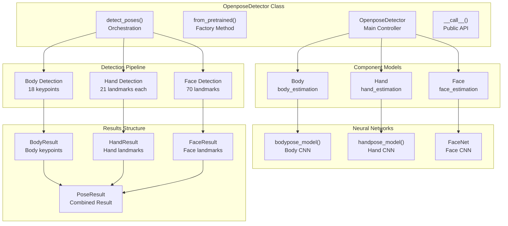
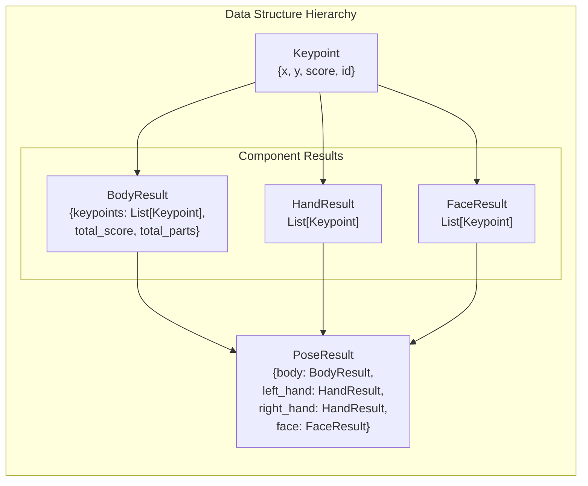
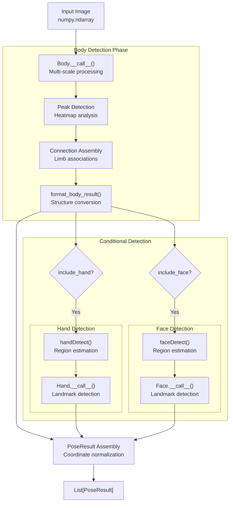
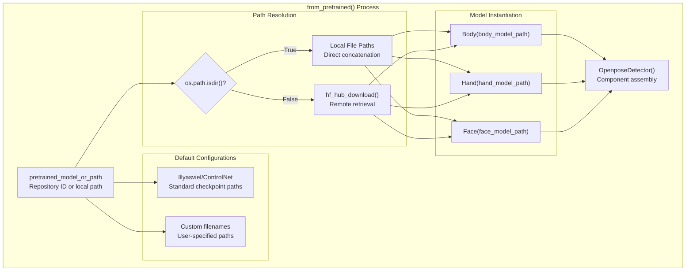
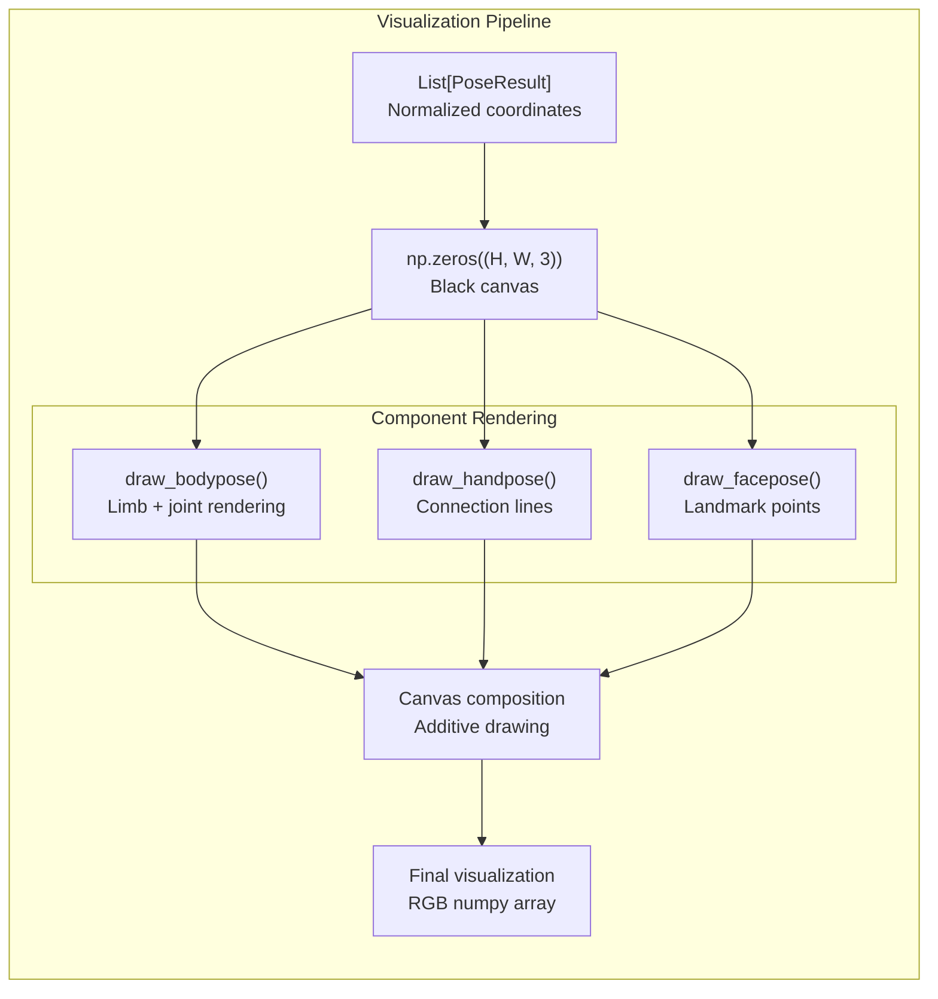

<!-- source: DeepWiki mcp.deepwiki.com · repo huggingface/controlnet_aux · extra page OpenPose Detector · fetched 2026-10-26 -->

# OpenPose Detector

<details>
<summary>Relevant source files</summary>

The following files were used as context for generating this wiki page:

- [src/controlnet_aux/open_pose/__init__.py](src/controlnet_aux/open_pose/__init__.py)
- [src/controlnet_aux/open_pose/body.py](src/controlnet_aux/open_pose/body.py)
- [src/controlnet_aux/open_pose/face.py](src/controlnet_aux/open_pose/face.py)
- [src/controlnet_aux/open_pose/hand.py](src/controlnet_aux/open_pose/hand.py)
- [src/controlnet_aux/open_pose/util.py](src/controlnet_aux/open_pose/util.py)

</details>


The OpenPose Detector provides classic OpenPose implementation for human pose estimation, supporting modular detection of body keypoints, hand landmarks, and facial features. This detector uses separate neural network models for each component and combines them into comprehensive pose results.

For whole-body pose detection with unified processing, see [DWpose Detector](#4.3.1).

## System Architecture

The OpenPose detector follows a modular three-component architecture where each detection type (body, hand, face) operates as an independent subsystem with its own neural network model.



Sources: [src/controlnet_aux/open_pose/__init__.py:70-235](), [src/controlnet_aux/open_pose/body.py:31-261](), [src/controlnet_aux/open_pose/hand.py:11-79](), [src/controlnet_aux/open_pose/face.py:306-364]()

## Core Data Structures

The detector uses structured data types to represent pose information at different levels of granularity.

| Data Structure | Purpose | Key Fields |
|----------------|---------|------------|
| `Keypoint` | Individual landmark | `x`, `y`, `score`, `id` |
| `BodyResult` | Body pose data | `keypoints`, `total_score`, `total_parts` |
| `HandResult` | Hand landmarks | `List[Keypoint]` |
| `FaceResult` | Face landmarks | `List[Keypoint]` |
| `PoseResult` | Complete pose | `body`, `left_hand`, `right_hand`, `face` |



Sources: [src/controlnet_aux/open_pose/body.py:13-29](), [src/controlnet_aux/open_pose/__init__.py:30-37]()

## Detection Pipeline

The detection process follows a hierarchical approach where body detection drives hand and face region detection.



Sources: [src/controlnet_aux/open_pose/__init__.py:160-197](), [src/controlnet_aux/open_pose/body.py:42-227](), [src/controlnet_aux/open_pose/util.py:202-292](), [src/controlnet_aux/open_pose/util.py:296-374]()

## Model Loading and Configuration

The detector supports flexible model loading from Hugging Face Hub with component-specific checkpoints.

### Model Loading Process



### Default Model Configurations

| Component | Default Filename | Repository |
|-----------|------------------|------------|
| Body | `body_pose_model.pth` | `lllyasviel/ControlNet` |
| Hand | `hand_pose_model.pth` | `lllyasviel/ControlNet` |
| Face | `facenet.pth` | `lllyasviel/Annotators` |

Sources: [src/controlnet_aux/open_pose/__init__.py:82-111]()

## Component Details

### Body Detection

The `Body` class handles 18-keypoint body pose detection using a convolutional neural network with Part Affinity Fields (PAF).

**Key Processing Steps:**
- Multi-scale inference at scale factor 0.5
- Heatmap and PAF generation via `bodypose_model`
- Peak detection with Gaussian filtering
- Limb connection assembly using PAF vectors
- Person grouping with subset formation

**Keypoint Layout:**
```
0: Head, 1: Neck, 2: Right Shoulder, 3: Right Elbow, 4: Right Wrist
5: Left Shoulder, 6: Left Elbow, 7: Left Wrist, 8: Right Hip
9: Right Knee, 10: Right Ankle, 11: Left Hip, 12: Left Knee
13: Left Ankle, 14: Right Eye, 15: Left Eye, 16: Right Ear, 17: Left Ear
```

Sources: [src/controlnet_aux/open_pose/body.py:42-227](), [src/controlnet_aux/open_pose/body.py:229-260]()

### Hand Detection

The `Hand` class processes 21-landmark hand detection within body-derived bounding boxes.

**Processing Pipeline:**
- Multi-scale inference (0.5, 1.0, 1.5, 2.0)
- Gaussian blur preprocessing
- 128x128 normalized output resolution
- Peak detection with connected component analysis

**Region Detection:**
Hand regions are estimated from body keypoints using shoulder-elbow-wrist triangulation with configurable ratio parameters.

Sources: [src/controlnet_aux/open_pose/hand.py:22-79](), [src/controlnet_aux/open_pose/util.py:202-292]()

### Face Detection  

The `Face` class implements 70-landmark facial keypoint detection using a 6-stage convolutional model.

**Architecture Features:**
- `FaceNet` with cascading heatmap refinement
- VGG-style backbone with 6 iterative stages
- 384x384 input resolution with bilinear upsampling
- Configurable inference size and threshold parameters

**Detection Process:**
Face regions are derived from head-eye-ear keypoint relationships with adaptive bounding box sizing.

Sources: [src/controlnet_aux/open_pose/face.py:12-275](), [src/controlnet_aux/open_pose/face.py:306-364](), [src/controlnet_aux/open_pose/util.py:296-374]()

## Visualization System

The detector includes comprehensive drawing utilities for pose visualization.

### Drawing Functions

| Function | Purpose | Key Features |
|----------|---------|--------------|
| `draw_bodypose()` | Body skeleton rendering | Colored limbs, joint circles |
| `draw_handpose()` | Hand connection lines | HSV color coding, finger chains |
| `draw_facepose()` | Face landmark points | White circles, minimal styling |
| `draw_poses()` | Complete pose assembly | Configurable component visibility |

### Rendering Pipeline



Sources: [src/controlnet_aux/open_pose/__init__.py:39-67](), [src/controlnet_aux/open_pose/util.py:69-197]()

## Usage Examples

### Basic Usage

```python
# Initialize detector
detector = OpenposeDetector.from_pretrained("lllyasviel/ControlNet")

# Detect poses with body only
result = detector(image, include_body=True, include_hand=False, include_face=False)

# Full pose detection
result = detector(image, include_hand=True, include_face=True)
```

### Advanced Configuration

```python
# Custom model paths
detector = OpenposeDetector.from_pretrained(
    "custom/repo",
    filename="custom_body.pth",
    hand_filename="custom_hand.pth", 
    face_filename="custom_face.pth"
)

# Device placement
detector = detector.to("cuda")

# Resolution control
result = detector(image, detect_resolution=512, image_resolution=1024)
```

Sources: [src/controlnet_aux/open_pose/__init__.py:199-234]()

## Integration Points

The OpenPose detector integrates with the broader controlnet_aux ecosystem through:

- **Processor Interface**: Registered as `"openpose"` in the `MODELS` registry
- **Common Utilities**: Uses `HWC3()` and `resize_image()` from shared utilities  
- **Hugging Face Hub**: Automatic model downloading and caching
- **Device Management**: Consistent GPU/CPU handling across components

The detector outputs standard PIL Images or numpy arrays compatible with ControlNet preprocessing pipelines.

Sources: [src/controlnet_aux/open_pose/__init__.py:24](), [src/controlnet_aux/open_pose/__init__.py:199-234]()

---

