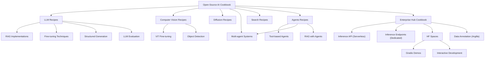
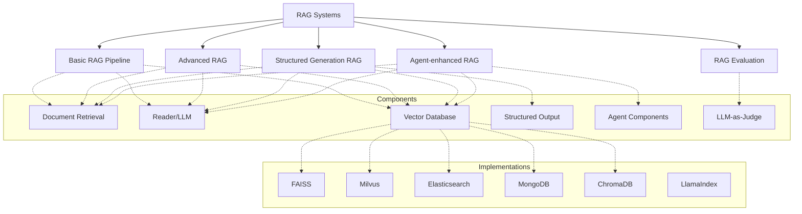
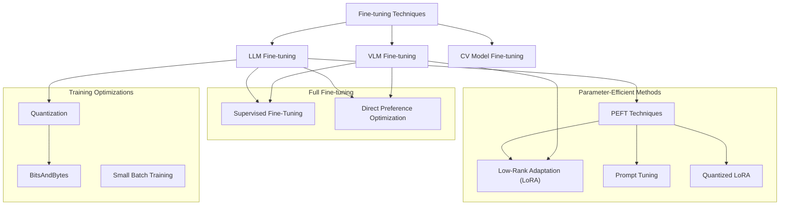
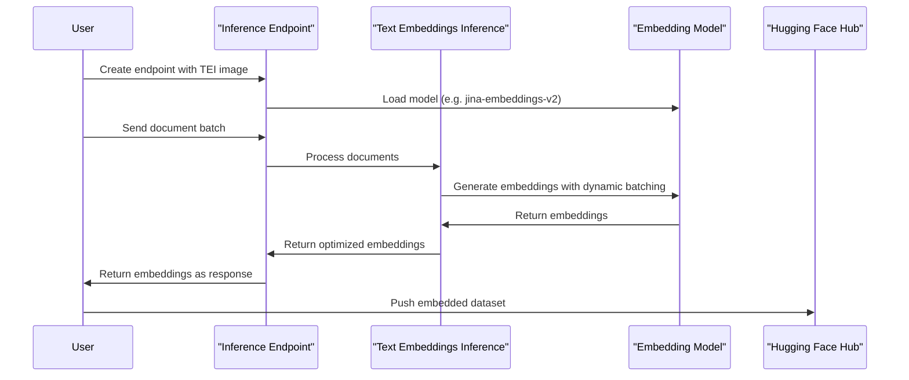

<!-- source: DeepWiki mcp.deepwiki.com · repo huggingface/cookbook · page 1 Open-Source AI Cookbook Overview · fetched 2026-10-26 -->

# Open-Source AI Cookbook Overview

Relevant source files

The following files were used as context for generating this wiki page:

- [.github/pull_request_template.md](.github/pull_request_template.md)
- [.gitignore](.gitignore)
- [README.md](README.md)
- [notebooks/en/_toctree.yml](notebooks/en/_toctree.yml)
- [notebooks/en/automatic_embedding_tei_inference_endpoints.ipynb](notebooks/en/automatic_embedding_tei_inference_endpoints.ipynb)
- [notebooks/en/index.md](notebooks/en/index.md)
- [notebooks/en/rag_with_hugging_face_gemma_mongodb.ipynb](notebooks/en/rag_with_hugging_face_gemma_mongodb.ipynb)
- [notebooks/en/structured_generation_vision_language_models.ipynb](notebooks/en/structured_generation_vision_language_models.ipynb)
- [notebooks/en/vector_search_with_hub_as_backend.ipynb](notebooks/en/vector_search_with_hub_as_backend.ipynb)

The Open-Source AI Cookbook is a comprehensive collection of Jupyter notebooks that demonstrate practical implementations of AI techniques using open-source tools and models. It serves as a hands-on reference for developers, researchers, and practitioners looking to build AI applications across various domains. This page provides an overview of the cookbook's content, structure, and purpose.

For information about contributing to the cookbook, see [Contributing to the Cookbook](#1.2).

Sources: [notebooks/en/index.md:1-16](), [README.md:1-5]()

## Repository Purpose and Scope

The Open-Source AI Cookbook aims to:

1. Provide practical, end-to-end examples of AI implementations
2. Showcase best practices for working with open-source AI tools and models
3. Cover a wide range of AI domains including LLMs, computer vision, multimodal systems, and more
4. Make advanced AI techniques accessible to developers with varying levels of expertise
5. Demonstrate enterprise deployment options for AI applications

All examples prioritize open-source tools, models available under permissive licenses, and implementations that can run on consumer hardware or affordable cloud options.

Sources: [notebooks/en/index.md:3-4](), [README.md:3-4](), [README.md:25-28]()

## Repository Structure and Organization

The cookbook is organized by technology domain, with notebooks covering specialized implementations within each area. The structure allows users to quickly find relevant examples for their specific use cases.

### Cookbook Structure Diagram

Sources: [notebooks/en/_toctree.yml:1-163]()

The notebooks are primarily organized by language, with English (`en`) being the main language. Translations into other languages are stored in their respective language subdirectories.

Sources: [README.md:46-64]()

## Key Components and Systems

### Retrieval-Augmented Generation (RAG) Systems

The cookbook provides extensive coverage of RAG implementations, which enhance language models with external knowledge retrieval. These implementations range from basic pipelines to advanced architectures.

#### RAG Systems Diagram

Example implementations include:
- Basic RAG with Zephyr and LangChain
- Advanced RAG on Hugging Face documentation
- MongoDB-based RAG with Gemma models
- Elasticsearch-based RAG systems
- RAG with source highlighting using structured generation
- RAG evaluation techniques

Sources: [notebooks/en/_toctree.yml:21-54](), [notebooks/en/rag_with_hugging_face_gemma_mongodb.ipynb:7-28]()

### Model Fine-tuning Techniques

The cookbook covers various approaches for fine-tuning pre-trained models, with a focus on parameter-efficient methods that can be implemented on consumer hardware.

#### Fine-tuning Techniques Diagram

Example notebooks include:
- Fine-tuning Code LLMs on custom code
- Prompt tuning with PEFT
- Fine-tuning Vision Transformers on custom datasets
- Fine-tuning Vision Language Models like Qwen2-VL and SmolVLM
- Post-training LLMs for reasoning with GRPO

Sources: [notebooks/en/_toctree.yml:25-28](), [notebooks/en/_toctree.yml:85-90](), [notebooks/en/_toctree.yml:107-120]()

### Vector Search and Embedding Services

The cookbook demonstrates various approaches to embedding and vector search, which are fundamental to many AI applications.

#### Text Embeddings Inference System Diagram

Implementations include:
- Automatic embeddings with TEI through Inference Endpoints
- Vector search on the Hugging Face Hub using DuckDB
- Using FAISS with HF datasets and CLIP for multimodal embedding
- Semantic reranking with Elasticsearch

Sources: [notebooks/en/automatic_embedding_tei_inference_endpoints.ipynb:8-26](), [notebooks/en/vector_search_with_hub_as_backend.ipynb:7-9](), [notebooks/en/_toctree.yml:103-104](), [notebooks/en/_toctree.yml:125-128]()

### Structured Generation and Multimodal Systems

The cookbook includes examples of structured information extraction from different sources using vision-language models and specialized structured generation techniques.

Example notebooks demonstrate:
- Structured generation from images using Vision Language Models
- RAG with source highlighting using structured generation
- Extracting structured information from documents
- Information extraction with Haystack and NuExtract

Sources: [notebooks/en/structured_generation_vision_language_models.ipynb:7-12](), [notebooks/en/_toctree.yml:52-52](), [notebooks/en/_toctree.yml:118-118]()

### Agent-based Systems

The cookbook covers agent-based systems that combine language models with tools to perform complex tasks through planning and execution.

Agent implementations include:
- Building agents with tool-calling capabilities
- Agentic RAG with query reformulation
- Text-to-SQL agents with error correction
- Data analyst agents for insights extraction
- Multi-agent systems for collaboration

Sources: [notebooks/en/_toctree.yml:133-146]()

### Enterprise Deployment

The Enterprise Hub Cookbook section provides guidance on deploying AI applications in production environments.

Deployment options include:
- Serverless inference using the Hugging Face Inference API
- Dedicated inference using Inference Endpoints
- Interactive development with JupyterLab Spaces
- Creating demos with Gradio and Spaces
- Data annotation workflows with Argilla

Sources: [notebooks/en/_toctree.yml:148-162]()

## Notebook Structure and Organization

Each notebook in the cookbook typically follows a consistent structure:

1. Clear title and author information
2. Statement of the problem or task
3. Installation of required dependencies
4. Step-by-step implementation with detailed explanations
5. Results and evaluation
6. Potential extensions or improvements

This standardized format makes it easy to understand the examples and apply them to similar problems.

Sources: [notebooks/en/automatic_embedding_tei_inference_endpoints.ipynb:7-26](), [notebooks/en/structured_generation_vision_language_models.ipynb:7-15](), [README.md:25-30]()

## Conclusion

The Open-Source AI Cookbook provides a valuable resource for developers, researchers, and practitioners looking to implement AI solutions using open-source tools and models. By covering a wide range of AI domains and techniques, the cookbook helps bridge the gap between theoretical understanding and practical application.

To get started, explore the different categories in the cookbook navigation or check out the recently added notebooks on the [cookbook index page](notebooks/en/index.md).

Sources: [notebooks/en/index.md:1-16](), [README.md:1-5]()

---

