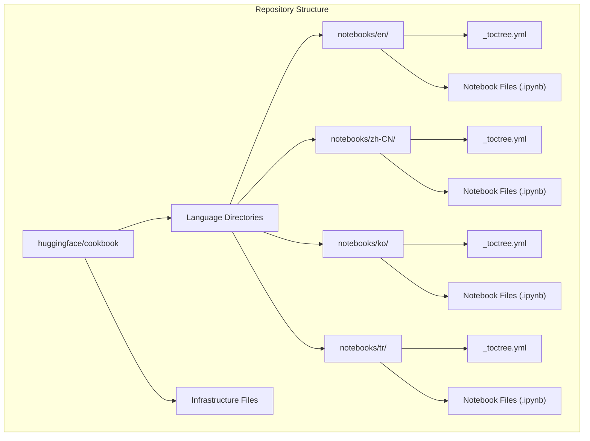
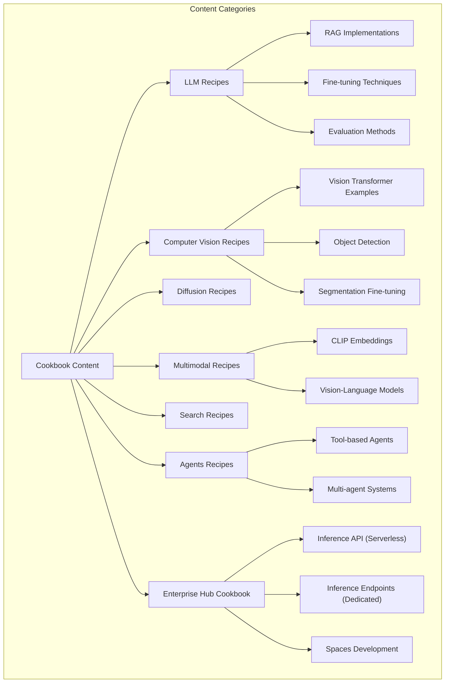
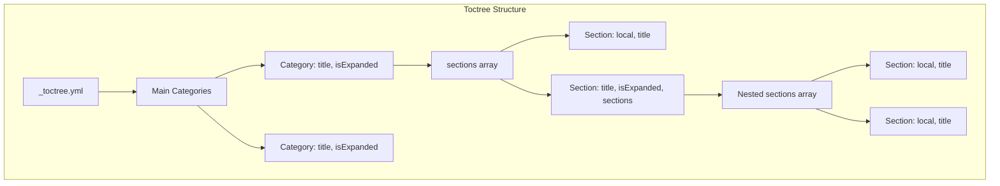
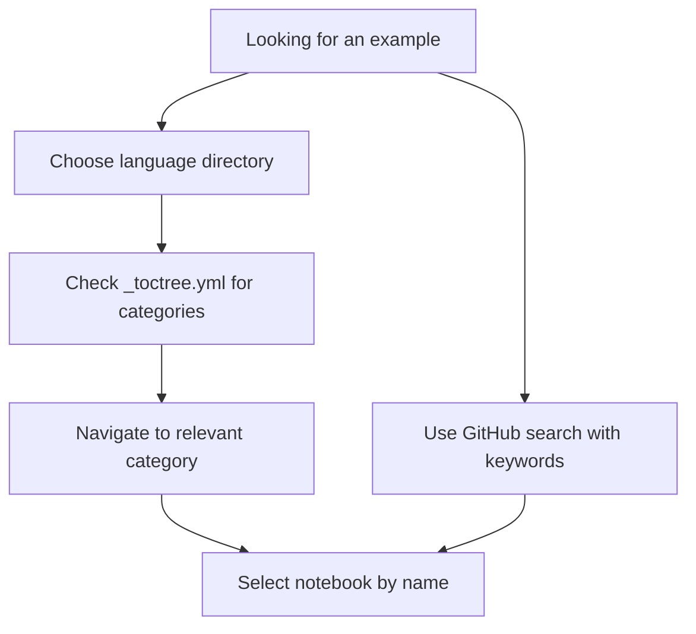

<!-- source: DeepWiki mcp.deepwiki.com · repo huggingface/cookbook · page 1.1 Repository Structure and Organization · fetched 2026-10-26 -->

# Repository Structure and Organization

<details>
<summary>Relevant source files</summary>

The following files were used as context for generating this wiki page:

- [notebooks/en/_toctree.yml](notebooks/en/_toctree.yml)
- [notebooks/en/automatic_embedding_tei_inference_endpoints.ipynb](notebooks/en/automatic_embedding_tei_inference_endpoints.ipynb)
- [notebooks/ko/_toctree.yml](notebooks/ko/_toctree.yml)
- [notebooks/ko/index.md](notebooks/ko/index.md)
- [notebooks/tr/_toctree.yml](notebooks/tr/_toctree.yml)
- [notebooks/tr/agent_data_analyst.ipynb](notebooks/tr/agent_data_analyst.ipynb)
- [notebooks/tr/agents.ipynb](notebooks/tr/agents.ipynb)
- [notebooks/tr/fine_tuning_code_llm_on_single_gpu.ipynb](notebooks/tr/fine_tuning_code_llm_on_single_gpu.ipynb)
- [notebooks/tr/fine_tuning_detr_custom_dataset.ipynb](notebooks/tr/fine_tuning_detr_custom_dataset.ipynb)
- [notebooks/tr/fine_tuning_vit_custom_dataset.ipynb](notebooks/tr/fine_tuning_vit_custom_dataset.ipynb)
- [notebooks/zh-CN/_toctree.yml](notebooks/zh-CN/_toctree.yml)
- [notebooks/zh-CN/enterprise_cookbook_overview.md](notebooks/zh-CN/enterprise_cookbook_overview.md)
- [notebooks/zh-CN/rag_with_hugging_face_gemma_elasticsearch.ipynb](notebooks/zh-CN/rag_with_hugging_face_gemma_elasticsearch.ipynb)
- [notebooks/zh-CN/rag_with_unstructured_data.ipynb](notebooks/zh-CN/rag_with_unstructured_data.ipynb)
- [notebooks/zh-CN/structured_generation.ipynb](notebooks/zh-CN/structured_generation.ipynb)

</details>


This document describes the overall structure and organization of the Hugging Face Cookbook repository, which contains example notebooks demonstrating AI techniques across multiple domains. It explains how the repository is organized, what directories contain which types of content, and how to navigate the repository to find specific examples. For information about contributing new examples to the cookbook, see [Contributing to the Cookbook](#1.2).

## Repository Overview

The Hugging Face Cookbook is organized as a collection of Jupyter notebooks, categorized by domain and available in multiple languages. The repository follows a consistent structure that makes it easy to navigate and find examples for specific use cases.



Sources: [notebooks/en/_toctree.yml](), [notebooks/zh-CN/_toctree.yml](), [notebooks/ko/_toctree.yml](), [notebooks/tr/_toctree.yml]()

The repository is primarily organized by language, with each language having its own directory under the `notebooks/` folder. Within each language directory, you'll find:

1. A `_toctree.yml` file that defines the structure and categorization of notebooks
2. The actual notebook files (`.ipynb`)
3. Supporting resources for those notebooks

## Content Categories and Organization

The notebooks are organized into several main categories, each focusing on a specific domain or technology within the AI ecosystem.



Sources: [notebooks/en/_toctree.yml](), [notebooks/zh-CN/_toctree.yml](), [notebooks/ko/_toctree.yml](), [notebooks/tr/_toctree.yml]()

### Main Categories

Looking at the English toctree file, we can identify the following main categories:

1. **MLOps Recipes**: Examples focusing on deployment and ML operations
2. **LLM Recipes**: Large language model examples, including RAG, fine-tuning, embeddings, etc.
3. **Computer Vision Recipes**: Image processing, object detection, etc.
4. **Diffusion Recipes**: Stable diffusion and other generative image models
5. **Multimodal Recipes**: Examples combining text, images, and other modalities
6. **Search Recipes**: Semantic search and vector search examples
7. **Agents Recipes**: AI agent implementations
8. **Enterprise Hub Cookbook**: Enterprise-focused examples for deployment and integration

Each main category contains multiple notebooks demonstrating specific techniques, architectures, or use cases.

## Navigation Structure

The cookbook's navigation is defined in the `_toctree.yml` files, which map to the structure seen on the Hugging Face website. Here's how the toctree is structured:



Sources: [notebooks/en/_toctree.yml:1-147]()

The toctree structure uses:
- `title`: Displayed name of the category or notebook
- `isExpanded`: Whether the section is expanded by default in the navigation
- `sections`: Array of child sections or notebooks
- `local`: Path to the notebook file (without extension)

## Language-Specific Organization

While the English notebooks provide the most comprehensive set of examples, many notebooks are also available in other languages. Each language has its own toctree file that defines which notebooks are available.

| Language | Directory | Main Categories |
|----------|-----------|-----------------|
| English | notebooks/en/ | All categories (most comprehensive) |
| Chinese | notebooks/zh-CN/ | LLM, Diffusion, Multimodal, LLM+RAG with Other Libraries, Computer Vision, Agents, Enterprise |
| Korean | notebooks/ko/ | LLM, Agents, Multimodal |
| Turkish | notebooks/tr/ | LLM, Computer Vision, Agents, Agent Applications |

Sources: [notebooks/en/_toctree.yml](), [notebooks/zh-CN/_toctree.yml](), [notebooks/ko/_toctree.yml](), [notebooks/tr/_toctree.yml]()

## Notebook Naming Convention

Notebooks follow a consistent naming convention that reflects their category and focus. For example:

- `rag_with_hf_and_milvus.ipynb`: RAG implementation using Hugging Face and Milvus
- `fine_tuning_vit_custom_dataset.ipynb`: Fine-tuning Vision Transformer on a custom dataset
- `agent_data_analyst.ipynb`: Agent for data analysis

This naming helps in identifying the content of a notebook at a glance.

## Accessing the Repository

You can access the Hugging Face Cookbook repository in multiple ways:

1. **GitHub**: Browse or clone the repository at https://github.com/huggingface/cookbook
2. **Hugging Face Website**: View the rendered notebooks directly on the Hugging Face website

## Navigating between Languages

If you're looking for examples in a specific language, navigate to the corresponding language directory:

```
notebooks/
├── en/          # English notebooks
├── zh-CN/       # Chinese notebooks
├── ko/          # Korean notebooks
└── tr/          # Turkish notebooks
```

Each language directory contains its own `_toctree.yml` file that defines the structure of the documentation for that language.

## Finding Examples

To find specific examples, you can:

1. Browse the repository structure and look at notebook names
2. Check the `_toctree.yml` file for your language to see the categorization
3. Use GitHub search to find notebooks mentioning specific techniques or models



## Example Toctree Structure

Here's an excerpt from the English toctree file showing the structure for LLM Recipes:

```
- title: LLM Recipes
  isExpanded: false
  sections:
    - local: automatic_embedding_tei_inference_endpoints
      title: Automatic Embeddings with TEI through Inference Endpoints
    - local: tgi_messages_api_demo
      title: Migrating from OpenAI to Open LLMs Using TGI's Messages API
    - local: advanced_rag
      title: Advanced RAG on HuggingFace documentation using LangChain
    ...
```

This structure defines a category "LLM Recipes" with multiple notebook examples, each with a path and display title.

Sources: [notebooks/en/_toctree.yml:14-81]()

## Related Infrastructure

The repository includes more than just notebooks - it also contains infrastructure for rendering the documentation on the Hugging Face website and other supporting files. However, as a user or contributor, you'll primarily interact with the notebook files and the toctree structure.

---

