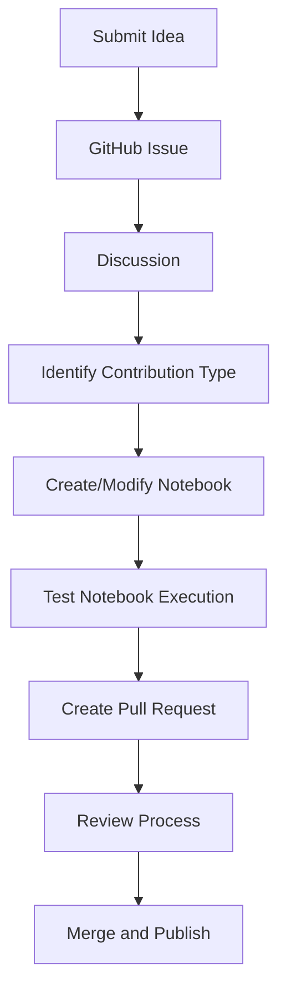
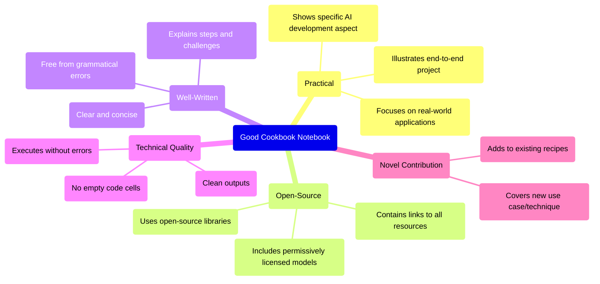
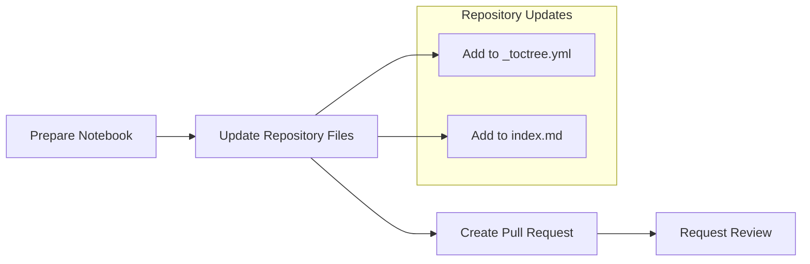
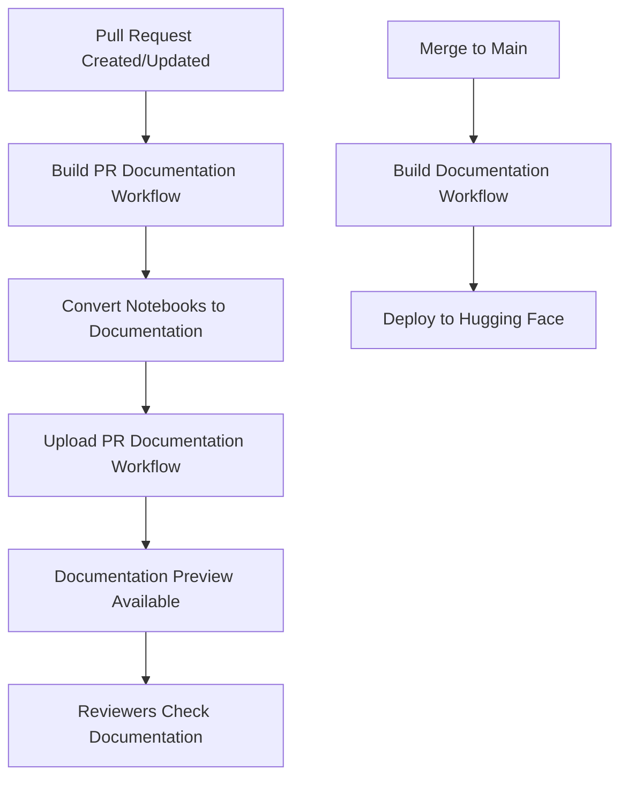
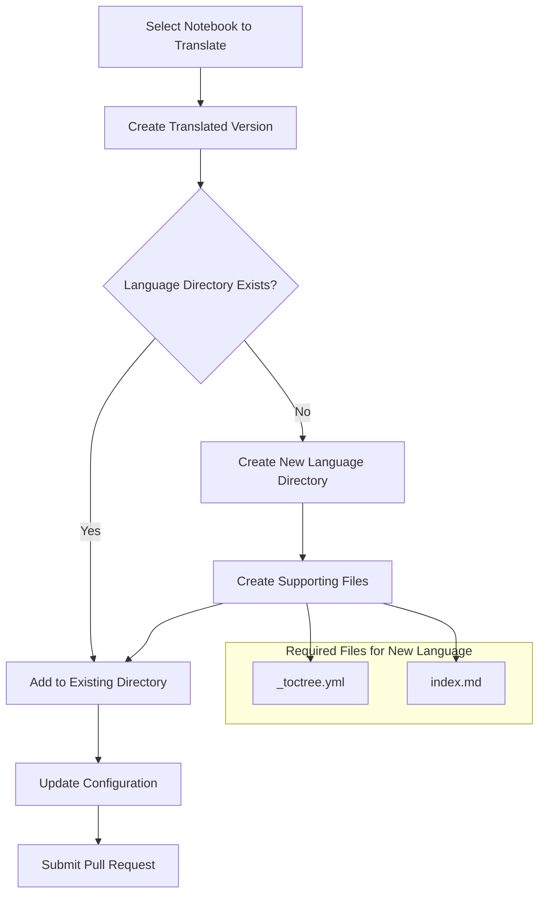

<!-- source: DeepWiki mcp.deepwiki.com · repo huggingface/cookbook · page 1.2 Contributing to the Cookbook · fetched 2026-10-26 -->

# Contributing to the Cookbook

<details>
<summary>Relevant source files</summary>

The following files were used as context for generating this wiki page:

- [.github/pull_request_template.md](.github/pull_request_template.md)
- [.github/workflows/build_documentation.yml](.github/workflows/build_documentation.yml)
- [.github/workflows/build_pr_documentation.yml](.github/workflows/build_pr_documentation.yml)
- [.github/workflows/upload_pr_documentation.yml](.github/workflows/upload_pr_documentation.yml)
- [.gitignore](.gitignore)
- [README.md](README.md)

</details>


This page explains how to contribute new notebooks or improvements to the Open-Source AI Cookbook repository. It covers the contribution process, notebook requirements, pull request creation, and translation guidelines. For an overview of the repository structure and organization, see [Repository Structure and Organization](#1.1).

## Overview of the Contribution Process

The Open-Source AI Cookbook welcomes contributions from everyone in the community. There are multiple ways to contribute:

1. **Submit ideas** for new examples or guides via GitHub Issues
2. **Contribute new notebooks** with practical AI examples
3. **Improve existing examples** by fixing issues or typos
4. **Translate notebooks** into different languages

The contribution process follows these general steps:



Sources: [README.md:6-19]()

## Notebook Requirements

To ensure consistency and quality, notebooks contributed to the Cookbook should meet specific requirements.

### What Makes a Good Cookbook Notebook



A high-quality notebook should be:

1. **Practical**: Provides an illustration of an end-to-end project or specific aspect of AI development, focusing on real-world applications.
2. **Built with open-source tools and models**: Uses open-source libraries, datasets, and pre-trained models available under permissive licenses.
3. **Clearly written**: Has clear, concise writing that's free from grammatical errors and maintains a friendly tone.
4. **Executes without errors**: The notebook should run without runtime errors.
5. **Adds to existing "recipes"**: Covers a subject that hasn't been addressed in existing notebooks.

Sources: [README.md:21-30]()

## Contributing a New Notebook

### Preparing Your Notebook

When creating a new notebook for contribution, ensure the following:

1. Use **lowercase filenames** for your notebook
2. Add a clear title and description of what the notebook covers
3. Include yourself as an author by adding this line after the first header:
   ```
   _Authored by: [Your Name](https://huggingface.co/your-username)_
   ```
4. Remove non-informative code cell outputs (e.g., from `pip install` commands)
5. Make sure there are no empty code cells
6. Test that the notebook runs completely without errors

### Handling Images

If your notebook includes images:

1. Upload them to the [huggingface/cookbook-images](https://huggingface.co/datasets/huggingface/cookbook-images) dataset
2. Reference them in markdown using the format:
   ```
   
   ```

Sources: [README.md:32-44]()

## Creating a Pull Request



To contribute your notebook:

1. **Fork the repository** and create a branch for your contribution
2. **Add your notebook** to the appropriate directory
3. **Update the navigation files**:
   - Add your notebook to `_toctree.yml`
   - Add your notebook to `index.md`
4. **Create a pull request** and tag the maintainers (@merveenoyan and @stevhliu)
5. **Address any feedback** during the review process

The pull request will trigger an automated documentation build process that checks if your notebook can be properly converted to documentation.

Sources: [README.md:32-45](), [.github/workflows/build_pr_documentation.yml:1-25](), [.github/pull_request_template.md:1-23]()

## Documentation Build Process

When you submit a pull request, an automated workflow builds the documentation to verify your notebook can be properly converted. This process helps catch any issues before merging.



The build process:
1. Is triggered when files in the `notebooks/` directory are changed
2. Converts Jupyter notebooks to documentation format
3. Builds documentation for all supported languages
4. Makes a preview available for review
5. Once merged, automatically deploys to the official Cookbook site

Sources: [.github/workflows/build_pr_documentation.yml:1-25](), [.github/workflows/build_documentation.yml:1-24](), [.github/workflows/upload_pr_documentation.yml:1-16]()

## Translating the Cookbook

The Cookbook aims to be available in multiple languages. Currently supported languages include English (en), Chinese (zh-CN), Korean (ko), Turkish (tr), and French (fr).

### Translation Process



To translate notebooks:

1. **For existing language directories**:
   - Add your translated notebook to `notebooks/LANG-ID/`
   - Update `notebooks/LANG-ID/_toctree.yml` and `notebooks/LANG-ID/index.md`

2. **For new languages**:
   - Create a directory under `notebooks/` using the appropriate language code (ISO 639-1)
   - Create required files (`_toctree.yml` and `index.md`)
   - Add your translated notebook
   - Update the GitHub workflow files to include the new language code

The language code should be either:
- Two lowercase letters (e.g., `en` for English)
- Two lowercase letters followed by hyphen and two uppercase letters (e.g., `zh-CN` for Chinese)

Sources: [README.md:47-64](), [.github/workflows/build_documentation.yml:20](), [.github/workflows/build_pr_documentation.yml:23]()

## Benefits of Contributing

After your contribution is merged, you can:

1. Be recognized as an author in the Cookbook
2. Request to join the [huggingcooks organization](https://huggingface.co/huggingcooks) to claim the contributor badge
3. Help expand the collection of AI examples available to the community
4. Showcase your expertise in specific AI domains

Your contributed notebook will appear in the [Open-Source AI Cookbook](https://huggingface.co/learn/cookbook/index), making it accessible to developers worldwide.

Sources: [README.md:19](), [README.md:45-46]()

---

