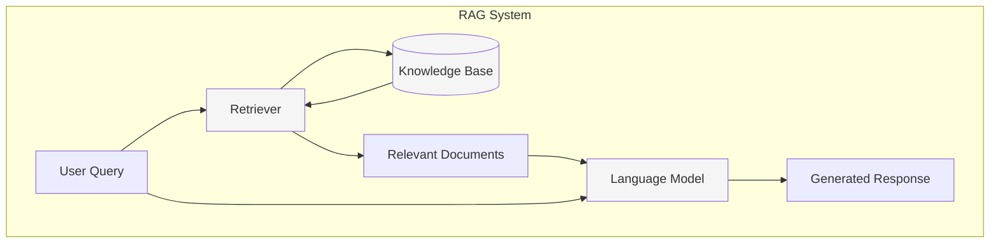
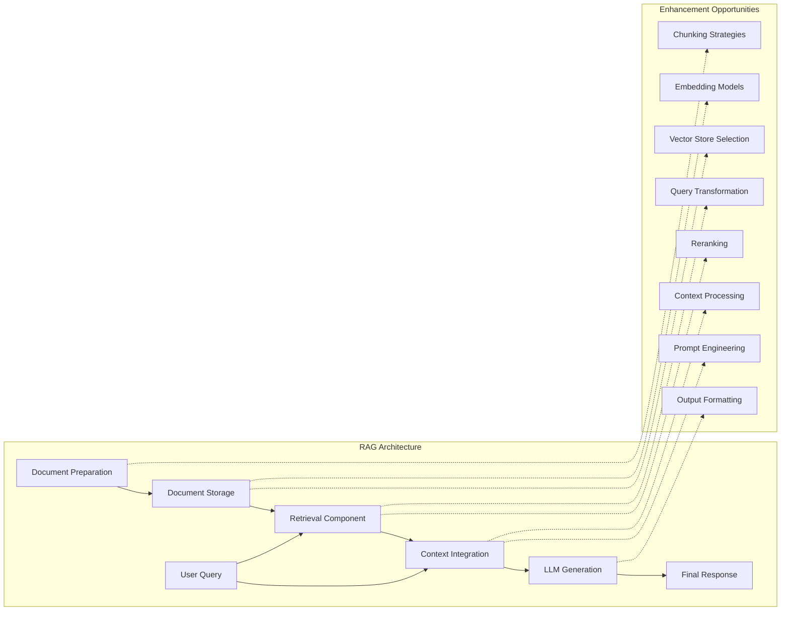
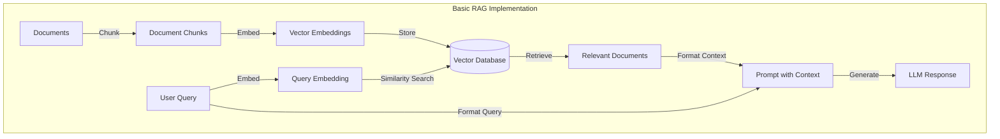
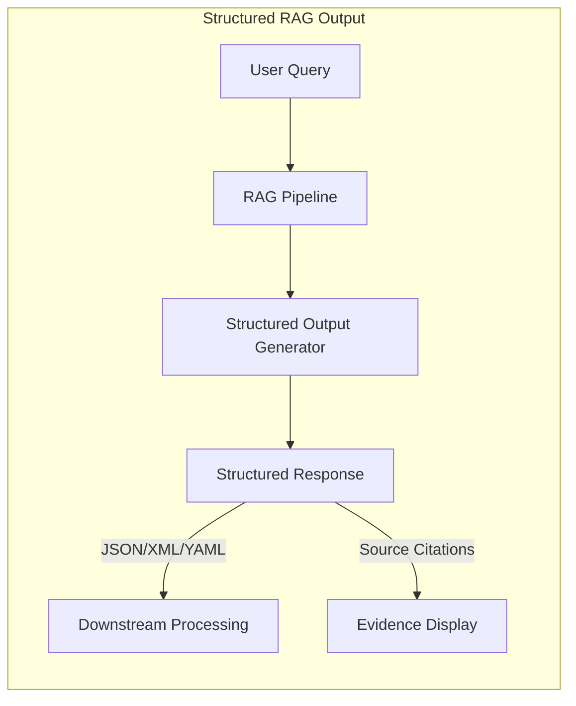
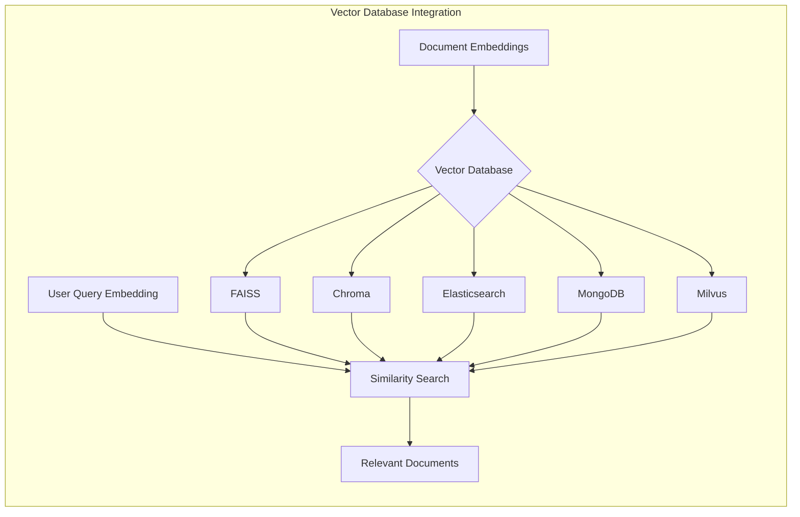
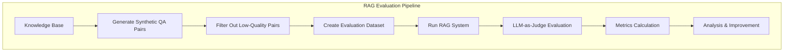

<!-- source: DeepWiki mcp.deepwiki.com · repo huggingface/cookbook · page 2 Retrieval-Augmented Generation (RAG) Systems · fetched 2026-10-26 -->

# Retrieval-Augmented Generation (RAG) Systems

<details>
<summary>Relevant source files</summary>

The following files were used as context for generating this wiki page:

- [.github/workflows/check_notebooks_lowercase.yml](.github/workflows/check_notebooks_lowercase.yml)
- [notebooks/en/advanced_rag.ipynb](notebooks/en/advanced_rag.ipynb)
- [notebooks/en/faiss_with_hf_datasets_and_clip.ipynb](notebooks/en/faiss_with_hf_datasets_and_clip.ipynb)
- [notebooks/en/fine_tuning_code_llm_on_single_gpu.ipynb](notebooks/en/fine_tuning_code_llm_on_single_gpu.ipynb)
- [notebooks/en/rag_evaluation.ipynb](notebooks/en/rag_evaluation.ipynb)
- [notebooks/en/rag_zephyr_langchain.ipynb](notebooks/en/rag_zephyr_langchain.ipynb)
- [notebooks/ko/advanced_ko_rag.ipynb](notebooks/ko/advanced_ko_rag.ipynb)
- [notebooks/ko/structured_generation.ipynb](notebooks/ko/structured_generation.ipynb)

</details>


This page provides an overview of Retrieval-Augmented Generation (RAG) systems, their components, implementation approaches, and evaluation methods. The document explains the core principles of RAG and covers various implementation techniques present in the cookbook, including basic RAG, advanced techniques, structured generation, vector database integrations, and evaluation strategies.

For information about agent-enhanced RAG systems, see [RAG with Agents](#3.4).

## What are RAG Systems?

Retrieval-Augmented Generation (RAG) is a technique that enhances language models by incorporating external knowledge sources. RAG systems retrieve relevant information from a knowledge base to augment the context provided to a language model, enabling more accurate, factual, and contextually relevant responses.



**Key benefits of RAG systems:**

- Augments LLM knowledge with up-to-date or domain-specific information
- Reduces hallucinations by grounding responses in factual sources
- Enables citation and attribution of information sources
- More cost-effective than fine-tuning for knowledge updates
- Allows customization to specific domains or document collections

Sources: [notebooks/en/rag_zephyr_langchain.ipynb:9-33](), [notebooks/en/advanced_rag.ipynb:19-31]()

## RAG System Components and Architecture

RAG systems typically consist of four main components that work together to augment LLM responses with relevant retrieved information.



### 1. Document Preparation
Documents are processed and split into manageable chunks that can be effectively retrieved and used as context.

### 2. Document Storage
Processed documents are embedded and stored in a vector database that enables semantic search.

### 3. Retrieval Component
Takes user queries, transforms them if needed, and retrieves the most relevant document chunks.

### 4. Context Integration
Combines retrieved documents with the user's query into a prompt for the language model.

### 5. LLM Generation
The language model generates a response based on the query and retrieved context.

Sources: [notebooks/en/advanced_rag.ipynb:24-31](), [notebooks/en/rag_zephyr_langchain.ipynb:25-32]()

## Basic RAG Implementations

Basic RAG implementations follow a straightforward pipeline where documents are chunked, embedded, stored, and then retrieved based on query similarity.



In a basic implementation, you can use LangChain and Hugging Face tools to:

1. Load and split documents into chunks
2. Create embeddings using models like `BAAI/bge-base-en-v1.5`
3. Store embeddings in a vector database like FAISS
4. Create a retriever that performs similarity search
5. Build an LLM chain that combines the retriever with a language model

Example implementation components:

```python
# Document loading and chunking
from langchain.text_splitter import RecursiveCharacterTextSplitter
text_splitter = RecursiveCharacterTextSplitter(chunk_size=512, chunk_overlap=30)
chunked_docs = text_splitter.split_documents(docs)

# Creating embeddings and vector store
from langchain.vectorstores import FAISS
from langchain.embeddings import HuggingFaceEmbeddings
db = FAISS.from_documents(chunked_docs, HuggingFaceEmbeddings(model_name='BAAI/bge-base-en-v1.5'))
retriever = db.as_retriever(search_type="similarity", search_kwargs={'k': 4})

# Creating LLM chain
from langchain.llms import HuggingFacePipeline
llm_chain = prompt | llm | StrOutputParser()
rag_chain = {"context": retriever, "question": RunnablePassthrough()} | llm_chain
```

Sources: [notebooks/en/rag_zephyr_langchain.ipynb:42-379]()

## Advanced RAG Techniques

Advanced RAG techniques improve upon basic implementations by optimizing each stage of the pipeline for better performance.

### Optimized Document Chunking

Different chunking strategies can significantly impact retrieval quality:

| Chunking Strategy | Description | Best Use Case |
|-------------------|-------------|---------------|
| Fixed-size chunks | Split documents into chunks of consistent size | General purpose |
| Semantic chunking | Split based on semantic boundaries | Preserving meaning |
| Recursive chunking | Split hierarchically using different separators | Structured documents |
| Sentence-based | Split at sentence boundaries | Preserving sentences |

For example, recursive chunking with different separators:

```python
MARKDOWN_SEPARATORS = [
    "\n#{1,6} ",
    "```\n",
    "\n\\\*\\\*\\\*+\n",
    "\n---+\n",
    "\n___+\n",
    "\n\n",
    "\n",
    " ",
    "",
]
text_splitter = RecursiveCharacterTextSplitter(
    chunk_size=1000, 
    chunk_overlap=100,
    separators=MARKDOWN_SEPARATORS,
)
```

### Enhanced Retrieval Methods

Advanced RAG techniques improve retrieval through:

1. **Query Transformation**: Rewriting the original query to make it more effective for retrieval
2. **Hybrid Search**: Combining dense (semantic) and sparse (keyword) retrieval
3. **Re-ranking**: Applying a second-stage ranking to initial results 
4. **Multi-query Retrieval**: Generating multiple queries from the original and combining results

### Context Processing

Sophisticated processing of retrieved context:

1. **Context Compression**: Removing redundant or irrelevant information
2. **Context Reordering**: Sorting retrieved documents by relevance
3. **Context Weighting**: Giving different weights to retrieved documents

Sources: [notebooks/en/advanced_rag.ipynb:108-201](), [notebooks/en/advanced_rag.ipynb:222-356]()

## Structured Generation for RAG

Structured generation enables RAG systems to produce outputs in specific formats, making the responses more useful for downstream processing.



There are two main approaches to structured generation in RAG:

### 1. Prompt-Based Structured Generation

Uses carefully crafted prompts to instruct the LLM to generate responses in a specific format:

```python
RAG_PROMPT_TEMPLATE_JSON = """
Answer based on the documents. Format your response as JSON with:
{
  "answer": Your comprehensive answer,
  "confidence_score": A number between 0 and 1,
  "source_snippets": ["snippet1", "snippet2", ...]
}
Context: {context}
Question: {user_query}
"""
```

While simple to implement, this approach may not be reliable with all models or complex output structures.

### 2. Constrained Decoding

Forces the LLM to generate outputs following a specific grammar or structure:

```python
from pydantic import BaseModel, confloat, StringConstraints
from typing import List, Annotated

class AnswerWithSnippets(BaseModel):
    answer: Annotated[str, StringConstraints(min_length=10, max_length=100)]
    confidence: Annotated[float, confloat(ge=0.0, le=1.0)]
    source_snippets: List[Annotated[str, StringConstraints(max_length=30)]]

# Using the schema with constrained decoding
grammar = {"type": "json", "value": AnswerWithSnippets.schema()}
answer = llm_client.text_generation(
    prompt,
    grammar=grammar,
    max_new_tokens=250,
)
```

Constrained decoding is more reliable but requires additional libraries like Outlines for local inference.

Benefits of structured generation in RAG:
- Source attribution with evidence highlighting
- Consistent response formatting
- Easier integration with downstream systems
- Confidence scoring for answers
- Structured data extraction from unstructured text

Sources: [notebooks/ko/structured_generation.ipynb:7-26](), [notebooks/ko/structured_generation.ipynb:87-147](), [notebooks/ko/structured_generation.ipynb:299-368]()

## RAG with Different Vector Databases

Vector databases are a crucial component in RAG systems, storing document embeddings for efficient similarity search. The choice of vector database affects performance, scalability, and deployment options.



### Common Vector Databases in RAG Systems

| Database | Type | Key Features | Best For |
|----------|------|-------------|----------|
| FAISS | In-memory/File | Fast similarity search, optimized for dense vectors | Single-machine deployments, research |
| ChromaDB | Embedded/Client-server | Simple API, persistent storage, metadata filtering | Prototyping, small-medium datasets |
| Elasticsearch | Distributed | Hybrid search, scaling, production-ready | Enterprise, large-scale deployments |
| MongoDB Atlas | Distributed | Document-oriented, familiar query language | Teams already using MongoDB |
| Milvus | Distributed | Cloud-native, high throughput | Large-scale vector search |

### Integration Examples

#### FAISS Integration

```python
from langchain.vectorstores import FAISS
from langchain.embeddings import HuggingFaceEmbeddings

# Create embeddings and FAISS vectorstore
embeddings = HuggingFaceEmbeddings(model_name='BAAI/bge-base-en-v1.5')
db = FAISS.from_documents(chunked_docs, embeddings)

# Create retriever with search parameters
retriever = db.as_retriever(
    search_type="similarity",
    search_kwargs={'k': 4}
)
```

#### Other Database Integrations

Similar patterns apply to other vector databases with specific client libraries:

```python
# ChromaDB example
from langchain.vectorstores import Chroma
db = Chroma.from_documents(chunked_docs, embeddings)

# Elasticsearch example
from langchain.vectorstores import ElasticsearchStore
db = ElasticsearchStore.from_documents(
    chunked_docs, 
    embeddings,
    es_url="http://localhost:9200",
    index_name="rag-documents"
)
```

When choosing a vector database, consider:
- Dataset size and expected growth
- Query performance requirements
- Deployment environment (local, cloud, on-premises)
- Integration with existing systems
- Need for additional features like filtering and hybrid search

Sources: [notebooks/en/rag_zephyr_langchain.ipynb:187-223](), [notebooks/en/faiss_with_hf_datasets_and_clip.ipynb:179-198](), [notebooks/en/advanced_rag.ipynb:163-188]()

## Evaluating RAG Systems

Evaluating RAG systems is essential to measure their effectiveness and identify areas for improvement. The cookbook provides methods for building synthetic evaluation datasets and using LLM-as-a-judge to compute the accuracy of RAG systems.



### Creating Synthetic Evaluation Datasets

1. Generate question-answer pairs from the knowledge base:
   ```python
   QA_generation_prompt = """
   Your task is to write a factoid question and an answer given a context.
   Your factoid question should be answerable with a specific, concise piece 
   of factual information from the context.
   
   Output:::
   Factoid question: (your factoid question)
   Answer: (your answer to the factoid question)
   
   Context: {context}
   Output:::
   """
   
   for sampled_context in random.sample(docs_processed, N_GENERATIONS):
       output_QA_couple = call_llm(llm_client, QA_generation_prompt.format(
           context=sampled_context.page_content))
   ```

2. Filter out low-quality questions using critique agents:
   - Questions that can be answered without context
   - Questions that reference the source directly
   - Questions with vague or subjective answers

### LLM-as-Judge Evaluation

Using an LLM to evaluate RAG system outputs:

```python
judge_prompt = """
You are evaluating a question-answering system.

You are given:
1. A question
2. The ground truth answer
3. The system's answer

Evaluate if the system's answer is correct, giving a score:
- 1: The answer is correct and complete
- 0.5: The answer is partially correct or incomplete
- 0: The answer is incorrect

Question: {question}
Ground Truth: {ground_truth}
System Answer: {answer}

Score:
"""
```

### Key Evaluation Metrics

| Metric | Description | Calculation |
|--------|-------------|-------------|
| Retrieval Precision | Proportion of retrieved docs that are relevant | relevant_docs / retrieved_docs |
| Retrieval Recall | Proportion of relevant docs that are retrieved | retrieved_docs / total_relevant_docs |
| Answer Accuracy | Correctness of generated answers | correct_answers / total_questions |
| Answer Completeness | Completeness of generated answers | complete_answers / total_questions |
| Hallucination Rate | Rate of fabricated information | hallucinated_answers / total_questions |

### Iterative Improvement

Based on evaluation results, you can improve RAG system components:
1. Chunking strategy: Adjust chunk size and overlap
2. Embedding model: Try different models or fine-tune on domain data
3. Retrieval parameters: Tune k value, similarity threshold
4. Prompt engineering: Refine system prompts for better context utilization
5. LLM selection: Compare different models for generation quality

Sources: [notebooks/en/rag_evaluation.ipynb:9-36](), [notebooks/en/rag_evaluation.ipynb:115-285](), [notebooks/en/rag_evaluation.ipynb:509-571]()

## Challenges and Best Practices

### Common Challenges in RAG Systems

1. **Context Length Limitations**: LLMs have token limits, restricting how much retrieved content can be used
2. **Information Dilution**: Irrelevant retrieved documents can dilute the useful information
3. **Lost-in-the-middle Effect**: Important information placed in the middle of context may be overlooked
4. **Computational Overhead**: Large-scale retrieval can introduce latency
5. **Domain Adaptation**: General-purpose embeddings may not work well for specialized domains

### Best Practices

1. **Chunking Strategy**: Choose appropriate chunking methods based on document structure
   ```python
   # Example of recursive chunking with domain-specific separators
   domain_separators = ["\n\n", "\n", ".", ";", ",", " "]
   text_splitter = RecursiveCharacterTextSplitter(
       chunk_size=800,  # Smaller for more precise retrieval
       chunk_overlap=150,  # Higher overlap to prevent context loss
       separators=domain_separators,
   )
   ```

2. **Embedding Model Selection**: Choose models that perform well on your domain
   - Use MTEB leaderboard to find strong general models
   - Consider fine-tuning embeddings on domain data for specialized use cases

3. **Hybrid Retrieval**: Combine dense and sparse retrievers for better coverage
   ```python
   # Combine BM25 and embedding retrieval
   from langchain.retrievers import BM25Retriever, EnsembleRetriever
   
   bm25_retriever = BM25Retriever.from_documents(docs)
   embedding_retriever = vector_db.as_retriever()
   
   ensemble_retriever = EnsembleRetriever(
       retrievers=[bm25_retriever, embedding_retriever],
       weights=[0.3, 0.7]
   )
   ```

4. **Retrieval Augmentation**:
   - Query reformulation: Transform queries for better retrieval
   - Document re-ranking: Apply a second stage ranking model
   - Metadata filtering: Use document metadata to filter results

5. **Evaluation and Monitoring**:
   - Regularly evaluate using synthetic or human-annotated benchmarks
   - Monitor retrieval quality in production
   - Collect user feedback to identify failure cases

Sources: [notebooks/en/advanced_rag.ipynb:100-124](), [notebooks/en/rag_zephyr_langchain.ipynb:176-184](), [notebooks/en/rag_evaluation.ipynb:32-36]()

## Conclusion

Retrieval-Augmented Generation systems provide a powerful approach to enhance LLM capabilities with external knowledge sources. By combining effective retrieval methods with language generation, RAG systems deliver more accurate, factual, and contextually relevant responses.

The cookbook provides implementations ranging from basic RAG setups to advanced techniques, including structured generation, different vector database integrations, and evaluation methods. By understanding the components and their interactions, you can build and optimize RAG systems for various use cases and domains.

---

