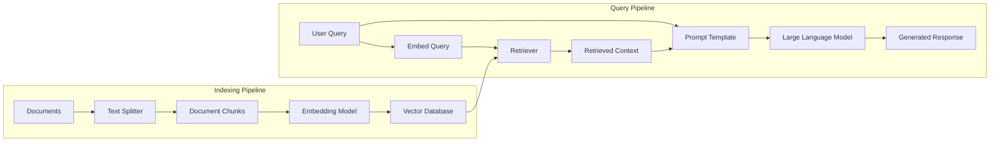
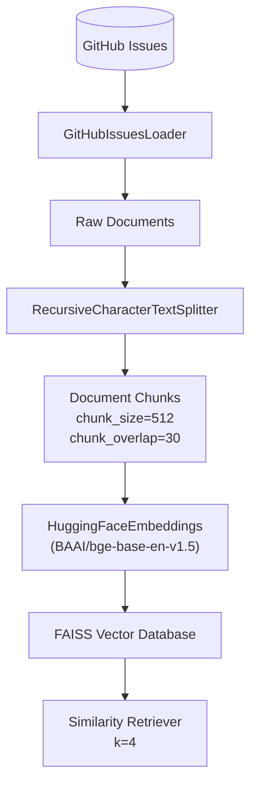
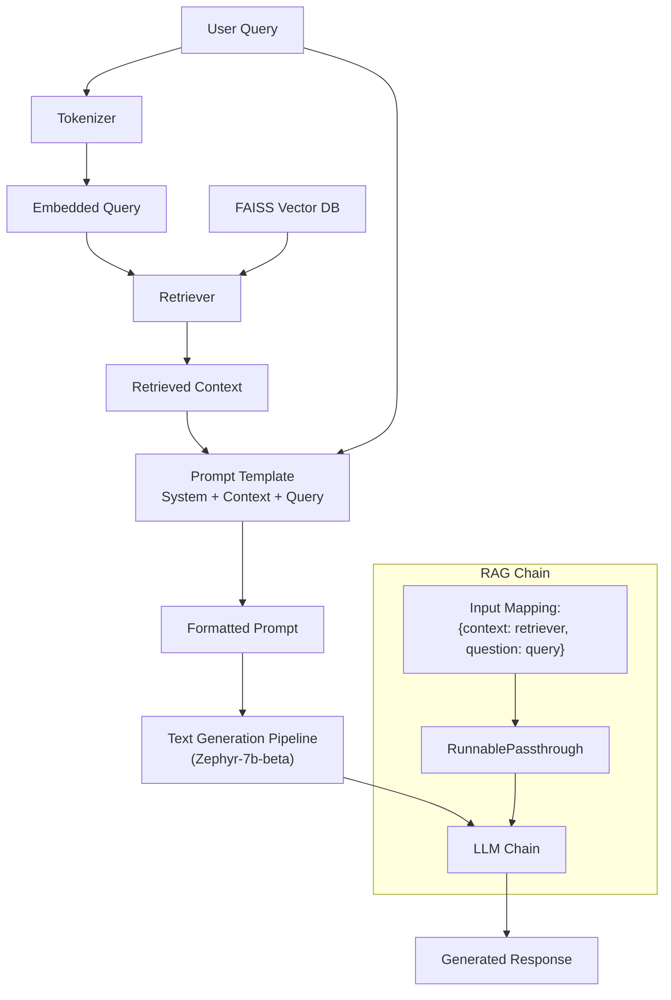
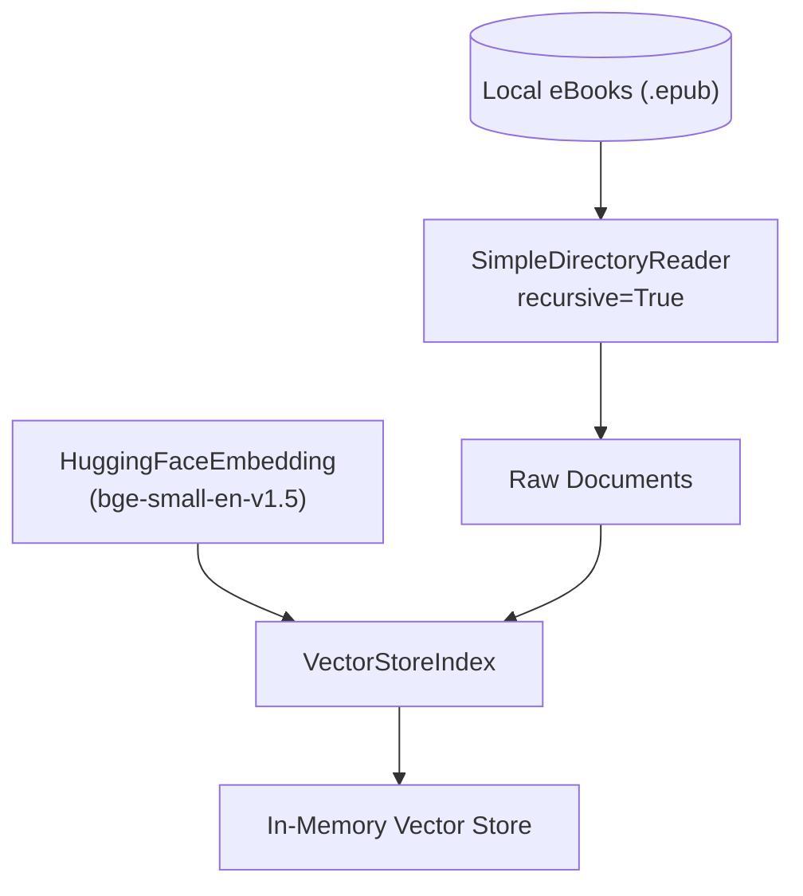
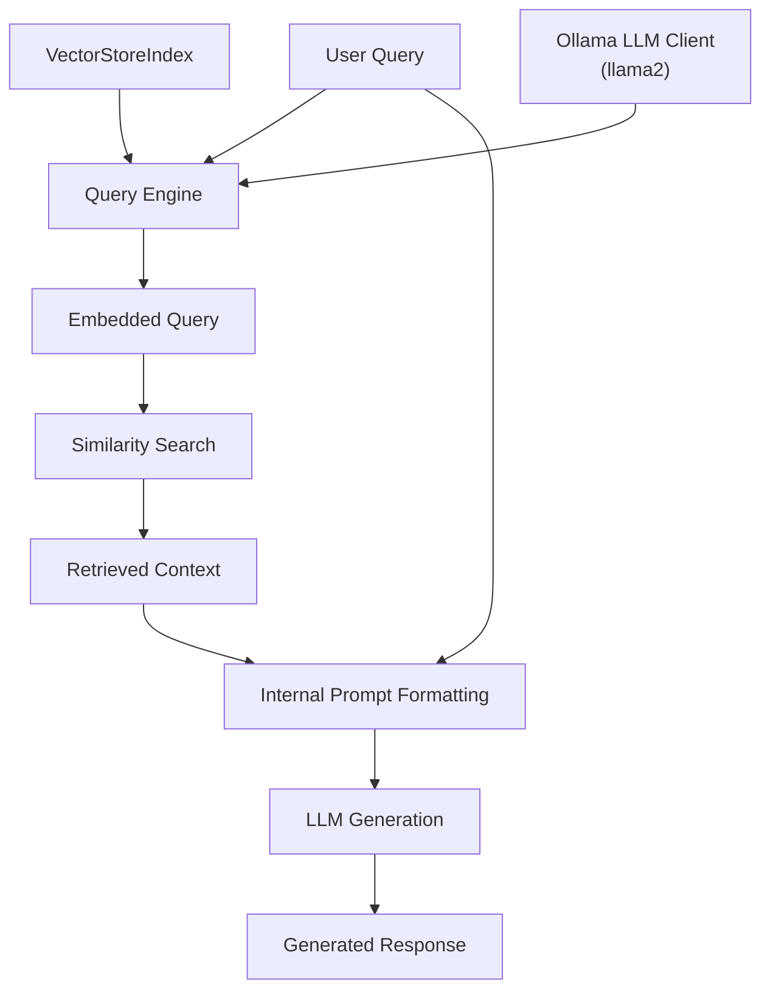

<!-- source: DeepWiki mcp.deepwiki.com · repo huggingface/cookbook · page 2.1 Basic RAG Implementations · fetched 2026-10-26 -->

# Basic RAG Implementations

<details>
<summary>Relevant source files</summary>

The following files were used as context for generating this wiki page:

- [.github/workflows/check_notebooks_lowercase.yml](.github/workflows/check_notebooks_lowercase.yml)
- [notebooks/en/faiss_with_hf_datasets_and_clip.ipynb](notebooks/en/faiss_with_hf_datasets_and_clip.ipynb)
- [notebooks/en/fine_tuning_code_llm_on_single_gpu.ipynb](notebooks/en/fine_tuning_code_llm_on_single_gpu.ipynb)
- [notebooks/en/rag_llamaindex_librarian.ipynb](notebooks/en/rag_llamaindex_librarian.ipynb)
- [notebooks/en/rag_with_hf_and_milvus.ipynb](notebooks/en/rag_with_hf_and_milvus.ipynb)
- [notebooks/en/rag_zephyr_langchain.ipynb](notebooks/en/rag_zephyr_langchain.ipynb)
- [notebooks/zh-CN/index.md](notebooks/zh-CN/index.md)
- [notebooks/zh-CN/prompt_tuning_peft.ipynb](notebooks/zh-CN/prompt_tuning_peft.ipynb)
- [notebooks/zh-CN/rag_with_hf_and_milvus.ipynb](notebooks/zh-CN/rag_with_hf_and_milvus.ipynb)

</details>


This document provides an overview of fundamental RAG (Retrieval-Augmented Generation) implementations using various frameworks and tools available in the Hugging Face ecosystem. It covers the essential components and workflows for building basic RAG systems, with practical examples using LangChain, LlamaIndex, and vector databases.

For more advanced RAG techniques including reranking, context refinement, and advanced prompting, see [Advanced RAG Techniques](#2.2). For information about structured output generation with RAG, see [Structured Generation for RAG](#2.3).

## What is RAG?

Retrieval-Augmented Generation (RAG) is a technique that enhances Large Language Models (LLMs) by retrieving relevant information from external knowledge sources before generating responses. This approach addresses limitations of LLMs by providing them with up-to-date, domain-specific information that may not be present in their training data.

### Basic RAG Architecture

The standard RAG pipeline consists of these key components:



Sources: [notebooks/en/rag_zephyr_langchain.ipynb:16-32](), [notebooks/en/rag_llamaindex_librarian.ipynb:16-49]()

## RAG Implementation with LangChain and Zephyr

LangChain provides a flexible framework for building RAG applications. The following example shows a basic implementation using Zephyr, a small but powerful open-source LLM.

### Data Preparation and Embedding



The implementation follows these steps:

1. **Document Loading**: Use `GitHubIssuesLoader` to fetch issues from a specific repository
2. **Text Chunking**: Split documents into smaller chunks using `RecursiveCharacterTextSplitter`
3. **Embedding Generation**: Create vector embeddings using the `bge-base-en-v1.5` model
4. **Vector Storage**: Store embeddings in a FAISS database for efficient similarity search
5. **Retriever Setup**: Configure a retriever that returns the top k most similar documents

Sources: [notebooks/en/rag_zephyr_langchain.ipynb:122-152](), [notebooks/en/rag_zephyr_langchain.ipynb:184-223]()

### Language Model Configuration and RAG Chain



The RAG chain implementation involves:

1. **LLM Configuration**: Load and configure the Zephyr model with appropriate parameters
2. **Prompt Template**: Create a template that combines system instructions, context, and user query
3. **Chain Creation**: Assemble a pipeline that connects the retriever with the LLM
4. **Response Generation**: Generate contextualized responses using the retrieved documents

Sources: [notebooks/en/rag_zephyr_langchain.ipynb:264-279](), [notebooks/en/rag_zephyr_langchain.ipynb:310-378]()

## RAG Implementation with LlamaIndex

LlamaIndex provides a data framework specifically designed for RAG applications, with simpler abstractions for document loading, indexing, and querying.

### Data Loading and Indexing



This implementation:

1. **Document Loading**: Uses `SimpleDirectoryReader` to load ebook files recursively
2. **Vector Index Creation**: Creates an in-memory vector index for document retrieval
3. **Embedding Generation**: Utilizes the `bge-small-en-v1.5` model for embeddings

Sources: [notebooks/en/rag_llamaindex_librarian.ipynb:194-229](), [notebooks/en/rag_llamaindex_librarian.ipynb:247-291]()

### Query Engine and Response Generation



The query process involves:

1. **Query Engine Setup**: Configure a query engine with the vector index and LLM
2. **Query Processing**: Process user queries to retrieve relevant context
3. **Response Generation**: Generate responses using the Llama2 model via Ollama

Sources: [notebooks/en/rag_llamaindex_librarian.ipynb:315-330](), [notebooks/en/rag_llamaindex_librarian.ipynb:336-381]()

## Framework Comparison

Each framework offers different advantages for implementing RAG systems:

| Framework | Vector Store Options | Key Features | Ideal Use Cases |
|-----------|---------------------|--------------|-----------------|
| LangChain | FAISS, Chroma, Pinecone, etc. | Flexible chains and agents, many integrations | Complex workflows, multiple data sources |
| LlamaIndex | In-memory, Chroma, Pinecone, etc. | RAG-specific abstractions, simpler API | Quick prototyping, document-focused applications |
| Direct Implementation | Milvus, FAISS, etc. | Full control, lower abstraction | Custom requirements, performance optimization |

Sources: [notebooks/en/rag_zephyr_langchain.ipynb:35-47](), [notebooks/en/rag_llamaindex_librarian.ipynb:35-49]()

## Implementation Considerations

When building a RAG system, several factors affect performance and accuracy:

### Chunking Strategy

The way documents are split affects retrieval quality:
- **Chunk Size**: Smaller chunks (e.g., 512 tokens) provide more specific context but may miss broader information
- **Chunk Overlap**: Overlapping chunks (e.g., 30-200 tokens) help preserve context across chunk boundaries

Sources: [notebooks/en/rag_zephyr_langchain.ipynb:142-159](), [notebooks/en/rag_llamaindex_librarian.ipynb:245-251]()

### Embedding Model Selection

The embedding model significantly impacts retrieval quality:
- **Model Size**: Larger models generally provide better semantic understanding but require more resources
- **Domain Alignment**: Models trained on domain-specific data often perform better for specialized content
- **Performance**: The [MTEB Leaderboard](https://huggingface.co/spaces/mteb/leaderboard) is a good reference for model selection

Sources: [notebooks/en/rag_zephyr_langchain.ipynb:178-183](), [notebooks/en/rag_llamaindex_librarian.ipynb:252-271]()

### Prompt Engineering

Effective prompt templates should:
- Clearly separate context from instructions
- Guide the model on how to use the retrieved information
- Include specific instructions for handling missing information

Example prompt template:
```
<|system|>
Answer the question based on your knowledge. Use the following context to help:

{context}

</s>
<|user|>
{question}
</s>
<|assistant|>
```

Sources: [notebooks/en/rag_zephyr_langchain.ipynb:329-348]()

## Conclusion

Basic RAG implementations provide a solid foundation for enhancing LLM capabilities with external knowledge. By following the patterns shown in this document, you can build RAG systems that deliver more accurate, up-to-date, and contextually relevant responses.

For more advanced techniques or specialized implementations, explore the additional notebooks in the cookbook repository and the related wiki pages.

---

