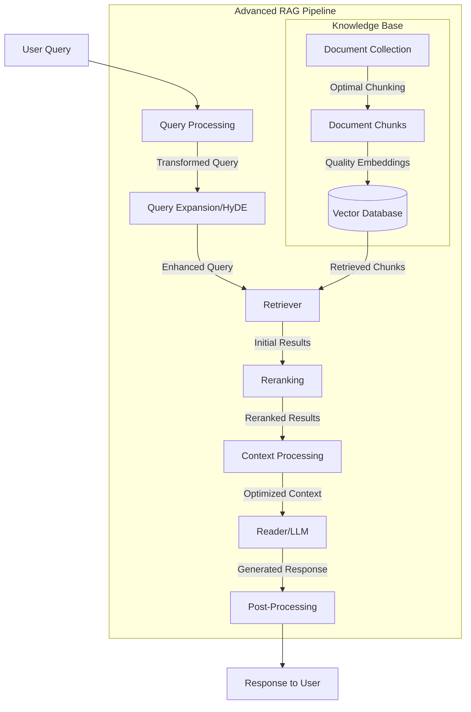
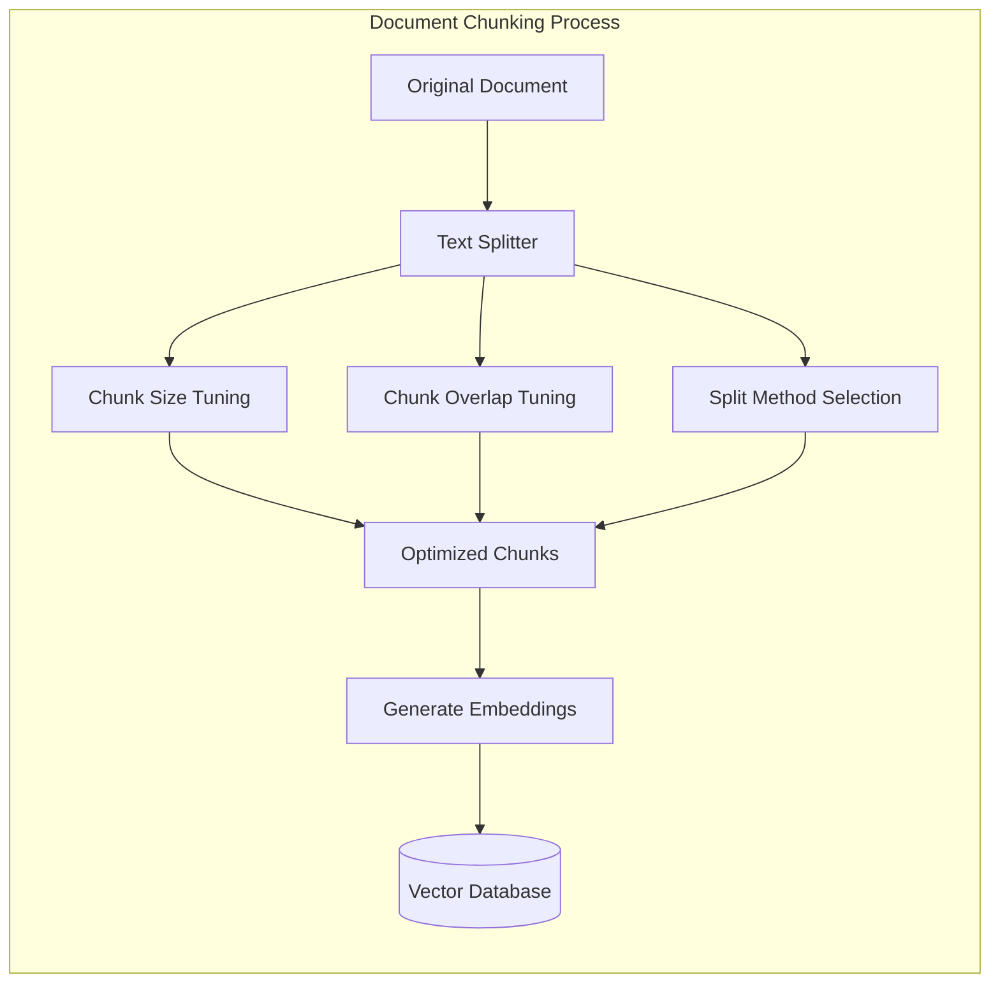
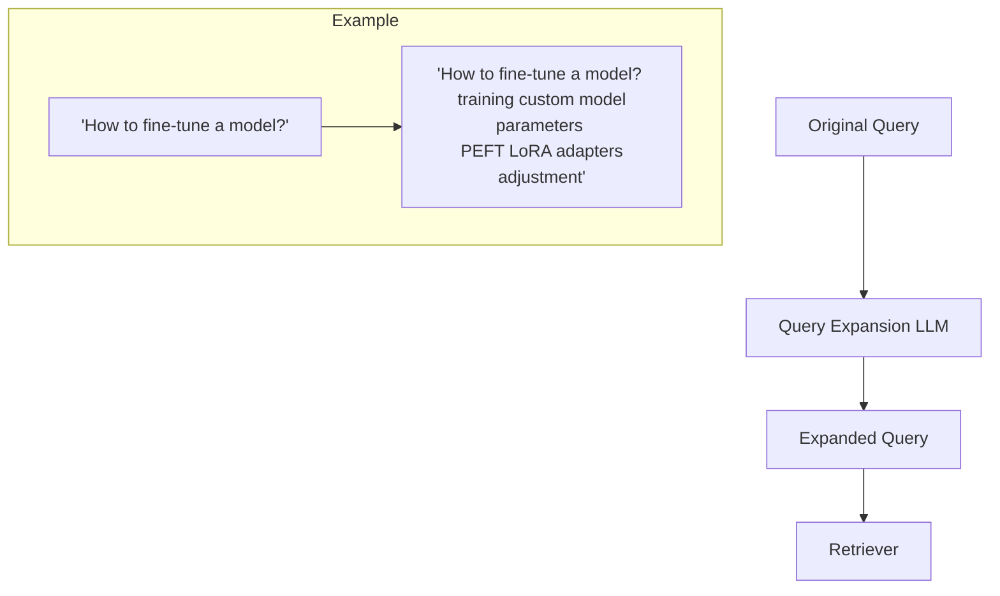
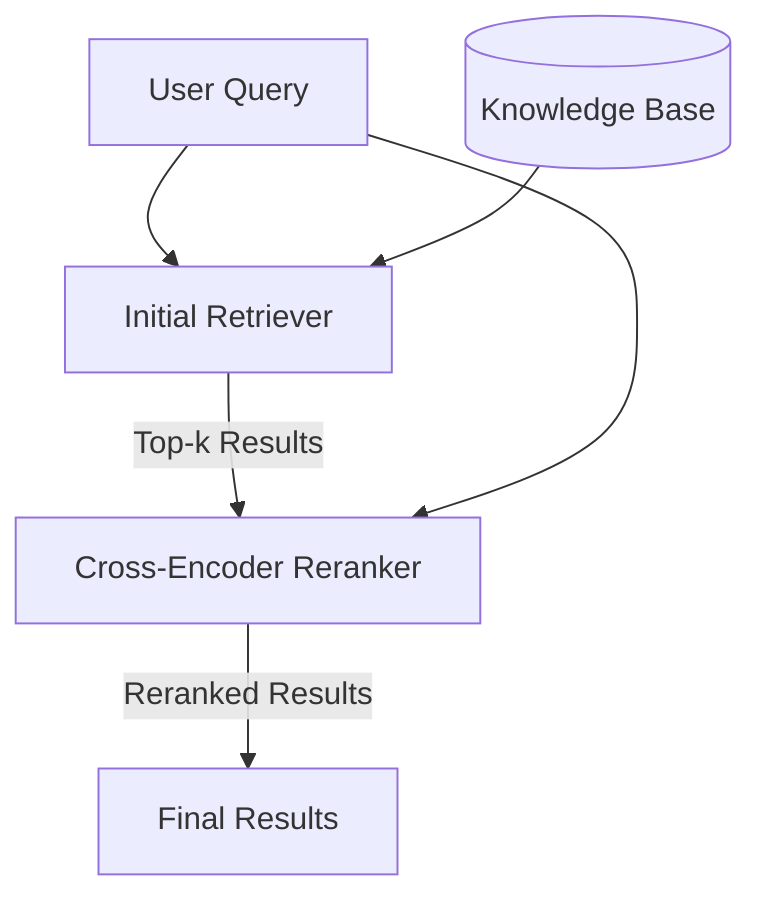
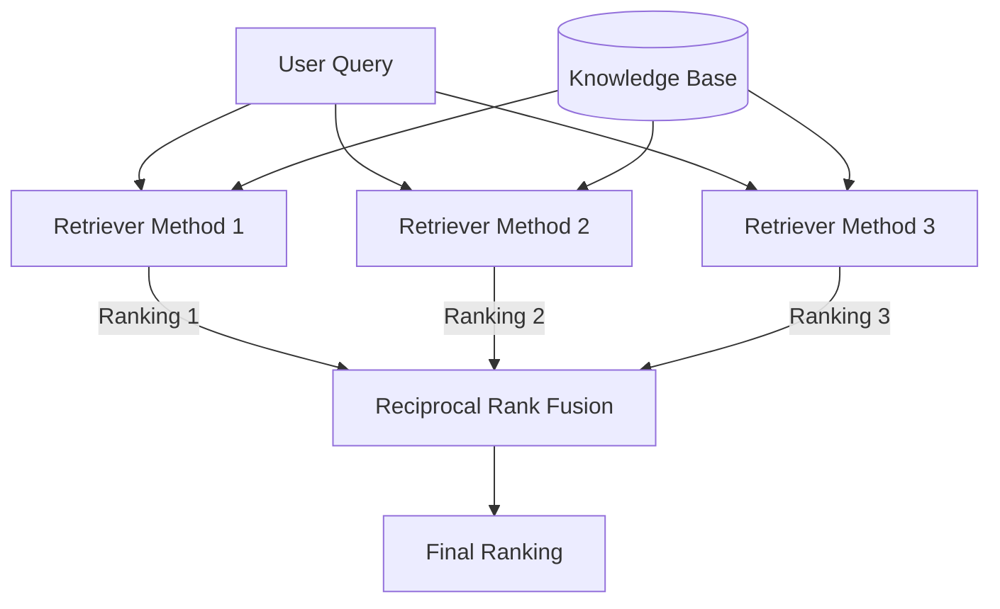
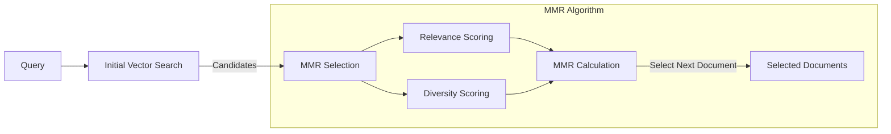
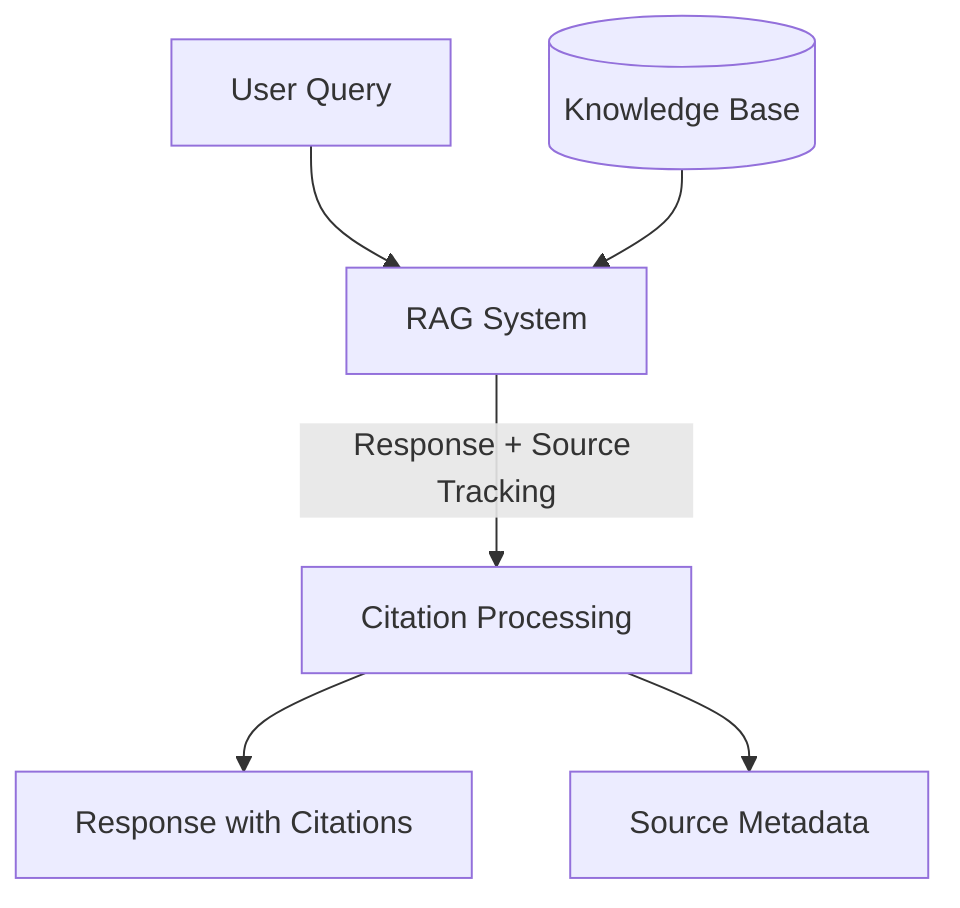
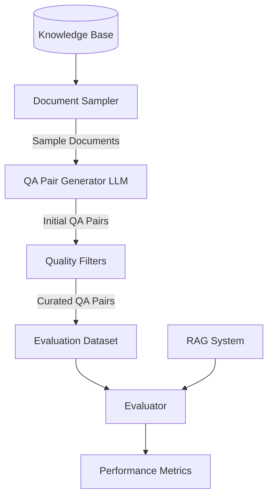
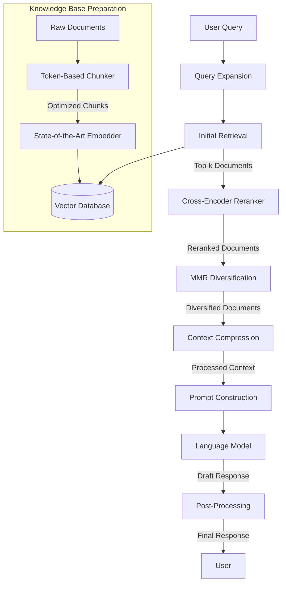

<!-- source: DeepWiki mcp.deepwiki.com · repo huggingface/cookbook · page 2.2 Advanced RAG Techniques · fetched 2026-10-26 -->

# Advanced RAG Techniques

Relevant source files

The following files were used as context for generating this wiki page:

- [notebooks/en/advanced_rag.ipynb](notebooks/en/advanced_rag.ipynb)
- [notebooks/en/rag_evaluation.ipynb](notebooks/en/rag_evaluation.ipynb)
- [notebooks/ko/_toctree.yml](notebooks/ko/_toctree.yml)
- [notebooks/ko/index.md](notebooks/ko/index.md)

This page covers advanced techniques for enhancing Retrieval Augmented Generation (RAG) systems beyond basic implementations. While [Basic RAG Implementations](#2.1) covers the fundamentals of setting up RAG pipelines, this document focuses on optimization techniques that can significantly improve retrieval quality, relevance, and overall response accuracy.

RAG systems are complex with many moving parts that can be tuned for performance gains. This document explores techniques including improved embedding models, optimized chunking strategies, reranking methods, query transformation approaches, and context handling enhancements.

## RAG System Architecture Overview

Sources: [notebooks/en/advanced_rag.ipynb:19-31]()

## Retriever Optimizations

The retriever is the component that fetches relevant context from the knowledge base. Several optimization techniques can enhance retrieval quality.

### Embedding Model Selection

The choice of embedding model significantly impacts retrieval performance. Advanced RAG systems often use state-of-the-art embedding models that better capture semantic meaning.

Popular embedding models for advanced RAG include:

| Model | Dimensions | Context Length | Special Features |
|-------|------------|----------------|------------------|
| GTE models | 768-1024 | 512 | Optimized for retrieval tasks |
| E5 models | 1024 | 512 | Strong multilingual support |
| BGE models | 768-1024 | 512 | Good balance of speed/performance |
| Instructor models | 768 | 512 | Can be guided with instructions |

The embedding model selection depends on your specific use case, language requirements, and computational constraints.

Sources: [notebooks/en/advanced_rag.ipynb:242-255]()

### Optimized Chunking Strategies

Advanced RAG implementations pay careful attention to how documents are chunked:

Key chunking optimizations include:

1. **Token-based chunking**: Rather than using a character count, advanced implementations use the tokenizer from the embedding model to ensure chunks respect token limits.

2. **Recursive chunking with semantic separators**: Using a hierarchical list of separators (paragraphs, sentences, etc.) to preserve the semantic structure of content.

3. **Optimal chunk size determination**: Finding the right balance - too small fragments important concepts, too large dilutes relevance.

4. **Strategic overlap**: Ensuring that contextual continuity is maintained between chunks.

Sources: [notebooks/en/advanced_rag.ipynb:147-204]()

## Query Transformation Techniques

Advanced RAG systems often transform the user query to improve retrieval quality.

### Query Expansion

Query expansion enriches the original query with additional relevant terms to increase the likelihood of matching relevant documents.

Implementation typically involves:
1. Passing the original query to an LLM
2. Asking the LLM to generate additional relevant search terms
3. Expanding the original query with these terms
4. Performing retrieval with the expanded query

Sources: [notebooks/en/advanced_rag.ipynb:500-550]()

### Hypothetical Document Embeddings (HyDE)

HyDE uses a language model to generate a hypothetical ideal document that would answer the query, then uses the embedding of that document for retrieval.

This technique is especially effective for complex, inferential queries where the user query terms might not directly match the relevant documents.

Sources: [notebooks/en/advanced_rag.ipynb:600-650]()

## Reranking Techniques

Reranking adds a second stage of relevance assessment after initial retrieval to improve precision.

### Cross-Encoder Reranking

While the initial retrieval typically uses bi-encoders (separate embeddings for query and documents), cross-encoders process the query and document together for more accurate relevance scoring.

Cross-encoders:
- Process query and document jointly rather than independently
- Provide more accurate relevance scoring
- Are computationally more expensive (only applied to top-k results)
- Can significantly improve precision at the top positions

Sources: [notebooks/en/advanced_rag.ipynb:700-750]()

### Reciprocal Rank Fusion (RRF)

RRF combines multiple ranking methods to create a more robust final ranking.

RRF can combine rankings from different retrieval methods, embedding models, or even hybrid neural-lexical approaches for more robust retrieval.

Sources: [notebooks/en/advanced_rag.ipynb:800-850]()

## Enhanced Context Handling

Once documents are retrieved, advanced RAG techniques optimize how context is presented to the language model.

### Maximum Marginal Relevance (MMR)

MMR balances relevance with diversity in the retrieval set to reduce redundancy and increase information coverage.

The MMR algorithm iteratively selects documents by balancing:
- Relevance to the query
- Diversity compared to already selected documents

This approach ensures broader coverage of relevant information while minimizing redundancy.

Sources: [notebooks/en/advanced_rag.ipynb:900-950]()

### Context Compression

Context compression techniques reduce the size of retrieved documents while preserving essential information:

1. **Map-Reduce Summarization**: Each document is summarized independently, then combined

2. **LLM-based extraction**: Using an LLM to extract only the portions directly relevant to the query

3. **Adaptive retrieval**: Dynamically adjusting the number of retrieved documents based on query complexity

4. **Document re-assembly**: Extracting and re-organizing key information from retrieved documents

These compression techniques help overcome context window limitations of LLMs and improve focus on relevant information.

Sources: [notebooks/en/advanced_rag.ipynb:1000-1050]()

## Output Processing Enhancements

Advanced RAG systems often include post-processing steps for improved responses.

### Source Attribution and Citation

Implementing mechanisms to track and attribute specific claims to source documents:

Techniques include:
- Passage-level source tracking
- Attribution markers in prompts
- Post-processing to format citations
- Structured output with source references

Sources: [notebooks/en/advanced_rag.ipynb:1100-1150]()

### Self-Verification and Fact-Checking

Advanced RAG systems may implement self-verification mechanisms:

1. **Confidence scoring**: Having the LLM assess its confidence in different parts of the response

2. **Verification step**: Using a separate prompt to check factual accuracy against retrieved content

3. **Uncertainty highlighting**: Explicitly marking uncertain information in responses

4. **Hallucination detection**: Post-processing to identify likely hallucinations

These techniques reduce the likelihood of hallucinated content in the final response.

Sources: [notebooks/en/advanced_rag.ipynb:1150-1200]()

## Evaluation and Monitoring

Implementing robust evaluation frameworks is critical for advanced RAG systems.

### Synthetic Dataset Generation

Creating synthetic question-answer pairs from the knowledge base for automated testing:

The generated dataset can be used to automatically assess system performance across various metrics.

Sources: [notebooks/rag_evaluation.ipynb:115-126]()

### LLM-as-Judge Evaluation

Using a separate LLM to evaluate the quality of RAG responses:

1. **Answer relevance**: Assessing if the response addresses the question

2. **Factual accuracy**: Verifying if information is consistent with retrieved documents

3. **Groundedness**: Ensuring all claims can be traced to source documents

4. **Context utilization**: Evaluating how well the system used the retrieved context

This approach provides more nuanced evaluation than simple exact-match metrics.

Sources: [notebooks/rag_evaluation.ipynb:20-35]()

## Implementation Considerations for Advanced RAG

When implementing advanced RAG techniques, consider:

1. **Modular architecture**: Design your system to easily swap out different components (embedders, retrievers, rerankers)

2. **Latency vs. quality tradeoffs**: More sophisticated techniques often increase latency, which may not be acceptable for all applications

3. **Monitoring and logging**: Implement comprehensive tracking to identify which techniques provide the most benefit

4. **A/B testing**: Test different combinations of techniques on real user queries to optimize for actual use cases

5. **Continuous improvement**: Set up mechanisms to collect feedback and continuously refine the system

Sources: [notebooks/en/advanced_rag.ipynb:1250-1300]()

## Practical Example of Advanced RAG Implementation

Here's a high-level architecture of an advanced RAG implementation:

This architecture incorporates multiple advanced techniques in a pipeline that can be adapted based on specific requirements and constraints.

Sources: [notebooks/en/advanced_rag.ipynb:19-31](), [notebooks/en/advanced_rag.ipynb:147-204]()

## Conclusion

Advanced RAG techniques represent a significant improvement over basic implementations. By incorporating optimized embedding models, sophisticated chunking strategies, query transformation, reranking, and enhanced context handling, RAG systems can deliver more accurate, relevant, and comprehensive responses.

The field of RAG is rapidly evolving, with new techniques being developed regularly. For evaluation methods to assess the impact of these techniques, see [RAG Evaluation](#2.5), and for structured output generation in RAG systems, see [Structured Generation for RAG](#2.3).

---

