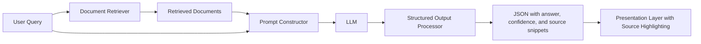
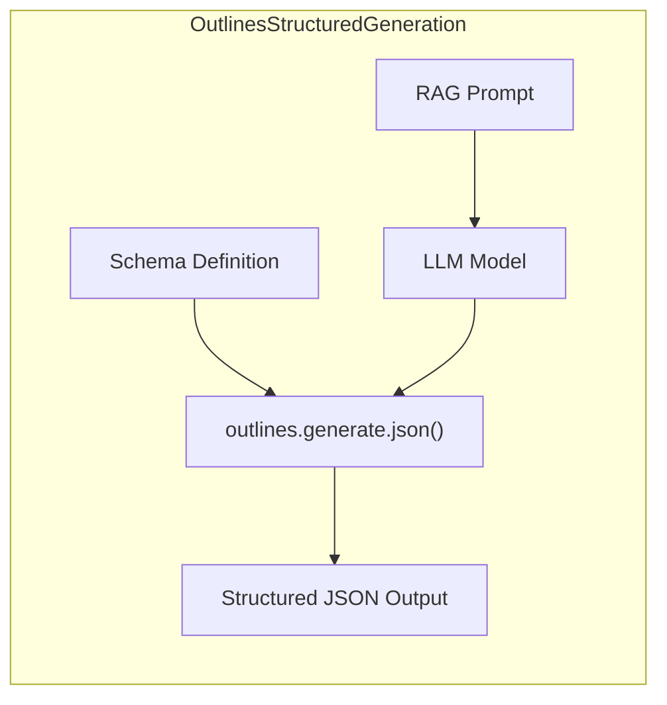
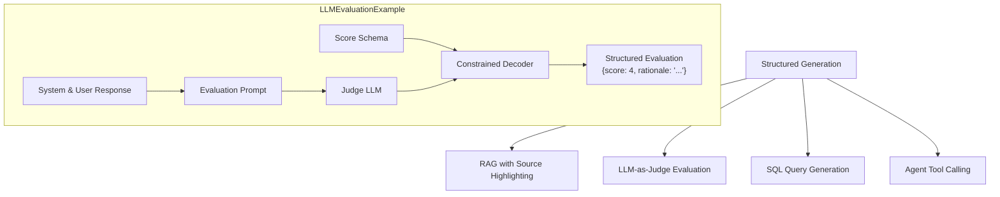

<!-- source: DeepWiki mcp.deepwiki.com · repo huggingface/cookbook · page 2.3 Structured Generation for RAG · fetched 2026-10-26 -->

# Structured Generation for RAG

<details>
<summary>Relevant source files</summary>

The following files were used as context for generating this wiki page:

- [notebooks/en/llm_judge.ipynb](notebooks/en/llm_judge.ipynb)
- [notebooks/en/structured_generation.ipynb](notebooks/en/structured_generation.ipynb)
- [notebooks/ko/advanced_ko_rag.ipynb](notebooks/ko/advanced_ko_rag.ipynb)
- [notebooks/ko/structured_generation.ipynb](notebooks/ko/structured_generation.ipynb)

</details>


Structured Generation for RAG is a technique that forces Language Model (LLM) outputs to follow specific formats or patterns within Retrieval-Augmented Generation (RAG) systems. This approach ensures that responses contain not only the answer derived from retrieved documents but also additional structured information such as source attributions, confidence scores, and other metadata in a consistent, machine-readable format.

This document focuses specifically on implementing structured generation techniques to enhance RAG systems, with particular emphasis on source highlighting and constrained output generation. For general RAG implementation information, see [Retrieval-Augmented Generation (RAG) Systems](#2) and [Advanced RAG Techniques](#2.2).

## Overview of Structured Generation

Structured generation addresses several challenges in RAG implementations:

1. Ensuring consistent output formats for downstream processing
2. Providing explicit attribution of generated content to source documents
3. Including metadata like confidence scores
4. Enabling source highlighting for improved transparency and trust



Sources: [notebooks/en/structured_generation.ipynb:7-27]()

## Implementation Approaches

There are two primary methods for implementing structured generation in RAG systems:

### Prompt-Based Structured Generation

The simplest approach uses carefully crafted prompts that instruct the LLM to generate responses in a specific format. This method works reasonably well with capable models but has limitations with less powerful LLMs or when using high temperature settings.

Example prompt template for JSON-structured output:

```
Answer the user query based on the source documents.

Here are the source documents: {context}

You should provide your answer as a JSON blob, and also provide all relevant short 
source snippets from the documents on which you directly based your answer, 
and a confidence score as a float between 0 and 1.

Your answer should be built as follows:
{
  "answer": your_answer,
  "confidence_score": your_confidence_score,
  "source_snippets": ["snippet_1", "snippet_2", ...]
}

Here is the user question: {user_query}.
```

#### Limitations of Prompt-Only Approach

While prompting works with capable models, it has several drawbacks:

- Output format may be inconsistent or malformed with less capable models
- High temperature settings can produce unusable outputs
- No guarantee the model will follow the requested format
- Parsing errors may occur if the output doesn't strictly adhere to the expected structure

Sources: [notebooks/en/structured_generation.ipynb:80-93](), [notebooks/ko/structured_generation.ipynb:293-304]()

### Constrained Decoding Approach

Constrained decoding enforces output formats by only allowing the model to generate tokens that conform to a predefined grammar or schema. This technique ensures valid outputs regardless of the model's capabilities or temperature settings.

```mermaid
flowchart TD
    subgraph "Traditional RAG"
        Query1["User Query"] --> Retriever1["Retriever"]
        Retriever1 --> Context1["Context"]
        Context1 --> Prompt1["Prompt Engineering"]
        Prompt1 --> LLM1["LLM"]
        LLM1 --> Output1["Unstructured Output"]
    end

    subgraph "Structured Generation RAG"
        Query2["User Query"] --> Retriever2["Retriever"]
        Retriever2 --> Context2["Context"]
        Context2 --> Prompt2["Prompt Engineering"]
        Prompt2 --> LLM2["LLM"]
        LLM2 --> Grammar["Grammar/Schema Definition"]
        Grammar --> Decoder["Constrained Decoder"]
        Decoder --> Output2["Structured Output (JSON)"]
        Output2 --> SourceHighlighter["Source Highlighter"]
        SourceHighlighter --> AnnotatedResponse["Answer with Highlighted Sources"]
    end
```



Constrained decoding works by applying a bias to the model's logits to force selection of only the tokens that conform to the defined constraints. This ensures the output is always valid according to the specified schema.

Sources: [notebooks/en/structured_generation.ipynb:339-346](), [notebooks/ko/structured_generation.ipynb:350-356]()

## Implementing Source Highlighting with Structured Generation

One of the most valuable applications of structured generation in RAG is highlighting source snippets that support the generated answer, improving transparency and verifiability.

### Defining the Output Schema

The first step is to define a schema that captures the required output structure:

```python
from pydantic import BaseModel, confloat, StringConstraints
from typing import List, Annotated

class AnswerWithSnippets(BaseModel):
    answer: Annotated[str, StringConstraints(min_length=10, max_length=100)]
    confidence: Annotated[float, confloat(ge=0.0, le=1.0)]
    source_snippets: List[Annotated[str, StringConstraints(max_length=30)]]
```

This Pydantic model defines:
- An answer string with length constraints
- A confidence score between 0 and 1
- A list of source snippets, each with a maximum length

Sources: [notebooks/en/structured_generation.ipynb:354-361](), [notebooks/ko/structured_generation.ipynb:367-374]()

### Implementing Constrained Decoding

The Hugging Face Inference API supports constrained decoding through its grammar parameter:

```python
# Using the InferenceClient
answer = llm_client.text_generation(
    prompt,
    grammar={"type": "json", "value": AnswerWithSnippets.schema()},
    max_new_tokens=250,
    temperature=1.6,
)
```

The grammar parameter ensures that the output conforms to the specified schema, even with high temperature settings, forcing the model to produce valid JSON that matches the defined structure.

Sources: [notebooks/en/structured_generation.ipynb:428-437](), [notebooks/ko/structured_generation.ipynb:430-439]()

### Processing and Visualizing Highlighted Snippets

Once the structured output is generated, the source snippets can be highlighted in the original context:

```python
def highlight(s):
    return "\x1b[1;32m" + s + "\x1b[0m"

def print_results(answer, source_text, highlight_snippets):
    print("Answer:", highlight(answer))
    print("\n\n", "=" * 10 + " Source documents " + "=" * 10)
    for snippet in highlight_snippets:
        source_text = source_text.replace(snippet.strip(), highlight(snippet.strip()))
    print(source_text)
```

This creates a visual representation showing exactly which parts of the source documents support the generated answer.

Sources: [notebooks/en/structured_generation.ipynb:262-271](), [notebooks/ko/structured_generation.ipynb:278-287]()

## Tools and Libraries for Structured Generation

Several tools and libraries support structured generation for RAG systems:

### Outlines Library

Outlines is a structured text generation library that can be used locally or through the Hugging Face Inference API. It provides fine-grained control over output generation to ensure adherence to defined schemas.



Implementation example:

```python
import outlines
import json

# Load model locally
model = outlines.models.transformers(repo_id)

# Convert schema to string
schema_as_str = json.dumps(AnswerWithSnippets.schema())

# Create generator with schema
generator = outlines.generate.json(model, schema_as_str)

# Generate structured output
result = generator(prompt)
```

Outlines works by applying a bias to the model's logits, ensuring only tokens that conform to the constraints are selected during generation.

Sources: [notebooks/en/structured_generation.ipynb:479-491](), [notebooks/ko/structured_generation.ipynb:496-499]()

### Hugging Face Inference API

The Hugging Face Inference API provides built-in support for constrained decoding:

```python
from huggingface_hub import InferenceClient

llm_client = InferenceClient(model=repo_id)

# Using grammar constraint
data = {
    "inputs": prompt,
    "parameters": {
        "temperature": 1.0,
        "return_full_text": False,
        "grammar": {"type": "json", "value": AnswerWithSnippets.schema()},
        "max_new_tokens": 250,
    },
}
answer = json.loads(llm_client.post(json=data))[0]["generated_text"]
```

Sources: [notebooks/en/structured_generation.ipynb:438-450](), [notebooks/ko/structured_generation.ipynb:470-479]()

### Text-Generation-Inference (TGI)

For self-hosted deployments, Text-Generation-Inference supports constrained generation through its API, offering the same capabilities as the Hugging Face Inference API but in a self-hosted environment.

## Advanced Use Cases and Extensions

Structured generation extends beyond source highlighting in RAG:



### LLM-as-a-Judge Evaluation

Structured generation is valuable for LLM evaluation frameworks, where it can be used to ensure consistent output formats for scores and rationales.

Example schema for LLM judge output:
```python
class JudgeOutput(BaseModel):
    score: int  # Score from 1-4
    rationale: str  # Explanation for the score
    confidence_level: float  # Confidence in the assessment
```

Sources: [notebooks/en/llm_judge.ipynb:452-480](), [notebooks/ko/structured_generation.ipynb:554-560]()

### Other Applications

Structured generation can be applied to various other scenarios:
- SQL query generation with validated syntax
- Agent frameworks with structured tool calls
- Form generation with specific fields
- Table creation with defined columns and data types

## Implementation Considerations

When implementing structured generation for RAG systems:

1. **Schema complexity**: Balance between overly rigid and overly flexible schemas
2. **Model selection**: More capable models generally follow structured formats better
3. **Error handling**: Plan for error cases even with constrained decoding
4. **Performance impact**: Constrained decoding may affect generation speed
5. **User experience**: Consider how to effectively present highlighted sources to end users

## Conclusion

Structured generation significantly enhances RAG systems by providing:
- Consistent output formats for downstream processing
- Improved transparency through source highlighting
- Additional metadata like confidence scores
- Better control over output format regardless of model capability

By combining effective prompting with constrained decoding techniques, developers can build more reliable and transparent RAG systems that clearly show how generated answers relate to source documents, enhancing user trust and system reliability.

Sources: [notebooks/en/structured_generation.ipynb:498-511](), [notebooks/ko/structured_generation.ipynb:553-569]()

---

