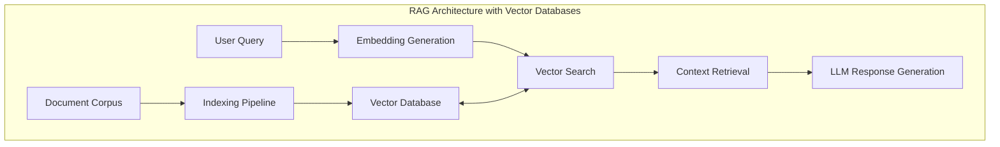
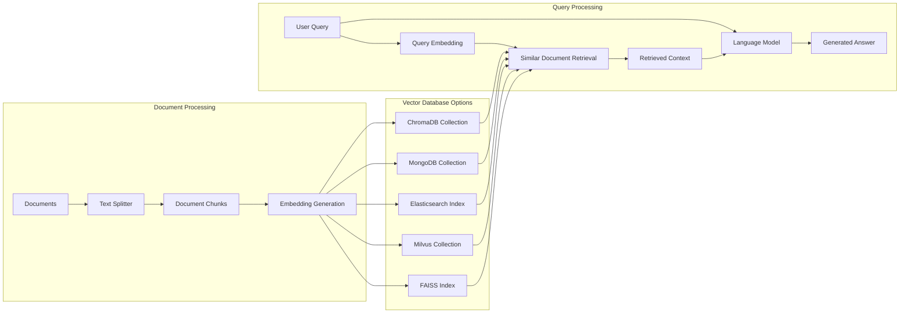
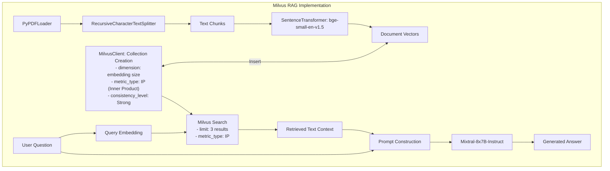
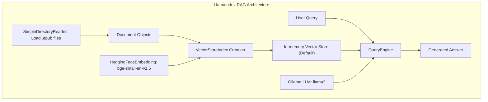
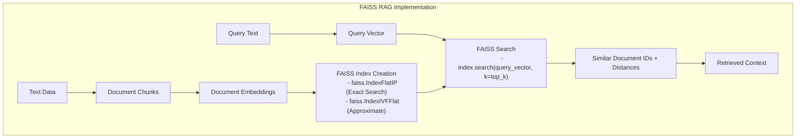
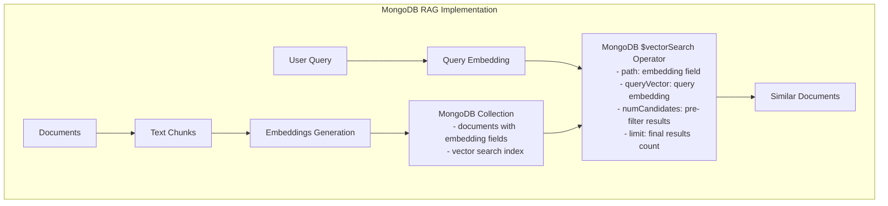
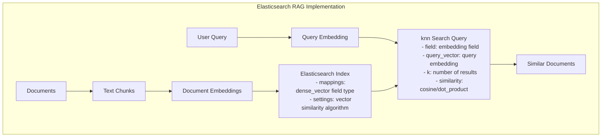
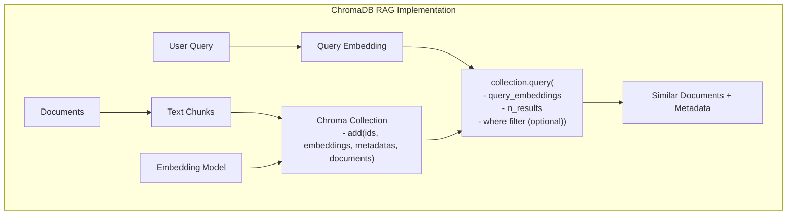

<!-- source: DeepWiki mcp.deepwiki.com · repo huggingface/cookbook · page 2.4 RAG with Different Vector Databases · fetched 2026-10-26 -->

# RAG with Different Vector Databases

<details>
<summary>Relevant source files</summary>

The following files were used as context for generating this wiki page:

- [notebooks/en/rag_llamaindex_librarian.ipynb](notebooks/en/rag_llamaindex_librarian.ipynb)
- [notebooks/en/rag_with_hf_and_milvus.ipynb](notebooks/en/rag_with_hf_and_milvus.ipynb)
- [notebooks/zh-CN/index.md](notebooks/zh-CN/index.md)
- [notebooks/zh-CN/prompt_tuning_peft.ipynb](notebooks/zh-CN/prompt_tuning_peft.ipynb)
- [notebooks/zh-CN/rag_with_hf_and_milvus.ipynb](notebooks/zh-CN/rag_with_hf_and_milvus.ipynb)

</details>


This document provides a comprehensive overview of implementing Retrieval-Augmented Generation (RAG) systems using various vector database options. We'll cover the integration of popular vector databases including FAISS, Milvus, Elasticsearch, MongoDB, and ChromaDB within RAG architectures, with practical examples. For more information about advanced RAG techniques or structured outputs, see [Advanced RAG Techniques](#2.2) or [Structured Generation for RAG](#2.3).

## Introduction to Vector Databases in RAG

Vector databases are specialized storage systems optimized for managing high-dimensional vector embeddings and performing efficient similarity searches. In RAG systems, they serve as the retrieval component that stores document embeddings and quickly fetches the most relevant context based on similarity to the query.



Sources: [notebooks/en/rag_llamaindex_librarian.ipynb:174-293](), [notebooks/en/rag_with_hf_and_milvus.ipynb:212-292]()

## Common Vector Database Options

There are several vector database options available for implementing RAG systems, each with its own strengths and characteristics:

| Database | Type | Key Features | Best For |
|----------|------|--------------|----------|
| FAISS | In-memory/file-based | Efficient similarity search, compact index | Small-medium datasets, local deployment |
| Milvus | Distributed vector DB | Highly scalable, rich query capabilities | Large-scale production, complex queries |
| Elasticsearch | Search engine with vector support | Full-text + vector search, mature ecosystem | Hybrid search (text + semantic) |
| MongoDB | Document DB with vector support | Document-oriented storage with vector fields | Existing MongoDB users |
| ChromaDB | Embedded vector DB | Easy setup, persistence options | Quick prototyping, simple applications |
| LlamaIndex | Abstraction layer | Works with multiple vector stores | Flexibility, easy switching between DBs |

Sources: [notebooks/en/rag_llamaindex_librarian.ipynb:26-45](), [notebooks/en/rag_with_hf_and_milvus.ipynb:7-14]()

## Vector Database Integration Architecture

The following diagram illustrates how different vector databases integrate into the RAG pipeline:



Sources: [notebooks/en/rag_with_hf_and_milvus.ipynb:342-365](), [notebooks/en/rag_llamaindex_librarian.ipynb:174-203]()

## Implementation with Milvus

Milvus is a powerful vector database designed specifically for similarity search and AI applications. Here's how to implement RAG with Milvus:



Sources: [notebooks/en/rag_with_hf_and_milvus.ipynb:231-291](), [notebooks/en/rag_with_hf_and_milvus.ipynb:371-408]()

### Code Example: Setting up Milvus for RAG

```python
from pymilvus import MilvusClient
from sentence_transformers import SentenceTransformer

# 1. Initialize embedding model
embedding_model = SentenceTransformer("BAAI/bge-small-en-v1.5")
embedding_dim = len(embedding_model.encode(["This is a test"])[0])

# 2. Create Milvus collection
milvus_client = MilvusClient(uri="./milvus_data.db")  # Local file-based storage
collection_name = "rag_collection"

milvus_client.create_collection(
    collection_name=collection_name,
    dimension=embedding_dim,
    metric_type="IP",  # Inner product distance
    consistency_level="Strong"
)

# 3. Insert data
for i, text in enumerate(text_chunks):
    vector = embedding_model.encode([text])[0].tolist()
    milvus_client.insert(
        collection_name=collection_name, 
        data={"id": i, "vector": vector, "text": text}
    )

# 4. Search for similar documents
query_vector = embedding_model.encode([query])[0].tolist()
search_results = milvus_client.search(
    collection_name=collection_name,
    data=[query_vector],
    limit=3,  # Return top 3 results
    search_params={"metric_type": "IP", "params": {}},
    output_fields=["text"]
)
```

Sources: [notebooks/en/rag_with_hf_and_milvus.ipynb:230-236](), [notebooks/en/rag_with_hf_and_milvus.ipynb:285-290](), [notebooks/en/rag_with_hf_and_milvus.ipynb:371-379]()

## Implementation with LlamaIndex

LlamaIndex provides a higher-level abstraction over multiple vector stores, making it easier to build RAG systems without worrying about the details of specific vector databases.



Sources: [notebooks/en/rag_llamaindex_librarian.ipynb:211-219](), [notebooks/en/rag_llamaindex_librarian.ipynb:264-271](), [notebooks/en/rag_llamaindex_librarian.ipynb:325-329]()

### Code Example: LlamaIndex with Custom Embedding Model

```python
from llama_index.core import SimpleDirectoryReader, VectorStoreIndex
from llama_index.embeddings.huggingface import HuggingFaceEmbedding
from llama_index.llms.ollama import Ollama

# 1. Load documents
loader = SimpleDirectoryReader(
    input_dir="./library/",
    recursive=True,
    required_exts=[".epub"],
)
documents = loader.load_data()

# 2. Set up embedding model
embedding_model = HuggingFaceEmbedding(model_name="BAAI/bge-small-en-v1.5")

# 3. Create vector index
index = VectorStoreIndex.from_documents(
    documents,
    embed_model=embedding_model,
)

# 4. Set up LLM and query engine
llm = Ollama(
    model="llama2",
    request_timeout=40.0,
)
query_engine = index.as_query_engine(llm=llm)

# 5. Query
response = query_engine.query("What are the titles of all the books available?")
```

Sources: [notebooks/en/rag_llamaindex_librarian.ipynb:211-219](), [notebooks/en/rag_llamaindex_librarian.ipynb:264-291](), [notebooks/en/rag_llamaindex_librarian.ipynb:325-329]()

## Implementation with Other Vector Databases

### FAISS (Facebook AI Similarity Search)

FAISS is an efficient library for similarity search developed by Facebook AI Research, particularly useful for in-memory vector storage and search.



### MongoDB Atlas Vector Search

MongoDB offers vector search capabilities that can be integrated with RAG systems.



### Elasticsearch

Elasticsearch provides powerful vector search capabilities combined with traditional search features.



### ChromaDB

ChromaDB is a simple, lightweight vector database designed specifically for embeddings.



## Vector Database Selection Considerations

When choosing a vector database for your RAG application, consider these key factors:

1. **Scale of data**: 
   - Small datasets (< 1M vectors): FAISS or ChromaDB
   - Medium datasets (1-10M vectors): Milvus Lite or MongoDB
   - Large datasets (>10M vectors): Milvus, Elasticsearch, or cloud-hosted options

2. **Deployment environment**:
   - Local/offline use: FAISS, ChromaDB, LlamaIndex with local storage
   - Production/cloud: Milvus, Elasticsearch, MongoDB Atlas

3. **Query complexity**:
   - Simple vector search: Any option
   - Hybrid search (text + vector): Elasticsearch, Milvus
   - Complex filtering + vector search: Milvus, MongoDB, Elasticsearch

4. **Integration requirements**:
   - Tight integration with existing MongoDB: MongoDB Vector Search
   - Existing Elasticsearch deployment: Elasticsearch vector search
   - Framework flexibility: LlamaIndex for easy switching between stores

5. **Performance considerations**:
   - Highest throughput: FAISS (in-memory)
   - Best scalability: Milvus, Elasticsearch
   - Lowest latency for small-scale: ChromaDB, FAISS

Sources: [notebooks/en/rag_llamaindex_librarian.ipynb:26-49](), [notebooks/en/rag_with_hf_and_milvus.ipynb:238-251]()

## Best Practices for Vector Databases in RAG

1. **Embedding consistency**: Use the same embedding model for indexing and querying

2. **Chunk size optimization**: 
   - Too small: Insufficient context for relevance
   - Too large: Diluted relevance signals
   - Typically 512-1024 tokens works well for most use cases

3. **Overlap strategy**: Use chunk overlap (typically 10-20% of chunk size) to prevent context fragmentation

4. **Index selection**:
   - Exact search (FAISS IndexFlatIP): Best quality, slower search
   - Approximate search (FAISS IndexIVFFlat): Faster search, slight quality tradeoff
   - Quantized indices: Smaller memory footprint, faster search, more quality tradeoff

5. **Filtering strategies**: Implement metadata filters to narrow search space before vector similarity

6. **Storage considerations**:
   - Persist indices to avoid recomputation
   - Consider incremental updates for evolving document collections

Sources: [notebooks/en/rag_llamaindex_librarian.ipynb:246-251](), [notebooks/en/rag_llamaindex_librarian.ipynb:387-405]()

## Conclusion

Vector databases are a critical component of effective RAG systems, enabling efficient storage and retrieval of document embeddings for context-relevant generation. The choice of vector database depends on your specific requirements for scale, deployment, query complexity, and integration needs.

For smaller projects or quick prototyping, FAISS or ChromaDB may be sufficient. For production deployments with larger datasets, Milvus, Elasticsearch, or MongoDB provide better scalability and feature sets. LlamaIndex offers a convenient abstraction layer that works with multiple vector stores, allowing for flexibility and easy experimentation.

When implementing RAG systems with any vector database, following best practices for embedding consistency, chunk size optimization, and index selection will help ensure optimal performance and relevance.

---

