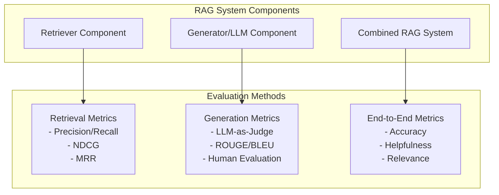
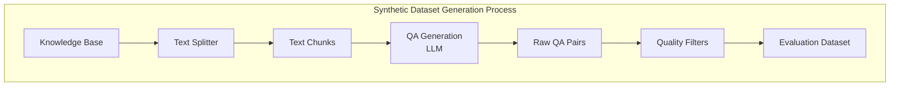
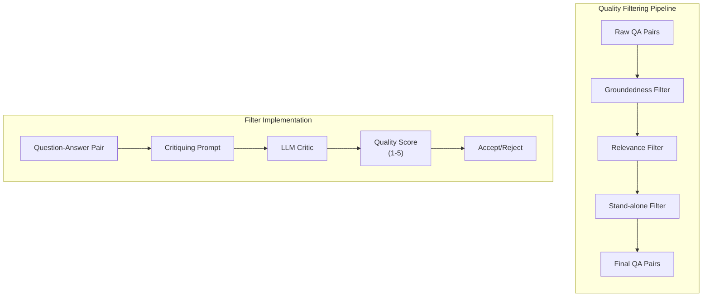
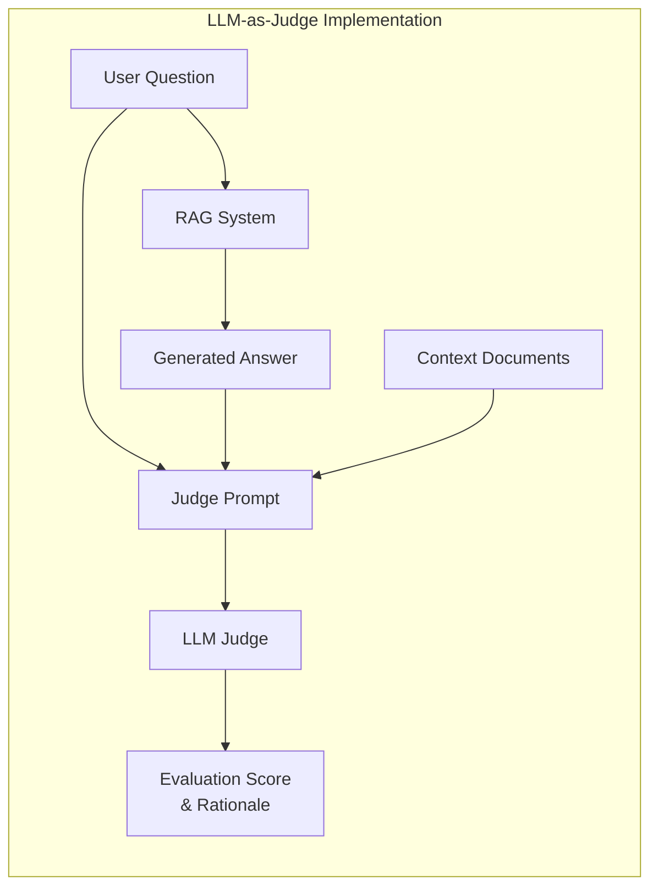
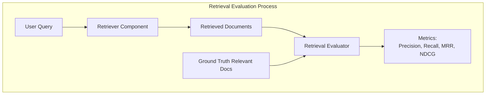
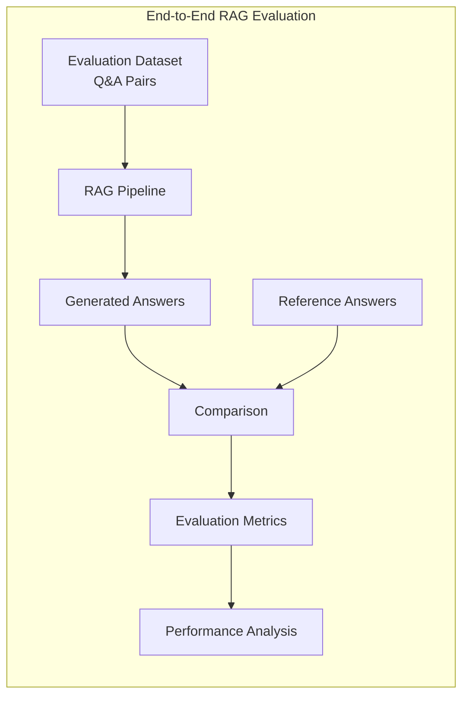
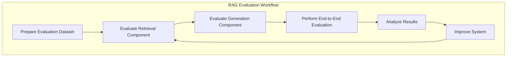
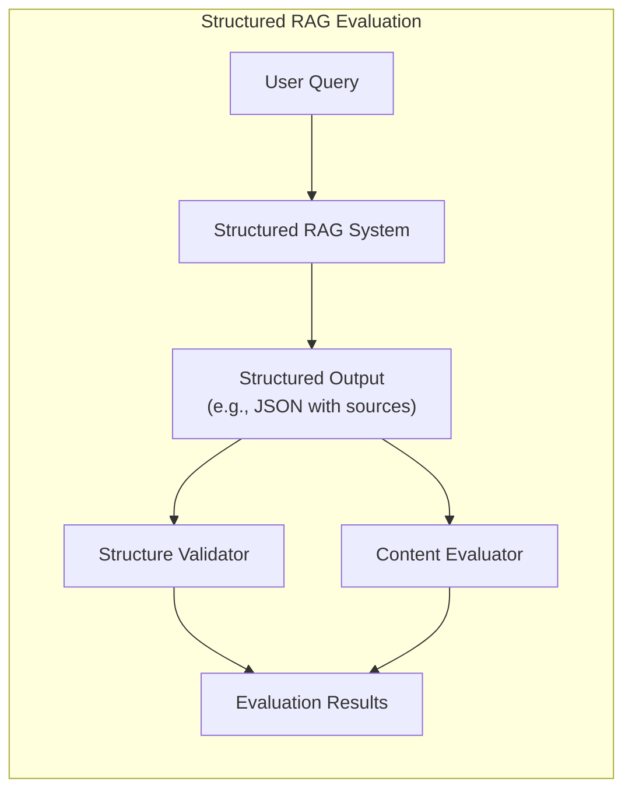

<!-- source: DeepWiki mcp.deepwiki.com · repo huggingface/cookbook · page 2.5 Evaluating RAG Systems · fetched 2026-10-26 -->

# Evaluating RAG Systems

<details>
<summary>Relevant source files</summary>

The following files were used as context for generating this wiki page:

- [notebooks/en/advanced_rag.ipynb](notebooks/en/advanced_rag.ipynb)
- [notebooks/en/llm_judge.ipynb](notebooks/en/llm_judge.ipynb)
- [notebooks/en/rag_evaluation.ipynb](notebooks/en/rag_evaluation.ipynb)
- [notebooks/en/structured_generation.ipynb](notebooks/en/structured_generation.ipynb)
- [notebooks/zh-CN/advanced_rag.ipynb](notebooks/zh-CN/advanced_rag.ipynb)
- [notebooks/zh-CN/automatic_embedding_tei_inference_endpoints.ipynb](notebooks/zh-CN/automatic_embedding_tei_inference_endpoints.ipynb)
- [notebooks/zh-CN/faiss_with_hf_datasets_and_clip.ipynb](notebooks/zh-CN/faiss_with_hf_datasets_and_clip.ipynb)
- [notebooks/zh-CN/fine_tuning_code_llm_on_single_gpu.ipynb](notebooks/zh-CN/fine_tuning_code_llm_on_single_gpu.ipynb)
- [notebooks/zh-CN/rag_evaluation.ipynb](notebooks/zh-CN/rag_evaluation.ipynb)
- [notebooks/zh-CN/rag_zephyr_langchain.ipynb](notebooks/zh-CN/rag_zephyr_langchain.ipynb)

</details>


This page documents approaches and methods for evaluating Retrieval-Augmented Generation (RAG) systems. While implementing RAG is relatively straightforward, measuring its effectiveness requires deliberate evaluation strategies to ensure the system is performing as expected. For information about implementing basic RAG systems, see [Basic RAG Implementations](#2.1), and for advanced techniques, see [Advanced RAG Techniques](#2.2).

## Overview of RAG Evaluation

Evaluating RAG systems presents unique challenges because there are multiple components to assess:

1. The retrieval component: How well does the system retrieve relevant information?
2. The generation component: Does the model produce accurate, helpful answers based on the retrieved information?
3. The end-to-end system: Does the combined system satisfy user queries correctly?

For effective RAG evaluation, we need to assess both individual components and the full system against benchmarks or ground truth data.



Sources: [notebooks/en/llm_judge.ipynb](notebooks/en/llm_judge.ipynb), [notebooks/en/rag_evaluation.ipynb](notebooks/en/rag_evaluation.ipynb)

## Creating Evaluation Datasets

Before evaluating a RAG system, you need appropriate datasets. For RAG evaluation, you need:

1. A collection of questions that can be answered using your knowledge base
2. Ground truth answers for comparison
3. The source documents that contain the answers

### Synthetic Dataset Generation

One effective approach is to generate synthetic evaluation datasets using LLMs, which can create question-answer pairs from your knowledge base.



This process can be implemented using the following components:

1. **Document Preparation**: Start with chunks from your knowledge base
2. **Question Generation**: Use an LLM to generate questions based on document content
3. **Quality Filtering**: Apply filters to ensure questions are high-quality
4. **Dataset Compilation**: Assemble the final evaluation dataset

The code for creating a synthetic dataset:

```python
# Load your knowledge base
docs_processed = text_splitter.split_documents(knowledge_base)

# Generate QA pairs using LLM
for sampled_context in random.sample(docs_processed, N_GENERATIONS):
    # Generate QA couple with LLM
    output_QA_couple = call_llm(llm_client, QA_generation_prompt.format(context=sampled_context.page_content))
    # Extract question and answer
    question = output_QA_couple.split("Factoid question: ")[-1].split("Answer: ")[0]
    answer = output_QA_couple.split("Answer: ")[-1]
    # Store with metadata
    outputs.append({
        "context": sampled_context.page_content,
        "question": question,
        "answer": answer,
        "source_doc": sampled_context.metadata["source"]
    })
```

Sources: [notebooks/en/rag_evaluation.ipynb:100-150](notebooks/en/rag_evaluation.ipynb:100-150)

### Quality Filtering

Not all generated questions are suitable for evaluation. Use critique agents to filter questions based on:

1. **Groundedness**: Can the question be answered from the context?
2. **Relevance**: Is the question useful for users?
3. **Stand-alone**: Is the question understandable without additional context?



Each filter uses specialized prompts to assess different quality aspects.

Sources: [notebooks/en/rag_evaluation.ipynb:363-463](notebooks/en/rag_evaluation.ipynb:363-463)

## LLM-as-a-Judge Evaluation

A powerful approach for evaluating RAG system outputs is to use an LLM as a judge. This method was introduced in the paper "Judging LLM-as-a-Judge with MT-Bench and Chatbot Arena" and offers a flexible way to assess outputs without human intervention.

### Setting Up LLM Judges

The process involves:

1. Creating a specialized prompt for the LLM to act as a judge
2. Running your RAG system to generate answers
3. Having the LLM evaluate the answers against reference answers or criteria



Sources: [notebooks/en/llm_judge.ipynb:25-35](notebooks/en/llm_judge.ipynb:25-35)

### Creating Effective Judge Prompts

The effectiveness of LLM-as-a-judge heavily depends on the prompt design. Based on empirical testing, effective prompts should:

1. Clearly define the task
2. Specify the scale and criteria
3. Ask for a rationale before the final score
4. Use a small, discrete scale (e.g., 1-4) rather than continuous scales

Example of a basic judge prompt:

```
You will be given a user_question and system_answer couple.
Your task is to provide a 'total rating' scoring how well the system_answer answers the user concerns expressed in the user_question.
Give your answer on a scale of 1 to 4, where 1 means that the system_answer is not helpful at all, and 4 means that the system_answer completely and helpfully addresses the user_question.

Here is the scale you should use to build your answer:
1: The system_answer is terrible: completely irrelevant to the question asked, or very partial
2: The system_answer is mostly not helpful: misses some key aspects of the question
3: The system_answer is mostly helpful: provides support, but still could be improved
4: The system_answer is excellent: relevant, direct, detailed, and addresses all the concerns raised in the question

Provide your feedback as follows:

Feedback:::
Evaluation: (your rationale for the rating, as a text)
Total rating: (your rating, as a number between 1 and 4)
```

Sources: [notebooks/en/llm_judge.ipynb:432-480](notebooks/en/llm_judge.ipynb:432-480)

### Evaluating Specific RAG Aspects

LLM judges can evaluate multiple aspects of RAG system performance:

1. **Answer Correctness**: Is the generated answer factually correct?
2. **Answer Completeness**: Does the answer address all parts of the question?
3. **Retrieval Quality**: Are the retrieved documents relevant to the question?
4. **Hallucination Detection**: Does the answer contain information not in the retrieved documents?

Each aspect requires a specialized prompt tailored to that specific criterion.

Sources: [notebooks/en/llm_judge.ipynb:86-105](notebooks/en/llm_judge.ipynb:86-105)

## Retrieval Evaluation Metrics

Evaluating the retrieval component of RAG systems focuses on measuring how effectively relevant documents are retrieved for a given query.

### Common Retrieval Metrics

1. **Precision@k**: Proportion of retrieved documents that are relevant
2. **Recall@k**: Proportion of relevant documents that are retrieved
3. **Mean Reciprocal Rank (MRR)**: Average of reciprocal ranks of the first relevant document
4. **Normalized Discounted Cumulative Gain (NDCG)**: Measures ranking quality with relevance grading



Sources: [notebooks/en/advanced_rag.ipynb:108-124](notebooks/en/advanced_rag.ipynb:108-124)

### Implementing Retrieval Evaluation

To evaluate retrieval quality:

1. Create a test set with queries and known relevant documents
2. Run the retriever on each query
3. Compare retrieved documents with relevant documents using metrics
4. Analyze results and fine-tune the retriever as needed

This is often implemented as a separate evaluation pipeline from the end-to-end evaluation.

Sources: [notebooks/en/advanced_rag.ipynb:595-650](notebooks/en/advanced_rag.ipynb:595-650)

## End-to-End RAG Evaluation

End-to-end evaluation assesses the complete RAG pipeline from query to final answer. This provides the most realistic assessment of system performance.

### Implementation Steps

1. Prepare evaluation dataset with questions and reference answers
2. Process each question through your RAG system
3. Evaluate generated answers against reference answers
4. Compute aggregate metrics



Sources: [notebooks/en/rag_evaluation.ipynb:568-590](notebooks/en/rag_evaluation.ipynb:568-590)

### Human Evaluation vs. Automated Evaluation

Both approaches have strengths:

| Method | Strengths | Weaknesses |
|--------|-----------|------------|
| Human Evaluation | More nuanced assessment | Expensive, time-consuming, subjective |
| LLM-as-Judge | Scalable, consistent, lower cost | Less nuanced than humans, potential biases |
| Automated Metrics | Fast, reproducible | Limited to specific aspects of quality |

For most practical applications, a combination of automated metrics and LLM-as-judge evaluation provides a good balance.

Sources: [notebooks/en/llm_judge.ipynb:86-105](notebooks/en/llm_judge.ipynb:86-105)

## Implementing Evaluation Pipelines

Below is a practical implementation of an evaluation pipeline using LLM-as-a-judge:

```python
# 1. Define Judge Prompt
IMPROVED_JUDGE_PROMPT = """
You will be given a user_question and system_answer couple.
Your task is to provide a 'total rating' scoring how well the system_answer answers the user concerns.
Give your answer on a scale of 1 to 4, where 1 means the answer is not helpful, and 4 means it completely addresses the question.

Here is the scale:
1: Terrible - completely irrelevant or incorrect
2: Mostly not helpful - misses key aspects
3: Mostly helpful - provides support but needs improvement
4: Excellent - relevant, direct, and addresses all concerns

Provide your feedback as follows:

Feedback:::
Evaluation: (your rationale)
Total rating: (your rating, as a number between 1 and 4)
"""

# 2. Run the evaluation
for query, ground_truth in evaluation_dataset:
    # Get RAG system answer
    rag_answer = rag_system.query(query)
    
    # Prepare prompt for the judge
    judge_prompt = IMPROVED_JUDGE_PROMPT.format(
        question=query,
        answer=rag_answer
    )
    
    # Get judgment
    judgment = llm_client.text_generation(judge_prompt)
    
    # Extract score
    score = extract_judge_score(judgment)
    
    # Store results
    evaluation_results.append({
        "query": query,
        "ground_truth": ground_truth,
        "rag_answer": rag_answer,
        "score": score,
        "judgment": judgment
    })

# 3. Analyze results
average_score = sum(r["score"] for r in evaluation_results) / len(evaluation_results)
```

Sources: [notebooks/en/llm_judge.ipynb:399-424](notebooks/en/llm_judge.ipynb:399-424)

## Improving Evaluation Reliability

Several techniques can improve LLM-as-judge reliability:

1. **Multiple Judges**: Use multiple LLMs and average scores
2. **Staged Evaluation**: Break complex evaluations into steps
3. **Calibration**: Compare LLM judge scores with human ratings to calibrate
4. **Chain-of-Thought Prompting**: Ask the LLM to explain its reasoning
5. **Few-Shot Examples**: Provide examples of good/bad answers and ratings

Example of implementing multiple judges:

```python
def evaluate_with_multiple_judges(query, answer, judge_models):
    scores = []
    for judge_model in judge_models:
        judge_client = InferenceClient(model=judge_model)
        judgment = judge_client.text_generation(
            JUDGE_PROMPT.format(question=query, answer=answer)
        )
        score = extract_judge_score(judgment)
        scores.append(score)
    
    # Return average and std dev
    return {
        "average_score": sum(scores) / len(scores),
        "std_deviation": statistics.stdev(scores) if len(scores) > 1 else 0,
        "individual_scores": scores
    }
```

Sources: [notebooks/en/llm_judge.ipynb:425-480](notebooks/en/llm_judge.ipynb:425-480)

## Best Practices for RAG Evaluation

Based on the implementation details in the codebase, here are key best practices:

1. **Comprehensive Evaluation**: Assess both retrieval and generation components, as well as end-to-end performance
2. **Diverse Test Sets**: Include various query types and difficulty levels in evaluation datasets
3. **Multiple Metrics**: Don't rely on a single metric; use a combination for a holistic view
4. **Regular Re-evaluation**: As your knowledge base or model changes, re-evaluate performance
5. **Ground Truth Validation**: Ensure your reference answers are accurate and comprehensive
6. **Continuous Improvement**: Use evaluation results to iteratively improve your RAG system

### Example Evaluation Workflow



Sources: [notebooks/en/rag_evaluation.ipynb:115-135](notebooks/en/rag_evaluation.ipynb:115-135), [notebooks/en/advanced_rag.ipynb:108-124](notebooks/en/advanced_rag.ipynb:108-124)

## Structured Output Evaluation

For RAG systems that generate structured outputs (like JSON or highlighted sources), special evaluation methods are needed.



For source-highlighted RAG systems, evaluation should check both the answer quality and whether the highlighted sources are actually relevant to the answer.

Sources: [notebooks/en/structured_generation.ipynb:69-100](notebooks/en/structured_generation.ipynb:69-100)

## Conclusion

Evaluating RAG systems requires a multi-faceted approach that addresses both retrieval quality and answer generation. By using a combination of automated metrics, LLM-as-judge evaluation, and potentially human feedback, you can comprehensively assess and improve your RAG system's performance.

The examples and methods outlined in this document provide a framework for building robust evaluation pipelines that can guide your RAG system development and ensure it meets user needs effectively.

---

