<!-- source: DeepWiki mcp.deepwiki.com · repo huggingface/cookbook · page 3 Agent Systems · fetched 2026-10-26 -->

# Agent Systems

<details>
<summary>Relevant source files</summary>

The following files were used as context for generating this wiki page:

- [notebooks/en/agent_data_analyst.ipynb](notebooks/en/agent_data_analyst.ipynb)
- [notebooks/en/agents.ipynb](notebooks/en/agents.ipynb)
- [notebooks/en/multiagent_web_assistant.ipynb](notebooks/en/multiagent_web_assistant.ipynb)
- [notebooks/zh-CN/agent_rag.ipynb](notebooks/zh-CN/agent_rag.ipynb)
- [notebooks/zh-CN/agents.ipynb](notebooks/zh-CN/agents.ipynb)

</details>


This page provides a comprehensive overview of agent systems within the Hugging Face Cookbook. Agent systems are LLM-powered applications that can use tools to achieve specific goals, allowing large language models to interact with external systems, execute code, retrieve information, and perform complex reasoning tasks. For information about Retrieval-Augmented Generation (RAG) systems, see [RAG Systems](#2).

## What Are Agent Systems?

Agent systems are AI applications that leverage large language models (LLMs) and equip them with tools to solve specific tasks. These systems use careful prompting and output parsing to allow LLMs to interact with external resources, such as web search tools, databases, image generators, or code execution environments.

In the Hugging Face ecosystem, agents are primarily implemented using the `smolagents` library, which provides building blocks for creating various types of agents.

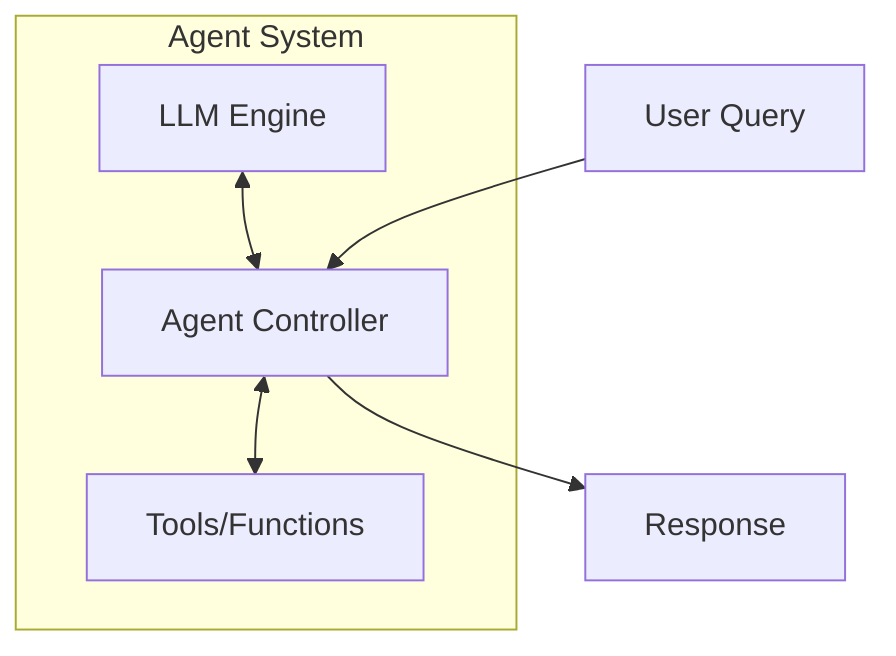

Sources: [notebooks/en/agents.ipynb:7-19]()

## Agent Architecture

At its core, an agent system consists of three main components: a language model, a set of tools, and an orchestration layer that manages the communication between them.

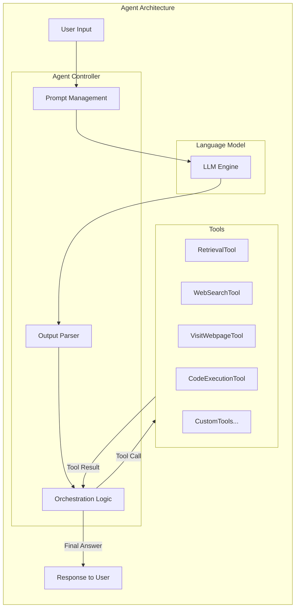

Sources: [notebooks/en/agents.ipynb:20-30](), [notebooks/en/multiagent_web_assistant.ipynb:7-36]()

## Types of Agents

The Hugging Face Cookbook implements several types of agents, each specializing in different tasks:

### Tool-Calling Agents

Tool-calling agents (`ToolCallingAgent`) focus on using external tools based on user queries. They can perform operations like web searches, visiting webpages, or generating images.

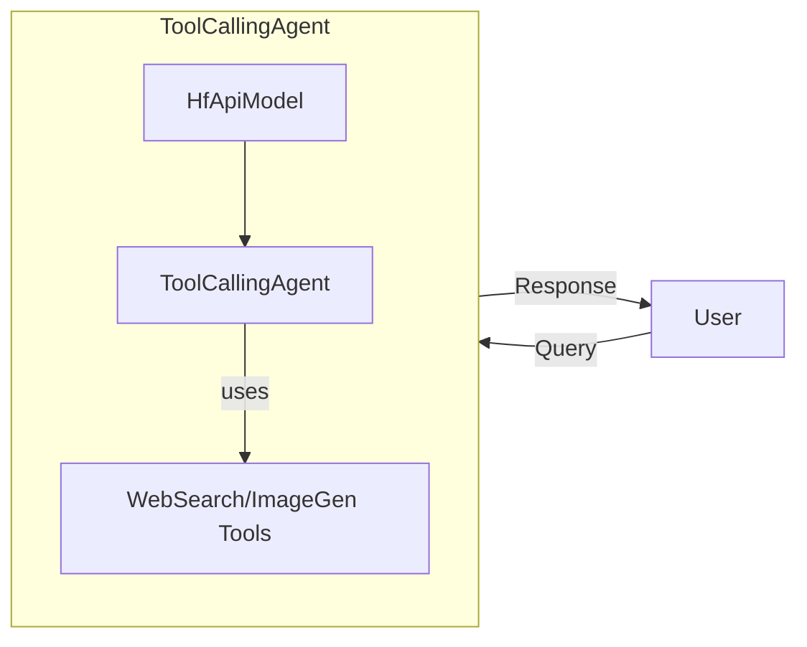

Sources: [notebooks/en/agents.ipynb:49-62]()

### Code Agents

Code agents (`CodeAgent`) can execute Python code to perform data analysis, calculations, or other programmatic tasks. They have access to specific libraries and run in a secure execution environment.

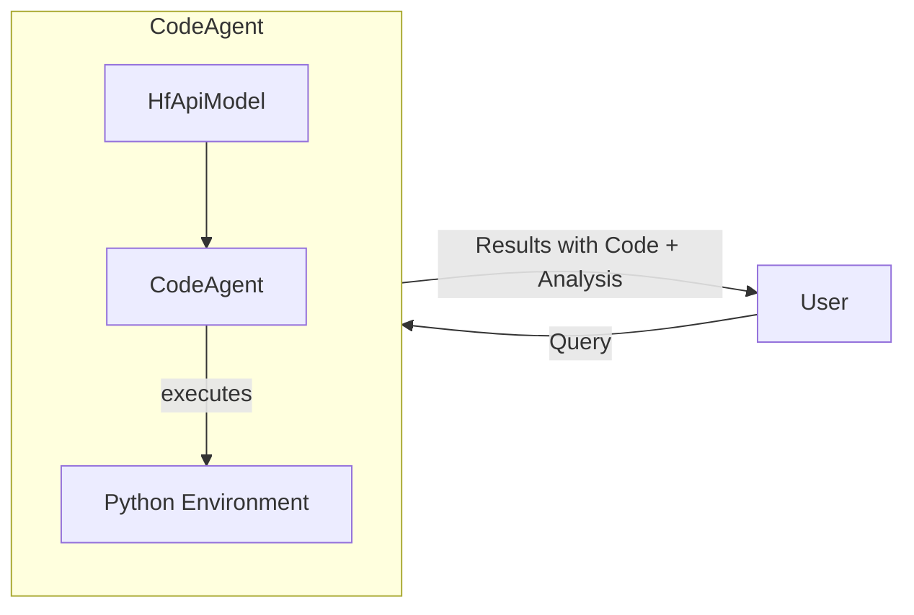

Sources: [notebooks/en/agent_data_analyst.ipynb:40-62]()

### Multi-Agent Systems

Multi-agent systems combine multiple agents in a hierarchical structure, where one agent (the manager) coordinates the activities of other agents (the managed agents).

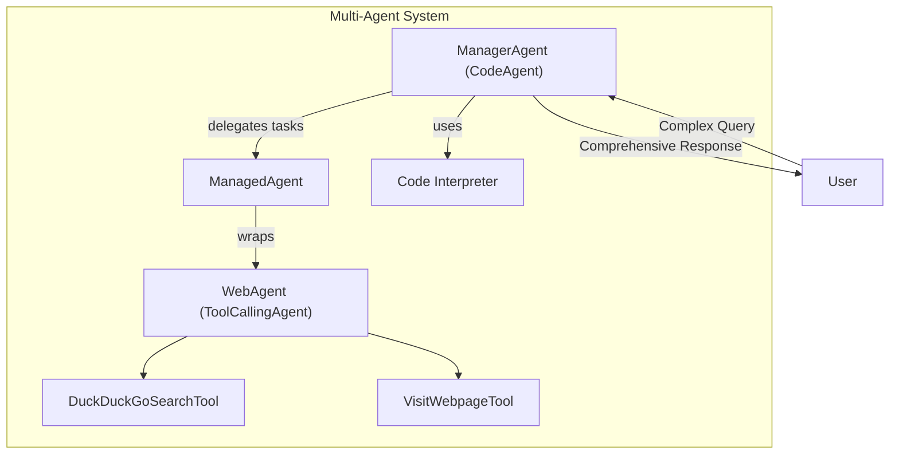

Sources: [notebooks/en/multiagent_web_assistant.ipynb:183-246]()

### RAG Agents

RAG Agents combine retrieval-augmented generation with the reasoning capabilities of agents. They can dynamically formulate retrieval queries, evaluate retrieved information, and decide when to retrieve more context.

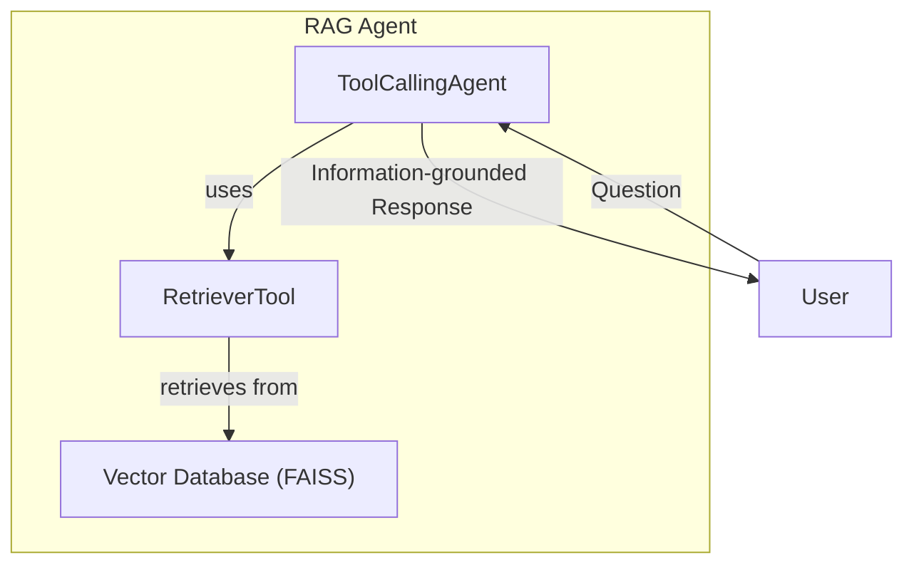

Sources: [notebooks/zh-CN/agent_rag.ipynb:165-198](), [notebooks/zh-CN/agent_rag.ipynb:222-231]()

## Agent Execution Flow

The typical execution flow of an agent involves the following steps:

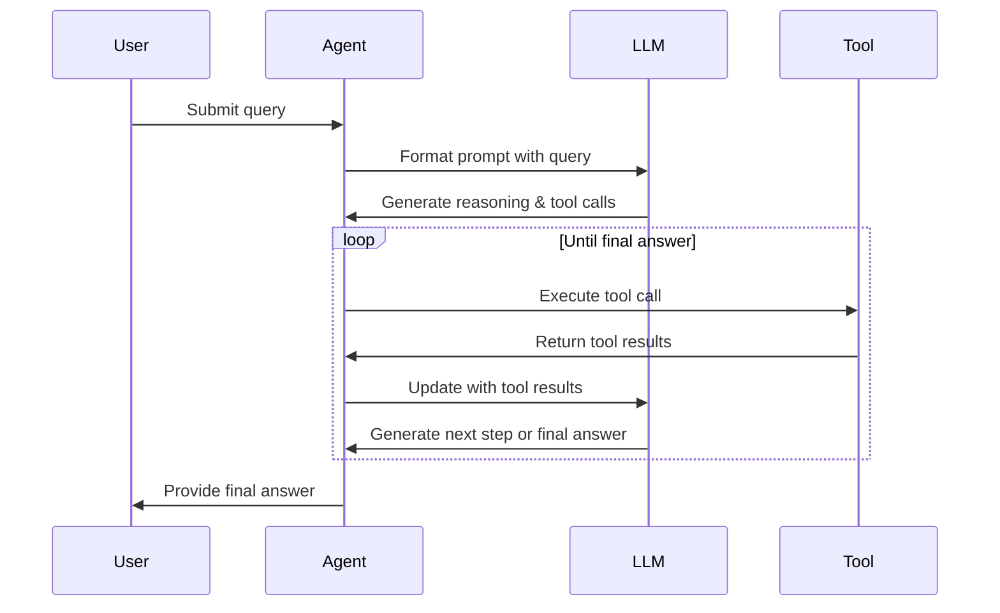

Sources: [notebooks/en/agents.ipynb:90-146]()

## Building Blocks

### Tools

Tools are the core components that agents use to interact with external systems or perform specific functions. Each tool is defined with a name, description, inputs, and output type.

#### Example Tool Definition

```mermaid
classDiagram
    class Tool {
        +String name
        +String description
        +Dict inputs
        +String output_type
        +forward(args) output
    }
    
    class TextToImageTool {
        +name = "image_generator"
        +description = "Creates an image according to prompt"
        +inputs = {"prompt": {...}}
        +output_type = "image"
        +forward(prompt) image
    }
    
    class RetrieverTool {
        +name = "retriever"
        +description = "Retrieves documents from knowledge base"
        +inputs = {"query": {...}}
        +output_type = "text"
        +forward(query) documents
    }
    
    class VisitWebpageTool {
        +name = "visit_webpage"
        +description = "Visits webpage and returns content"
        +inputs = {"url": {...}}
        +output_type = "text"
        +forward(url) content
    }
    
    Tool <|-- TextToImageTool
    Tool <|-- RetrieverTool
    Tool <|-- VisitWebpageTool
```

Sources: [notebooks/en/agents.ipynb:65-88](), [notebooks/en/multiagent_web_assistant.ipynb:102-137](), [notebooks/zh-CN/agent_rag.ipynb:165-198]()

### Models

Agents are powered by language models, which can be accessed through the `HfApiModel` class for using Hugging Face's Inference API or other custom model interfaces.

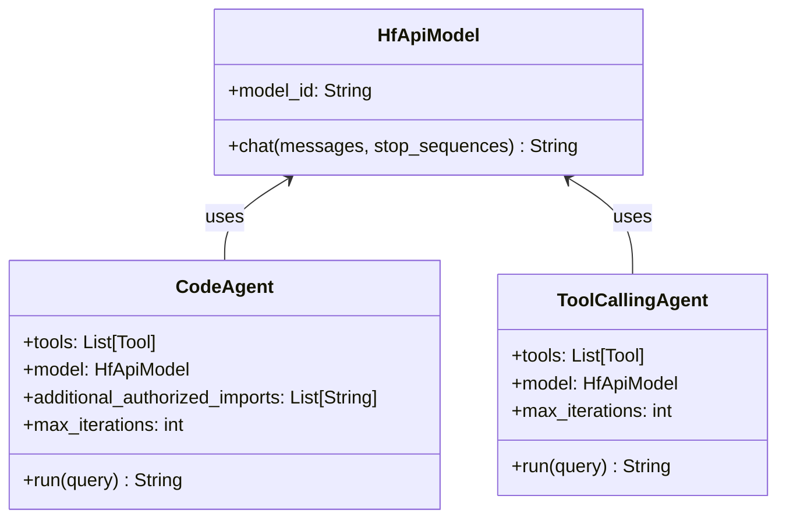

Sources: [notebooks/en/agent_data_analyst.ipynb:49-62](), [notebooks/en/multiagent_web_assistant.ipynb:207-214]()

## Agent Applications

### Web Browsing Assistant

A web browsing assistant allows users to search for information on the web and obtain relevant results. It combines search capabilities with the ability to visit and extract content from webpages.

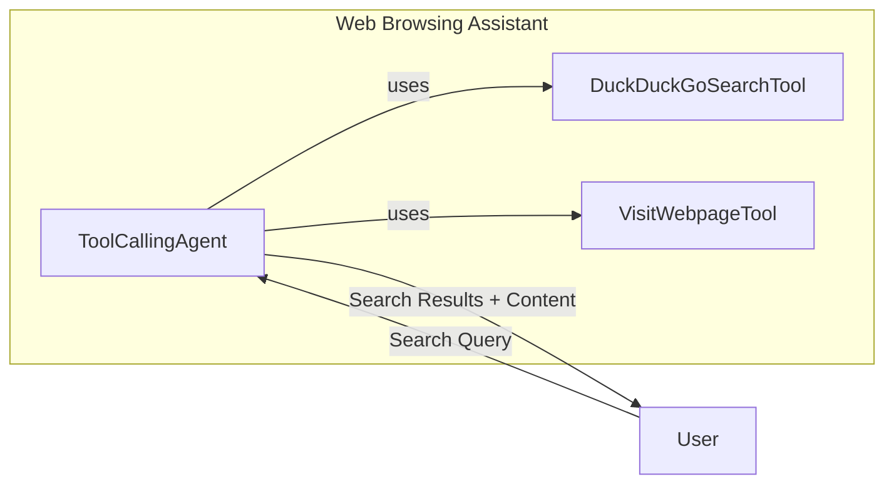

Sources: [notebooks/en/multiagent_web_assistant.ipynb:86-95](), [notebooks/en/multiagent_web_assistant.ipynb:199-214]()

### Data Analysis Agent

A data analysis agent can load datasets, perform statistical analysis, generate visualizations, and interpret patterns in the data.

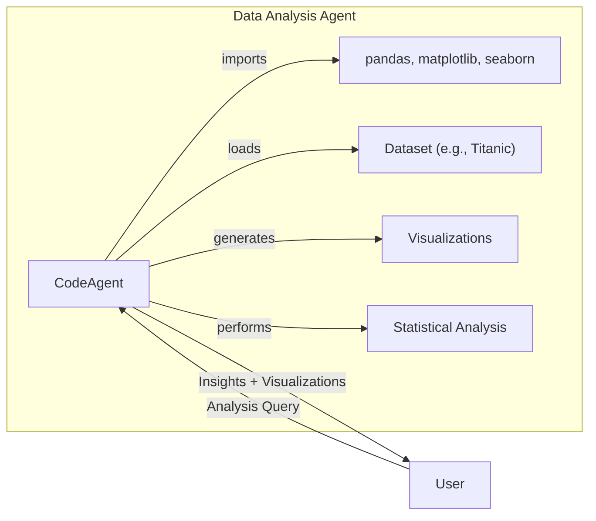

Sources: [notebooks/en/agent_data_analyst.ipynb:7-18](), [notebooks/en/agent_data_analyst.ipynb:33-62]()

### Multi-Agent Web Assistant

A multi-agent web assistant uses a hierarchical structure where a manager agent coordinates with a web search agent to solve complex tasks.

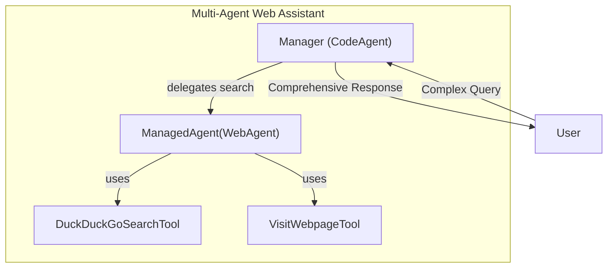

Sources: [notebooks/en/multiagent_web_assistant.ipynb:7-32](), [notebooks/en/multiagent_web_assistant.ipynb:227-246]()

### Agent-Enhanced RAG

Agent-enhanced RAG systems improve upon traditional RAG by allowing dynamic query reformulation and multiple retrieval steps.

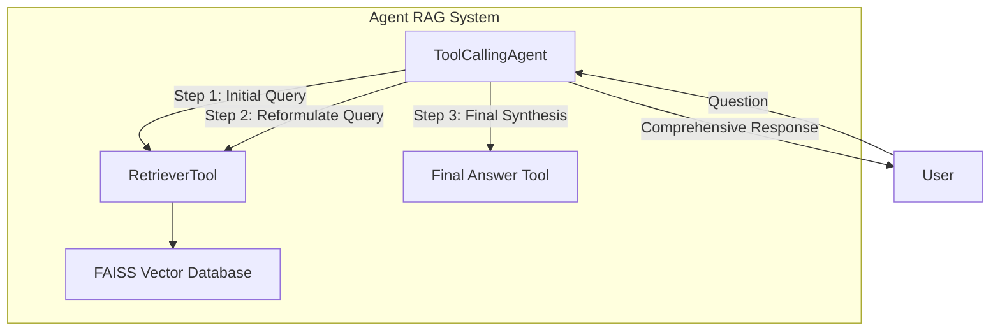

Sources: [notebooks/zh-CN/agent_rag.ipynb:7-31](), [notebooks/zh-CN/agent_rag.ipynb:223-243]()

## Usage Patterns

### Creating an Agent

Agents are typically created by specifying a model, tools, and other configuration parameters.

```python
# Example of creating a tool-calling agent
from smolagents import HfApiModel, ToolCallingAgent
from smolagents import DuckDuckGoSearchTool

model = HfApiModel("CohereForAI/c4ai-command-r-plus")
web_agent = ToolCallingAgent(
    tools=[DuckDuckGoSearchTool(), visit_webpage],
    model=model,
    max_iterations=10,
)
```

Sources: [notebooks/en/multiagent_web_assistant.ipynb:198-214]()

### Running an Agent

Agents are executed by calling their `run` method with a user query.

```python
# Example of running an agent
response = agent.run("How can I push a model to the Hub?")
print(response)
```

Sources: [notebooks/zh-CN/agent_rag.ipynb:539-542]()

### Creating Multi-Agent Systems

Multi-agent systems involve creating managed agents and a manager agent that coordinates them.

```python
# Example of creating a multi-agent system
managed_web_agent = ManagedAgent(
    agent=web_agent,
    name="search_agent",
    description="Runs web searches for you. Give it your query as an argument.",
)

manager_agent = CodeAgent(
    tools=[],
    model=model,
    managed_agents=[managed_web_agent],
    additional_authorized_imports=["time", "datetime"],
)
```

Sources: [notebooks/en/multiagent_web_assistant.ipynb:229-258]()

## Summary

Agent systems in the Hugging Face Cookbook provide a powerful framework for building AI applications that can use external tools, execute code, and reason about complex tasks. The modular architecture allows for creating specialized agents for specific use cases, from web browsing and data analysis to enhanced RAG systems. By understanding the components and patterns described in this document, you can create sophisticated agent-based applications that leverage the capabilities of large language models.

---

