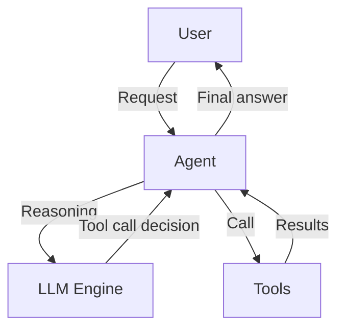
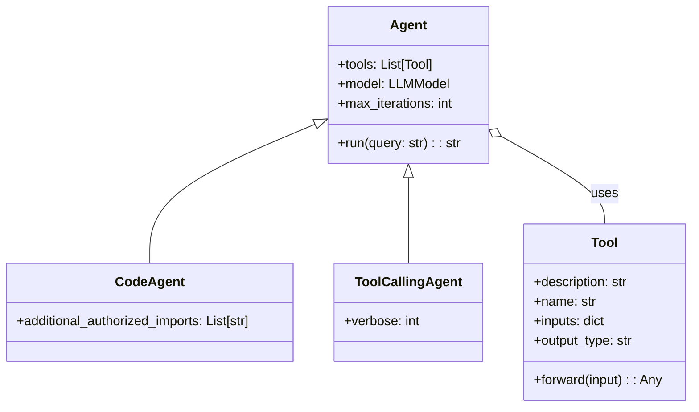
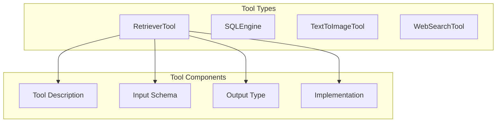
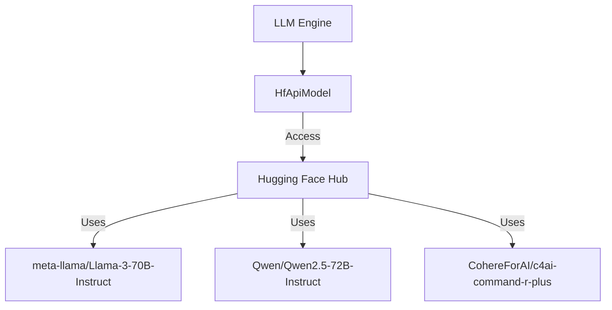
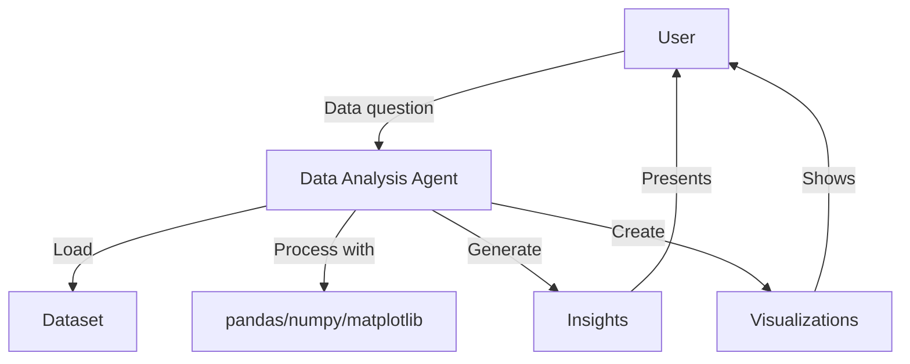
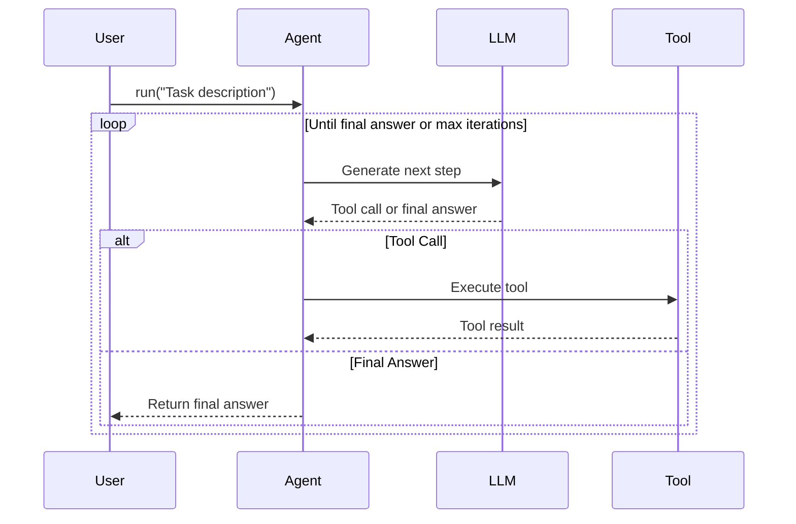

<!-- source: DeepWiki mcp.deepwiki.com · repo huggingface/cookbook · page 3.1 Tool-Based Agents · fetched 2026-10-26 -->

# Tool-Based Agents

<details>
<summary>Relevant source files</summary>

The following files were used as context for generating this wiki page:

- [notebooks/en/agent_data_analyst.ipynb](notebooks/en/agent_data_analyst.ipynb)
- [notebooks/en/agent_text_to_sql.ipynb](notebooks/en/agent_text_to_sql.ipynb)
- [notebooks/en/agents.ipynb](notebooks/en/agents.ipynb)
- [notebooks/zh-CN/agent_rag.ipynb](notebooks/zh-CN/agent_rag.ipynb)
- [notebooks/zh-CN/agents.ipynb](notebooks/zh-CN/agents.ipynb)

</details>


Tool-Based Agents are systems that extend the capabilities of Large Language Models (LLMs) by enabling them to use specialized external tools to solve tasks. This page describes the implementation of tool-based agents in the cookbook, their architecture, and common use cases.

For information about multi-agent systems with multiple collaborating agents, see [Multi-Agent Architectures](#3.2). For information about specific applications of agents, see [Agent Applications](#3.3). For details on how agents can enhance RAG systems, see [RAG with Agents](#3.4).

## Core Concepts

Tool-based agents combine LLMs with specialized tools to perform tasks that would be difficult or impossible for the LLM alone. The system works by having the LLM decide which tools to call, with what parameters, and how to interpret their results to solve a given task.


**Diagram: Tool-Based Agent Workflow**

Sources:
- [notebooks/en/agents.ipynb:7-20]()
- [notebooks/en/agent_data_analyst.ipynb:7-14]()

## Agent Architecture

The cookbook implements two main types of agents: `CodeAgent` and `ToolCallingAgent`. Both are built on the `smolagents` library.


**Diagram: Agent Class Hierarchy**

Sources:
- [notebooks/en/agent_data_analyst.ipynb:35-41]()
- [notebooks/zh-CN/agent_rag.ipynb:223-230]()
- [notebooks/en/agent_text_to_sql.ipynb:163-177]()

### CodeAgent

`CodeAgent` generates and executes Python code to accomplish tasks. It's particularly well-suited for data analysis, where the agent can write code to process data, generate visualizations, and extract insights.

Key features:
- Executes Python code safely within a controlled environment
- Can be given access to specific external libraries
- Can iterate on its solutions based on execution results

Example initialization:
```python
agent = CodeAgent(
    tools=[sql_engine],
    model=HfApiModel("meta-llama/Meta-Llama-3-8B-Instruct"),
    additional_authorized_imports=["numpy", "pandas", "matplotlib.pyplot"],
    max_iterations=10
)
```

Sources:
- [notebooks/en/agent_data_analyst.ipynb:49-62]()
- [notebooks/en/agent_text_to_sql.ipynb:174-177]()

### ToolCallingAgent

`ToolCallingAgent` generates JSON-formatted tool calls and manages the conversation flow. It's designed for scenarios where structured tool calling is needed.

Key features:
- Generates tool calls in JSON format
- Parses tool results and feeds them back into the conversation
- Decides when to make a final answer instead of more tool calls

Example initialization:
```python
agent = ToolCallingAgent(
    tools=[retriever_tool], 
    model=model, 
    max_iterations=4, 
    verbose=2
)
```

Sources:
- [notebooks/zh-CN/agent_rag.ipynb:223-230]()
- [notebooks/zh-CN/agent_rag.ipynb:237-240]()

## Tools System

Tools are the functions that extend an LLM's capabilities. Each tool has a specific purpose, input parameters, and output format.


**Diagram: Tool Components and Types**

Sources:
- [notebooks/en/agents.ipynb:63-88]()
- [notebooks/zh-CN/agent_rag.ipynb:166-198]()
- [notebooks/en/agent_text_to_sql.ipynb:130-152]()

### Creating Tools

Tools can be created in two ways:

1. **Class-based approach** - Creating a subclass of `Tool`:

```python
class RetrieverTool(Tool):
    name = "retriever"
    description = "Using semantic similarity, retrieves documents from the knowledge base"
    inputs = {
        "query": {
            "type": "text",
            "description": "The query to perform."
        }
    }
    output_type = "text"

    def forward(self, query: str) -> str:
        # Implementation here
        return results
```

2. **Decorator-based approach** - Using the `@tool` decorator:

```python
@tool
def sql_engine(query: str) -> str:
    """
    Allows you to perform SQL queries on the table.
    
    Args:
        query: The query to perform. This should be correct SQL.
    """
    # Implementation here
    return output
```

Sources:
- [notebooks/zh-CN/agent_rag.ipynb:166-198]()
- [notebooks/en/agent_text_to_sql.ipynb:130-152]()

## LLM Engine

The LLM engine is the language model that powers the agent's reasoning. The cookbook uses the `HfApiModel` class to connect to models on the Hugging Face Hub via the Inference API.


**Diagram: LLM Engine Architecture**

Example initialization:
```python
from smolagents import HfApiModel
model = HfApiModel("meta-llama/Llama-3-70B-Instruct")
```

Sources:
- [notebooks/en/agent_data_analyst.ipynb:49-55]()
- [notebooks/zh-CN/agent_rag.ipynb:225]()
- [notebooks/en/agent_text_to_sql.ipynb:174-176]()

## Use Cases

### Data Analysis Agent

The Data Analysis Agent uses `CodeAgent` with data science libraries to analyze datasets, extract insights, and create visualizations.


**Diagram: Data Analysis Agent Workflow**

Example task:
```
"Analyze the Titanic dataset and identify three key factors correlated with survival rate."
```

Sources:
- [notebooks/en/agent_data_analyst.ipynb:7-14]()
- [notebooks/en/agent_data_analyst.ipynb:87-116]()

### Retrieval-Augmented Generation Agent

The RAG Agent enhances standard RAG by giving the agent control over query formulation and multiple retrievals.

```mermaid
graph TD
    User["User"] --> |"Question"| RAGAgent["RAG Agent"]
    RAGAgent --> |"Formulates query"| RetrieverTool["RetrieverTool"]
    RetrieverTool --> |"Searches"| VectorDB["Vector Database"]
    VectorDB --> |"Returns"| Documents["Relevant Documents"]
    Documents --> RAGAgent
    RAGAgent --> |"Decides to"| Decision{"Need more info?"}
    Decision -- "Yes" --> |"Reformulates query"| RetrieverTool
    Decision -- "No" --> |"Synthesizes"| Answer["Final Answer"]
    Answer --> User
```
**Diagram: RAG Agent Workflow**

Advantages over standard RAG:
- Can reformulate queries for better retrieval
- Makes multiple retrieval attempts with different queries
- Intelligently synthesizes information from multiple sources

Sources:
- [notebooks/zh-CN/agent_rag.ipynb:11-27]()
- [notebooks/zh-CN/agent_rag.ipynb:157-158]()

### Text-to-SQL Agent

The Text-to-SQL Agent converts natural language questions into SQL queries and validates the results.

```mermaid
graph TD
    User["User"] --> |"Natural language question"| SQLAgent["Text-to-SQL Agent"]
    SQLAgent --> |"Generates"| SQLQuery["SQL Query"]
    SQLQuery --> SQLEngine["SQL Engine Tool"]
    SQLEngine --> |"Executes on"| Database["Database"]
    Database --> |"Returns"| Results["Query Results"]
    Results --> SQLAgent
    SQLAgent --> |"Evaluates"| Evaluation{"Valid results?"}
    Evaluation -- "No" --> |"Corrects"| SQLQuery
    Evaluation -- "Yes" --> |"Formats"| Answer["Final Answer"]
    Answer --> User
```
**Diagram: Text-to-SQL Agent Workflow**

Example:
```
"Which waiter got more total money from tips?"
```

Sources:
- [notebooks/en/agent_text_to_sql.ipynb:7-18]()
- [notebooks/en/agent_text_to_sql.ipynb:393-534]()

## Implementation Example

Let's see a complete example of implementing a tool-based agent:

1. Create a tool:
```python
@tool
def sql_engine(query: str) -> str:
    """
    Allows you to perform SQL queries on the database.
    The 'receipts' table contains: receipt_id, customer_name, price, tip
    
    Args:
        query: The query to perform. This should be correct SQL.
    """
    # Implementation
    return output
```

2. Initialize the agent:
```python
agent = CodeAgent(
    tools=[sql_engine],
    model=HfApiModel("meta-llama/Meta-Llama-3-8B-Instruct"),
    max_iterations=3
)
```

3. Run the agent:
```python
result = agent.run("Can you give me the name of the client who got the most expensive receipt?")
```

Sources:
- [notebooks/en/agent_text_to_sql.ipynb:130-152]()
- [notebooks/en/agent_text_to_sql.ipynb:174-177]()
- [notebooks/en/agent_text_to_sql.ipynb:288-289]()

## Execution Flow


**Diagram: Agent Execution Flow**

The execution of a tool-based agent follows these steps:

1. User submits a task to the agent
2. Agent sends the task to the LLM
3. LLM decides whether to call a tool or provide a final answer
4. If calling a tool, the agent executes it and feeds the result back to the LLM
5. Steps 3-4 repeat until the LLM provides a final answer or reaches max iterations
6. Agent returns the final answer to the user

Sources:
- [notebooks/en/agents.ipynb:29-47]()
- [notebooks/zh-CN/agent_rag.ipynb:237-240]()

## Common Tools

Here's a reference for common tools used in the cookbook:

| Tool Name | Description | Input Parameters | Output Type |
|-----------|-------------|------------------|-------------|
| RetrieverTool | Retrieves documents from a vector database | `query`: Text query | Text (Documents) |
| TextToImageTool | Generates images from text descriptions | `prompt`: Text description | Image |
| SQLEngineTool | Executes SQL queries on a database | `query`: SQL query | Text (Results) |
| WebSearchTool | Searches the web for information | `query`: Search query | Text (Search results) |

Sources:
- [notebooks/en/agents.ipynb:63-88]()
- [notebooks/zh-CN/agent_rag.ipynb:166-198]()
- [notebooks/en/agent_text_to_sql.ipynb:130-152]()

## Best Practices

When working with tool-based agents, consider these best practices:

1. **Clear tool descriptions**: Provide detailed descriptions of what each tool does and what inputs it expects
2. **Appropriate iteration limits**: Set `max_iterations` to prevent infinite loops while allowing complex tasks to complete
3. **Tool error handling**: Ensure tools handle errors gracefully and return informative error messages
4. **LLM selection**: Choose an LLM with strong reasoning capabilities for better tool usage
5. **Task specificity**: Frame your task clearly and specifically to guide the agent

Sources:
- [notebooks/en/agent_data_analyst.ipynb:57-62]()
- [notebooks/zh-CN/agent_rag.ipynb:228-230]()
- [notebooks/en/agent_text_to_sql.ipynb:174-177]()

## Advanced Features

### Customizing Agent Behavior

You can customize agent behavior by:
- Setting the `max_iterations` parameter to control how many steps the agent can take
- Using `verbose` parameter (for `ToolCallingAgent`) to control logging detail
- Specifying `additional_authorized_imports` (for `CodeAgent`) to control which libraries can be used

### Tool Design Patterns

Effective tool design patterns include:
- Single-responsibility tools that do one thing well
- Detailed documentation in tool descriptions
- Clear input parameter specifications with types and descriptions
- Appropriate error handling and informative error messages

Sources:
- [notebooks/en/agent_data_analyst.ipynb:57-62]()
- [notebooks/zh-CN/agent_rag.ipynb:173-177]()

## Conclusion

Tool-Based Agents provide a powerful pattern for extending LLMs with specialized capabilities. By combining LLM reasoning with purpose-built tools, these agents can solve complex, multi-step tasks that require external information or specialized processing.

The cookbook demonstrates various applications including data analysis, retrieval-augmented generation, and text-to-SQL conversion, showcasing the flexibility and effectiveness of this approach.

---

