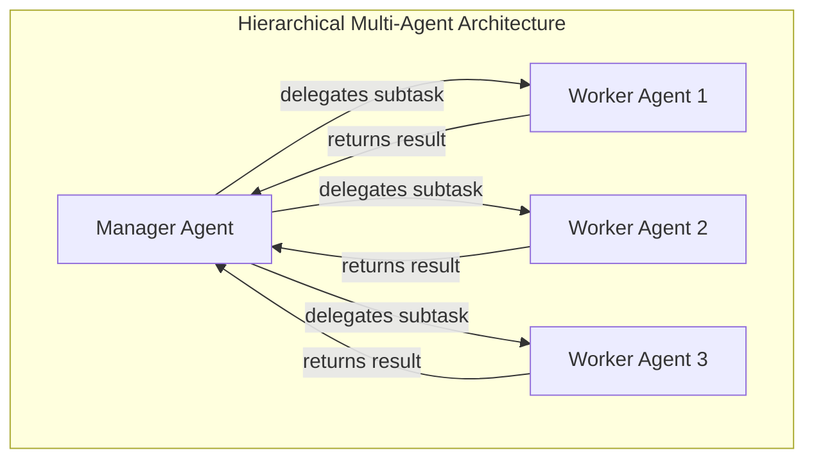
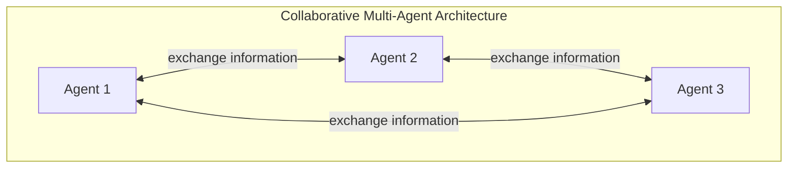
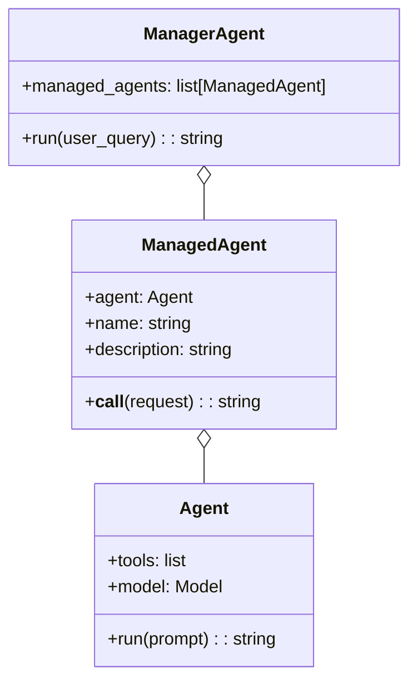
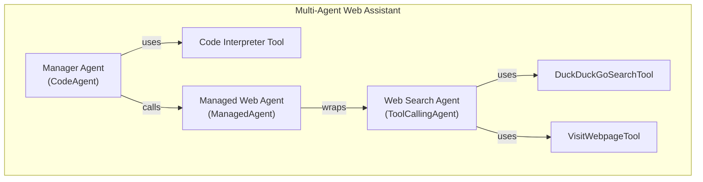
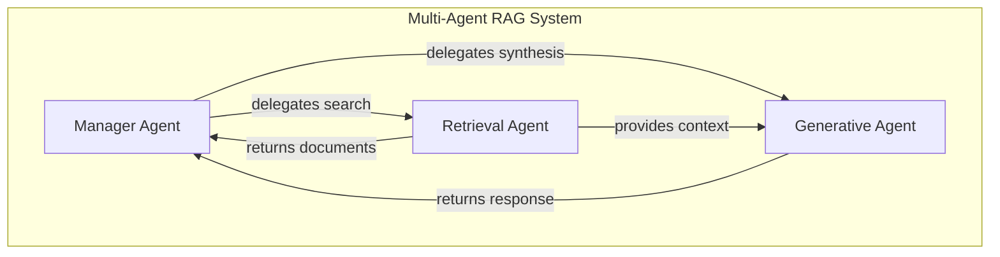

<!-- source: DeepWiki mcp.deepwiki.com · repo huggingface/cookbook · page 3.2 Multi-Agent Architectures · fetched 2026-10-26 -->

# Multi-Agent Architectures

Relevant source files

The following files were used as context for generating this wiki page:

- [notebooks/en/fine_tuning_smol_vlm_sft_trl.ipynb](notebooks/en/fine_tuning_smol_vlm_sft_trl.ipynb)
- [notebooks/en/fine_tuning_vlm_dpo_smolvlm_instruct.ipynb](notebooks/en/fine_tuning_vlm_dpo_smolvlm_instruct.ipynb)
- [notebooks/en/multiagent_rag_system.ipynb](notebooks/en/multiagent_rag_system.ipynb)
- [notebooks/en/multiagent_web_assistant.ipynb](notebooks/en/multiagent_web_assistant.ipynb)

This page provides an overview of multi-agent architectures implemented in the Hugging Face Cookbook. Multi-agent architectures involve multiple AI agents working together to solve complex tasks by leveraging their specialized capabilities. This document covers the design patterns, components, and implementation details for building systems where multiple agents collaborate effectively.

For information about individual agents and their capabilities, see [Agent Systems](#3).

## Introduction to Multi-Agent Architectures

Multi-agent architectures enable complex problem-solving by orchestrating multiple specialized agents to collaborate toward a common goal. These architectures distribute tasks among different agents based on their specialized capabilities, allowing the system to handle more complex workflows than single agents can manage.

The key benefits of multi-agent architectures include:

1. **Task decomposition** - Breaking down complex tasks into subtasks that specialized agents can handle
2. **Specialization** - Using agents optimized for specific subtasks
3. **Scalability** - Adding more agents to handle additional tasks or domains
4. **Resilience** - System can continue functioning even if some agents fail
5. **Emergent behavior** - The collective capabilities of the system can exceed the sum of individual agents

Sources:
- [notebooks/en/multiagent_rag_system.ipynb:21-27]()
- [notebooks/en/multiagent_web_assistant.ipynb:6-35]()

## Types of Multi-Agent Architectures

The most common multi-agent architectures are hierarchical and collaborative systems.

### Hierarchical (Manager-Worker) Architecture

The hierarchical architecture, also known as the manager-worker pattern, involves a manager agent that coordinates one or more worker agents. The manager is responsible for planning, task decomposition, and delegating subtasks to appropriate worker agents.

In this architecture:

1. The manager agent receives the user query
2. The manager decomposes the task into subtasks
3. The manager delegates subtasks to appropriate worker agents
4. Worker agents execute their specialized tasks and return results
5. The manager synthesizes the results into a coherent response

Sources:
- [notebooks/en/multiagent_web_assistant.ipynb:6-35]()
- [notebooks/en/multiagent_web_assistant.ipynb:243-246]()

### Collaborative (Peer-to-Peer) Architecture

In a collaborative architecture, agents operate as peers without a central coordinator. Each agent has specialized capabilities and can communicate directly with other agents to solve complex problems collectively.

Collaborative architectures are particularly useful for complex tasks where the optimal sequence of operations is not known in advance, allowing agents to dynamically coordinate their actions.

Sources:
- [notebooks/en/multiagent_rag_system.ipynb:17-27]()

## Components of Multi-Agent Systems

### Agents

Agents are the fundamental building blocks of multi-agent systems. Each agent is designed to perform specific tasks using its reasoning capabilities and assigned tools.

The main types of agents commonly used in multi-agent systems include:

| Agent Type | Description | Common Use Cases |
|------------|-------------|------------------|
| `CodeAgent` | Uses code execution for complex reasoning and data manipulation | Manager agents, data analysis |
| `ToolCallingAgent` | Uses JSON-mode tool calling for sequential tasks | Specialized workers like web search |
| `ReactCodeAgent` | Combines ReAct prompting with code execution | Complex reasoning tasks |
| `ManagedAgent` | Wrapper that makes agents callable by other agents | Worker agents in hierarchical systems |

Sources:
- [notebooks/en/multiagent_web_assistant.ipynb:199-205]()
- [notebooks/en/multiagent_web_assistant.ipynb:229-233]()

### Tools

Tools provide agents with specific capabilities to interact with external systems or perform specialized functions. Commonly used tools in multi-agent systems include:

| Tool | Description |
|------|-------------|
| `DuckDuckGoSearchTool` | Searches the web using DuckDuckGo |
| `VisitWebpageTool` | Fetches and converts webpage content to markdown |
| Code interpreter | Executes Python code for data analysis and manipulation |

Sources:
- [notebooks/en/multiagent_web_assistant.ipynb:89-136]()
- [notebooks/en/multiagent_web_assistant.ipynb:199-205]()

### Communication Mechanisms

In multi-agent systems, agents need mechanisms to communicate with each other. The main communication patterns are:

1. **Direct function calls** - In hierarchical systems, the manager directly calls worker agents
2. **Message passing** - Agents exchange structured messages containing information and requests
3. **Shared memory** - Agents write to and read from a common data store

Sources:
- [notebooks/en/multiagent_web_assistant.ipynb:229-233]()
- [notebooks/en/multiagent_web_assistant.ipynb:249-258]()

## Implementing Multi-Agent Systems

### Using ManagedAgent for Hierarchical Systems

The `ManagedAgent` class is a key component for implementing hierarchical multi-agent systems. It wraps a worker agent and makes it callable by the manager agent.

To create a hierarchical multi-agent system:

1. Initialize specialized worker agents with appropriate tools
2. Wrap worker agents with `ManagedAgent`
3. Create a manager agent and provide the managed agents during initialization
4. The manager can then delegate tasks to the managed agents through function calls

Sources:
- [notebooks/en/multiagent_web_assistant.ipynb:226-233]()
- [notebooks/en/multiagent_web_assistant.ipynb:249-258]()

### Multi-Agent Web Assistant Example

The multi-agent web assistant is a hierarchical system that combines a manager agent with a specialized web search agent:

Implementation steps:

1. Initialize tools for web searching and webpage visiting
2. Create a web search agent with these tools
3. Wrap the web search agent with `ManagedAgent`
4. Create a manager agent with code execution capabilities and provide the managed web agent
5. The manager can now delegate web search tasks to the specialized agent while focusing on higher-level planning

Sources:
- [notebooks/en/multiagent_web_assistant.ipynb:16-31]()
- [notebooks/en/multiagent_web_assistant.ipynb:207-214]()
- [notebooks/en/multiagent_web_assistant.ipynb:226-233]()
- [notebooks/en/multiagent_web_assistant.ipynb:249-258]()

### Multi-Agent RAG System Example

The multi-agent RAG (Retrieval-Augmented Generation) system is designed to enhance information retrieval and synthesis:

In this system:

1. The manager agent evaluates the user query and determines the appropriate agent to handle it
2. The retrieval agent searches for relevant documents when information lookup is needed
3. The generative agent synthesizes information into coherent responses
4. The manager coordinates between the agents to produce the final response

Sources:
- [notebooks/en/multiagent_rag_system.ipynb:17-27]()
- [notebooks/en/multiagent_rag_system.ipynb:21-27]()

## Best Practices for Multi-Agent Architectures

When designing and implementing multi-agent systems, consider the following best practices:

1. **Clear agent specialization** - Each agent should have well-defined responsibilities and capabilities
2. **Appropriate task decomposition** - Break down complex tasks into subtasks that align with agent specializations
3. **Efficient communication** - Minimize the amount of information exchanged between agents
4. **Error handling** - Implement mechanisms to handle agent failures and unexpected outputs
5. **Model selection** - Choose appropriate models for different agents based on their specific requirements

Sources:
- [notebooks/en/multiagent_web_assistant.ipynb:186-191]()
- [notebooks/en/multiagent_web_assistant.ipynb:243-246]()

## Conclusion

Multi-agent architectures provide a powerful framework for building complex AI systems that can leverage specialized capabilities of different agents. By carefully designing the system architecture, selecting appropriate agents and tools, and implementing effective communication mechanisms, developers can create multi-agent systems that can handle a wide range of complex tasks.

The examples covered in this document demonstrate different approaches to multi-agent architecture, from hierarchical systems with manager-worker relationships to collaborative systems with peer-to-peer interactions. These patterns can be adapted and extended to suit specific application requirements.

---

