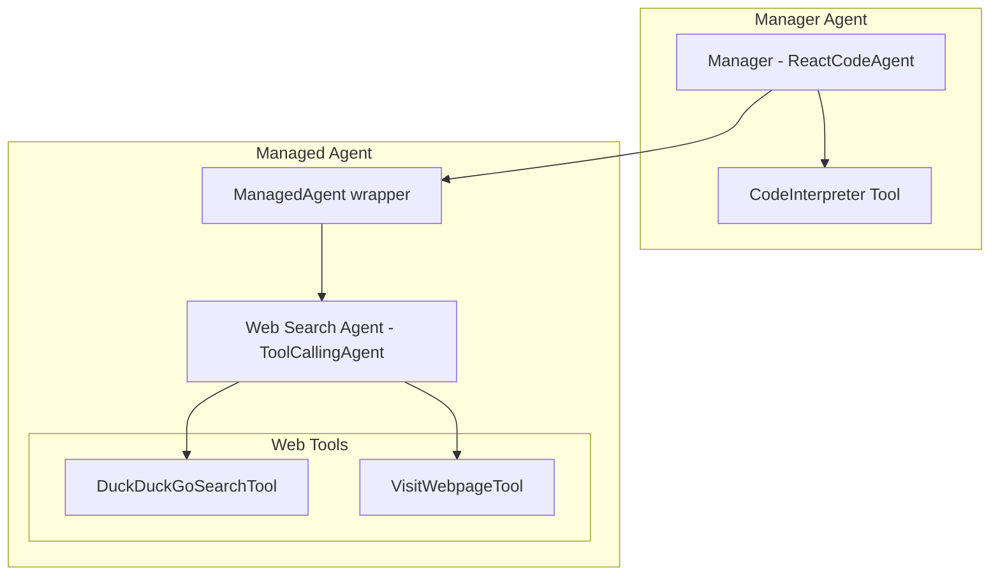
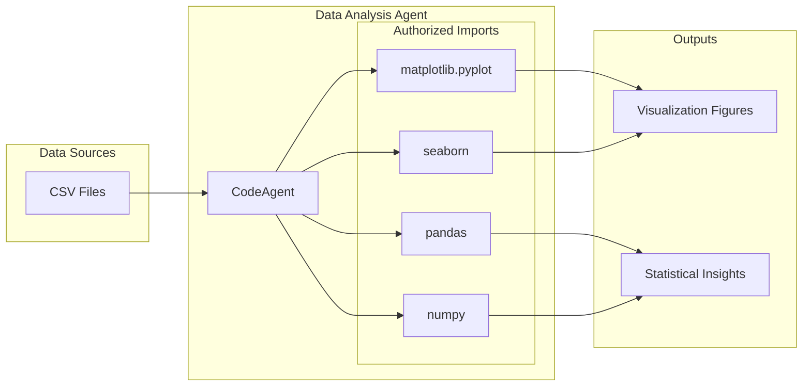
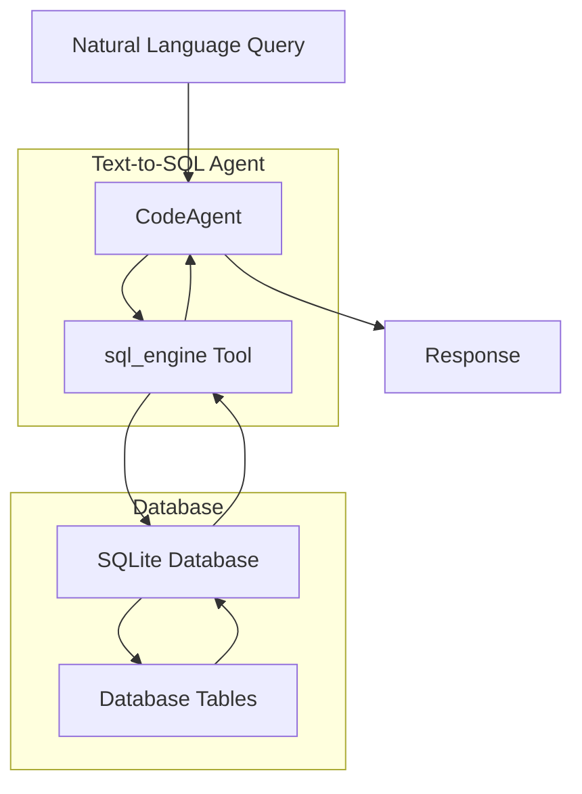
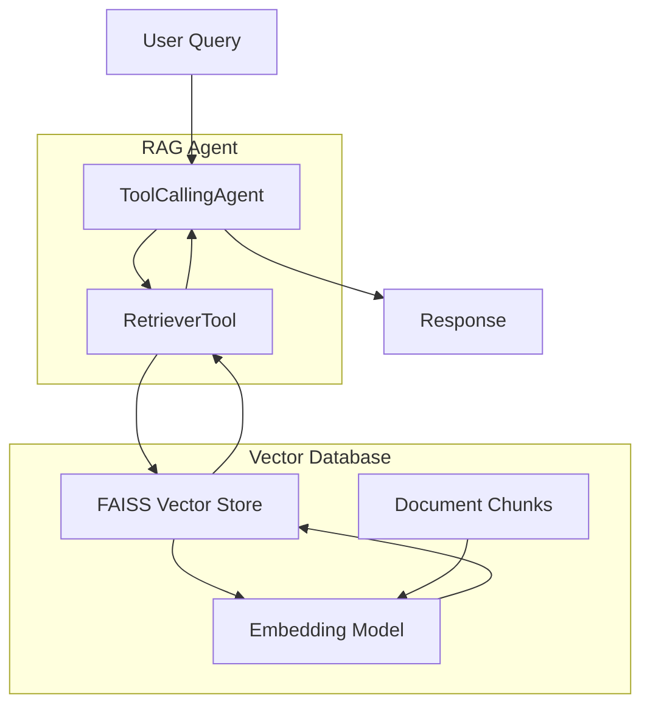

<!-- source: DeepWiki mcp.deepwiki.com · repo huggingface/cookbook · page 3.3 Agent Applications · fetched 2026-10-26 -->

# Agent Applications

<details>
<summary>Relevant source files</summary>

The following files were used as context for generating this wiki page:

- [notebooks/en/agent_data_analyst.ipynb](notebooks/en/agent_data_analyst.ipynb)
- [notebooks/en/agent_text_to_sql.ipynb](notebooks/en/agent_text_to_sql.ipynb)
- [notebooks/en/multiagent_web_assistant.ipynb](notebooks/en/multiagent_web_assistant.ipynb)
- [notebooks/zh-CN/agent_rag.ipynb](notebooks/zh-CN/agent_rag.ipynb)
- [notebooks/zh-CN/agents.ipynb](notebooks/zh-CN/agents.ipynb)

</details>


This document provides an overview of specialized agent implementations designed for specific use cases in the Hugging Face cookbook. These applications demonstrate how intelligent agents can be configured and deployed to solve particular classes of problems, showcasing the versatility of agent-based approaches. For general information about agent architectures, see [Tool-Based Agents](#3.1) and [Multi-Agent Architectures](#3.2).

## Introduction to Agent Applications

Agent applications are specialized implementations of the general agent framework, tailored to solve specific categories of problems. The applications covered in this document include:

1. **Web Browsing Agents**: Autonomous systems for navigating and extracting information from the web
2. **Data Analysis Agents**: Specialized agents for data exploration, visualization, and insight extraction
3. **Text-to-SQL Agents**: Agents that translate natural language questions into SQL queries with error correction capabilities
4. **RAG-Enhanced Agents**: Retrieval-augmented generation systems with agent capabilities for query refinement

These applications build on the common agent architecture while adding domain-specific tools, prompting strategies, and error handling mechanisms.

Sources: [notebooks/en/multiagent_web_assistant.ipynb:1-37](), [notebooks/en/agent_data_analyst.ipynb:1-19](), [notebooks/en/agent_text_to_sql.ipynb:1-19](), [notebooks/zh-CN/agent_rag.ipynb:1-32]()

## Web Browsing Agents

Web browsing agents leverage internet search capabilities and web page content extraction to find information and answer questions. They can navigate search results, visit web pages, and synthesize information across multiple sources.

### Multi-Agent Web Browser Architecture

Web browsing agents often employ a hierarchical multi-agent structure to separate the planning/reasoning layer from the search execution layer. The following diagram illustrates this architecture:



In this architecture:

1. The Manager Agent (typically a `CodeAgent`) coordinates the overall strategy and makes high-level decisions
2. The Web Search Agent is wrapped as a `ManagedAgent` and operates search tools
3. Two key tools enable web browsing: `DuckDuckGoSearchTool` for searching and `VisitWebpageTool` for extracting content from web pages

This hierarchical structure allows for specialization while maintaining coherent reasoning across the system.

Sources: [notebooks/en/multiagent_web_assistant.ipynb:1-37](), [notebooks/en/multiagent_web_assistant.ipynb:93-137](), [notebooks/en/multiagent_web_assistant.ipynb:175-216]()

### Web Browsing Agent Implementation

The web browsing agent requires two main components:

1. **Web Search Tool**: Performs internet searches (typically using DuckDuckGo API)
2. **Web Content Extraction Tool**: Visits web pages and converts HTML to readable text

The following code pattern demonstrates the creation of these agents:

```python
# Create managed web agent
web_agent = ToolCallingAgent(
    tools=[DuckDuckGoSearchTool(), visit_webpage],
    model=model,
    max_iterations=10,
)

# Wrap as managed agent
managed_web_agent = ManagedAgent(
    agent=web_agent,
    name="search_agent",
    description="Runs web searches for you. Give it your query as an argument.",
)

# Create manager agent
manager_agent = CodeAgent(
    tools=[],
    model=model,
    managed_agents=[managed_web_agent],
    additional_authorized_imports=["time", "datetime"],
)
```

This setup allows the manager agent to use the web search agent as a tool, creating a hierarchical decision-making structure.

Sources: [notebooks/en/multiagent_web_assistant.ipynb:199-235](), [notebooks/en/multiagent_web_assistant.ipynb:247-258]()

## Data Analysis Agents

Data analysis agents specialize in exploring datasets, generating visualizations, and extracting insights. They combine the capabilities of LLMs with data science libraries to perform comprehensive analyses.

### Data Analysis Agent Architecture

The data analysis agent operates as a `CodeAgent` with access to data science libraries. It loads, transforms, and visualizes data to answer analytical questions.



The data analysis agent doesn't require external tools since it works with the standard Python data analysis libraries directly. It leverages the code execution capabilities of `CodeAgent` to perform complex analytical tasks.

Sources: [notebooks/en/agent_data_analyst.ipynb:34-62]()

### Data Analysis Agent Implementation

The data analysis agent is initialized with access to data science libraries through the `additional_authorized_imports` parameter:

```python
agent = CodeAgent(
    tools=[],
    model=model,
    additional_authorized_imports=["numpy", "pandas", "matplotlib.pyplot", "seaborn"],
    max_iterations=10,
)
```

The agent can then read data files, perform statistical analysis, create visualizations, and summarize findings. This approach is particularly powerful for exploratory data analysis tasks where the specific operations needed aren't known in advance.

Sources: [notebooks/en/agent_data_analyst.ipynb:48-62](), [notebooks/en/agent_data_analyst.ipynb:86-116]()

## Text-to-SQL Agents

Text-to-SQL agents translate natural language questions into SQL queries and handle potential errors in those queries. They excel at making database information accessible through natural language interfaces.

### Text-to-SQL Agent Architecture

The text-to-SQL agent operates with a SQL execution tool that connects to a database. It uses a `CodeAgent` to generate, execute, and if necessary, modify SQL queries based on execution results.



The key advantage of this approach is the agent's ability to handle errors and iterate on the SQL query until it produces the desired result.

Sources: [notebooks/en/agent_text_to_sql.ipynb:119-122](), [notebooks/en/agent_text_to_sql.ipynb:129-153]()

### Text-to-SQL Agent Implementation

The text-to-SQL agent requires two main components:

1. A SQL execution tool that connects to the database
2. A `CodeAgent` that can generate and modify SQL queries

The SQL execution tool is implemented as follows:

```python
@tool
def sql_engine(query: str) -> str:
    """
    Allows you to perform SQL queries on the table. Returns a string representation of the result.
    
    Args:
        query: The query to perform. This should be correct SQL.
    """
    output = ""
    with engine.connect() as con:
        rows = con.execute(text(query))
        for row in rows:
            output += "\n" + str(row)
    return output
```

The agent is then initialized with this tool:

```python
agent = CodeAgent(
    tools=[sql_engine],
    model=HfApiModel("model_id"),
)
```

This setup allows the agent to translate natural language questions into SQL queries and handle errors through its iteration capabilities.

Sources: [notebooks/en/agent_text_to_sql.ipynb:129-153](), [notebooks/en/agent_text_to_sql.ipynb:164-177]()

## RAG-Enhanced Agents

RAG-enhanced agents combine retrieval-augmented generation with agent capabilities for improved information retrieval and synthesis. They can reformulate queries, explore multiple retrieval strategies, and self-correct when information is insufficient.

### RAG Agent Architecture

The RAG agent architecture combines a vector database retriever with agent-based query planning and reformulation.



The key advantages of this approach include:
- Query reformulation to better match document content
- Multiple retrieval attempts with different queries
- Self-correction when initial retrievals are insufficient

Sources: [notebooks/zh-CN/agent_rag.ipynb:156-158](), [notebooks/zh-CN/agent_rag.ipynb:169-199]()

### RAG Agent Implementation

The RAG agent requires a vector database retriever tool that interfaces with the document store:

```python
class RetrieverTool(Tool):
    name = "retriever"
    description = "Using semantic similarity, retrieves some documents from the knowledge base."
    inputs = {
        "query": {
            "type": "text",
            "description": "The query to perform. This should be semantically close to your target documents."
        }
    }
    output_type = "text"

    def __init__(self, vectordb: VectorStore, **kwargs):
        super().__init__(**kwargs)
        self.vectordb = vectordb

    def forward(self, query: str) -> str:
        docs = self.vectordb.similarity_search(query, k=7)
        return "\nRetrieved documents:\n" + "".join([
            f"===== Document {str(i)} =====\n" + doc.page_content
            for i, doc in enumerate(docs)
        ])
```

The agent is then initialized with this tool:

```python
retriever_tool = RetrieverTool(vectordb)
agent = ToolCallingAgent(
    tools=[retriever_tool], 
    model=model,
    max_iterations=4
)
```

This setup allows the agent to intelligently retrieve and synthesize information from the document store.

Sources: [notebooks/zh-CN/agent_rag.ipynb:169-199](), [notebooks/zh-CN/agent_rag.ipynb:222-230]()

## Agent Application Performance Considerations

Different agent applications have different performance characteristics based on their architectures and requirements.

### Memory and Computational Requirements

| Agent Application | Memory Requirements | Computation | Context Window Needs |
|-------------------|---------------------|-------------|---------------------|
| Web Browsing      | Medium              | Medium      | High (web content)  |
| Data Analysis     | High (datasets)     | High        | Medium              |
| Text-to-SQL       | Low                 | Low         | Low                 |
| RAG-Enhanced      | High (vector DB)    | Medium      | High (documents)    |

### Model Selection Guidelines

Agent applications may require different model capabilities:

| Agent Application | Reasoning Complexity | Domain Knowledge | Tool Usage Skill |
|-------------------|---------------------|------------------|------------------|
| Web Browsing      | High                | General          | High             |
| Data Analysis     | High                | Statistics       | High             |
| Text-to-SQL       | Medium              | SQL Syntax       | Medium           |
| RAG-Enhanced      | Medium              | Search Strategy  | Medium           |

For complex applications like data analysis or web browsing, larger models (>30B parameters) typically perform better due to their superior reasoning capabilities and tool usage skills.

Sources: [notebooks/en/agent_data_analyst.ipynb:48-56](), [notebooks/en/multiagent_web_assistant.ipynb:66-73](), [notebooks/zh-CN/agent_rag.ipynb:211-215]()

## Best Practices for Agent Applications

### Common Implementation Patterns

1. **Tool Encapsulation**: Create specialized tools that handle complexity internally rather than requiring the agent to manage it
2. **Hierarchical Design**: Use manager-managed patterns for complex tasks that benefit from specialization
3. **Iteration Limits**: Set appropriate `max_iterations` based on task complexity:
   - Simple tasks: 2-3 iterations
   - Complex reasoning: 5-10 iterations
4. **Error Handling**: Design tools to return informative error messages rather than failing silently

### Model Selection

For most agent applications, models with the following characteristics perform best:

1. Strong reasoning abilities
2. Good tool usage capabilities
3. Appropriate context window for the task
4. Support for the necessary agent protocol (JSON/Function calling)

Popular model choices include:
- Llama 3.1 (8B-70B)
- Qwen 2.5 (7B-72B)
- Command-R and Command-R+

Sources: [notebooks/en/agent_data_analyst.ipynb:48-56](), [notebooks/en/multiagent_web_assistant.ipynb:66-80](), [notebooks/zh-CN/agent_rag.ipynb:211-215]()

---

