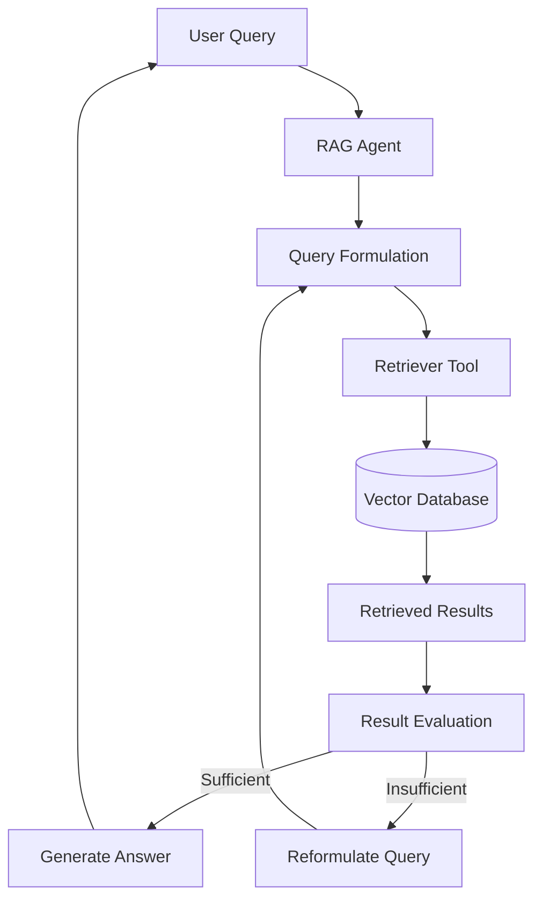
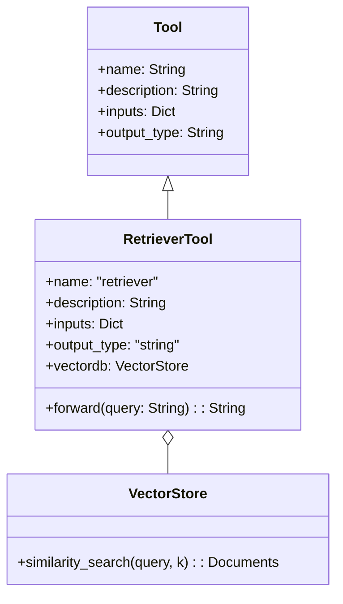
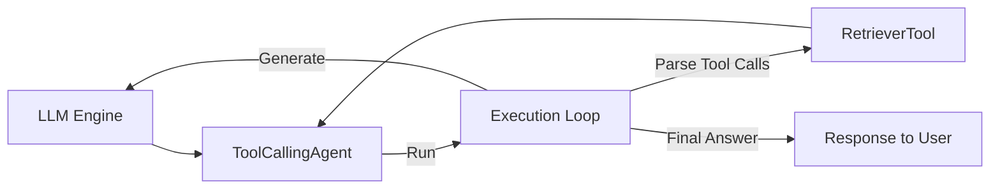
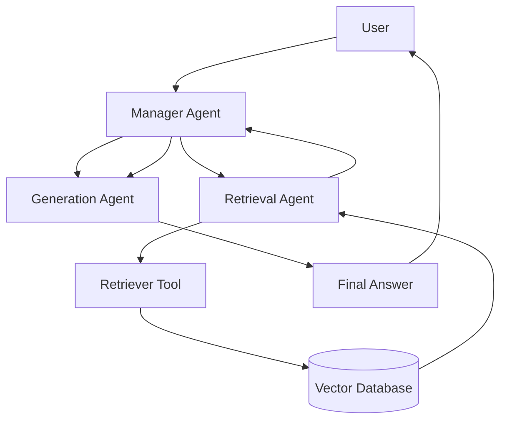

<!-- source: DeepWiki mcp.deepwiki.com · repo huggingface/cookbook · page 3.4 RAG with Agents · fetched 2026-10-26 -->

# RAG with Agents

Relevant source files

The following files were used as context for generating this wiki page:

- [notebooks/en/agent_rag.ipynb](notebooks/en/agent_rag.ipynb)
- [notebooks/en/fine_tuning_smol_vlm_sft_trl.ipynb](notebooks/en/fine_tuning_smol_vlm_sft_trl.ipynb)
- [notebooks/en/fine_tuning_vlm_dpo_smolvlm_instruct.ipynb](notebooks/en/fine_tuning_vlm_dpo_smolvlm_instruct.ipynb)
- [notebooks/en/multiagent_rag_system.ipynb](notebooks/en/multiagent_rag_system.ipynb)

This document explains how to enhance Retrieval-Augmented Generation (RAG) systems using agents. For more basic RAG implementations, see [Basic RAG Implementations](#2.1) or for advanced techniques not involving agents, see [Advanced RAG Techniques](#2.2).

## Introduction

Traditional RAG systems have limitations that can significantly impact their effectiveness. The two main limitations are:

1. **Single retrieval step**: Conventional RAG performs only one retrieval operation. If this retrieval yields poor results, the final generation will be compromised.

2. **Query-based similarity**: Semantic similarity is computed using the original user query as the reference point. This can be problematic since user queries are often phrased as questions, while the documents containing the answers might be in affirmative form, potentially resulting in lower similarity scores.

RAG with Agents addresses these limitations by employing an agent-based approach where an LLM agent is equipped with retrieval capabilities. This agent can:

- **Reformulate queries** to better match the expected document structure
- **Critique retrieved results** and perform additional retrievals if necessary
- **Synthesize information** from multiple retrieval steps

Sources: [notebooks/en/agent_rag.ipynb:6-27](), [notebooks/en/multiagent_rag_system.ipynb:16-27]()

## System Architecture

The architecture of a RAG with Agents system consists of several key components:

1. **Agent**: The core component that orchestrates the entire process, typically powered by an LLM.
2. **Retriever Tool**: A tool the agent can use to retrieve information from a knowledge base.
3. **Vector Database**: Stores document embeddings for semantic search.
4. **Query Formulation**: The agent formulates effective retrieval queries.
5. **Result Evaluation**: The agent evaluates retrieval results and decides if additional retrieval is needed.

Sources: [notebooks/en/agent_rag.ipynb:180-209](), [notebooks/en/multiagent_rag.ipynb:20-31]()

## Implementation Components

### RetrieverTool

The `RetrieverTool` class is the core component that enables the agent to perform retrieval operations:

The `RetrieverTool` is implemented as a subclass of `Tool`, with a `vectordb` attribute that stores an instance of a vector database. The tool has a `forward` method that takes a query string as input and returns retrieved documents as a formatted string.

Sources: [notebooks/en/agent_rag.ipynb:180-209]()

### Agent Setup

The agent is set up using:

1. **Model**: An LLM engine that can process messages and generate text (e.g., HfApiModel using Llama-3.1-70B-Instruct).
2. **Tools**: List of tools the agent can use (primarily the RetrieverTool).
3. **Execution Loop**: When the agent's `run()` method is called, it enters a loop that generates tool calls, executes them, and continues until a final answer is produced.

Sources: [notebooks/en/agent_rag.ipynb:235-242](), [notebooks/en/agent_rag.ipynb:249-251]()

## Agentic RAG Techniques

### Query Reformulation

The agent improves upon traditional RAG by reformulating the user's original query before retrieval. This is similar to techniques like Hypothetical Document Embedding (HyDE), but done within the agent's reasoning process.

The agent can:
1. Convert questions to statements
2. Add context and specificity
3. Use domain-specific terminology
4. Remove ambiguity

For example, a user query "How can I push a model to the Hub?" might be reformulated to "Push a model to Hugging Face Hub using push_to_hub function" to better match relevant documentation.

Sources: [notebooks/en/agent_rag.ipynb:18-24]()

### Self-Query and Iterative Retrieval

The agent can analyze the quality of retrieved documents and decide to perform additional retrievals with refined queries. This creates an iterative retrieval process that improves result quality.

The steps include:
1. Evaluate retrieved documents
2. Identify missing information
3. Formulate a more specific query
4. Retrieve additional documents
5. Synthesize information from all retrievals

Sources: [notebooks/en/agent_rag.ipynb:18-24]()

## Multi-Agent RAG System

For more complex scenarios, a multi-agent RAG system can be implemented where different agents perform specialized roles:

In this architecture:
- **Manager Agent**: Orchestrates the overall process and delegates tasks
- **Retrieval Agent**: Specializes in formulating queries and analyzing retrieved documents
- **Generation Agent**: Focuses on synthesizing information and generating the final answer

This approach enables more sophisticated reasoning and higher quality responses.

Sources: [notebooks/en/multiagent_rag_system.ipynb:25-32]()

## Use Cases

RAG with Agents is particularly useful for:

1. **Complex queries**: When information needs to be gathered from multiple sources
2. **Domain-specific knowledge retrieval**: When terminology and phrasing differ between queries and documents
3. **Ambiguous questions**: When the query requires clarification or reformulation
4. **Fact verification**: When multiple retrievals are needed to verify information

Sources: [notebooks/en/agent_rag.ipynb:16-27]()

## Implementation Steps

To implement a RAG with Agents system:

1. **Prepare knowledge base**:
   - Process documents (splitting, cleaning)
   - Generate embeddings
   - Create a vector database

2. **Create retriever tool**:
   - Implement a tool class that interfaces with the vector database
   - Define input schema and output format

3. **Set up agent**:
   - Choose an appropriate LLM
   - Configure agent with tools
   - Define agent behavior through system prompt

4. **Run agent**:
   - Pass user query to agent
   - Agent handles query formulation, retrieval, and answer generation

Sources: [notebooks/en/agent_rag.ipynb:123-157](), [notebooks/en/agent_rag.ipynb:180-209](), [notebooks/en/agent_rag.ipynb:235-242]()

## Advantages and Limitations

### Advantages

- Improves retrieval quality through better query formulation
- Enables iterative refinement of retrieved information
- Combines language understanding with strategic retrieval
- Reduces the likelihood of hallucinations through multiple verification steps

### Limitations

- Higher computational cost due to multiple LLM calls
- Increased latency from multiple retrieval steps
- Requires careful prompt engineering for agent guidance
- More complex implementation compared to traditional RAG

Sources: [notebooks/en/agent_rag.ipynb:16-27]()

## Conclusion

RAG with Agents represents a significant improvement over traditional RAG implementations by addressing key limitations. By giving an LLM agent the ability to reformulate queries and perform multiple retrievals, this approach yields more accurate and comprehensive responses, particularly for complex queries.

The implementation requires setting up a retrieval tool, configuring an agent with appropriate reasoning capabilities, and integrating these components into a cohesive system. While more complex than basic RAG, the improvements in result quality make it a valuable approach for advanced information retrieval and generation tasks.

---

