<!-- source: DeepWiki mcp.deepwiki.com · repo huggingface/cookbook · page 4 Model Fine-tuning Techniques · fetched 2026-10-26 -->

# Model Fine-tuning Techniques

<details>
<summary>Relevant source files</summary>

The following files were used as context for generating this wiki page:

- [notebooks/en/fine_tuning_smol_vlm_sft_trl.ipynb](notebooks/en/fine_tuning_smol_vlm_sft_trl.ipynb)
- [notebooks/en/fine_tuning_vit_custom_dataset.ipynb](notebooks/en/fine_tuning_vit_custom_dataset.ipynb)
- [notebooks/en/fine_tuning_vlm_dpo_smolvlm_instruct.ipynb](notebooks/en/fine_tuning_vlm_dpo_smolvlm_instruct.ipynb)
- [notebooks/en/multiagent_rag_system.ipynb](notebooks/en/multiagent_rag_system.ipynb)
- [notebooks/tr/_toctree.yml](notebooks/tr/_toctree.yml)
- [notebooks/tr/agent_data_analyst.ipynb](notebooks/tr/agent_data_analyst.ipynb)
- [notebooks/tr/agents.ipynb](notebooks/tr/agents.ipynb)
- [notebooks/tr/fine_tuning_code_llm_on_single_gpu.ipynb](notebooks/tr/fine_tuning_code_llm_on_single_gpu.ipynb)
- [notebooks/tr/fine_tuning_detr_custom_dataset.ipynb](notebooks/tr/fine_tuning_detr_custom_dataset.ipynb)
- [notebooks/tr/fine_tuning_vit_custom_dataset.ipynb](notebooks/tr/fine_tuning_vit_custom_dataset.ipynb)

</details>


This document provides an overview of modern fine-tuning techniques for language, vision, and multimodal models using the Hugging Face ecosystem. It covers parameter-efficient methods, optimization strategies, and practical implementation approaches for adapting pre-trained models to specific tasks and domains. For information about evaluating fine-tuned models, see [Evaluation and Testing](#6).

## 1. Introduction to Model Fine-tuning

Fine-tuning is the process of taking a pre-trained model and adapting it to a specific task or domain by continuing training on a smaller, task-specific dataset. This approach leverages the knowledge captured in large pre-trained models while tailoring their capabilities to particular applications, often with significantly reduced computational resources compared to pre-training from scratch.

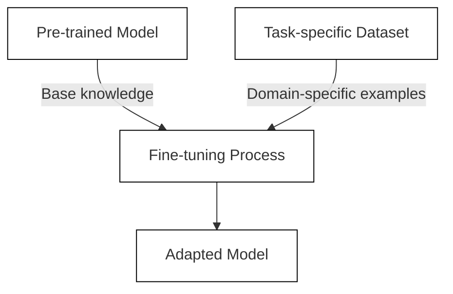

The fine-tuning process can be applied to various model types:
- Language models (e.g., code generation models)
- Vision models (e.g., image classification, object detection)
- Vision-language models (multimodal models that process both images and text)

Sources: [notebooks/en/fine_tuning_smol_vlm_sft_trl.ipynb](), [notebooks/en/fine_tuning_vit_custom_dataset.ipynb](), [notebooks/tr/fine_tuning_code_llm_on_single_gpu.ipynb]()

## 2. Types of Fine-tuning Approaches

### 2.1 Full Fine-tuning

Full fine-tuning involves updating all parameters of a pre-trained model. While effective, this approach:
- Requires significant computational resources
- May lead to catastrophic forgetting of pre-trained knowledge
- Results in a new model of the same size as the original

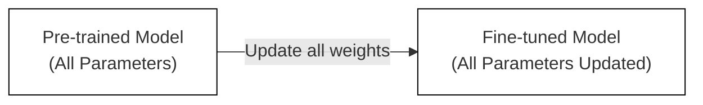

Sources: [notebooks/en/fine_tuning_vit_custom_dataset.ipynb]()

### 2.2 Parameter-Efficient Fine-tuning (PEFT)

PEFT methods update only a small subset of parameters or introduce a small number of new trainable parameters while keeping most of the pre-trained model frozen.

#### 2.2.1 Low-Rank Adaptation (LoRA)

LoRA adds low-rank decomposition matrices to the model's weight matrices, significantly reducing the number of trainable parameters.

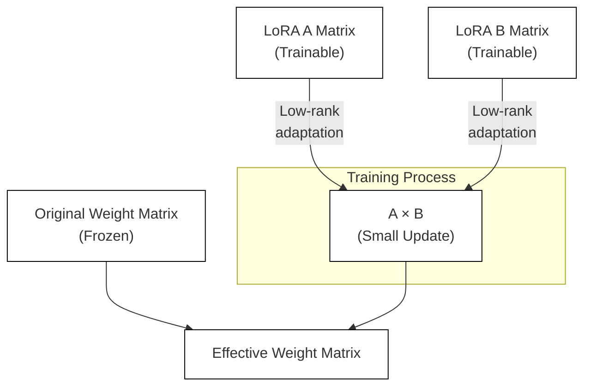

Key configuration parameters for LoRA include:
- `r`: Rank of the decomposition matrices (typically 8-64)
- `alpha`: Scaling factor for the LoRA contribution
- `target_modules`: Which weight matrices to apply LoRA to

Example configuration from code example:
```
LORA_R=8
LORA_ALPHA=32  
LORA_DROPOUT=0.0
LORA_TARGET_MODULES="c_proj,c_attn,q_attn,c_fc,c_proj"
```

Sources: [notebooks/tr/fine_tuning_code_llm_on_single_gpu.ipynb:112-113]()

#### 2.2.2 Quantized LoRA (QLoRA)

QLoRA combines quantization with LoRA to further reduce memory requirements:
- The base model is loaded in a quantized format (e.g., 4-bit quantization)
- LoRA adapters are applied to the quantized model
- Updates are computed in higher precision (e.g., bfloat16)

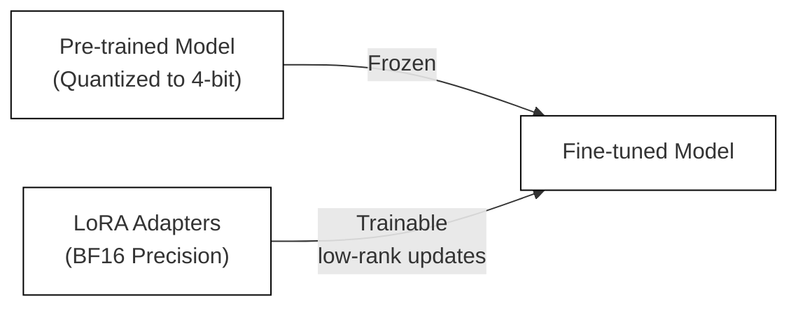

Example configuration parameters:
```
USE_NESTED_QUANT=True
BNB_4BIT_COMPUTE_DTYPE="bfloat16"
```

Sources: [notebooks/tr/fine_tuning_code_llm_on_single_gpu.ipynb:116-117]()

#### 2.2.3 Prompt Tuning

Prompt tuning adds trainable embedding vectors (virtual tokens) to the input sequence while keeping the model parameters fixed.

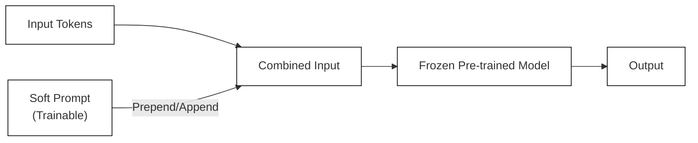

Sources: [notebooks/en/fine_tuning_smol_vlm_sft_trl.ipynb]()

## 3. Optimization Techniques for Resource-Constrained Fine-tuning

### 3.1 Quantization and Bit Manipulation

Quantization reduces the precision of model weights to save memory:

- 8-bit quantization (INT8)
- 4-bit quantization (INT4/NF4)
- Binary and ternary quantization

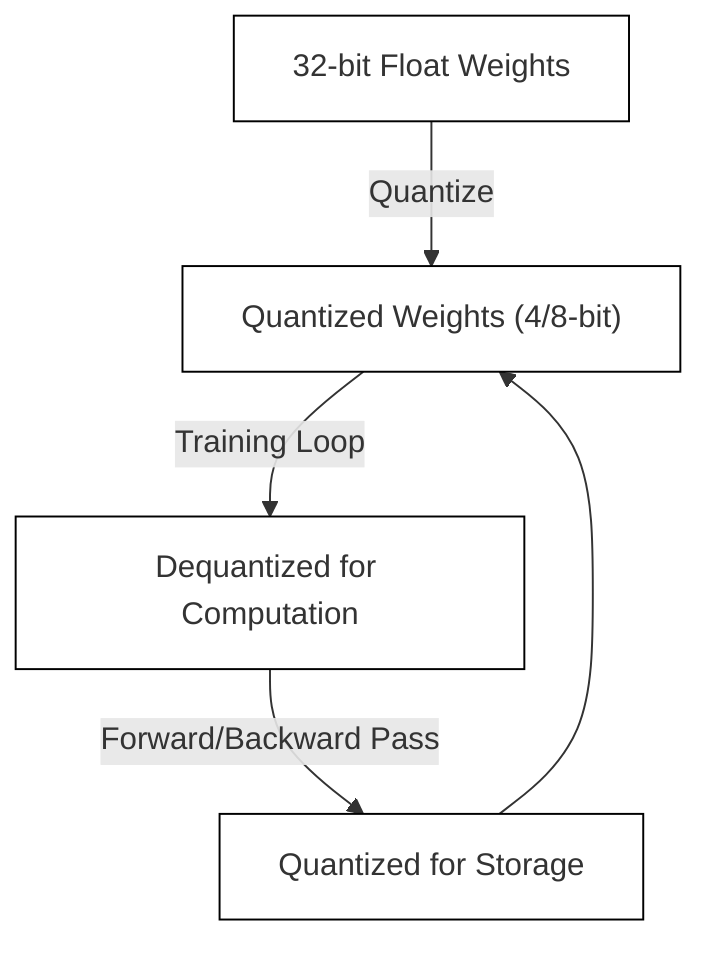

### 3.2 Mixed Precision Training

Using lower precision formats (e.g., bfloat16) for certain operations while maintaining higher precision for others:

```
BF16=True
FP16=False
```

Sources: [notebooks/tr/fine_tuning_code_llm_on_single_gpu.ipynb:102-103]()

### 3.3. Memory Optimization Techniques

Additional techniques to make fine-tuning possible on consumer hardware:

- Gradient accumulation: Update weights after accumulating gradients from multiple batches
- Gradient checkpointing: Trade computation for memory by recomputing activations during backward pass
- Flash attention: Efficient attention mechanism that reduces memory footprint

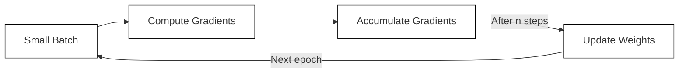

Example configuration:
```
BATCH_SIZE=16
GR_ACC_STEPS=1
```

Sources: [notebooks/tr/fine_tuning_code_llm_on_single_gpu.ipynb:92-93](), [notebooks/en/fine_tuning_smol_vlm_sft_trl.ipynb:69-71]()

## 4. Fine-tuning Methodologies

### 4.1 Supervised Fine-tuning (SFT)

SFT involves training a model with labeled examples to minimize the difference between model predictions and ground truth labels.

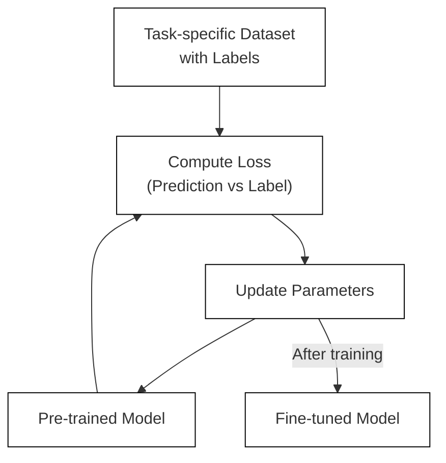

Sources: [notebooks/en/fine_tuning_vit_custom_dataset.ipynb](), [notebooks/tr/fine_tuning_code_llm_on_single_gpu.ipynb]()

### 4.2 Direct Preference Optimization (DPO)

DPO fine-tunes models based on human preferences between pairs of model outputs.

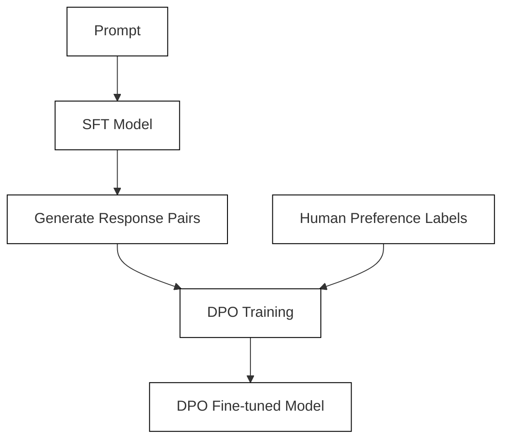

The process involves:
1. Starting with an SFT model
2. Using pairs of model outputs (chosen/rejected)
3. Training to increase the likelihood of chosen outputs relative to rejected ones

Sources: [notebooks/en/fine_tuning_vlm_dpo_smolvlm_instruct.ipynb:18-26]()

## 5. Fine-tuning Different Model Types

### 5.1 Fine-tuning Language Models for Code

Code language models like StarCoder can be fine-tuned to better understand specific programming languages, coding styles, or internal libraries.

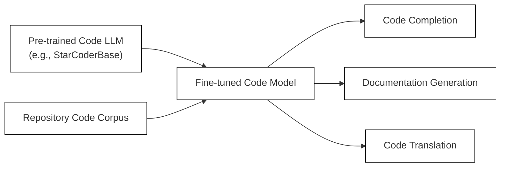

Key techniques for code model fine-tuning:
- FIM (Fill-in-the-Middle) training to handle code context
- LoRA for parameter-efficient updates
- 4-bit quantization to reduce memory requirements

Example configuration:
```
FIM_RATE=0.5
FIM_SPM_RATE=0.5
```

Sources: [notebooks/tr/fine_tuning_code_llm_on_single_gpu.ipynb:106-107]()

### 5.2 Fine-tuning Vision Models

Vision models like Vision Transformers (ViT) can be fine-tuned for specific visual domains.

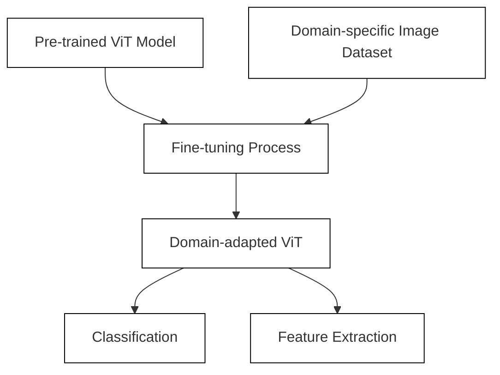

Example process:
1. Load a pre-trained ViT model 
2. Replace the classification head for the target number of classes
3. Apply data augmentation for training examples
4. Train with appropriate learning rate scheduling

Sources: [notebooks/en/fine_tuning_vit_custom_dataset.ipynb]()

### 5.3 Fine-tuning Object Detection Models

Object detection models like DETR can be fine-tuned for specific types of objects.

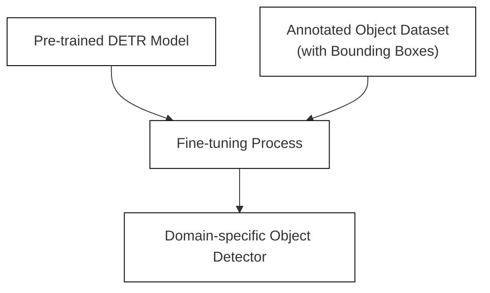

Key considerations:
- Properly formatted bounding box annotations
- Balancing localization and classification losses
- Appropriate data augmentation for object detection

Sources: [notebooks/tr/fine_tuning_detr_custom_dataset.ipynb]()

### 5.4 Fine-tuning Vision-Language Models (VLMs)

VLMs like SmolVLM can be fine-tuned for multimodal understanding tasks.

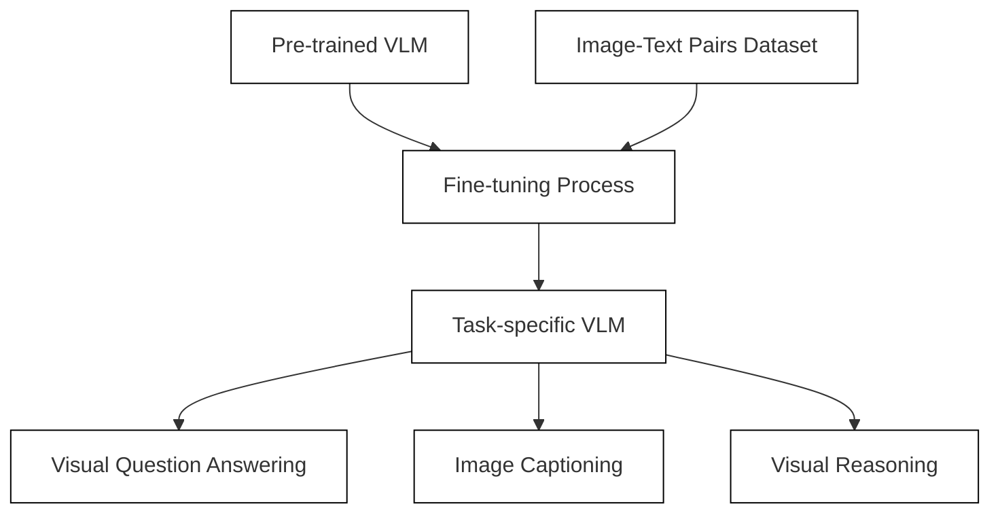

The data formatting typically follows a specific structure to handle both image and text inputs:

```python
[
    {"role": "system", "content": [{"type": "text", "text": system_message}]},
    {"role": "user", "content": [
        {"type": "image", "image": image},
        {"type": "text", "text": query}
    ]},
    {"role": "assistant", "content": [{"type": "text", "text": response}]}
]
```

Sources: [notebooks/en/fine_tuning_smol_vlm_sft_trl.ipynb:159-192]()

## 6. Practical Implementation with Hugging Face

### 6.1 Dataset Preparation

Proper dataset preparation is crucial for effective fine-tuning:

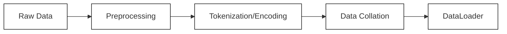

Key components:
- Dataset class implementation 
- Tokenization for text
- Image transformations for vision
- Appropriate formatting for model requirements
- Train/validation/test splits

Sources: [notebooks/en/fine_tuning_vit_custom_dataset.ipynb:127-165](), [notebooks/en/fine_tuning_smol_vlm_sft_trl.ipynb:159-192]()

### 6.2 Training Configuration

Properly configured training arguments are essential for successful fine-tuning:

| Parameter | Purpose | Typical Values |
|-----------|---------|----------------|
| Learning rate | Controls update magnitude | 1e-5 to 5e-4 |
| Batch size | Examples per update | 4-32 (GPU-dependent) |
| Training steps | Total updates | 1000-10000 |
| Warmup steps | Gradual LR increase | 5-10% of total steps |
| Weight decay | Regularization | 0.01-0.1 |
| LoRA rank | Size of LoRA adapters | 8-64 |
| LoRA alpha | LoRA scaling factor | 16-32 |

Example configuration:
```
MAX_STEPS=2000
BATCH_SIZE=16
GR_ACC_STEPS=1
LR=5e-4
LR_SCHEDULER_TYPE="cosine"
WEIGHT_DECAY=0.01
NUM_WARMUP_STEPS=30
```

Sources: [notebooks/tr/fine_tuning_code_llm_on_single_gpu.ipynb:88-102]()

### 6.3 Model Saving and Loading

After fine-tuning, models can be saved and loaded for inference:


For PEFT models, you typically save just the adapter weights:
```python
peft_model.save_pretrained("path/to/adapter")
```

For full models:
```python
model.save_pretrained("path/to/model")
tokenizer.save_pretrained("path/to/model")
```

Sources: [notebooks/en/fine_tuning_smol_vlm_sft_trl.ipynb](), [notebooks/tr/fine_tuning_code_llm_on_single_gpu.ipynb]()

## 7. Case Studies of Fine-tuning Applications

### 7.1 Code Completion and Generation

Fine-tuning code models on repository-specific code enables:
- Improved completion suggestions aligned with internal coding standards
- Generation of boilerplate code following repository patterns
- Better understanding of custom libraries and APIs

### 7.2 Medical Image Analysis

Fine-tuning vision models for medical imaging:
- Adapting pre-trained models to specific imaging modalities (X-ray, MRI, ultrasound)
- Tailoring models for specific diagnostic tasks
- Handling domain-specific characteristics of medical images

### 7.3 Visual Question Answering

Fine-tuning VLMs for domain-specific visual QA:
- Answering questions about charts and graphs (data analysis)
- Providing information about fashion items in images
- Detailed explanations of technical diagrams or scientific visualizations

Sources: [notebooks/en/fine_tuning_smol_vlm_sft_trl.ipynb:20-27](), [notebooks/en/fine_tuning_vlm_dpo_smolvlm_instruct.ipynb:19-26]()

## 8. Hardware Considerations

Different fine-tuning approaches have varying hardware requirements:

| Fine-tuning Method | Memory Requirements | GPU VRAM Needed | Training Time |
|--------------------|---------------------|-----------------|---------------|
| Full fine-tuning | Very high | 24GB+ | Longest |
| LoRA | Moderate | 8-16GB | Medium |
| QLoRA | Low | 8GB or less | Medium |
| Prompt tuning | Very low | <8GB | Shortest |

The notebook examples demonstrate how to fine-tune:
- A 1B parameter code model on a single GPU using QLoRA
- A vision transformer model with standard fine-tuning
- A DETR object detection model for custom objects
- A SmolVLM model using optimized training procedures

Sources: [notebooks/en/fine_tuning_smol_vlm_sft_trl.ipynb:35-39](), [notebooks/tr/fine_tuning_code_llm_on_single_gpu.ipynb:46-52]()

---

