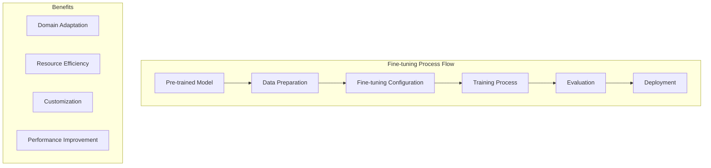
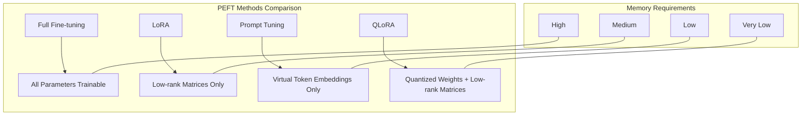
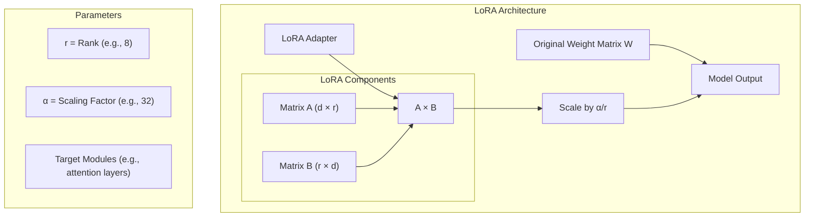
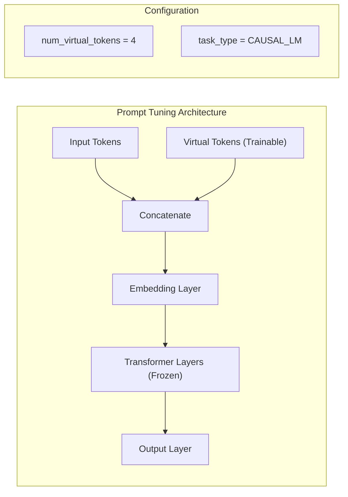
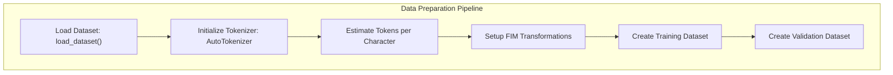
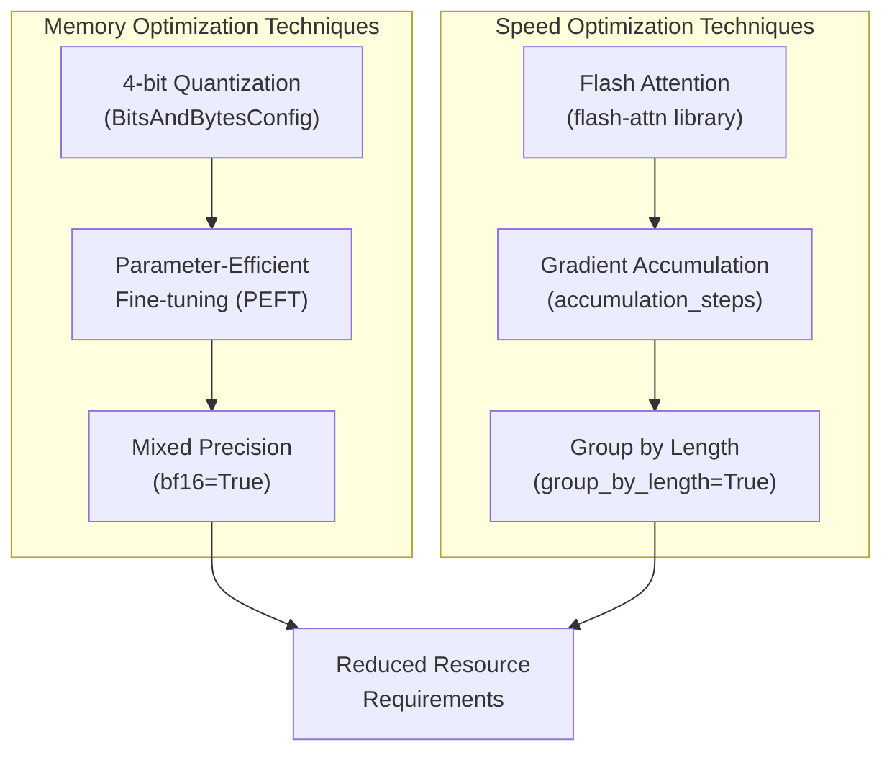

<!-- source: DeepWiki mcp.deepwiki.com · repo huggingface/cookbook · page 4.1 Fine-tuning Language Models · fetched 2026-10-26 -->

# Fine-tuning Language Models

<details>
<summary>Relevant source files</summary>

The following files were used as context for generating this wiki page:

- [.github/workflows/check_notebooks_lowercase.yml](.github/workflows/check_notebooks_lowercase.yml)
- [notebooks/en/faiss_with_hf_datasets_and_clip.ipynb](notebooks/en/faiss_with_hf_datasets_and_clip.ipynb)
- [notebooks/en/fine_tuning_code_llm_on_single_gpu.ipynb](notebooks/en/fine_tuning_code_llm_on_single_gpu.ipynb)
- [notebooks/en/rag_with_hf_and_milvus.ipynb](notebooks/en/rag_with_hf_and_milvus.ipynb)
- [notebooks/en/rag_zephyr_langchain.ipynb](notebooks/en/rag_zephyr_langchain.ipynb)
- [notebooks/tr/_toctree.yml](notebooks/tr/_toctree.yml)
- [notebooks/tr/agent_data_analyst.ipynb](notebooks/tr/agent_data_analyst.ipynb)
- [notebooks/tr/agents.ipynb](notebooks/tr/agents.ipynb)
- [notebooks/tr/fine_tuning_code_llm_on_single_gpu.ipynb](notebooks/tr/fine_tuning_code_llm_on_single_gpu.ipynb)
- [notebooks/tr/fine_tuning_detr_custom_dataset.ipynb](notebooks/tr/fine_tuning_detr_custom_dataset.ipynb)
- [notebooks/tr/fine_tuning_vit_custom_dataset.ipynb](notebooks/tr/fine_tuning_vit_custom_dataset.ipynb)
- [notebooks/zh-CN/index.md](notebooks/zh-CN/index.md)
- [notebooks/zh-CN/prompt_tuning_peft.ipynb](notebooks/zh-CN/prompt_tuning_peft.ipynb)
- [notebooks/zh-CN/rag_with_hf_and_milvus.ipynb](notebooks/zh-CN/rag_with_hf_and_milvus.ipynb)

</details>


This page explains how to fine-tune language models (LLMs) using techniques available in the Hugging Face ecosystem. Fine-tuning allows adapting pre-trained models to specific domains, styles, or tasks while minimizing computational resources. For information about fine-tuning Vision Models, see [Fine-tuning Vision Models](#4.2), and for fine-tuning Vision-Language Models, see [Fine-tuning Vision-Language Models](#4.3).

## Introduction to Language Model Fine-tuning

Language model fine-tuning adapts pre-trained models to specific domains or tasks by continuing training on specialized datasets. This process leverages the knowledge embedded in models while customizing them for your specific requirements. In the context of code models, for example, fine-tuning helps adapt general programming knowledge to match organization-specific coding conventions and libraries.



Sources: [notebooks/en/fine_tuning_code_llm_on_single_gpu.ipynb:23-41]()

## Types of Fine-tuning Approaches

There are several approaches to fine-tuning language models, each with different trade-offs in terms of computational resources, performance, and flexibility:

### Full Fine-tuning

Full fine-tuning updates all parameters of a pre-trained model, requiring significant computational resources but potentially yielding the best performance. However, this approach typically requires multiple GPUs with large memory capacity.

### Parameter-Efficient Fine-tuning (PEFT)

Parameter-Efficient Fine-Tuning methods update only a small subset of parameters, drastically reducing memory requirements while still achieving comparable performance to full fine-tuning. Common PEFT methods include:

1. **LoRA (Low-Rank Adaptation)**: Adds small, trainable rank decomposition matrices to existing weights
2. **QLoRA**: Combines quantization with LoRA to further reduce memory requirements
3. **Prompt Tuning**: Adds trainable virtual tokens to the input prompt
4. **Prefix Tuning**: Prepends trainable vectors to key and value vectors in attention layers



Sources: [notebooks/en/fine_tuning_code_llm_on_single_gpu.ipynb:61-65](), [notebooks/zh-CN/prompt_tuning_peft.ipynb:28-41]()

## LoRA Fine-tuning Architecture

LoRA is one of the most popular PEFT methods. It works by adding small, trainable rank decomposition matrices to existing weights, allowing for efficient fine-tuning without modifying the original model weights.



In the Hugging Face implementation, LoRA configuration is set up as follows:

Sources: [notebooks/en/fine_tuning_code_llm_on_single_gpu.ipynb:115-126](), [notebooks/en/fine_tuning_code_llm_on_single_gpu.ipynb:354-362]()

## Prompt Tuning Architecture

Prompt tuning is another PEFT method that adds trainable virtual token embeddings to the input prompt. These virtual tokens are optimized during training but can't be directly translated to natural language.



The key advantage of prompt tuning is that it preserves the original model's knowledge while adding task-specific capabilities through the virtual tokens.

Sources: [notebooks/zh-CN/prompt_tuning_peft.ipynb:35-41](), [notebooks/zh-CN/prompt_tuning_peft.ipynb:196-200]()

## Fine-tuning Process for Code Language Models

The fine-tuning process for code language models involves several steps, from data preparation to model deployment. The following sections detail this process using a code LLM (StarCoderBase) as an example.

### Data Preparation

1. **Dataset Selection**: Choose an appropriate dataset for fine-tuning. For code models, this typically involves a collection of code files in the target programming languages.

2. **Data Loading**: Load the dataset using the Hugging Face `datasets` library.

3. **Tokenization**: Convert text to token IDs using the model's tokenizer.

4. **Chunking**: Split text into fixed-length chunks for efficient processing.

5. **Optional Transformations**: Apply transformations like FIM (Fill in the Middle) to help the model learn specific patterns.



The FIM (Fill in the Middle) transformation is particularly useful for code models, as it helps the model learn to fill in code snippets in the middle of existing code, not just generate code from left to right.

Sources: [notebooks/en/fine_tuning_code_llm_on_single_gpu.ipynb:159-171](), [notebooks/en/fine_tuning_code_llm_on_single_gpu.ipynb:177-203](), [notebooks/en/fine_tuning_code_llm_on_single_gpu.ipynb:276-293]()

### Model Configuration

1. **Load Pre-trained Model**: Load the base model using `AutoModelForCausalLM`.

2. **Apply Quantization**: Use BitsAndBytes config for 4-bit quantization to reduce memory usage.

3. **Setup PEFT Configuration**: Configure LoRA or other PEFT methods.

4. **Get PEFT Model**: Apply the PEFT configuration to the model.

```python
# BitsAndBytes Configuration for Quantization
bnb_config = BitsAndBytesConfig(
    load_in_4bit=True,
    bnb_4bit_quant_type="nf4",
    bnb_4bit_compute_dtype=compute_dtype,
    bnb_4bit_use_double_quant=USE_NESTED_QUANT,
)

# LoRA Configuration
peft_config = LoraConfig(
    lora_alpha=LORA_ALPHA,
    lora_dropout=LORA_DROPOUT,
    r=LORA_R,
    bias="none",
    task_type="CAUSAL_LM",
    target_modules=LORA_TARGET_MODULES.split(","),
)
```

Sources: [notebooks/en/fine_tuning_code_llm_on_single_gpu.ipynb:344-362]()

### Training Setup and Execution

1. **Configure Training Arguments**: Set up parameters like learning rate, batch size, number of steps, etc.

2. **Initialize Trainer**: Set up the Hugging Face Trainer with model, data, and training arguments.

3. **Run Training**: Start the training process.

4. **Monitor Progress**: Track loss and other metrics during training.

```python
# Training Arguments Configuration
training_args = TrainingArguments(
    output_dir=OUTPUT_DIR,
    max_steps=MAX_STEPS,
    per_device_train_batch_size=BATCH_SIZE,
    learning_rate=LR,
    weight_decay=WEIGHT_DECAY,
    bf16=BF16,
    optim="adamw_torch",
    lr_scheduler_type=LR_SCHEDULER_TYPE,
    warmup_steps=NUM_WARMUP_STEPS,
)

# Initialize and Run Trainer
trainer = Trainer(
    model=model,
    args=training_args,
    train_dataset=train_dataset,
    eval_dataset=eval_dataset,
    data_collator=default_data_collator,
    tokenizer=tokenizer,
)

trainer.train()
```

Sources: [notebooks/en/fine_tuning_code_llm_on_single_gpu.ipynb:364-385](), [notebooks/en/fine_tuning_code_llm_on_single_gpu.ipynb:387-394](), [notebooks/en/fine_tuning_code_llm_on_single_gpu.ipynb:396]()

### Evaluation and Deployment

1. **Evaluate Model**: Assess the model's performance using metrics like perplexity.

2. **Save Model**: Save the fine-tuned model locally or push to Hugging Face Hub.

3. **Deploy Model**: Make the model available for inference.

```python
# Push to Hugging Face Hub
model.push_to_hub("your-username/fine-tuned-model-name")
tokenizer.push_to_hub("your-username/fine-tuned-model-name")
```

The fine-tuned model can then be loaded and used for inference just like any other Hugging Face model.

Sources: [notebooks/en/fine_tuning_code_llm_on_single_gpu.ipynb:402-406]()

## Optimization Techniques for Resource-Constrained Environments

Fine-tuning large language models can be resource-intensive. Various optimization techniques can help fit the process on limited hardware like a single GPU:



### 4-bit Quantization

Using 4-bit quantization via BitsAndBytes significantly reduces the model's memory footprint, allowing larger models to fit on a single GPU.

### Parameter-Efficient Fine-tuning

PEFT methods like LoRA drastically reduce the number of trainable parameters, further reducing memory requirements.

### Mixed Precision Training

Using BF16 or FP16 mixed precision training accelerates computation and reduces memory usage.

### Flash Attention

The `flash-attn` library provides an optimized attention implementation that reduces memory usage and increases speed.

### Gradient Accumulation

Accumulating gradients across multiple batches allows training with larger effective batch sizes than would fit in memory.

Sources: [notebooks/en/fine_tuning_code_llm_on_single_gpu.ipynb:61-64](), [notebooks/en/fine_tuning_code_llm_on_single_gpu.ipynb:77](), [notebooks/en/fine_tuning_code_llm_on_single_gpu.ipynb:115-126]()

## Example Configurations and Hyperparameters

Here are some example configurations for fine-tuning a code language model (specifically StarCoderBase-1B) on a single GPU:

```python
# Model and Data
MODEL = "bigcode/starcoderbase-1b"
DATASET = "smangrul/hf-stack-v1"
SEQ_LENGTH = 2048

# Training Parameters
MAX_STEPS = 2000
BATCH_SIZE = 16
LR = 5e-4
LR_SCHEDULER_TYPE = "cosine"
WEIGHT_DECAY = 0.01
NUM_WARMUP_STEPS = 30
BF16 = True

# LoRA Parameters
LORA_R = 8
LORA_ALPHA = 32
LORA_DROPOUT = 0.0
LORA_TARGET_MODULES = "c_proj,c_attn,q_attn,c_fc,c_proj"

# Quantization Parameters
USE_NESTED_QUANT = True
BNB_4BIT_COMPUTE_DTYPE = "bfloat16"
```

These hyperparameters can serve as a starting point for your own fine-tuning projects, but you may need to adjust them based on your specific model, dataset, and hardware constraints.

Sources: [notebooks/en/fine_tuning_code_llm_on_single_gpu.ipynb:91-126]()

## Conclusion

Fine-tuning language models, particularly with parameter-efficient methods like LoRA and prompt tuning, allows for customizing pre-trained models to specific domains and tasks without requiring extensive computational resources. By following the process outlined in this page and utilizing optimization techniques like quantization and flash attention, you can effectively fine-tune large language models even on a single GPU.

The Hugging Face ecosystem provides comprehensive tools for the entire fine-tuning pipeline, from data preparation to model deployment, making the process accessible and streamlined.

---

