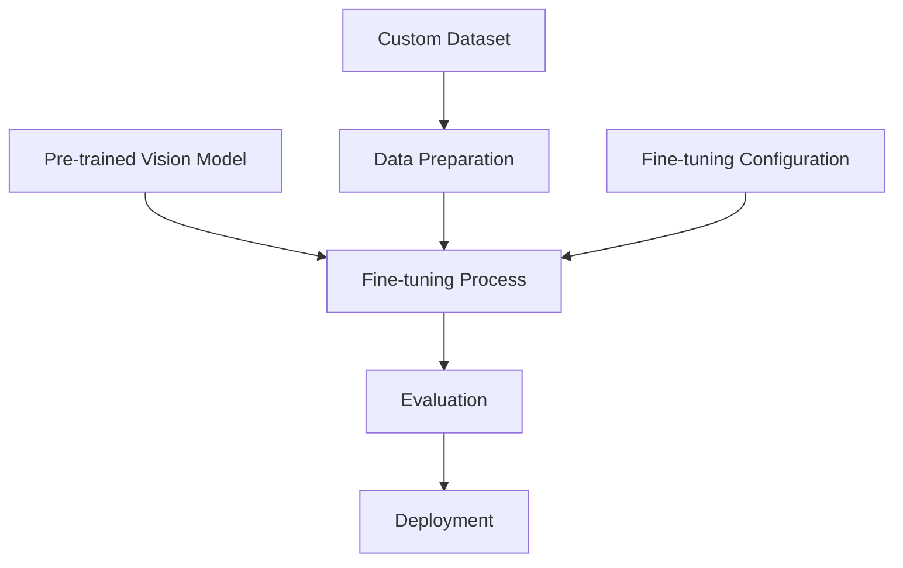
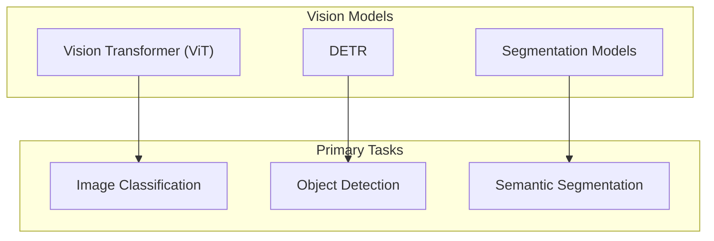
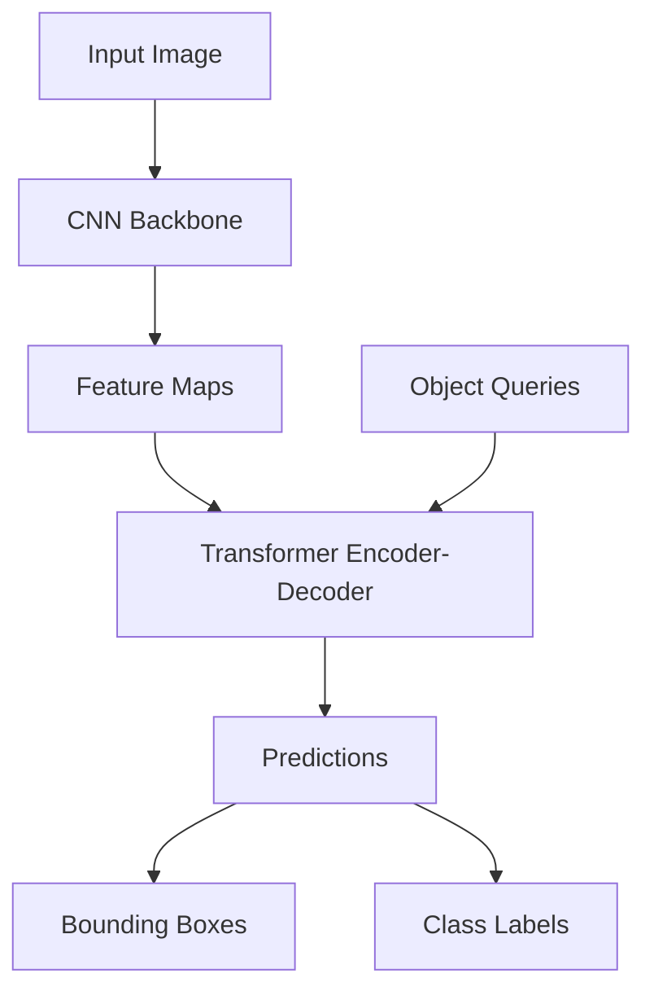
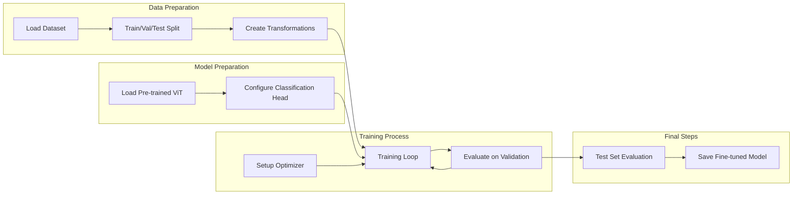
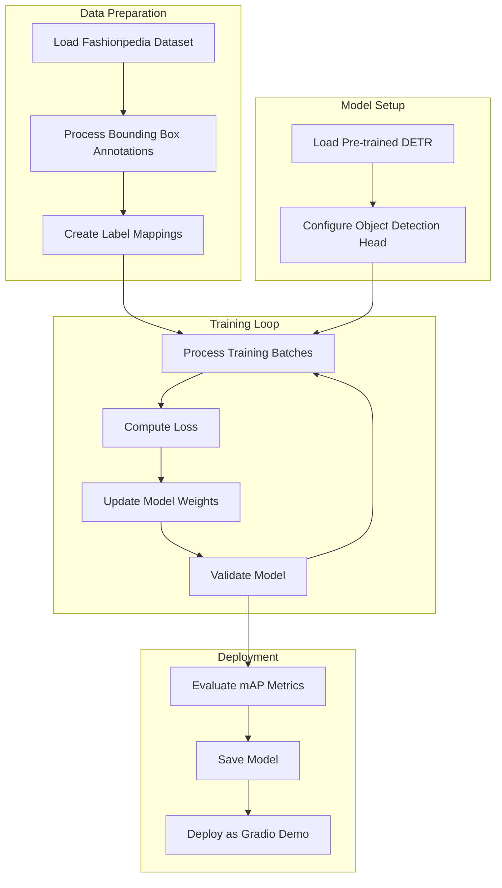

<!-- source: DeepWiki mcp.deepwiki.com · repo huggingface/cookbook · page 4.2 Fine-tuning Vision Models · fetched 2026-10-26 -->

# Fine-tuning Vision Models

<details>
<summary>Relevant source files</summary>

The following files were used as context for generating this wiki page:

- [notebooks/en/fine_tuning_vit_custom_dataset.ipynb](notebooks/en/fine_tuning_vit_custom_dataset.ipynb)
- [notebooks/tr/_toctree.yml](notebooks/tr/_toctree.yml)
- [notebooks/tr/agent_data_analyst.ipynb](notebooks/tr/agent_data_analyst.ipynb)
- [notebooks/tr/agents.ipynb](notebooks/tr/agents.ipynb)
- [notebooks/tr/fine_tuning_code_llm_on_single_gpu.ipynb](notebooks/tr/fine_tuning_code_llm_on_single_gpu.ipynb)
- [notebooks/tr/fine_tuning_detr_custom_dataset.ipynb](notebooks/tr/fine_tuning_detr_custom_dataset.ipynb)
- [notebooks/tr/fine_tuning_vit_custom_dataset.ipynb](notebooks/tr/fine_tuning_vit_custom_dataset.ipynb)

</details>


This page explains how to fine-tune pre-trained vision models on custom datasets using Hugging Face Transformers. Fine-tuning allows you to adapt powerful vision models to your specific tasks by leveraging transfer learning techniques. For fine-tuning language models, see [Fine-tuning Language Models](#4.1). For fine-tuning multimodal vision-language models, see [Fine-tuning Vision-Language Models](#4.3).

## Overview of Vision Model Fine-tuning

Fine-tuning a vision model involves taking a pre-trained model (trained on a large dataset like ImageNet) and adapting it to a more specific task or dataset. This process typically requires less data and computational resources than training from scratch while achieving comparable or better performance.



**Diagram: Vision Model Fine-tuning Process**

Sources: [notebooks/en/fine_tuning_vit_custom_dataset.ipynb](), [notebooks/tr/fine_tuning_detr_custom_dataset.ipynb]()

## Supported Vision Models

The Hugging Face ecosystem supports fine-tuning various vision models, including:

- **Vision Transformers (ViT)**: For image classification tasks
- **DETR (DEtection TRansformer)**: For object detection tasks 
- **Semantic Segmentation models**: For pixel-level segmentation tasks



**Diagram: Vision Models and Their Tasks**

Sources: [notebooks/en/fine_tuning_vit_custom_dataset.ipynb](), [notebooks/tr/fine_tuning_detr_custom_dataset.ipynb]()

## Vision Transformer (ViT) Fine-tuning

### ViT Architecture Overview

The Vision Transformer divides an image into fixed-size patches, linearly embeds each patch, adds position embeddings, and feeds the resulting sequence of vectors to a standard Transformer encoder.


**Diagram: Vision Transformer Architecture**

Sources: [notebooks/en/fine_tuning_vit_custom_dataset.ipynb]()

### Dataset Preparation for ViT

When fine-tuning a Vision Transformer, you need to prepare your dataset properly. The example below demonstrates how to prepare a custom biomedical dataset:

1. **Load the dataset**:
```python
from datasets import load_dataset
dataset = load_dataset('your_custom_dataset') 
```

2. **Split the dataset** into training, validation, and test sets:
```python
train_ds = dataset['train']
val_ds = dataset['validation']
test_ds = dataset['test']
```

3. **Create transformations** for image preprocessing:
```python
from torchvision import transforms
transform = transforms.Compose([
    transforms.Resize((224, 224)),
    transforms.ToTensor(),
    transforms.Normalize([0.5, 0.5, 0.5], [0.5, 0.5, 0.5])
])
```

Sources: [notebooks/en/fine_tuning_vit_custom_dataset.ipynb:88-212]()

### Fine-tuning ViT

The fine-tuning process for a Vision Transformer involves:

1. **Load a pre-trained ViT model**:
```python
from transformers import ViTForImageClassification, ViTConfig
model = ViTForImageClassification.from_pretrained('google/vit-base-patch16-224')
```

2. **Configure the model** for your classification task:
```python
# Replace the classification head with a new one for your classes
model.classifier = torch.nn.Linear(model.config.hidden_size, num_classes)
```

3. **Define training arguments**:
```python
from transformers import TrainingArguments
training_args = TrainingArguments(
    output_dir="./results",
    per_device_train_batch_size=16,
    evaluation_strategy="steps",
    num_train_epochs=3,
    save_steps=500,
    eval_steps=100,
    logging_dir="./logs",
)
```

4. **Create trainer and train the model**:
```python
from transformers import Trainer
trainer = Trainer(
    model=model,
    args=training_args,
    train_dataset=train_dataset,
    eval_dataset=val_dataset,
)
trainer.train()
```

Sources: [notebooks/en/fine_tuning_vit_custom_dataset.ipynb:500-800]()

## DETR Fine-tuning for Object Detection

### DETR Architecture Overview

DETR (DEtection TRansformer) is an end-to-end object detection system that uses a Transformer architecture for direct set prediction.



**Diagram: DETR Architecture**

Sources: [notebooks/tr/fine_tuning_detr_custom_dataset.ipynb]()

### Dataset Preparation for DETR

When fine-tuning DETR, you need to prepare a dataset with bounding box annotations:

1. **Load the dataset**:
```python
from datasets import load_dataset
dataset = load_dataset('detection-datasets/fashionpedia')
```

2. **Inspect and process annotations**:
```python
# Example annotation format
"""
{
  'image_id': 23,
  'image': <PIL.Image>,
  'width': 682,
  'height': 1024,
  'objects': {
    'bbox_id': [150311, 150312, 150313, 150314],
    'category': [23, 23, 33, 10],
    'bbox': [[445.0, 910.0, 505.0, 983.0], ...],
    'area': [1422, 843, 373, 56375]
  }
}
"""
```

3. **Create label mappings**:
```python
id2label = {
    0: 'shirt, blouse', 1: 'top, t-shirt, sweatshirt', ...
}
label2id = {v: k for k, v in id2label.items()}
```

Sources: [notebooks/tr/fine_tuning_detr_custom_dataset.ipynb:88-293]()

### Fine-tuning DETR

The fine-tuning process for DETR involves:

1. **Load a pre-trained DETR model**:
```python
from transformers import DetrForObjectDetection
model = DetrForObjectDetection.from_pretrained("facebook/detr-resnet-50")
```

2. **Update model configuration** for your task:
```python
model.config.num_labels = len(id2label)
model.config.id2label = id2label
model.config.label2id = label2id
```

3. **Define training arguments and train**:
```python
training_args = TrainingArguments(
    output_dir="./results",
    per_device_train_batch_size=8,
    num_train_epochs=100,
    save_steps=1000,
    learning_rate=1e-5,
)

trainer = Trainer(
    model=model,
    args=training_args,
    train_dataset=train_dataset,
    data_collator=collate_fn,
)
trainer.train()
```

Sources: [notebooks/tr/fine_tuning_detr_custom_dataset.ipynb:400-600]()

## Case Study: Fine-tuning ViT on Biomedical Data

This case study demonstrates fine-tuning a Vision Transformer on a biomedical dataset (breast cancer ultrasound images) with three classes: benign, malignant, and normal.



**Diagram: ViT Fine-tuning Workflow on Biomedical Data**

Sources: [notebooks/en/fine_tuning_vit_custom_dataset.ipynb]()

Key implementation details:

1. **Dataset Characteristics**:
   - 780 ultrasound images
   - 3 classes: benign, malignant, normal
   - Dataset split: 80% training, 20% validation/test

2. **Model Configuration**:
   - Pre-trained model: `google/vit-large-patch16-224`
   - Originally trained on ImageNet-21k (14M images)
   - Fine-tuned to classify breast cancer ultrasound images

3. **Training Configuration**:
   - Learning rate: 3e-4
   - Batch size: 16
   - Epochs: 10
   - Image size: 224x224

4. **Performance**:
   - Validation accuracy: ~90%
   - Class-specific precision and recall available in the notebook

Sources: [notebooks/en/fine_tuning_vit_custom_dataset.ipynb:9-21](), [notebooks/en/fine_tuning_vit_custom_dataset.ipynb:500-1000]()

## Case Study: Fine-tuning DETR on Fashion Data

This case study demonstrates fine-tuning a DETR model on the Fashionpedia dataset for fashion object detection.



**Diagram: DETR Fine-tuning Workflow on Fashion Data**

Sources: [notebooks/tr/fine_tuning_detr_custom_dataset.ipynb]()

Key implementation details:

1. **Dataset Characteristics**:
   - Fashionpedia: 46,781 images
   - 342,182 bounding boxes
   - 46 fashion-related categories (clothing items, accessories, etc.)

2. **Model Configuration**:
   - Pre-trained model: `facebook/detr-resnet-50`
   - Modified to detect fashion objects across 46 categories

3. **Training Configuration**:
   - Learning rate: 1e-5
   - Batch size: 8
   - Training iterations: Limited to fit in memory

4. **Deployment**:
   - Deployed as a Gradio demo on Hugging Face Spaces
   - Accessible via API for integration with applications

Sources: [notebooks/tr/fine_tuning_detr_custom_dataset.ipynb:30-47](), [notebooks/tr/fine_tuning_detr_custom_dataset.ipynb:400-700]()

## Best Practices for Vision Model Fine-tuning

When fine-tuning vision models, consider these best practices for optimal results:

### Data Preparation
- Use appropriate data augmentation techniques (random crops, flips, rotations)
- Ensure class balance in your dataset to prevent biased learning
- Normalize images using mean and standard deviation from the pre-training dataset

### Model Configuration
- For smaller datasets, consider freezing the backbone and only fine-tuning the head
- Use a smaller learning rate than when training from scratch (typically 1e-4 to 1e-6)
- Apply learning rate schedules (like cosine decay) for stable training

### Optimization
- For large models (like ViT-Large), consider using:
  - Mixed precision training (FP16 or BF16)
  - Gradient accumulation for larger effective batch sizes
  - Parameter-efficient fine-tuning methods like LoRA when applicable

### Evaluation
- Use appropriate metrics (accuracy for classification, mAP for object detection)
- Monitor validation performance to prevent overfitting
- Use early stopping based on validation performance

Sources: [notebooks/en/fine_tuning_vit_custom_dataset.ipynb](), [notebooks/tr/fine_tuning_detr_custom_dataset.ipynb]()

## Conclusion

Fine-tuning vision models allows you to leverage powerful pre-trained models for specific downstream tasks with less data and computational resources than training from scratch. The Hugging Face ecosystem provides tools and workflows for fine-tuning various vision models, including ViT for classification tasks and DETR for object detection tasks. By following the best practices and workflows outlined in this document, you can effectively adapt these models to your specific use cases.

---

