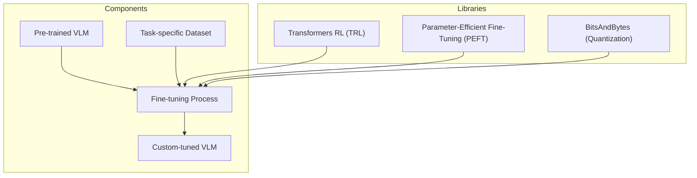
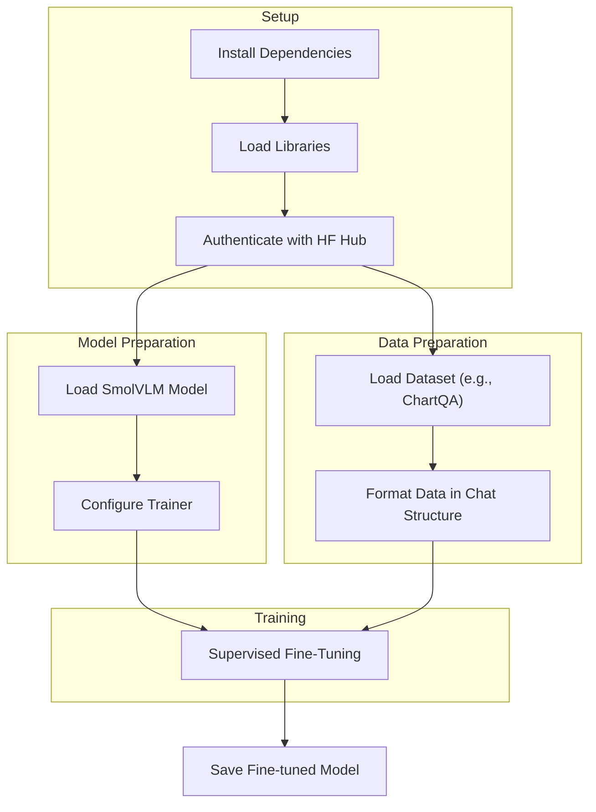
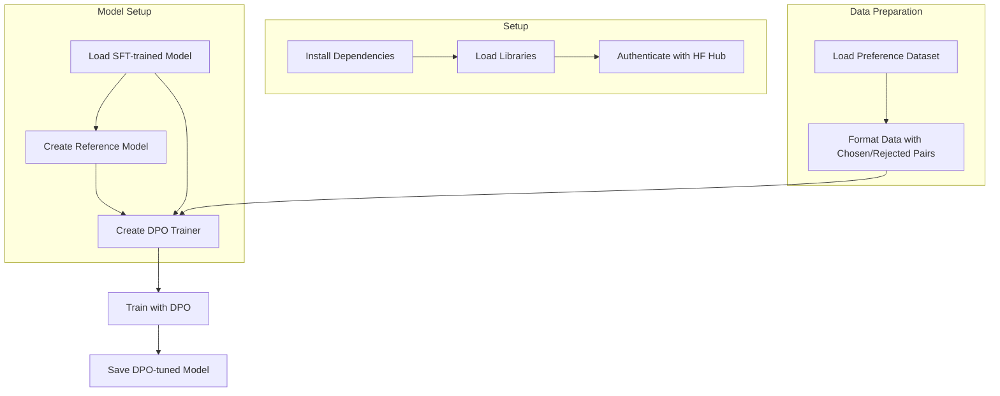

<!-- source: DeepWiki mcp.deepwiki.com · repo huggingface/cookbook · page 4.3 Fine-tuning Vision-Language Models · fetched 2026-10-26 -->

# Fine-tuning Vision-Language Models

<details>
<summary>Relevant source files</summary>

The following files were used as context for generating this wiki page:

- [notebooks/en/fine_tuning_smol_vlm_sft_trl.ipynb](notebooks/en/fine_tuning_smol_vlm_sft_trl.ipynb)
- [notebooks/en/fine_tuning_vlm_dpo_smolvlm_instruct.ipynb](notebooks/en/fine_tuning_vlm_dpo_smolvlm_instruct.ipynb)
- [notebooks/en/multiagent_rag_system.ipynb](notebooks/en/multiagent_rag_system.ipynb)
- [notebooks/en/rag_with_hf_and_milvus.ipynb](notebooks/en/rag_with_hf_and_milvus.ipynb)
- [notebooks/zh-CN/index.md](notebooks/zh-CN/index.md)
- [notebooks/zh-CN/prompt_tuning_peft.ipynb](notebooks/zh-CN/prompt_tuning_peft.ipynb)
- [notebooks/zh-CN/rag_with_hf_and_milvus.ipynb](notebooks/zh-CN/rag_with_hf_and_milvus.ipynb)

</details>


This document provides a comprehensive guide on fine-tuning Vision-Language Models (VLMs), focusing specifically on techniques and implementations using the Hugging Face ecosystem. It covers Supervised Fine-Tuning (SFT) and Direct Preference Optimization (DPO) approaches for customizing VLMs for specific visual understanding tasks.

For information about general model fine-tuning techniques, see [Model Fine-tuning Techniques](#4), and for vision model-specific fine-tuning, see [Fine-tuning Vision Models](#4.2).

## 1. Introduction to Vision-Language Models

Vision-Language Models (VLMs) are multimodal AI models that can process and understand both visual and textual inputs. These models establish connections between images and text, enabling them to perform tasks such as:

- Visual question answering (VQA)
- Image captioning
- Visual reasoning
- Multimodal chat interfaces

Fine-tuning these models allows you to adapt pre-trained VLMs for specific downstream tasks or domains, enhancing their performance on targeted applications.

Sources: [notebooks/en/fine_tuning_smol_vlm_sft_trl.ipynb:19-38]()

## 2. Fine-tuning Techniques for VLMs

There are two primary approaches for fine-tuning Vision-Language Models:

### 2.1 Supervised Fine-Tuning (SFT)

SFT involves training the model on pairs of inputs (images + text prompts) and desired outputs (text responses). The model learns to generate appropriate responses to visual-textual prompts through supervised learning.

### 2.2 Direct Preference Optimization (DPO)

DPO fine-tunes VLMs using preference data, where the model learns from pairs of responses (chosen vs. rejected) for each input. This approach helps align the model with human preferences and reduce hallucinations.

Sources: [notebooks/en/fine_tuning_vlm_dpo_smolvlm_instruct.ipynb:20-26](), [notebooks/en/fine_tuning_smol_vlm_sft_trl.ipynb:44-57]()

## 3. Architecture and Components

### VLM Fine-tuning Architecture



The fine-tuning workflow typically involves:

1. **Pre-trained VLM**: Start with a foundation model that has already been trained on large datasets
2. **Task-specific Dataset**: Prepare a dataset relevant to your target application
3. **Fine-tuning Process**: Apply techniques like SFT or DPO using libraries such as TRL
4. **Custom-tuned VLM**: The resulting model customized for your specific task

Sources: [notebooks/en/fine_tuning_smol_vlm_sft_trl.ipynb:56-61](), [notebooks/en/fine_tuning_vlm_dpo_smolvlm_instruct.ipynb:32-35]()

## 4. Fine-tuning SmolVLM with TRL

[SmolVLM](https://huggingface.co/blog/smolvlm) is a highly performant and memory-efficient vision-language model that can be fine-tuned on consumer GPUs. This section details the process of fine-tuning SmolVLM using the Transformer Reinforcement Learning (TRL) library.

### 4.1 SmolVLM Fine-tuning Workflow



### 4.2 Implementation Details

The fine-tuning process involves several key steps:

1. **Install Dependencies**: Set up required libraries including `transformers`, `trl`, `datasets`, `bitsandbytes`, `peft`, and `accelerate`.

2. **Load Dataset**: Use the Hugging Face `datasets` library to load an appropriate dataset (e.g., ChartQA for chart analysis training).

3. **Format Data**: Structure the data in a chat format with system message, user input (including images), and assistant responses.

4. **Configure Training**: Set up the TRL `SFTTrainer` with appropriate parameters:

```python
trainer = SFTTrainer(
    model=model,
    tokenizer=tokenizer,
    train_dataset=train_dataset,
    max_seq_length=max_seq_length,
    dataset_text_field="text",
    packing=packing
)
```

5. **Train and Save**: Fine-tune the model and save the results to the Hugging Face Hub.

Sources: [notebooks/en/fine_tuning_smol_vlm_sft_trl.ipynb:67-82](), [notebooks/en/fine_tuning_smol_vlm_sft_trl.ipynb:123-200](), [notebooks/en/fine_tuning_smol_vlm_sft_trl.ipynb:212-263]()

## 5. Fine-tuning with Direct Preference Optimization (DPO)

DPO is an advanced technique for aligning VLMs with human preferences. It uses pairs of responses (chosen vs. rejected) to guide the model toward generating more desirable outputs.

### 5.1 DPO Fine-tuning Process



### 5.2 DPO Training Configuration

The DPO training is configured using the `DPOTrainer` from the TRL library:

```python
dpo_trainer = DPOTrainer(
    model=model,
    ref_model=ref_model,
    tokenizer=tokenizer,
    train_dataset=train_dataset,
    beta=beta,
    max_length=max_length,
    max_prompt_length=max_prompt_length
)
```

### 5.3 Dataset Structure for DPO

The preference dataset needs to include:
- Input prompts with images
- Chosen responses (preferred model outputs)
- Rejected responses (undesired model outputs)

This structure helps the model learn to distinguish between good and bad responses.

Sources: [notebooks/en/fine_tuning_vlm_dpo_smolvlm_instruct.ipynb:20-26](), [notebooks/en/fine_tuning_vlm_dpo_smolvlm_instruct.ipynb:32-33]()

## 6. Technical Considerations and Best Practices

### 6.1 Hardware Requirements

Fine-tuning VLMs can be resource-intensive. Here are typical requirements and optimization techniques:

| Model Size | GPU Memory | Optimization Techniques |
|------------|------------|-------------------------|
| Small (1-3B params) | 8-16GB | QLoRA, 8-bit quantization |
| Medium (7-13B params) | 24-32GB | 4-bit quantization, gradient checkpointing |
| Large (>30B params) | 40GB+ | DeepSpeed, multi-GPU training |

SmolVLM (2B parameters) can be fine-tuned on consumer GPUs like the NVIDIA L4 with appropriate optimizations.

### 6.2 Input Formatting

VLMs require careful formatting of multimodal inputs. A typical example for SmolVLM:

```python
def format_data(sample):
    return [
        {
            "role": "system",
            "content": [{"type": "text", "text": system_message}]
        },
        {
            "role": "user",
            "content": [
                {"type": "image", "image": sample["image"]},
                {"type": "text", "text": sample['query']}
            ]
        },
        {
            "role": "assistant",
            "content": [{"type": "text", "text": sample["label"][0]}]
        }
    ]
```

### 6.3 Fine-tuning Parameters

Key parameters to consider when configuring your training:

| Parameter | Typical Value | Description |
|-----------|---------------|-------------|
| Learning Rate | 1e-5 to 2e-6 | Lower for larger models |
| Batch Size | 1-8 | Limited by GPU memory |
| Training Epochs | 3-10 | Depends on dataset size |
| Max Sequence Length | 512-2048 | Affects context window |
| LoRA Rank | 8-64 | Trade-off between parameters and quality |
| LoRA Alpha | 16-32 | Scaling factor for LoRA updates |

Sources: [notebooks/en/fine_tuning_smol_vlm_sft_trl.ipynb:159-193](), [notebooks/en/fine_tuning_smol_vlm_sft_trl.ipynb:277-317]()

## 7. Evaluation and Deployment

### 7.1 Evaluation Metrics

Common metrics for evaluating fine-tuned VLMs:

- **Visual Question Answering (VQA)**: Accuracy, F1 score
- **Image Captioning**: BLEU, ROUGE, CIDEr, SPICE
- **User Satisfaction**: Human evaluation, preference studies
- **Hallucination Rate**: Factual consistency measures

### 7.2 Deployment Options

Once fine-tuned, you have several deployment options:

1. **Hugging Face Hub**: Push your model to the Hub for community sharing
2. **Inference Endpoints**: Deploy on Hugging Face Inference Endpoints for API access
3. **Local Deployment**: Run locally with frameworks like FastAPI or Gradio
4. **Edge Deployment**: Optimize with techniques like quantization for edge devices

Sources: [notebooks/en/fine_tuning_smol_vlm_sft_trl.ipynb:350-375]()

## 8. Practical Applications

Fine-tuned VLMs can be applied to various domains:

1. **Visual Assistance**: Help visually impaired users understand images
2. **Data Visualization Analysis**: Interpret charts, graphs, and other visualizations
3. **Educational Tools**: Create interactive visual explanatory systems
4. **Content Moderation**: Identify problematic or unsafe visual content
5. **Medical Image Analysis**: Assist in interpreting medical images
6. **E-commerce**: Improve product search and recommendations based on visual queries

Sources: [notebooks/en/fine_tuning_smol_vlm_sft_trl.ipynb:19-26]()

## 9. Limitations and Future Directions

While fine-tuning VLMs is powerful, there are important limitations to consider:

- **Computational Resources**: Fine-tuning larger models requires significant compute
- **Data Requirements**: Quality multimodal datasets are essential but can be scarce
- **Bias and Fairness**: Models can inherit or amplify biases in training data
- **Evaluation Challenges**: Assessing multimodal understanding remains difficult

Future directions include:
- More parameter-efficient fine-tuning methods
- Improved techniques for aligning VLMs with human values
- Multi-task fine-tuning across diverse visual understanding skills
- Reducing hallucinations in visual reasoning tasks

Sources: [notebooks/en/fine_tuning_smol_vlm_sft_trl.ipynb:37-38](), [notebooks/en/fine_tuning_vlm_dpo_smolvlm_instruct.ipynb:24-26]()

---

