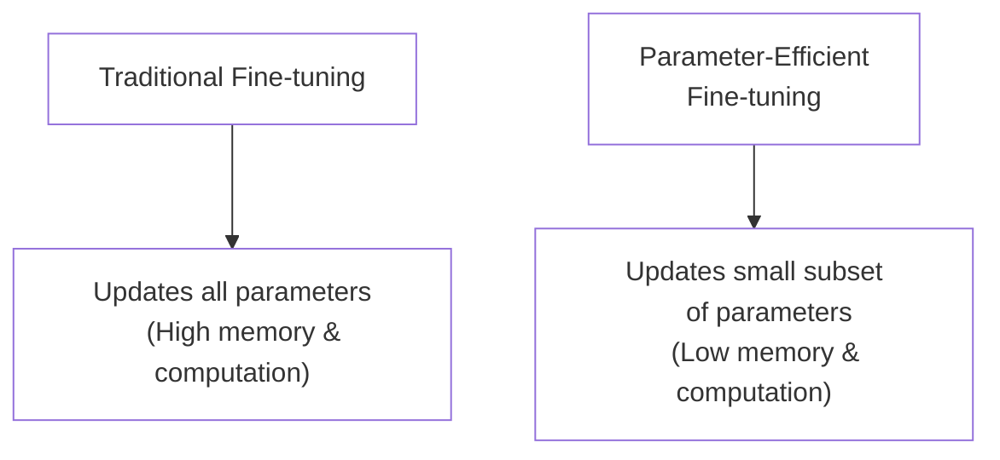
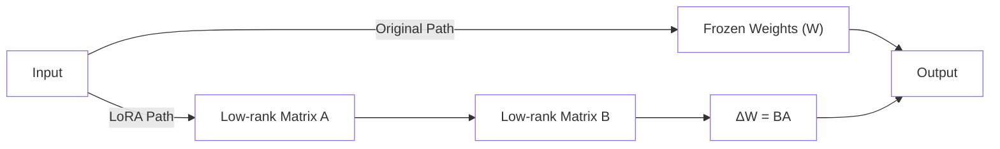
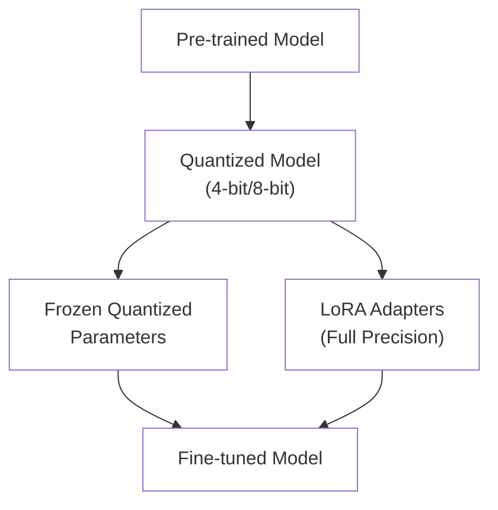
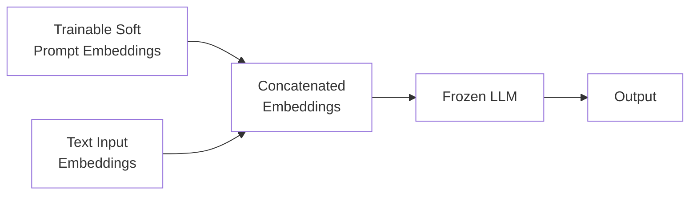
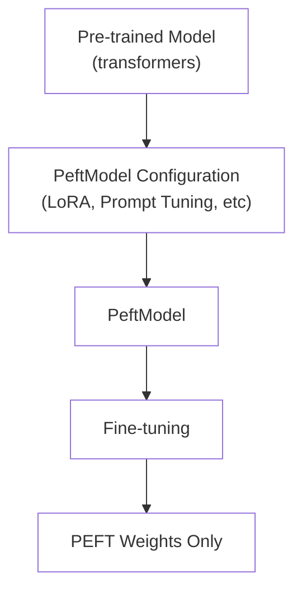
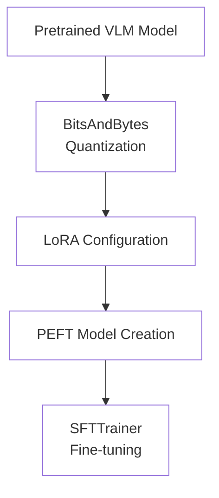
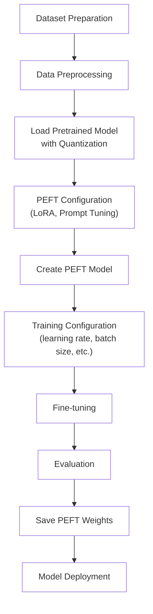
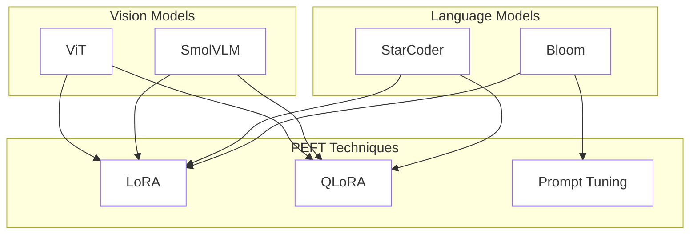

<!-- source: DeepWiki mcp.deepwiki.com · repo huggingface/cookbook · page 4.4 Parameter-Efficient Fine-tuning · fetched 2026-10-26 -->

# Parameter-Efficient Fine-tuning

<details>
<summary>Relevant source files</summary>

The following files were used as context for generating this wiki page:

- [notebooks/en/fine_tuning_smol_vlm_sft_trl.ipynb](notebooks/en/fine_tuning_smol_vlm_sft_trl.ipynb)
- [notebooks/en/fine_tuning_vlm_dpo_smolvlm_instruct.ipynb](notebooks/en/fine_tuning_vlm_dpo_smolvlm_instruct.ipynb)
- [notebooks/en/multiagent_rag_system.ipynb](notebooks/en/multiagent_rag_system.ipynb)
- [notebooks/en/rag_with_hf_and_milvus.ipynb](notebooks/en/rag_with_hf_and_milvus.ipynb)
- [notebooks/tr/_toctree.yml](notebooks/tr/_toctree.yml)
- [notebooks/tr/agent_data_analyst.ipynb](notebooks/tr/agent_data_analyst.ipynb)
- [notebooks/tr/agents.ipynb](notebooks/tr/agents.ipynb)
- [notebooks/tr/fine_tuning_code_llm_on_single_gpu.ipynb](notebooks/tr/fine_tuning_code_llm_on_single_gpu.ipynb)
- [notebooks/tr/fine_tuning_detr_custom_dataset.ipynb](notebooks/tr/fine_tuning_detr_custom_dataset.ipynb)
- [notebooks/tr/fine_tuning_vit_custom_dataset.ipynb](notebooks/tr/fine_tuning_vit_custom_dataset.ipynb)
- [notebooks/zh-CN/index.md](notebooks/zh-CN/index.md)
- [notebooks/zh-CN/prompt_tuning_peft.ipynb](notebooks/zh-CN/prompt_tuning_peft.ipynb)
- [notebooks/zh-CN/rag_with_hf_and_milvus.ipynb](notebooks/zh-CN/rag_with_hf_and_milvus.ipynb)

</details>


Parameter-efficient fine-tuning (PEFT) refers to a collection of techniques that allow you to adapt pre-trained models to specific tasks while updating only a small subset of parameters. These methods significantly reduce computational requirements compared to traditional fine-tuning, making it feasible to adapt large models on consumer hardware. This page covers key PEFT techniques, their implementation, and practical examples in the Hugging Face ecosystem.

For larger topics such as RAG systems or multimodal applications that may incorporate PEFT, see [Retrieval-Augmented Generation (RAG) Systems](#2) and [Model Fine-tuning Techniques](#4).

## Overview of Parameter-Efficient Fine-tuning

Traditional fine-tuning updates all parameters of a pre-trained model, which becomes increasingly resource-intensive as models grow larger. Parameter-efficient fine-tuning addresses this challenge by modifying only a small subset of parameters or introducing a small number of new trainable parameters, while keeping most of the pre-trained model frozen.



Sources: 
- notebooks/en/fine_tuning_smol_vlm_sft_trl.ipynb
- notebooks/tr/fine_tuning_code_llm_on_single_gpu.ipynb

### Benefits of Parameter-Efficient Fine-tuning

PEFT techniques offer several advantages over traditional fine-tuning:

| Benefit | Description |
|---------|-------------|
| **Lower memory requirements** | Requires significantly less GPU memory since most parameters are frozen |
| **Faster training** | Fewer parameters to update means faster training times |
| **Reduced storage** | Only need to store the small set of fine-tuned parameters instead of the entire model |
| **Mitigates catastrophic forgetting** | Preserves general knowledge from pre-training by keeping most parameters frozen |
| **Consumer hardware compatible** | Enables fine-tuning of large models on consumer GPUs |

Sources:
- notebooks/en/fine_tuning_smol_vlm_sft_trl.ipynb
- notebooks/en/fine_tuning_vlm_dpo_smolvlm_instruct.ipynb

## Key Parameter-Efficient Fine-tuning Techniques

### Low-Rank Adaptation (LoRA)

LoRA is one of the most popular PEFT techniques. It approximates weight updates using low-rank decomposition matrices, drastically reducing the number of trainable parameters.



**Key LoRA parameters:**
- `r`: Rank dimension (smaller r means fewer parameters)
- `alpha`: Scaling factor to control update magnitude
- `dropout`: Dropout probability applied to LoRA layers
- `target_modules`: Specific layers to apply LoRA to

Sources:
- notebooks/tr/fine_tuning_code_llm_on_single_gpu.ipynb
- notebooks/en/fine_tuning_smol_vlm_sft_trl.ipynb

### Quantized LoRA (QLoRA)

QLoRA combines quantization with LoRA, further reducing memory requirements by quantizing the base model (typically to 4-bit or 8-bit precision) while applying LoRA for fine-tuning.



Sources:
- notebooks/tr/fine_tuning_code_llm_on_single_gpu.ipynb
- notebooks/en/fine_tuning_smol_vlm_sft_trl.ipynb

### Prompt Tuning

Prompt tuning adds trainable tokens to the input prompt while keeping the model frozen. These "soft prompts" are optimized during training to improve performance on specific tasks.



Sources:
- notebooks/zh-CN/prompt_tuning_peft.ipynb

## PEFT Implementation with Hugging Face

The Hugging Face ecosystem provides comprehensive support for parameter-efficient fine-tuning through the PEFT library and integration with other libraries like Transformers and TRL (Transformer Reinforcement Learning).

### PEFT Library Integration



Sources:
- notebooks/zh-CN/prompt_tuning_peft.ipynb

### Example Implementation for LoRA Fine-tuning

The basic pattern for implementing LoRA fine-tuning involves:
1. Loading a pre-trained model
2. Configuring LoRA parameters
3. Converting the model to a PEFT model
4. Fine-tuning with regular PyTorch/Hugging Face training loops

Sample implementation outline:

```python
from transformers import AutoModelForCausalLM, AutoTokenizer
from peft import LoraConfig, get_peft_model

# 1. Load pre-trained model
model = AutoModelForCausalLM.from_pretrained("model_name")
tokenizer = AutoTokenizer.from_pretrained("model_name")

# 2. Configure LoRA
lora_config = LoraConfig(
    r=8,                    # Rank
    lora_alpha=32,          # Alpha parameter
    lora_dropout=0.05,      # Dropout probability
    target_modules=["q_proj", "v_proj"],  # Target layers for LoRA
    bias="none"
)

# 3. Convert to PEFT model
peft_model = get_peft_model(model, lora_config)

# 4. Train as usual
# ...regular training loop...
```

Sources:
- notebooks/tr/fine_tuning_code_llm_on_single_gpu.ipynb

## Applications and Examples

### Fine-tuning Vision Language Models

Fine-tuning vision-language models (VLMs) like SmolVLM using parameter-efficient methods allows adaptation to specific visual tasks while maintaining reasonable computational requirements.



Example workflow for fine-tuning SmolVLM:

1. Install dependencies and prepare the environment
2. Load the VLM model and tokenizer
3. Configure quantization using BitsAndBytes
4. Set up LoRA configuration
5. Create PEFT model and fine-tune using SFTTrainer

Sources:
- notebooks/en/fine_tuning_smol_vlm_sft_trl.ipynb
- notebooks/en/fine_tuning_vlm_dpo_smolvlm_instruct.ipynb

### Fine-tuning Code Models

Parameter-efficient fine-tuning is particularly useful for code models, allowing for adaptation to specific programming styles, frameworks, or internal code patterns.

Example workflow for fine-tuning StarCoder on a custom codebase:


Sources:
- notebooks/tr/fine_tuning_code_llm_on_single_gpu.ipynb

## Training Configuration

### Memory Optimization Techniques

When fine-tuning large models, several memory optimization techniques can be combined with PEFT:

1. **Quantization**: Using libraries like BitsAndBytes to load models in lower precision (4-bit or 8-bit)
2. **Gradient Checkpointing**: Trading computation for memory by recomputing activations during backpropagation
3. **Flash Attention**: Efficient attention implementation that reduces memory usage
4. **Mixed Precision Training**: Using lower precision for certain operations to save memory

Example configuration:

```python
# Quantization configuration
bnb_config = BitsAndBytesConfig(
    load_in_4bit=True,
    bnb_4bit_use_double_quant=True,
    bnb_4bit_quant_type="nf4",
    bnb_4bit_compute_dtype=torch.bfloat16
)

# Load model with quantization
model = AutoModelForCausalLM.from_pretrained(
    model_name,
    quantization_config=bnb_config,
    device_map="auto"
)

# Enable gradient checkpointing
model.gradient_checkpointing_enable()
```

Sources:
- notebooks/tr/fine_tuning_code_llm_on_single_gpu.ipynb
- notebooks/en/fine_tuning_smol_vlm_sft_trl.ipynb

### Training Parameters

Key training parameters for parameter-efficient fine-tuning:

| Parameter | Description | Typical Values |
|-----------|-------------|----------------|
| Learning rate | Controls update step size | 1e-4 to 5e-4 |
| Batch size | Number of samples per batch | 1-16 (GPU dependent) |
| Gradient accumulation steps | Effective batch size multiplier | 1-16 |
| Training epochs | Number of passes through the dataset | 1-5 |
| LoRA rank (r) | Dimension of low-rank matrices | 8, 16, 32, 64 |
| LoRA alpha | Scaling factor for LoRA update | 16, 32 |
| Target modules | Layers to apply LoRA to | Model-specific |

Sources:
- notebooks/tr/fine_tuning_code_llm_on_single_gpu.ipynb
- notebooks/en/fine_tuning_smol_vlm_sft_trl.ipynb

## End-to-End PEFT Workflow

The complete workflow for parameter-efficient fine-tuning combines model preparation, PEFT configuration, training setup, and evaluation.



Sources:
- notebooks/en/fine_tuning_smol_vlm_sft_trl.ipynb
- notebooks/tr/fine_tuning_code_llm_on_single_gpu.ipynb
- notebooks/en/fine_tuning_vlm_dpo_smolvlm_instruct.ipynb

## Advanced PEFT Techniques

### Direct Preference Optimization (DPO)

DPO is a technique used with PEFT to align models with human preferences by learning from paired examples (preferred vs. non-preferred outputs).


Sources:
- notebooks/en/fine_tuning_vlm_dpo_smolvlm_instruct.ipynb

### Fine-tuning Language and Vision Transformers

Parameter-efficient fine-tuning can be applied to different model architectures including Vision Transformers (ViT) and language models.



Sources:
- notebooks/tr/fine_tuning_vit_custom_dataset.ipynb
- notebooks/en/fine_tuning_smol_vlm_sft_trl.ipynb
- notebooks/tr/fine_tuning_code_llm_on_single_gpu.ipynb
- notebooks/zh-CN/prompt_tuning_peft.ipynb

## Conclusion

Parameter-efficient fine-tuning techniques have revolutionized how we adapt large pre-trained models to specific tasks. By updating only a small subset of parameters, PEFT methods like LoRA, QLoRA, and prompt tuning make it feasible to fine-tune large language and vision models on consumer hardware, while maintaining performance comparable to full fine-tuning.

The Hugging Face ecosystem provides comprehensive support for these techniques through libraries like PEFT, Transformers, and TRL, making them accessible to a wide range of users. As models continue to grow in size and complexity, parameter-efficient fine-tuning will become increasingly important for adapting these models to specific applications.

Sources:
- notebooks/en/fine_tuning_smol_vlm_sft_trl.ipynb
- notebooks/en/fine_tuning_vlm_dpo_smolvlm_instruct.ipynb
- notebooks/tr/fine_tuning_code_llm_on_single_gpu.ipynb
- notebooks/zh-CN/prompt_tuning_peft.ipynb
- notebooks/tr/fine_tuning_vit_custom_dataset.ipynb

---

