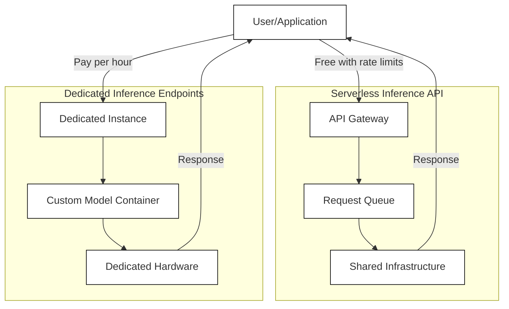
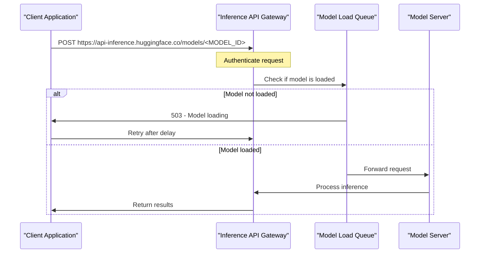
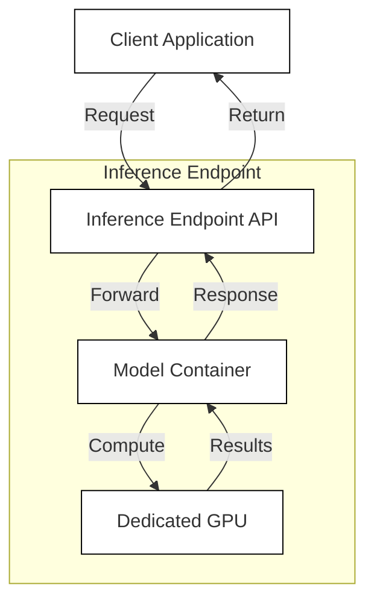
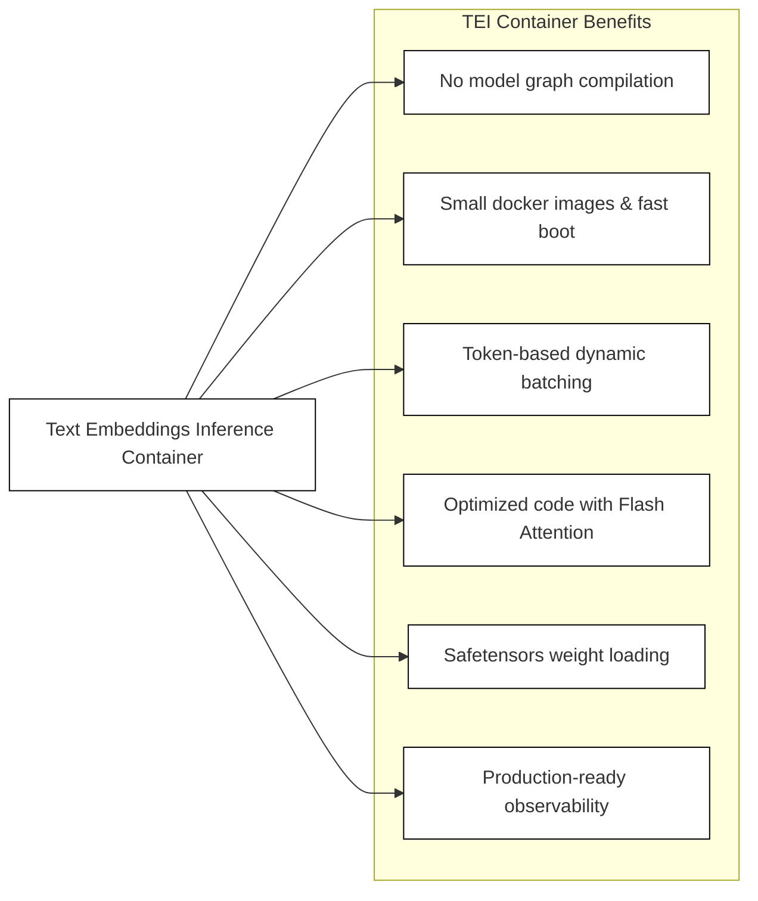
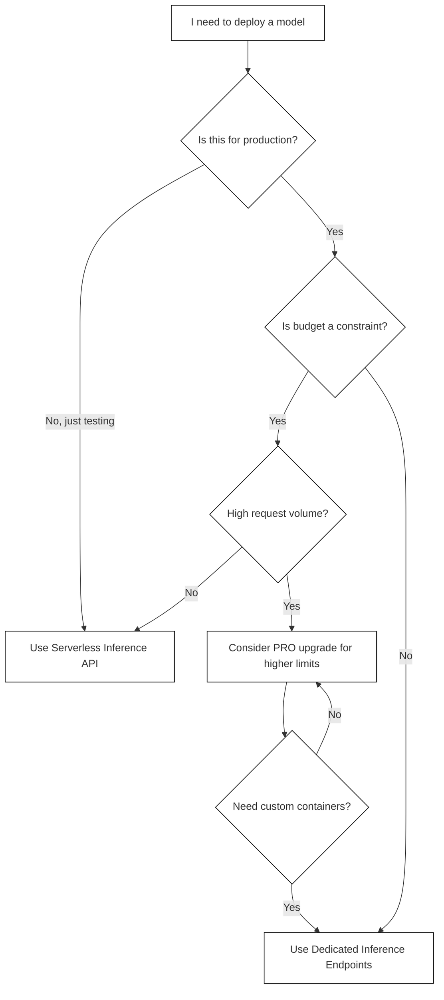

<!-- source: DeepWiki mcp.deepwiki.com · repo huggingface/cookbook · page 5.1 Inference Options · fetched 2026-10-26 -->

# Inference Options

<details>
<summary>Relevant source files</summary>

The following files were used as context for generating this wiki page:

- [notebooks/en/_toctree.yml](notebooks/en/_toctree.yml)
- [notebooks/en/automatic_embedding_tei_inference_endpoints.ipynb](notebooks/en/automatic_embedding_tei_inference_endpoints.ipynb)
- [notebooks/en/enterprise_cookbook_argilla.ipynb](notebooks/en/enterprise_cookbook_argilla.ipynb)
- [notebooks/en/enterprise_cookbook_dev_spaces.md](notebooks/en/enterprise_cookbook_dev_spaces.md)
- [notebooks/en/enterprise_dedicated_endpoints.ipynb](notebooks/en/enterprise_dedicated_endpoints.ipynb)
- [notebooks/en/enterprise_hub_serverless_inference_api.ipynb](notebooks/en/enterprise_hub_serverless_inference_api.ipynb)

</details>


This document describes the different inference options available in the Hugging Face ecosystem for deploying and running machine learning models. We focus specifically on comparing the Serverless Inference API (for quick testing and smaller workloads) and Dedicated Inference Endpoints (for production deployments). For information about embedding generation with Inference Endpoints, see [Automatic Embeddings with Inference Endpoints](#5.2).

## Overview of Inference Options

Hugging Face offers two main options for model inference:

1. **Serverless Inference API**: A free service for quickly testing and evaluating models with simple API calls. Suitable for development and lower-volume usage.

2. **Dedicated Inference Endpoints**: A paid service that provides dedicated compute resources for running models with consistent performance, scaling, and reliability. Suitable for production deployments.

### Comparison at a Glance

| Feature | Serverless Inference API | Dedicated Inference Endpoints |
| ------- | ------------------------ | ----------------------------- |
| Cost | Free (with rate limits) | Pay per hour (based on hardware) |
| Rate limits | Yes (~few hundred requests/hour) | No (limited only by hardware) |
| Setup | None required | Create and configure endpoint |
| Hardware | Shared resources | Dedicated GPUs/CPUs |
| Use cases | Testing, development, low volume | Production, high volume |
| Performance | Variable (shared resources) | Consistent (dedicated resources) |
| API customization | Limited | Full control |
| Models | Public or your private models | Custom container options |

Sources: [notebooks/en/enterprise_hub_serverless_inference_api.ipynb:15-28](), [notebooks/en/automatic_embedding_tei_inference_endpoints.ipynb:15-26]()

## Inference Options Architecture



Sources: [notebooks/en/enterprise_hub_serverless_inference_api.ipynb:96-104](), [notebooks/en/automatic_embedding_tei_inference_endpoints.ipynb:312-321]()

## Serverless Inference API

The Serverless Inference API provides a straightforward way to test models without any setup or infrastructure management. It's available for free with rate limits for regular users, and higher rate limits for PRO users.

### How It Works



Sources: [notebooks/en/enterprise_hub_serverless_inference_api.ipynb:96-104](), [notebooks/en/enterprise_hub_serverless_inference_api.ipynb:155-163]()

### Usage Examples

You can use the Serverless Inference API in two main ways:

#### 1. Direct HTTP Requests

```python
import requests

API_URL = "https://api-inference.huggingface.co/models/codellama/CodeLlama-7b-hf"
HEADERS = {"Authorization": f"Bearer {token}"}

def query(payload):
    response = requests.post(API_URL, headers=HEADERS, json=payload)
    return response.json()

output = query({
    "inputs": "A HTTP POST request is used to ",
    "parameters": {"temperature": 0.8, "max_new_tokens": 50, "seed": 42},
})
```

Sources: [notebooks/en/enterprise_hub_serverless_inference_api.ipynb:129-148]()

#### 2. Using the `huggingface_hub` Python Library

```python
from huggingface_hub import InferenceClient

client = InferenceClient()
response = client.text_generation(
    prompt="A HTTP POST request is used to ",
    model="codellama/CodeLlama-7b-hf",
    temperature=0.8,
    max_new_tokens=50,
    seed=42,
    return_full_text=True,
)
```

Sources: [notebooks/en/enterprise_hub_serverless_inference_api.ipynb:195-207]()

### Limitations and Considerations

- **Rate Limits**: Regular users are limited to a few hundred requests per hour. PRO accounts ($9/month) get higher rate limits.
- **Model Loading**: If a model isn't already loaded, the API initially returns a 503 response. You need to retry after waiting for the model to load.
- **Variable Performance**: Since resources are shared, performance can vary based on overall load.
- **Best Practices**: For LLMs, it's important to use the correct chat templates for each model. The `InferenceClient` simplifies this with methods like `chat_completion()`.

Sources: [notebooks/en/enterprise_hub_serverless_inference_api.ipynb:26-27](), [notebooks/en/enterprise_hub_serverless_inference_api.ipynb:155-163](), [notebooks/en/enterprise_hub_serverless_inference_api.ipynb:359-371]()

## Dedicated Inference Endpoints

Dedicated Inference Endpoints provide production-grade infrastructure for deploying machine learning models with consistent performance, reliability, and scaling options.

### Architecture and Components



Sources: [notebooks/en/automatic_embedding_tei_inference_endpoints.ipynb:312-321]()

### Available Hardware Options

Hugging Face offers a wide range of hardware options for Inference Endpoints, allowing you to choose the right balance of performance and cost for your specific needs.

| Provider | Instance Type | Size | GPUs | Memory | Hourly Rate |
|----------|--------------|------|------|--------|-------------|
| aws      | nvidia-a10g  | x1   | 1    | 24GB   | $1.00       |
| aws      | nvidia-t4    | x1   | 1    | 14GB   | $0.50       |
| aws      | nvidia-t4    | x4   | 4    | 56GB   | $3.00       |
| aws      | nvidia-a100  | x1   | 1    | 80GB   | $4.00       |
| aws      | nvidia-a100  | x4   | 4    | 320GB  | $16.00      |
| gcp      | nvidia-l4    | x1   | 1    | 24GB   | $0.80       |
| gcp      | nvidia-a100  | x1   | 1    | 80GB   | $6.00       |
| gcp      | nvidia-h100  | x1   | 1    | 80GB   | $12.50      |

*Note: This is a subset of available options. See documentation for the complete list.*

Sources: [notebooks/en/automatic_embedding_tei_inference_endpoints.ipynb:116-146]()

### Creating an Inference Endpoint

You can create an Inference Endpoint programmatically using the `huggingface_hub` Python library:

```python
from huggingface_hub import create_inference_endpoint

endpoint = create_inference_endpoint(
    "my-endpoint-name",
    repository="model-name/model-id",
    task="text-generation",
    framework="pytorch",
    accelerator="gpu",
    instance_size="x1",
    instance_type="nvidia-a10g",
    region="us-east-1",
    vendor="aws",
    type="protected",
)

# Wait for the endpoint to be ready
endpoint.wait()
```

Sources: [notebooks/en/automatic_embedding_tei_inference_endpoints.ipynb:330-356](), [notebooks/en/automatic_embedding_tei_inference_endpoints.ipynb:411-412]()

### Using a Custom Container Image

For specialized use cases, you can use custom container images with your Inference Endpoint:

```python
endpoint = create_inference_endpoint(
    "my-tei-endpoint",
    repository="model-name/model-id",
    task="sentence-embeddings",
    framework="pytorch",
    accelerator="gpu",
    instance_size="x1",
    instance_type="nvidia-a10g",
    region="us-east-1",
    vendor="aws",
    custom_image={
        "health_route": "/health",
        "env": {
            "MAX_BATCH_TOKENS": "4096",
            "MAX_CONCURRENT_REQUESTS": "512",
            "MODEL_ID": "/repository"
        },
        "url": "ghcr.io/huggingface/text-embeddings-inference:0.5.0",
    },
    type="protected",
)
```

Sources: [notebooks/en/automatic_embedding_tei_inference_endpoints.ipynb:330-356]()

### Making Requests to an Inference Endpoint

Once your endpoint is running, you can make inference requests:

```python
response = endpoint.client.post(
    json={"inputs": "Your input text", "parameters": {"temperature": 0.7}},
    task="text-generation"
)
```

For streaming responses:

```python
for token in endpoint.client.post(
    json={"inputs": "Your input text", "parameters": {"temperature": 0.7}},
    task="text-generation",
    stream=True
):
    print(token.choices[0].delta.content, end="")
```

Sources: [notebooks/en/automatic_embedding_tei_inference_endpoints.ipynb:446-448](), [notebooks/en/enterprise_hub_serverless_inference_api.ipynb:455-458]()

### Managing Endpoint Lifecycle

You can manage the lifecycle of your endpoint programmatically:

```python
# Pause the endpoint (stop billing)
endpoint = endpoint.pause()

# Resume a paused endpoint
endpoint = endpoint.resume()

# Delete an endpoint when no longer needed
endpoint = endpoint.delete()
```

Sources: [notebooks/en/automatic_embedding_tei_inference_endpoints.ipynb:618-620](), [notebooks/en/automatic_embedding_tei_inference_endpoints.ipynb:809-813]()

## Specialized Inference Options

### Text Embeddings Inference (TEI)

For embedding generation tasks, Hugging Face offers a specialized Text Embeddings Inference (TEI) container that provides optimized performance:



Sources: [notebooks/en/automatic_embedding_tei_inference_endpoints.ipynb:15-26]()

## Decision Guide: Which Inference Option to Choose?



Sources: [notebooks/en/enterprise_hub_serverless_inference_api.ipynb:26-27](), [notebooks/en/automatic_embedding_tei_inference_endpoints.ipynb:771-791]()

## Integration with Other Hugging Face Services

### JupyterLab Spaces

Hugging Face JupyterLab Spaces can be used alongside Inference Options for development and testing:

- Create models and evaluate them using the Serverless Inference API
- Develop code that will be deployed to Dedicated Inference Endpoints
- Scale your compute resources dynamically for training and testing
- Connect to cloud resources with your preferred local IDE via SSH

Sources: [notebooks/en/enterprise_cookbook_dev_spaces.md:6-16](), [notebooks/en/enterprise_cookbook_dev_spaces.md:57-66]()

### Data Annotation with Argilla

You can use Hugging Face Inference options with Argilla for data annotation workflows:

1. Use Inference API to generate candidate responses
2. Upload these responses to Argilla for evaluation and annotation
3. Download the annotated data for model improvement
4. Deploy improved models on Inference Endpoints

Sources: [notebooks/en/enterprise_cookbook_argilla.ipynb:16-29](), [notebooks/en/enterprise_cookbook_argilla.ipynb:775-780]()

## Conclusion

Hugging Face provides flexible inference options to match different needs and stages of the model lifecycle:

- **Serverless Inference API** is ideal for development, testing, and low-volume applications where ease of use and cost are primary concerns.
- **Dedicated Inference Endpoints** provide the reliability, control, and performance needed for production deployments and high-volume applications.

As your needs evolve, you can easily transition from Serverless to Dedicated options, leveraging the same API patterns and code structure across both.

---

