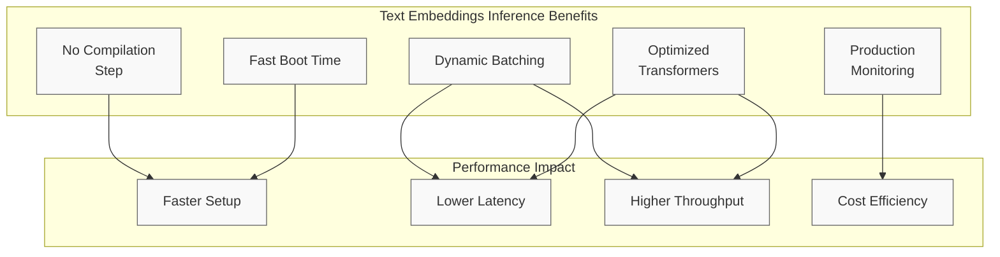
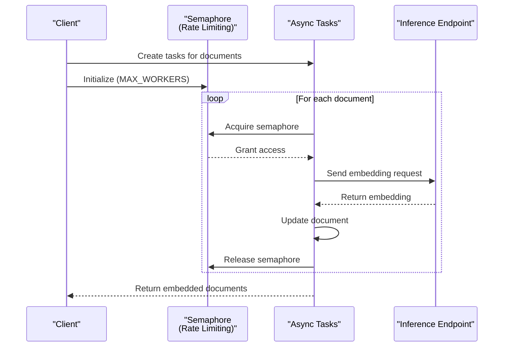
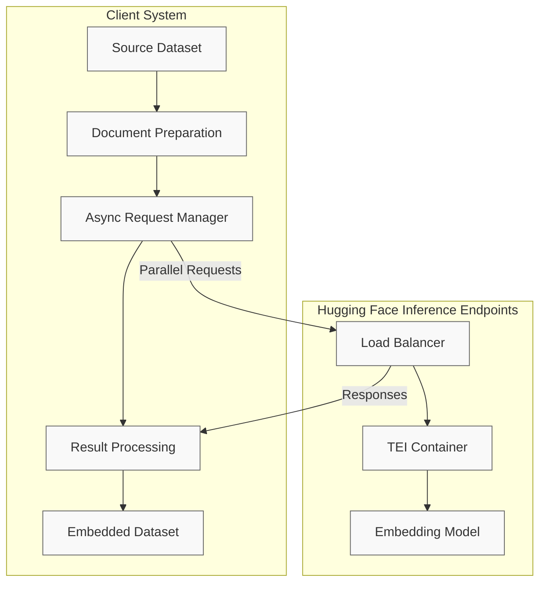

<!-- source: DeepWiki mcp.deepwiki.com · repo huggingface/cookbook · page 5.2 Automatic Embeddings with Inference Endpoints · fetched 2026-10-26 -->

# Automatic Embeddings with Inference Endpoints

<details>
<summary>Relevant source files</summary>

The following files were used as context for generating this wiki page:

- [notebooks/en/_toctree.yml](notebooks/en/_toctree.yml)
- [notebooks/en/automatic_embedding_tei_inference_endpoints.ipynb](notebooks/en/automatic_embedding_tei_inference_endpoints.ipynb)
- [notebooks/zh-CN/advanced_rag.ipynb](notebooks/zh-CN/advanced_rag.ipynb)
- [notebooks/zh-CN/automatic_embedding_tei_inference_endpoints.ipynb](notebooks/zh-CN/automatic_embedding_tei_inference_endpoints.ipynb)
- [notebooks/zh-CN/faiss_with_hf_datasets_and_clip.ipynb](notebooks/zh-CN/faiss_with_hf_datasets_and_clip.ipynb)
- [notebooks/zh-CN/fine_tuning_code_llm_on_single_gpu.ipynb](notebooks/zh-CN/fine_tuning_code_llm_on_single_gpu.ipynb)
- [notebooks/zh-CN/rag_evaluation.ipynb](notebooks/zh-CN/rag_evaluation.ipynb)
- [notebooks/zh-CN/rag_zephyr_langchain.ipynb](notebooks/zh-CN/rag_zephyr_langchain.ipynb)

</details>


## Purpose and Scope

This document explains how to efficiently generate text embeddings at scale using Hugging Face Inference Endpoints. Text embeddings convert raw text into dense vector representations, which are essential for semantic search, retrieval-augmented generation (RAG), and other NLP tasks. This approach is particularly valuable when you need to process large document collections while minimizing costs and infrastructure management. For information about using RAG with different vector databases, see [RAG with Different Vector Databases](#2.4).

Sources: [notebooks/en/automatic_embedding_tei_inference_endpoints.ipynb:8-26]()

## Overview of Embedding with Inference Endpoints

Inference Endpoints provide a serverless or dedicated infrastructure option for running inference on Hugging Face models. By combining them with Text Embeddings Inference (TEI) - an optimized inference solution for embedding models - you can create a high-performance, cost-effective embedding pipeline.

The workflow consists of three main steps:
1. Creating and configuring a dedicated Inference Endpoint with TEI
2. Processing documents in parallel through asynchronous requests
3. Saving the resulting embeddings into a dataset


Sources: [notebooks/en/automatic_embedding_tei_inference_endpoints.ipynb:16-26](), [notebooks/en/automatic_embedding_tei_inference_endpoints.ipynb:312-319]()

## Advantages of Text Embeddings Inference (TEI)

Text Embeddings Inference offers several optimizations that make it ideal for embedding large document collections:

- No model graph compilation step
- Small Docker images and fast boot times
- Token-based dynamic batching
- Optimized transformers code using Flash Attention, Candle, and cuBLASLt
- Safetensors weight loading
- Production-ready monitoring (Open Telemetry, Prometheus metrics)

These optimizations result in significant performance improvements compared to standard inference approaches.



Sources: [notebooks/en/automatic_embedding_tei_inference_endpoints.ipynb:19-26]()

## Setting Up an Inference Endpoint

### Required APIs and Dependencies

To interact with Inference Endpoints, you'll need:

```python
# Required packages
aiohttp      # For async HTTP requests
datasets     # For dataset handling
huggingface_hub  # For Inference Endpoints API
numpy        # For array operations
pandas       # For data manipulation
```

Sources: [notebooks/en/automatic_embedding_tei_inference_endpoints.ipynb:48-49](), [notebooks/en/automatic_embedding_tei_inference_endpoints.ipynb:65-82]()

### Configuration Parameters

Several key parameters need to be defined:

| Parameter | Description | Example |
|-----------|-------------|---------|
| `DATASET_IN` | Source dataset path on Hugging Face | 'username/dataset-name' |
| `DATASET_OUT` | Destination for embedded dataset | 'processed-dataset-name' |
| `ENDPOINT_NAME` | Name for your Inference Endpoint | 'my-embedding-endpoint' |
| `MAX_WORKERS` | Number of parallel embedding workers | 5 |
| `VENDOR` | Cloud provider | 'aws' |
| `REGION` | Deployment region | 'us-east-1' |
| `INSTANCE_SIZE` | Size tier | 'medium' |
| `INSTANCE_TYPE` | Hardware configuration | 'g5.2xlarge' |

Sources: [notebooks/en/automatic_embedding_tei_inference_endpoints.ipynb:103-112](), [notebooks/en/automatic_embedding_tei_inference_endpoints.ipynb:142-146]()

### Available GPU Options

Inference Endpoints offers a variety of GPU options to match your performance and budget requirements:

| Provider | Instance Type | Instance Size | Hourly rate | GPUs | Memory | Architecture |
|:--------:|:-------------:|:-------------:|:-----------:|:----:|:------:|:------------:|
| aws      | nvidia-a10g   | x1            | $1          | 1    | 24GB   | NVIDIA A10G  |
| aws      | nvidia-t4     | x1            | $0.5        | 1    | 14GB   | NVIDIA T4    |
| aws      | nvidia-t4     | x4            | $3          | 4    | 56GB   | NVIDIA T4    |
| gcp      | nvidia-l4     | x1            | $0.8        | 1    | 24GB   | NVIDIA L4    |
| gcp      | nvidia-l4     | x4            | $3.8        | 4    | 96GB   | NVIDIA L4    |
| aws      | nvidia-a100   | x1            | $4          | 1    | 80GB   | NVIDIA A100  |
| aws      | nvidia-a10g   | x4            | $5          | 4    | 96GB   | NVIDIA A10G  |

This is a subset of the available options. For memory-intensive embedding models like `jina-embeddings-v2` with 8k context length, an A10G or larger GPU is recommended.

Sources: [notebooks/en/automatic_embedding_tei_inference_endpoints.ipynb:116-146]()

### Creating the Endpoint

The endpoint can be created programmatically using the Hugging Face Hub API:

```python
endpoint = create_inference_endpoint(
    ENDPOINT_NAME,
    repository="jinaai/jina-embeddings-v2-base-en",  # Or your embedding model
    task="sentence-embeddings",
    accelerator="gpu",
    instance_size=INSTANCE_SIZE,
    instance_type=INSTANCE_TYPE,
    region=REGION,
    vendor=VENDOR,
    namespace=namespace,
    custom_image={
        "health_route": "/health",
        "env": {
            "MAX_BATCH_TOKENS": str(MAX_WORKERS * 2048),
            "MAX_CONCURRENT_REQUESTS": "512",
            "MODEL_ID": "/repository"
        },
        "url": "ghcr.io/huggingface/text-embeddings-inference:0.5.0",
    },
    type="protected",
)
```

The key configuration elements include:
- **Model selection**: Choose an appropriate embedding model
- **Hardware configuration**: Select GPU type and size based on your needs
- **TEI configuration**: Tune batching parameters through environment variables
- **Security**: Use the `protected` type for authenticated access

Sources: [notebooks/en/automatic_embedding_tei_inference_endpoints.ipynb:316-343]()

## Embedding Document Collections

### Loading Source Data

First, load the dataset you want to embed:

```python
dataset = load_dataset(DATASET_IN)
documents = dataset['train'].to_pandas().to_dict('records')[:ROW_COUNT]
```

Sources: [notebooks/en/automatic_embedding_tei_inference_endpoints.ipynb:254-256](), [notebooks/en/automatic_embedding_tei_inference_endpoints.ipynb:288-289]()

### Parallel Processing with Async Requests

For efficient processing, implement an asynchronous request pattern:



The implementation uses Python's `asyncio` library with a bounded semaphore to control concurrency:

```python
async def request(document, semaphore):
    async with semaphore:  # Rate limit requests
        result = await endpoint.async_client.post(
            json={"inputs": document['content'], 'truncate': True}, 
            task="feature-extraction"
        )
        result = np.array(json.loads(result.decode()))
        document['embedding'] = result[0]
        return document

async def main(documents):
    semaphore = asyncio.BoundedSemaphore(MAX_WORKERS)
    tasks = [request(document, semaphore) for document in documents]
    
    for f in tqdm(asyncio.as_completed(tasks), total=len(documents)):
        await f
```

This pattern allows for controlled parallelization of embedding requests, ensuring optimal throughput without overwhelming the endpoint.

Sources: [notebooks/en/automatic_embedding_tei_inference_endpoints.ipynb:507-525](), [notebooks/en/automatic_embedding_tei_inference_endpoints.ipynb:560-562]()

### Handling Long Documents

For documents that exceed the model's context length, use truncation:

```python
# Handle long documents with truncation
response = endpoint.client.post(
    json={"inputs": document_text, 'truncate': True}, 
    task="feature-extraction"
)
```

This ensures that documents are processed without errors, even if they exceed the model's maximum sequence length.

Sources: [notebooks/en/automatic_embedding_tei_inference_endpoints.ipynb:432-435](), [notebooks/en/automatic_embedding_tei_inference_endpoints.ipynb:475-479]()

## Managing Cost and Resources

### Pausing the Endpoint

To avoid unnecessary charges, pause the endpoint when not in use:

```python
endpoint = endpoint.pause()
```

Sources: [notebooks/en/automatic_embedding_tei_inference_endpoints.ipynb:605-607]()

### Cost Analysis

The cost-efficiency of this approach comes from:
1. Only paying for the time the endpoint is active
2. Using optimized TEI containers for faster processing
3. Selecting appropriate hardware for your workload

For reference, embedding 100 documents with a Jina embeddings model on a single A10G GPU typically costs less than $0.05.

Sources: [notebooks/en/automatic_embedding_tei_inference_endpoints.ipynb:777]()

### Resource Cleanup

When you're completely finished, delete the endpoint:

```python
endpoint = endpoint.delete()
```

Sources: [notebooks/en/automatic_embedding_tei_inference_endpoints.ipynb:809-813]()

## Saving and Using Embedded Documents

### Creating a Dataset with Embeddings

Convert your embedded documents back to a dataset format:

```python
df = pd.DataFrame(documents)
dd = DatasetDict({'train': Dataset.from_pandas(df)})
dd.push_to_hub(repo_id=DATASET_OUT)
```

This creates a new dataset on the Hugging Face Hub with your embedded documents, ready for use in downstream tasks.

Sources: [notebooks/en/automatic_embedding_tei_inference_endpoints.ipynb:641-642](), [notebooks/en/automatic_embedding_tei_inference_endpoints.ipynb:691]()

## Complete System Architecture

The complete embedding pipeline integrates several components:



This architecture provides:
- Efficient parallel processing of documents
- Controlled resource utilization
- Optimized inference performance
- Cost-effective scaling for large document collections

Sources: [notebooks/en/automatic_embedding_tei_inference_endpoints.ipynb:507-525](), [notebooks/en/automatic_embedding_tei_inference_endpoints.ipynb:316-343]()

## Conclusion

Using Inference Endpoints with Text Embeddings Inference provides an efficient, scalable approach to embedding document collections. This approach offers:

1. **Performance**: Optimized containers and hardware acceleration
2. **Cost-efficiency**: Pay only for what you use
3. **Simplicity**: No infrastructure management
4. **Scalability**: Scale up or down based on your needs

For larger production workloads, consider fine-tuning the batch size, concurrency, and instance type to optimize performance and cost.

Sources: [notebooks/en/automatic_embedding_tei_inference_endpoints.ipynb:19-26](), [notebooks/en/automatic_embedding_tei_inference_endpoints.ipynb:789-790]()

---

