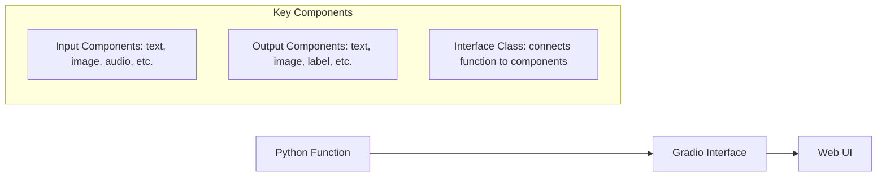
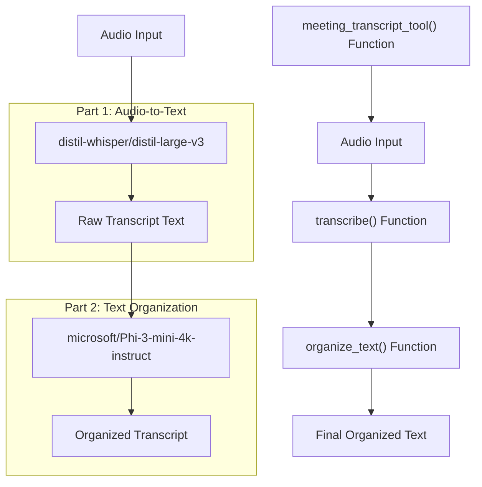
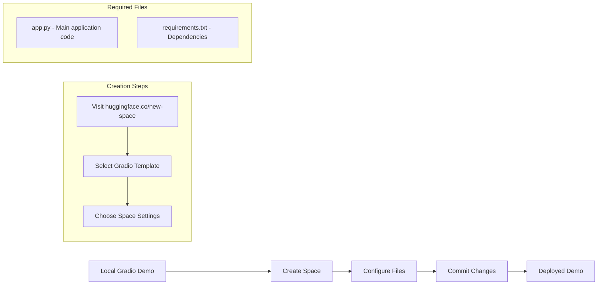
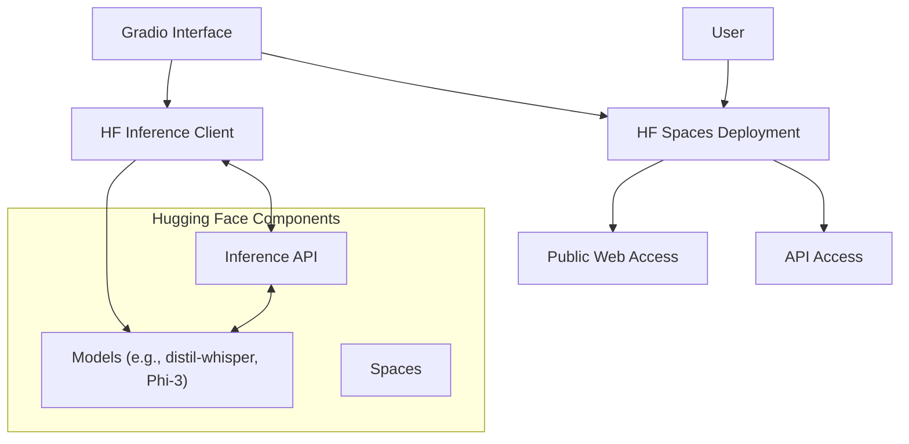

<!-- source: DeepWiki mcp.deepwiki.com · repo huggingface/cookbook · page 5.3 Building ML Demos with Gradio and Spaces · fetched 2026-10-26 -->

# Building ML Demos with Gradio and Spaces

<details>
<summary>Relevant source files</summary>

The following files were used as context for generating this wiki page:

- [notebooks/en/enterprise_cookbook_argilla.ipynb](notebooks/en/enterprise_cookbook_argilla.ipynb)
- [notebooks/en/enterprise_cookbook_dev_spaces.md](notebooks/en/enterprise_cookbook_dev_spaces.md)
- [notebooks/en/enterprise_cookbook_gradio.ipynb](notebooks/en/enterprise_cookbook_gradio.ipynb)
- [notebooks/en/enterprise_cookbook_overview.md](notebooks/en/enterprise_cookbook_overview.md)
- [notebooks/en/enterprise_dedicated_endpoints.ipynb](notebooks/en/enterprise_dedicated_endpoints.ipynb)
- [notebooks/en/enterprise_hub_serverless_inference_api.ipynb](notebooks/en/enterprise_hub_serverless_inference_api.ipynb)

</details>


This document details how to create interactive machine learning demos using Gradio and deploy them on Hugging Face Spaces. Gradio allows you to quickly transform any Python function into a web interface, while Spaces provides hosting and sharing capabilities for these demos with easy integration into the Hugging Face ecosystem.

For information about serverless inference options, see [Inference Options](#5.1). For interactive development environments using JupyterLab, see [Interactive Development with JupyterLab Spaces](#5.4).

## Core Concepts of Gradio

Gradio's fundamental purpose is to transform Python functions into web interfaces. The basic workflow involves:

1. Creating a Python function that performs your ML task
2. Wrapping it with a Gradio Interface that defines inputs and outputs
3. Launching the interface locally or deploying it to Spaces

### Gradio Architecture



Sources: [notebooks/en/enterprise_cookbook_gradio.ipynb:66-67](), [notebooks/en/enterprise_cookbook_gradio.ipynb:142-147]()

### Basic Example: Hello World Demo

Here's a simple example that demonstrates the basics of Gradio:

```python
def greet(name, intensity):
    return "Hello, " + name + "!" * int(intensity)

demo = gr.Interface(
    fn=greet,
    inputs=["text", "slider"],
    outputs=["text"],
)

demo.launch()
```

This creates a web interface with:
- A text box for entering a name
- A slider for selecting intensity
- A text output area for displaying the greeting

When you call `demo.launch()`, Gradio starts a local web server and opens the interface in your browser.

Sources: [notebooks/en/enterprise_cookbook_gradio.ipynb:89-175]()

## Building a Real-World ML Demo

The notebook demonstrates a more complex application: a meeting transcription tool that combines two ML models:

### Meeting Transcription Tool Architecture



Sources: [notebooks/en/enterprise_cookbook_gradio.ipynb:184-196](), [notebooks/en/enterprise_cookbook_gradio.ipynb:348-382](), [notebooks/en/enterprise_cookbook_gradio.ipynb:536-564]()

### Audio Transcription Component

The first component converts audio to text using the `distil-whisper/distil-large-v3` model:

```python
def transcribe(audio_input):
    if audio_input is None:
        raise gr.Error("No audio file submitted!")

    output = pipe(
        audio_input,
        batch_size=BATCH_SIZE,
        generate_kwargs={"task": "transcribe"},
        return_timestamps=True
    )
    return output["text"]
```

This function is wrapped with a Gradio interface:

```python
part_1_demo = gr.Interface(
    fn=transcribe,
    inputs=gr.Audio(type="filepath"),
    outputs=gr.Textbox(show_copy_button=True),
    title="Transcribe Audio to Text",
)
```

Sources: [notebooks/en/enterprise_cookbook_gradio.ipynb:348-382](), [notebooks/en/enterprise_cookbook_gradio.ipynb:406-413]()

### Text Organization Component

The second component structures the text using the `microsoft/Phi-3-mini-4k-instruct` model via the Hugging Face Inference API:

```python
def organize_text(meeting_transcript):
    messages = build_messages(meeting_transcript)
    response = client.chat_completion(
        messages, model=TEXT_MODEL_NAME, max_tokens=250, seed=430
    )
    return response.choices[0].message.content
```

This function is also wrapped with a Gradio interface:

```python
part_2_demo = gr.Interface(
    fn=organize_text,
    inputs=gr.Textbox(value=sample_transcript),
    outputs=gr.Textbox(show_copy_button=True),
    title="Clean Up Transcript Text",
)
```

Sources: [notebooks/en/enterprise_cookbook_gradio.ipynb:536-564](), [notebooks/en/enterprise_cookbook_gradio.ipynb:588-595]()

### Combined Interface

These components are then combined into a single interface:

```python
def meeting_transcript_tool(audio_input):
    meeting_text = transcribe(audio_input)
    organized_text = organize_text(meeting_text)
    return organized_text

full_demo = gr.Interface(
    fn=meeting_transcript_tool,
    inputs=gr.Audio(type="filepath"),
    outputs=gr.Textbox(show_copy_button=True),
    title="The Complete Meeting Transcription Tool",
)
```

Sources: [notebooks/en/enterprise_cookbook_gradio.ipynb:635-647]()

## Deploying to Hugging Face Spaces

### Deployment Flow



Sources: [notebooks/en/enterprise_cookbook_gradio.ipynb:666-674]()

### Creating a New Space

1. Go to https://huggingface.co/new-space
2. Select "Gradio" from the templates
3. Configure basic options (name, visibility, etc.)

Sources: [notebooks/en/enterprise_cookbook_gradio.ipynb:671-674]()

### Required Files

You need to create or edit two main files:

1. **app.py** - Contains your Gradio application code:
   ```python
   # outline of app.py:
   def meeting_transcript_tool(...):
      ...
   def transcribe(...):
      ...
   def organize_text(...):
      ...
   ```

2. **requirements.txt** - Lists the required Python libraries:
   ```
   # contents of requirements.txt:
   torch
   transformers
   ```

Sources: [notebooks/en/enterprise_cookbook_gradio.ipynb:684-707]()

## Advanced Gradio Features

### API Access

Every Gradio demo automatically generates an API endpoint. This allows programmatic access to your demo:

```python
from gradio_client import Client, handle_file

client = Client("username/space-name")
result = client.predict(
    audio_input=handle_file('path/to/audio.wav'),
    api_name="/predict"
)
```

This makes it easy to integrate your demo into other applications or workflows.

Sources: [notebooks/en/enterprise_cookbook_gradio.ipynb:739-835]()

### Sharing via Public URL

During development, you can generate a temporary public URL to share your demo:

```python
demo.launch(share=True)
```

This creates a public link that remains active as long as your local session is running.

### Flagging for Feedback

Gradio includes a built-in mechanism for collecting user feedback:

```python
demo = gr.Interface(
    fn=my_function,
    inputs=...,
    outputs=...,
    allow_flagging="manual"
)
```

This adds a "Flag" button to your interface, allowing users to provide feedback on outputs.

Sources: [notebooks/en/enterprise_cookbook_gradio.ipynb:715-754]()

## Integration with Hugging Face Ecosystem

### Components Integration



Sources: [notebooks/en/enterprise_cookbook_gradio.ipynb:459-462](), [notebooks/en/enterprise_cookbook_gradio.ipynb:536-547]()

Gradio demos can be integrated with other Hugging Face Hub components:

- **Models**: Connect directly to models via the Inference API
- **Datasets**: Showcase model performance on datasets
- **Spaces**: Deploy and share your demos with others

## Best Practices

### Component Customization

Gradio components can be customized with various parameters:

```python
inputs = gr.Audio(type="filepath")
outputs = gr.Textbox(show_copy_button=True)
```

Sources: [notebooks/en/enterprise_cookbook_gradio.ipynb:406-410]()

### Error Handling

Implement proper error handling to provide a good user experience:

```python
def my_function(input):
    if not valid_input(input):
        raise gr.Error("Invalid input provided")
    # Process input...
```

Sources: [notebooks/en/enterprise_cookbook_gradio.ipynb:372-374]()

### Performance Considerations

- **Model Loading**: Load models only once at startup, not on each function call
- **Caching**: Use caching mechanisms for expensive operations
- **Asynchronous Processing**: For long-running tasks, consider using Gradio's async support

### Security Best Practices

- **Input Validation**: Always validate user inputs
- **Access Control**: Use Spaces' privacy settings to control access to your demo
- **API Tokens**: Be careful with API tokens and secrets in your code

Sources: [notebooks/en/enterprise_cookbook_gradio.ipynb:493-499]()

## Conclusion

Gradio and Spaces provide a powerful combination for creating and sharing ML demos with minimal effort. The key advantages include:

1. Rapid development of web interfaces for ML models
2. Easy deployment to Hugging Face Spaces
3. Automatic API generation
4. Integration with the broader Hugging Face ecosystem

By following the patterns and practices outlined in this document, you can quickly build interactive demos for your machine learning models and deploy them to the web.

---

