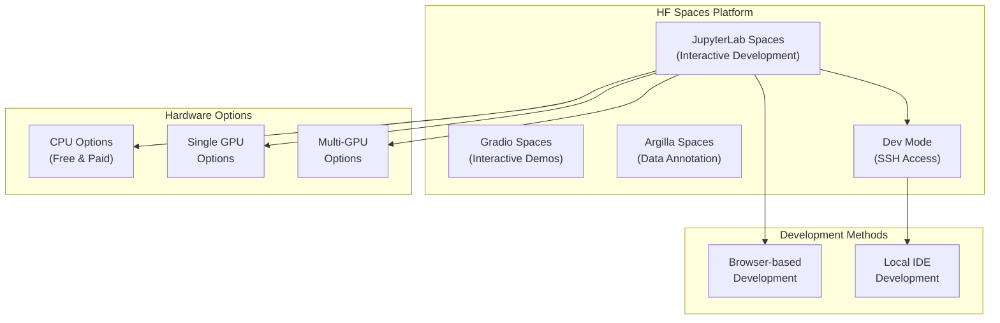
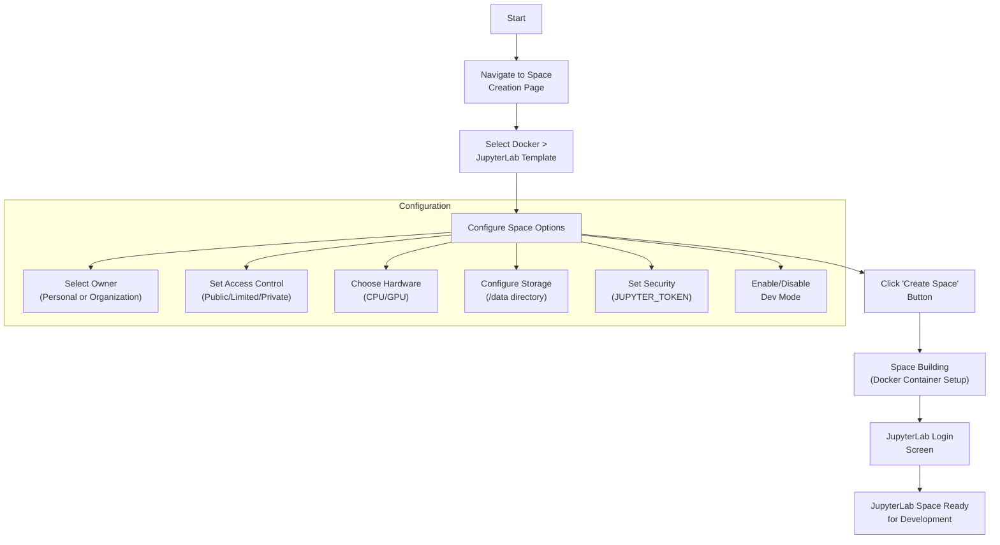
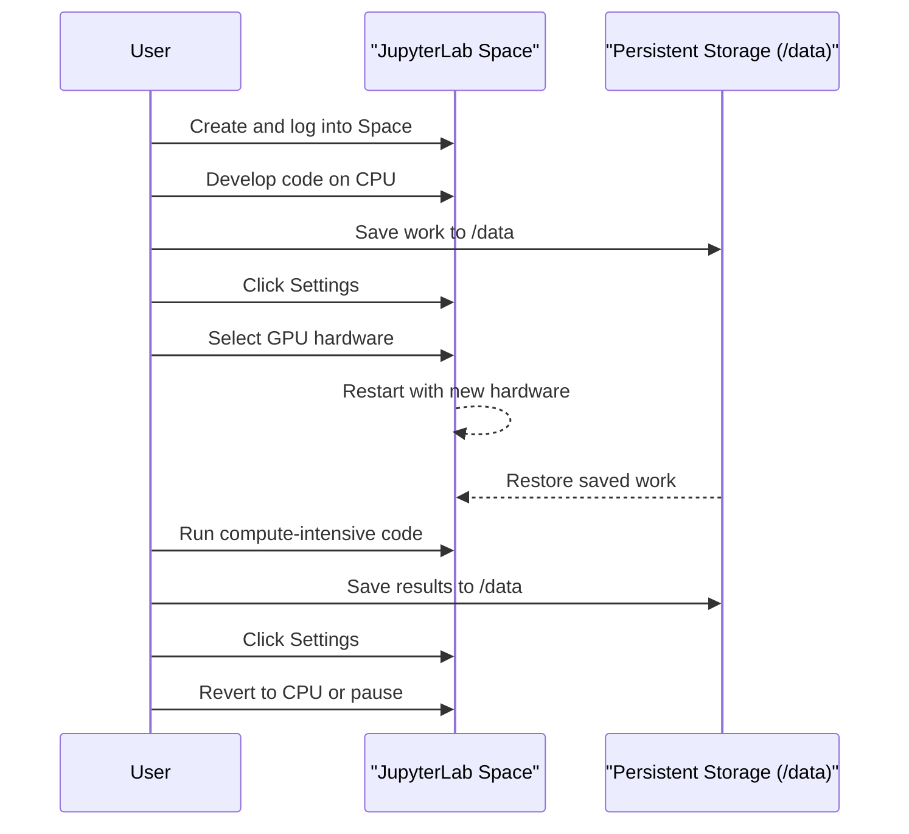
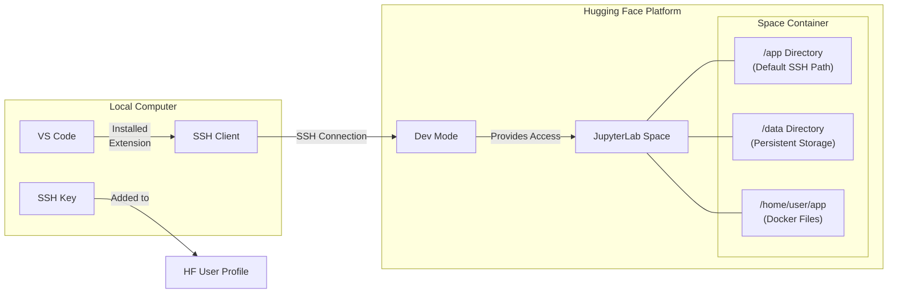

<!-- source: DeepWiki mcp.deepwiki.com · repo huggingface/cookbook · page 5.4 Interactive Development with JupyterLab Spaces · fetched 2026-10-26 -->

# Interactive Development with JupyterLab Spaces

Relevant source files

The following files were used as context for generating this wiki page:

- [notebooks/en/enterprise_cookbook_argilla.ipynb](notebooks/en/enterprise_cookbook_argilla.ipynb)
- [notebooks/en/enterprise_cookbook_dev_spaces.md](notebooks/en/enterprise_cookbook_dev_spaces.md)
- [notebooks/en/enterprise_cookbook_gradio.ipynb](notebooks/en/enterprise_cookbook_gradio.ipynb)
- [notebooks/en/enterprise_cookbook_overview.md](notebooks/en/enterprise_cookbook_overview.md)
- [notebooks/en/enterprise_dedicated_endpoints.ipynb](notebooks/en/enterprise_dedicated_endpoints.ipynb)
- [notebooks/en/enterprise_hub_serverless_inference_api.ipynb](notebooks/en/enterprise_hub_serverless_inference_api.ipynb)

## Overview

JupyterLab Spaces provides an interactive development environment in the Hugging Face ecosystem, allowing users to spin up cloud-based JupyterLab instances with various CPU and GPU options. This wiki page covers setting up, configuring, and using JupyterLab Spaces for development work, including how to connect to cloud resources from your local IDE using Dev Mode.

For information about creating interactive demos with Gradio on Spaces, see [Building ML Demos with Gradio and Spaces](#5.3). For data annotation workflows, see [Data Annotation with Argilla](#5.5).

Sources: [notebooks/en/enterprise_cookbook_overview.md:8-11](), [notebooks/en/enterprise_cookbook_dev_spaces.md:1-16]()

## Advantages of JupyterLab Spaces

JupyterLab Spaces offers several advantages over other notebook services like Google Colab or Kaggle Notebooks:

- **Reliable hardware**: GPUs are stable and won't cancel your jobs before completion
- **Hardware flexibility**: Access to a wide range of GPU options (including A100s and multi-GPU setups)
- **Local development integration**: Native support for connecting from your local IDE via SSH
- **Persistent storage**: All files are saved even when the Space is paused
- **Hardware switching**: Dynamically switch between CPUs and GPUs without losing work
- **Customizable environment**: Full control over the underlying Docker container

Sources: [notebooks/en/enterprise_cookbook_dev_spaces.md:1-16](), [notebooks/en/enterprise_cookbook_overview.md:8-11]()

## Creating a JupyterLab Space

To create a JupyterLab Space, navigate to the Space creation page and select Docker > JupyterLab. The process involves several important configuration steps.

Sources: [notebooks/en/enterprise_cookbook_dev_spaces.md:22-41]()

### Configuration Options

#### Owner Selection
- For individual use: Select your personal account
- For enterprise use: Select your organization's name to bill compute costs to the organization

#### Access Control
- **Public access**: Available to everyone (default)
- **Limited access**: Restrict to specific Resource Groups
- **Private Space**: Only specified users can see the Space

#### Hardware Selection
- **Initial setup**: Start with free CPU for configuration
- **Production use**: Switch to paid hardware when needed
- **Available options**: Range from free CPUs to high-end GPUs like A100s

#### Storage Configuration
- **Persistent storage**: Attach storage to save work when Space is paused/reset
- **Storage location**: All persistent data is stored in the `/data` directory
- **Storage expansion**: Increase disk space in settings as needed

#### Security Settings
- **Password protection**: Set `JUPYTER_TOKEN` Space secret (default is "huggingface")
- **Dev Mode**: Enable SSH access for connecting from local IDE (Enterprise subscribers)

Sources: [notebooks/en/enterprise_cookbook_dev_spaces.md:22-41]()

## Using Your JupyterLab Space

Once your JupyterLab Space is created, you can begin working with it through the browser interface or connect from your local IDE.

Sources: [notebooks/en/enterprise_cookbook_dev_spaces.md:48-54]()

### Working in the Browser

- Use the JupyterLab interface to create notebooks, scripts, and other files
- Store files in the `/data` directory for persistence
- Access standard JupyterLab tools (terminal, text editor, etc.)
- Install packages using the terminal or requirements.txt

### Switching Hardware Dynamically

JupyterLab Spaces allows you to change hardware while preserving your work:

1. Start initial development on free or lower-cost CPU
2. When ready for intensive computation, click Settings in the top right
3. Select from available hardware options (CPUs to various GPUs)
4. Set sleep time to control when Space turns off due to inactivity
5. Manually pause spaces to stop billing when not in use

When switching hardware:
- The Space restarts with a clean environment
- All saved files in `/data` directory remain available
- Environment variables are reset (similar to Google Colab)

Sources: [notebooks/en/enterprise_cookbook_dev_spaces.md:58-71]()

### Customizing Your Environment

JupyterLab Spaces are Docker containers that can be customized:

- Edit `requirements.txt` to add Python packages
- Modify the `Dockerfile` to change the base image or install system dependencies
- Access container files at `/home/user/app`
- Keep persistent data in `/data` directory

Sources: [notebooks/en/enterprise_cookbook_dev_spaces.md:73-81]()

## Dev Mode: Remote Development from Local IDE

Dev Mode is an Enterprise Hub feature that enables SSH access to your JupyterLab Space, allowing you to develop using your preferred local IDE.

### Setting Up Dev Mode

1. Activate Dev Mode in your Space's settings
2. Install the VS Code Remote - SSH extension locally
3. Add your SSH key to your Hugging Face profile
4. Click "Connect with VS Code" in the Space interface
5. VS Code will establish a remote connection to your Space

### Working with Dev Mode

When connected via SSH:
- Default directory is `/app` (initially empty)
- Navigate to `/data` to access persistent files
- Container configuration files are in `/home/user/app`

Sources: [notebooks/en/enterprise_cookbook_dev_spaces.md:84-98]()

## Best Practices and Tips

### Storage Management
- Make regular backups of important files
- Files in the `/data` directory are persistent but not automatically backed up
- Factory reset the Space to clear storage cache if you receive "storage full" warnings

### Hardware Optimization
- Use free/cheaper CPU for setup, data preparation, and API testing
- Switch to GPU only when needed for intensive computations
- Set appropriate sleep times to balance availability with cost
- Manually pause Spaces when not in use to avoid unnecessary charges

### Environment Management
- Use `requirements.txt` for Python dependencies
- Customize the Docker container for specialized environments
- Store credentials securely using Space Secrets
- For long-running jobs, increase or disable the sleep timeout

Sources: [notebooks/en/enterprise_cookbook_dev_spaces.md:67-71](), [notebooks/en/enterprise_cookbook_dev_spaces.md:98-106]()

## Comparing JupyterLab Spaces and Other Notebook Services

| Feature | JupyterLab Spaces | Google Colab | Kaggle Notebooks |
|---------|-------------------|--------------|------------------|
| **Hardware Stability** | Stable, no unexpected terminations | May terminate long-running jobs | May terminate long-running jobs |
| **Hardware Options** | Broad selection (CPU to multi-GPU) | Limited GPU options | Limited GPU options |
| **Local IDE Integration** | Yes, via Dev Mode (SSH) | Limited (e.g., via extensions) | No |
| **Persistent Storage** | Yes (`/data` directory) | Google Drive integration | Limited |
| **Environment Customization** | Full Docker customization | Limited to package installation | Limited |
| **Sleep Controls** | Configurable, can prevent sleep | Disconnects after inactivity | Disconnects after inactivity |
| **Cost Model** | Pay-as-you-go for hardware | Free tier with limitations | Free |

Sources: [notebooks/en/enterprise_cookbook_dev_spaces.md:1-14](), [notebooks/en/enterprise_cookbook_overview.md:8-11]()

---

