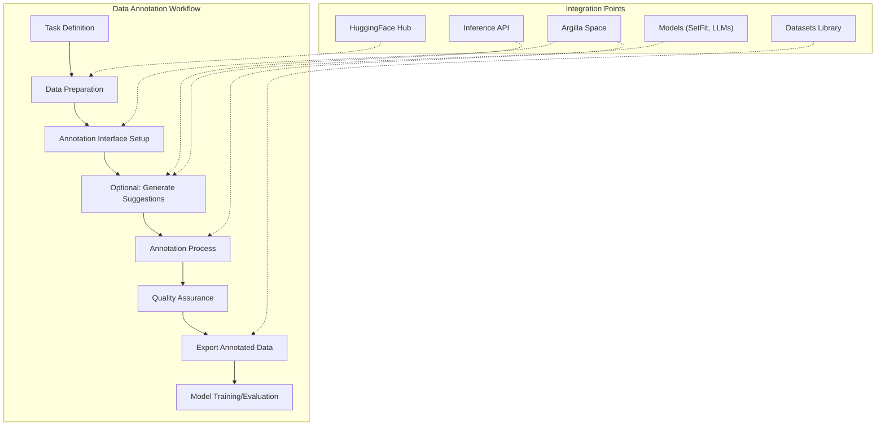
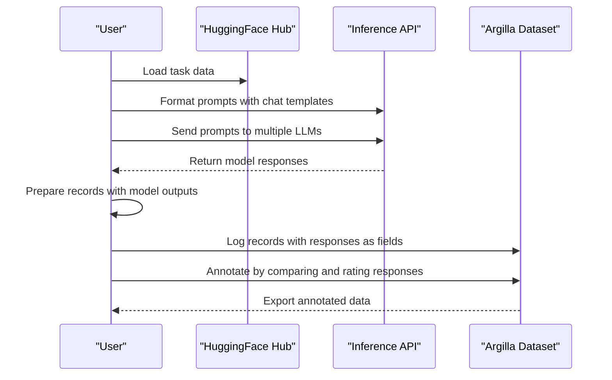
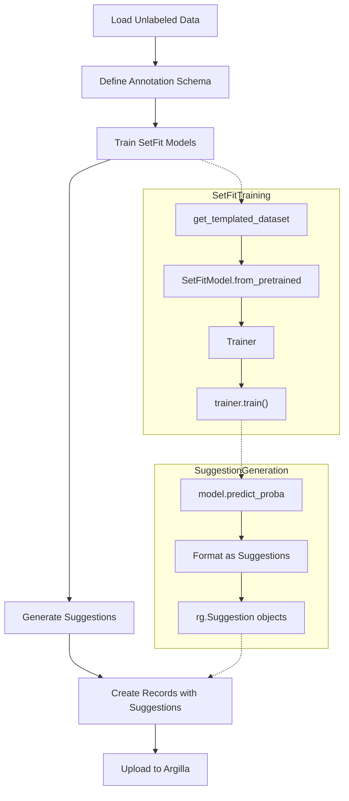
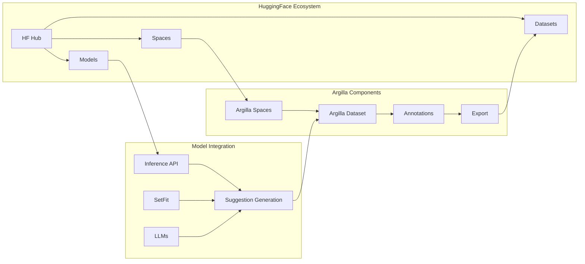

<!-- source: DeepWiki mcp.deepwiki.com · repo huggingface/cookbook · page 5.5 Data Annotation with Argilla · fetched 2026-10-26 -->

# Data Annotation with Argilla

<details>
<summary>Relevant source files</summary>

The following files were used as context for generating this wiki page:

- [notebooks/en/enterprise_cookbook_argilla.ipynb](notebooks/en/enterprise_cookbook_argilla.ipynb)
- [notebooks/en/enterprise_cookbook_dev_spaces.md](notebooks/en/enterprise_cookbook_dev_spaces.md)
- [notebooks/en/enterprise_dedicated_endpoints.ipynb](notebooks/en/enterprise_dedicated_endpoints.ipynb)
- [notebooks/en/enterprise_hub_serverless_inference_api.ipynb](notebooks/en/enterprise_hub_serverless_inference_api.ipynb)
- [notebooks/en/labelling_feedback_setfit.ipynb](notebooks/en/labelling_feedback_setfit.ipynb)

</details>


Argilla is a collaboration tool for AI engineers and domain experts to build high-quality datasets through systematic annotation processes. This page covers how to set up Argilla on Hugging Face Spaces, create annotation projects, streamline annotation with model-generated suggestions, and download annotated data for further use in model development.

For information about deploying models using Inference Endpoints, see [Inference Options](#5.1).

## Overview of Argilla for Data Annotation

Argilla enables teams to create, annotate, and evaluate datasets collaboratively. In the context of Hugging Face's Enterprise Hub, Argilla Spaces provides a hosted solution for data annotation that seamlessly integrates with the broader Hugging Face ecosystem.

Key capabilities include:
- Creating custom annotation interfaces with various question types
- Providing annotation suggestions to accelerate the labeling process
- Collaborating with multiple annotators on the same dataset
- Evaluating LLM outputs systematically
- Exporting annotated data for model training and evaluation



Sources: [notebooks/en/enterprise_cookbook_argilla.ipynb:8-28](), [notebooks/en/labelling_feedback_setfit.ipynb:8-24]()

## Setting Up Argilla

Argilla can be deployed on Hugging Face Spaces with a few clicks, providing a hosted solution for data annotation.

### Creating an Argilla Space

1. Navigate to [Hugging Face Spaces](https://huggingface.co/spaces) and create a new Space
2. Select the Argilla template from the available options
3. Configure your Space settings (visibility, hardware, etc.)
4. Launch your Argilla Space

### Connecting to Argilla

Once your Argilla Space is up and running, you can connect to it programmatically:

```python
import argilla as rg
from huggingface_hub import login

# Login to HF Hub first
login()

# Connect to Argilla Space
client = rg.Argilla(
    api_url="https://username-spacename.hf.space",
    api_key="your-api-key",  # Found in "My Settings > API key" in Argilla UI
    headers={"Authorization": f"Bearer {huggingface_hub.get_token()}"},  # For private spaces
)
```

Sources: [notebooks/en/enterprise_cookbook_argilla.ipynb:39-68](), [notebooks/en/labelling_feedback_setfit.ipynb:31-92]()

## Creating Annotation Projects

Argilla allows you to create customized annotation projects with various field types and question formats.

### Configuring Dataset Settings

Each annotation project in Argilla is defined by a set of fields (what data to annotate) and questions (what annotators should answer):

```python
settings = rg.Settings(
    guidelines="Your detailed annotation guidelines here",
    fields=[
        rg.TextField(name="text", title="Input Text", use_markdown=True)
    ],
    questions=[
        rg.LabelQuestion(
            name="sentiment", 
            title="What is the sentiment?",
            labels=["positive", "neutral", "negative"]
        ),
        rg.MultiLabelQuestion(
            name="topics",
            title="Select all relevant topics",
            labels=["business", "technology", "health", "politics"]
        ),
        rg.TextQuestion(
            name="correction",
            title="Corrected Text",
            use_markdown=True,
            required=False
        )
    ]
)

dataset = rg.Dataset(
    name="your_dataset_name",
    settings=settings,
    workspace="workspace_name"
)
dataset.create()
```

The example above creates an annotation interface with:
- A text field to display content for annotation
- A single-label question for sentiment analysis
- A multi-label question for topic classification
- A text field for annotators to provide corrected versions

Sources: [notebooks/en/enterprise_cookbook_argilla.ipynb:523-634](), [notebooks/en/labelling_feedback_setfit.ipynb:126-164]()

## Generating Annotation Suggestions

One powerful feature of Argilla is the ability to provide annotators with initial suggestions, speeding up the annotation process. There are two main approaches covered in the cookbook:

### Using LLMs for Response Generation

For tasks like code generation or text summarization, you can use LLMs to generate candidate responses:



This approach is demonstrated in the code generation example, where:
1. Task instructions from a dataset are loaded
2. Two different LLMs (e.g., Meta-Llama-3 and Mixtral) are prompted
3. The responses are uploaded to Argilla for human evaluation and comparison

Sources: [notebooks/en/enterprise_cookbook_argilla.ipynb:75-420]()

### Using SetFit for Zero-Shot Classification Suggestions

For classification tasks, SetFit can provide zero-shot suggestions without any labeled examples:



The key components are:
1. Define a template and candidate labels
2. Train a SetFit model with minimal examples
3. Generate predictions for unlabeled data
4. Convert predictions to Argilla suggestions

For classification tasks, you'll typically use a threshold to determine whether to suggest a label:

```python
# For LabelQuestion (single-label classification)
sentiment = max(record["sentiment"], key=lambda x: x["score"])["label"]
suggestions.append(rg.Suggestion(question_name="sentiment", value=sentiment))

# For MultiLabelQuestion (multi-label classification)
threshold = 2 / len(labels)  # Adaptive threshold based on number of labels
topics = [label["label"] for label in record["topics"] if label["score"] >= threshold]
if topics:
    suggestions.append(rg.Suggestion(question_name="topics", value=topics))
```

Sources: [notebooks/en/labelling_feedback_setfit.ipynb:179-525]()

## Writing Effective Annotation Guidelines

Good annotation guidelines are crucial for consistent, high-quality annotations. They should be:

1. **Simple and clear**: Easy to understand for people unfamiliar with the task
2. **Reproducible and explicit**: Contain all information needed for the annotation task
3. **Comprehensive yet concise**: As short as possible while including all necessary information

Example annotation guidelines for code evaluation:

```
Your task is to evaluate the responses of two LLMs to code generation tasks. 

First, you need to score each response on a scale from 0 to 7. Add points to your final score based on the following criteria:
- Add up to +2 points if the code is properly commented, with inline comments and doc strings for functions.
- Add up to +2 points if the code contains a good example for testing. 
- Add up to +3 points if the code runs and works correctly. Copy the code into an IDE and test it with at least two different inputs. Attribute one point if the code is overall correct but has some issues. Attribute three points if the code is fully correct and robust against different scenarios. 

Your resulting final score can be any value between 0 to 7. 

If both responses have a final score of <= 4, select one response and correct it manually in the text field. 
The corrected response must fulfill all criteria from above.
```

> **Note**: Creating annotator guidelines is an iterative process. Try doing a few dozen annotations yourself and refining the guidelines before assigning the task to others.

Sources: [notebooks/en/enterprise_cookbook_argilla.ipynb:487-522]()

## Uploading Data to Argilla

Once you've defined your dataset and prepared your data (with or without suggestions), you can upload it to Argilla:

```python
# Create records with fields and optional suggestions
records = [
    rg.Record(
        fields={"text": example["text"]},
        suggestions=[
            rg.Suggestion(question_name="sentiment", value="positive"),
            rg.Suggestion(question_name="topics", value=["technology", "business"])
        ],
        metadata={"source": "example_dataset"}
    )
    for example in data
]

# Upload records to Argilla
dataset.records.log(records)
```

Sources: [notebooks/en/enterprise_cookbook_argilla.ipynb:655-694](), [notebooks/en/labelling_feedback_setfit.ipynb:492-544]()

## Argilla Annotation Interface

After uploading your data, annotators can access the Argilla interface through your Hugging Face Space. The interface shows:

- The content to be annotated
- Questions to be answered
- Model-generated suggestions (if provided)
- Guidelines for annotation

Suggestions appear with a sparkle icon and can be accepted or modified by annotators.


Sources: [notebooks/en/enterprise_cookbook_argilla.ipynb:701-704](), [notebooks/en/labelling_feedback_setfit.ipynb:552-554]()

## Downloading Annotated Data

Once annotation is complete, you can download the data for further processing:

```python
# Get the dataset with annotations
annotated_dataset = client.datasets("dataset_name", workspace="workspace_name")

# Convert to a Hugging Face dataset
hf_dataset = annotated_dataset.records.to_datasets()

# Export to various formats
hf_dataset.to_pandas()  # Convert to pandas DataFrame
hf_dataset.to_csv("annotations.csv")  # Save as CSV
hf_dataset.to_json("annotations.json")  # Save as JSON
hf_dataset.save_to_disk("annotations")  # Save as a datasets.Dataset
```

Sources: [notebooks/en/enterprise_cookbook_argilla.ipynb:732-763]()

## Example Workflows

### LLM Output Evaluation

One common workflow is using Argilla to evaluate outputs from different LLM models:

1. Generate responses from multiple models for the same prompts
2. Upload the prompts and responses to Argilla
3. Define evaluation criteria (e.g., correctness, helpfulness, creativity)
4. Have human annotators rate and compare the responses
5. Analyze the results to determine which model performs better

This allows for systematic comparison of different models on specific tasks.

### Supervised Fine-tuning Data Creation

Argilla can also be used to create high-quality training data for fine-tuning:

1. Generate initial responses with existing models
2. Have annotators correct or improve the responses
3. Export the corrected responses
4. Use the prompt-response pairs for supervised fine-tuning

### Classification Dataset Annotation

For classification tasks, the workflow typically involves:

1. Collect unlabeled data
2. Generate label suggestions using models like SetFit
3. Have annotators verify and correct the suggestions
4. Export the labeled dataset for model training

Sources: [notebooks/en/enterprise_cookbook_argilla.ipynb:766-780]()

## Best Practices

- **Start small**: Begin with a small test set to refine your guidelines and interface
- **Provide clear examples**: Include examples of good annotations in your guidelines
- **Use suggestions wisely**: Model suggestions can speed up annotation but may bias annotators
- **Monitor annotation quality**: Regularly review annotations to catch issues early
- **Iterate on guidelines**: Update guidelines based on annotator feedback and edge cases
- **Consider annotator agreement**: For subjective tasks, have multiple annotators label the same data

Sources: [notebooks/en/enterprise_cookbook_argilla.ipynb:487-522]()

## Integration with the Hugging Face Ecosystem

Argilla integrates seamlessly with the Hugging Face ecosystem:



- **Hugging Face Spaces**: Hosts Argilla for easy deployment
- **Models & Inference API**: Generate suggestions for annotations
- **Datasets**: Import data for annotation and export annotated data
- **SetFit**: Create zero-shot classification suggestions

Sources: [notebooks/en/enterprise_cookbook_argilla.ipynb:39-68](), [notebooks/en/labelling_feedback_setfit.ipynb:77-92]()

## Conclusion

Argilla on Hugging Face Spaces provides a powerful platform for data annotation, enabling teams to:

1. Create customized annotation interfaces
2. Accelerate annotation with model-generated suggestions
3. Collaborate on data curation and evaluation
4. Export high-quality annotated data for model development

This systematic approach to data annotation is crucial for developing high-performing AI models across various applications, from evaluating LLM outputs to creating training data for fine-tuning.

---

