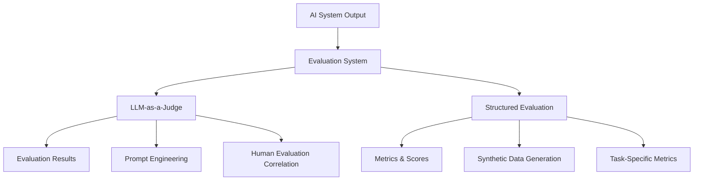
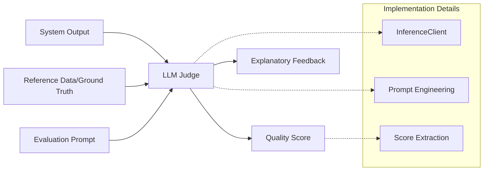
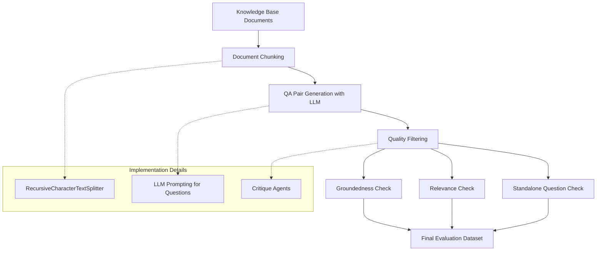
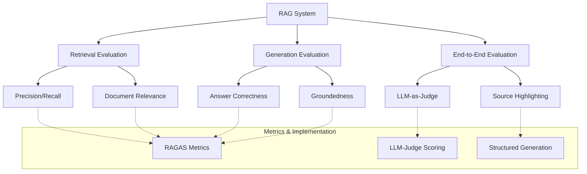
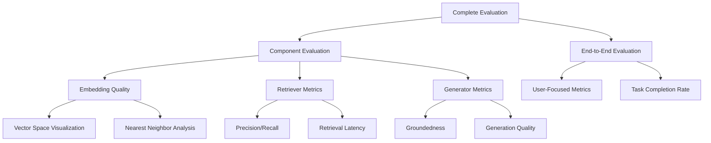
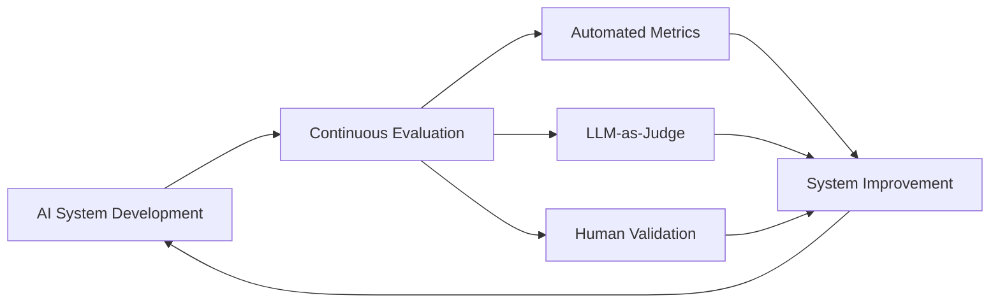

<!-- source: DeepWiki mcp.deepwiki.com · repo huggingface/cookbook · page 6 Evaluation and Testing · fetched 2026-10-26 -->

# Evaluation and Testing

<details>
<summary>Relevant source files</summary>

The following files were used as context for generating this wiki page:

- [notebooks/en/advanced_rag.ipynb](notebooks/en/advanced_rag.ipynb)
- [notebooks/en/llm_judge.ipynb](notebooks/en/llm_judge.ipynb)
- [notebooks/en/rag_evaluation.ipynb](notebooks/en/rag_evaluation.ipynb)
- [notebooks/en/structured_generation.ipynb](notebooks/en/structured_generation.ipynb)
- [notebooks/zh-CN/advanced_rag.ipynb](notebooks/zh-CN/advanced_rag.ipynb)
- [notebooks/zh-CN/automatic_embedding_tei_inference_endpoints.ipynb](notebooks/zh-CN/automatic_embedding_tei_inference_endpoints.ipynb)
- [notebooks/zh-CN/faiss_with_hf_datasets_and_clip.ipynb](notebooks/zh-CN/faiss_with_hf_datasets_and_clip.ipynb)
- [notebooks/zh-CN/fine_tuning_code_llm_on_single_gpu.ipynb](notebooks/zh-CN/fine_tuning_code_llm_on_single_gpu.ipynb)
- [notebooks/zh-CN/rag_evaluation.ipynb](notebooks/zh-CN/rag_evaluation.ipynb)
- [notebooks/zh-CN/rag_zephyr_langchain.ipynb](notebooks/zh-CN/rag_zephyr_langchain.ipynb)

</details>


This page provides an overview of the evaluation and testing approaches used in the Hugging Face Cookbook repository. It covers methods for assessing the performance of AI systems, with a particular focus on Large Language Model (LLM) outputs and Retrieval-Augmented Generation (RAG) systems. For implementation details of RAG systems, see [Retrieval-Augmented Generation (RAG) Systems](#2).

## Overview of Evaluation Approaches

Evaluating AI systems, particularly LLMs, presents unique challenges as traditional metrics like BLEU or ROUGE often fail to capture the quality of generated text. The Cookbook demonstrates two primary evaluation approaches:

1. **LLM-as-a-Judge**: Using an LLM to evaluate the outputs of other AI systems
2. **Structured Evaluation**: Using defined metrics and synthetic data generation for systematic assessment



Sources:
- notebooks/en/llm_judge.ipynb
- notebooks/en/rag_evaluation.ipynb

## LLM-as-a-Judge Evaluation

The LLM-as-a-judge approach uses large language models to evaluate the outputs of other AI systems. This method is particularly useful for tasks where traditional metrics fall short, such as open-ended text generation, RAG systems, or when evaluation requires understanding context and nuance.

### The LLM-as-a-Judge Pipeline



Sources:
- notebooks/en/llm_judge.ipynb

### Implementation Steps

1. **Setup an LLM Client**: Use `InferenceClient` from Hugging Face Hub to access the judge model.
2. **Design Evaluation Prompts**: Create prompts that instruct the LLM to evaluate outputs based on specific criteria.
3. **Extract Scores**: Parse the LLM's response to extract numerical scores and feedback.
4. **Validate Against Human Judgments**: Compare LLM evaluations with human judgments to ensure correlation.

### Best Practices for LLM-as-a-Judge

Based on experiments in the Cookbook, the following practices improve judge reliability:

1. **Discrete Scales**: Use small integer scales (1-4 or 1-5) rather than continuous ranges
2. **Force Rationale**: Request the LLM to provide reasoning before giving a score
3. **Clear Criteria**: Define specific evaluation criteria in the prompt
4. **Consistency Checks**: Compare against human ratings where possible

```python
IMPROVED_JUDGE_PROMPT = """
You will be given a user_question and system_answer couple.
Your task is to provide a 'total rating' scoring how well the system_answer answers the user concerns expressed in the user_question.
Give your answer on a scale of 1 to 4, where 1 means that the system_answer is not helpful at all, and 4 means that the system_answer completely and helpfully addresses the user_question.

Here is the scale you should use to build your answer:
1: The system_answer is terrible: completely irrelevant to the question asked, or very partial
2: The system_answer is mostly not helpful: misses some key aspects of the question
3: The system_answer is mostly helpful: provides support, but still could be improved
4: The system_answer is excellent: relevant, direct, detailed, and addresses all the concerns raised in the question

Provide your feedback as follows:

Feedback:::
Evaluation: (your rationale for the rating, as a text)
Total rating: (your rating, as a number between 1 and 4)
"""
```

Sources:
- notebooks/en/llm_judge.ipynb

## Creating Synthetic Evaluation Datasets

For comprehensive evaluation, particularly of RAG systems, the Cookbook demonstrates how to create synthetic evaluation datasets with LLMs. This approach allows for large-scale automated evaluation without requiring human-annotated data.

### Synthetic Dataset Generation Pipeline



Sources:
- notebooks/en/rag_evaluation.ipynb

### Generation Process

1. **Prepare Source Documents**: Split knowledge base documents into manageable chunks.
2. **Generate QA Pairs**: Use an LLM to create question-answer pairs based on document content.
3. **Quality Filtering**: Use critique agents to filter QA pairs based on:
   - **Groundedness**: Answers must be supported by document content
   - **Relevance**: Questions must be relevant to the domain
   - **Standalone**: Questions should be understandable without context

### Example QA Generation Prompt

```
Your task is to write a factoid question and an answer given a context.
Your factoid question should be answerable with a specific, concise piece of factual information from the context.
Your factoid question should be formulated in the same style as questions users could ask in a search engine.
This means that your factoid question MUST NOT mention something like "according to the passage" or "context".

Provide your answer as follows:

Output:::
Factoid question: (your factoid question)
Answer: (your answer to the factoid question)
```

Sources:
- notebooks/en/rag_evaluation.ipynb

## Evaluating RAG Systems

The Cookbook emphasizes special considerations for evaluating RAG (Retrieval-Augmented Generation) systems due to their multi-component nature.

### RAG Evaluation Dimensions

1. **Retrieval Quality**: Assessing the relevance of retrieved documents
2. **Generation Accuracy**: Measuring correctness of the generated answers
3. **Groundedness**: Ensuring answers are supported by retrieved documents
4. **Source Highlighting**: Identifying specific sources for generated content



Sources:
- notebooks/en/rag_evaluation.ipynb
- notebooks/en/advanced_rag.ipynb
- notebooks/en/structured_generation.ipynb

### Source Highlighting in RAG Evaluation

A novel approach shown in the Cookbook is using structured generation to highlight the sources that informed the RAG output. This provides transparency and aids in evaluating groundedness.

Example implementation using constrained decoding:

```python
from pydantic import BaseModel, confloat, StringConstraints
from typing import List, Annotated

class AnswerWithSnippets(BaseModel):
    answer: Annotated[str, StringConstraints(min_length=10, max_length=100)]
    confidence: Annotated[float, confloat(ge=0.0, le=1.0)]
    source_snippets: List[Annotated[str, StringConstraints(max_length=30)]]
```

Sources:
- notebooks/en/structured_generation.ipynb

## Structured Evaluation Approaches

Beyond LLM-as-a-judge, the Cookbook demonstrates structured evaluation approaches for systematic assessment.

### Evaluation of RAG Components

The Cookbook shows how to evaluate individual components of a RAG system:

1. **Embeddings Quality**: Using visualization techniques to assess embedding quality
2. **Retriever Performance**: Measuring precision, recall, and relevance of retrieved documents
3. **Generation Quality**: Assessing the final generated output's quality



Sources:
- notebooks/en/advanced_rag.ipynb
- notebooks/en/rag_evaluation.ipynb

### Metrics and Benchmarks

The structured evaluation approaches include:

1. **Automatic Metrics**: Quantitative measures like precision, recall, F1 score
2. **Qualitative Assessment**: Human evaluation of generated outputs
3. **Task-Specific Metrics**: Custom metrics for specific applications

A typical evaluation flow includes:

1. Generate a test dataset (synthetic or curated)
2. Run the system on the test dataset
3. Apply automatic metrics for quantitative assessment
4. Use LLM-as-a-judge for qualitative evaluation
5. Analyze results to identify improvement areas

## Summary and Best Practices

Based on the approaches in the Cookbook, here are key recommendations for AI system evaluation:

1. **Multi-faceted Evaluation**: Use both automated metrics and qualitative assessments
2. **Component-level Testing**: Evaluate individual components before end-to-end testing
3. **Synthetic Test Data**: Generate diverse test cases with LLMs
4. **Continuous Evaluation**: Build evaluation into the development process
5. **Human-in-the-loop**: Periodically validate automated evaluation with human judgment



Sources:
- notebooks/en/llm_judge.ipynb
- notebooks/en/rag_evaluation.ipynb
- notebooks/en/advanced_rag.ipynb

This page provides an overview of evaluation approaches demonstrated in the Cookbook. For implementation details, refer to the specific notebooks linked in each section.

---

