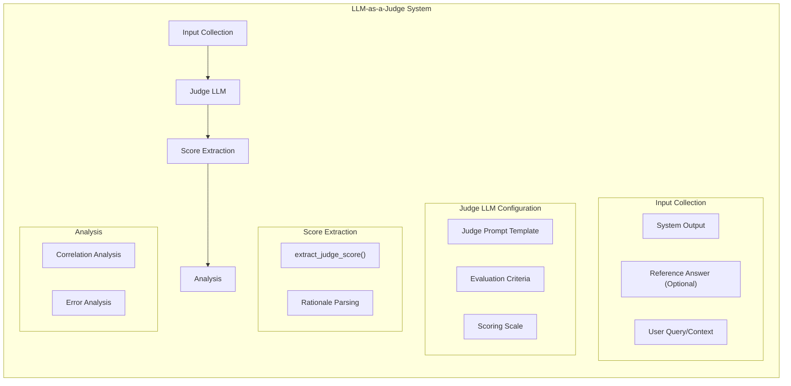
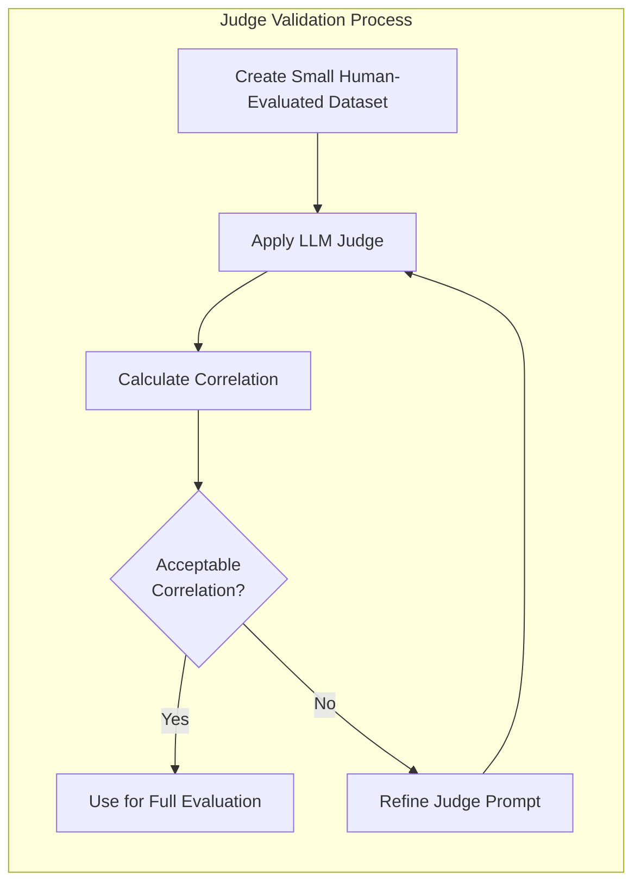
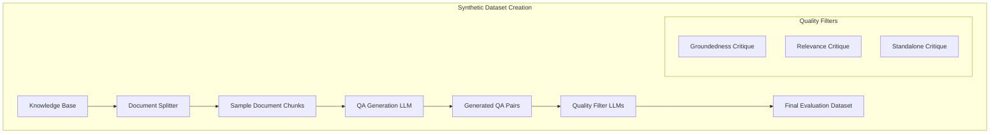
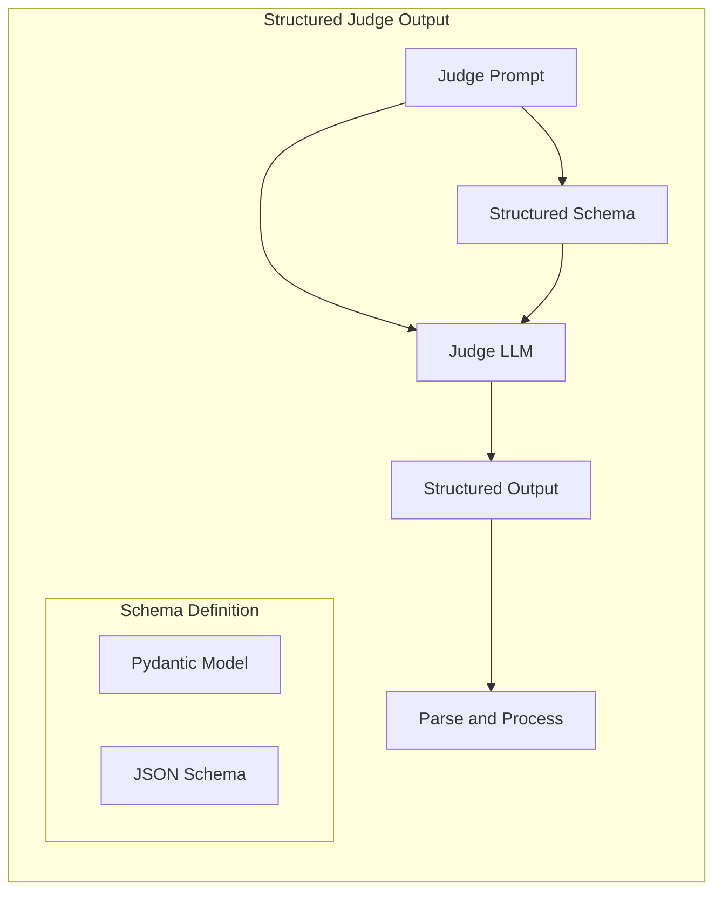
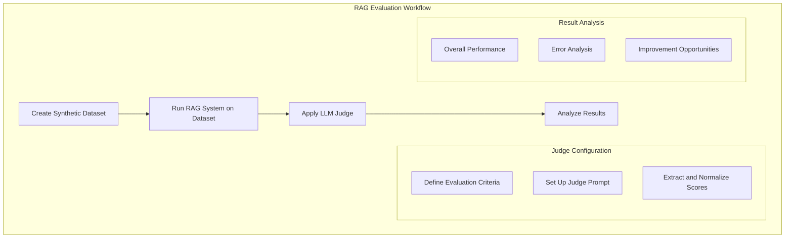

<!-- source: DeepWiki mcp.deepwiki.com · repo huggingface/cookbook · page 6.1 LLM-as-a-Judge Evaluation · fetched 2026-10-26 -->

# LLM-as-a-Judge Evaluation

<details>
<summary>Relevant source files</summary>

The following files were used as context for generating this wiki page:

- [notebooks/en/advanced_rag.ipynb](notebooks/en/advanced_rag.ipynb)
- [notebooks/en/llm_judge.ipynb](notebooks/en/llm_judge.ipynb)
- [notebooks/en/rag_evaluation.ipynb](notebooks/en/rag_evaluation.ipynb)
- [notebooks/en/structured_generation.ipynb](notebooks/en/structured_generation.ipynb)

</details>


LLM-as-a-Judge is a powerful technique for evaluating the outputs of AI systems, particularly large language models (LLMs), using another LLM as an evaluator. This document explains how to implement and use LLM-as-a-Judge for evaluation purposes in the Hugging Face ecosystem. For information about general evaluation metrics and approaches, see [Evaluation and Testing](#6.2).

## Overview

Evaluating large language models is challenging due to their broad capabilities and the subjective nature of their outputs. Traditional metrics like ROUGE or BLEU often fail to capture nuanced aspects of quality such as factual accuracy, coherence, usefulness, and style.

LLM-as-a-Judge addresses this by leveraging an LLM's own understanding capabilities to assess outputs based on multiple criteria. While human evaluation remains the gold standard, LLM-as-a-Judge provides an automated, scalable alternative that correlates well with human judgments when properly implemented.

Sources: [notebooks/en/llm_judge.ipynb:5-25]()

## When to Use LLM-as-a-Judge

LLM-as-a-Judge is particularly useful in scenarios where:

1. You need to evaluate open-ended responses with multiple quality dimensions
2. Traditional metrics fail to capture important aspects of the output
3. Human evaluation is too time-consuming or expensive
4. You're developing and tuning a RAG (Retrieval-Augmented Generation) system
5. You want to compare different variations of prompts or system architectures

Sources: [notebooks/en/llm_judge.ipynb:87-100](), [notebooks/en/rag_evaluation.ipynb:9-35]()

## Components of an LLM Judge System



The diagram shows the main components of an LLM-as-a-Judge system. The process begins with collecting inputs, including the system output to be evaluated, user query/context, and optionally a reference answer. A judge LLM is configured with a prompt template, evaluation criteria, and scoring scale. The judge then produces an evaluation, and scores are extracted using functions like `extract_judge_score()`. Finally, analysis can be performed to assess the judge's reliability.

Sources: [notebooks/en/llm_judge.ipynb:27-42](), [notebooks/en/llm_judge.ipynb:346-396]()

## Setting Up an LLM Judge

### Judge Selection

When selecting an LLM to serve as a judge:

- Choose a model with sufficient capabilities to understand the domain
- Preferably use a model more capable than the system being evaluated
- Consider using models that perform well on reasoning benchmarks
- For RAG evaluation, use models that can assess factuality well

In the examples, Mixtral-8x7B-Instruct is used as a judge, which performs well on various benchmarks.

Sources: [notebooks/en/llm_judge.ipynb:71-80](), [notebooks/en/rag_evaluation.ipynb:165-170]()

### Basic Judge Prompt

A basic judge prompt includes:

- Task description
- Scale definition (minimum, maximum, value types)
- Output format specification
- Example answer structure

Here's the structure of a basic judge prompt:

```
You will be given a user_question and system_answer couple.
Your task is to provide a 'total rating' scoring how well the system_answer answers the user concerns expressed in the user_question.
Give your answer as a float on a scale of 0 to 10, where 0 means that the system_answer is not helpful at all, and 10 means that the answer completely and helpfully addresses the question.

Provide your feedback as follows:

Feedback:::
Total rating: (your rating, as a float between 0 and 10)

Now here are the question and answer.

Question: {question}
Answer: {answer}

Feedback:::
Total rating: 
```

Sources: [notebooks/en/llm_judge.ipynb:346-362]()

### Improved Judge Prompt

The basic prompt can be enhanced with several techniques:

1. **Leave more time for thought** - Add an "Evaluation" field before the final answer
2. **Use a small integer scale** - Use scales like 1-4 or 1-5 instead of continuous ranges
3. **Provide clear scale guidance** - Define what each point on the scale means
4. **Include a motivational element** - Add a reward prompt to encourage accuracy

```
You will be given a user_question and system_answer couple.
Your task is to provide a 'total rating' scoring how well the system_answer answers the user concerns expressed in the user_question.
Give your answer on a scale of 1 to 4, where 1 means that the system_answer is not helpful at all, and 4 means that the system_answer completely and helpfully addresses the user_question.

Here is the scale you should use to build your answer:
1: The system_answer is terrible: completely irrelevant to the question asked, or very partial
2: The system_answer is mostly not helpful: misses some key aspects of the question
3: The system_answer is mostly helpful: provides support, but still could be improved
4: The system_answer is excellent: relevant, direct, detailed, and addresses all the concerns raised in the question

Provide your feedback as follows:

Feedback:::
Evaluation: (your rationale for the rating, as a text)
Total rating: (your rating, as a number between 1 and 4)

You MUST provide values for 'Evaluation:' and 'Total rating:' in your answer.

Now here are the question and answer.

Question: {question}
Answer: {answer}

Provide your feedback. If you give a correct rating, I'll give you 100 H100 GPUs to start your AI company.
Feedback:::
Evaluation: 
```

Sources: [notebooks/en/llm_judge.ipynb:438-480]()

### Score Extraction

After the judge LLM generates its evaluation, the score needs to be extracted. The `extract_judge_score` function handles this:

```python
def extract_judge_score(answer: str, split_str: str = "Total rating:") -> int:
    try:
        if split_str in answer:
            rating = answer.split(split_str)[1]
        else:
            rating = answer
        digit_groups = [el.strip() for el in re.findall(r"\d+(?:\.\d+)?", rating)]
        return float(digit_groups[0])
    except Exception as e:
        print(e)
        return None
```

This function extracts the numerical rating from the judge's output, handling different formats and potential errors.

Sources: [notebooks/en/llm_judge.ipynb:386-401]()

## Validating Judge Performance

To ensure your LLM judge is reliable, validate it against human judgments:



This diagram shows the process for validating an LLM judge. First, create a small dataset with human evaluations. Then apply the LLM judge to the same examples and calculate the correlation between human and LLM scores. If the correlation is acceptable, proceed with using the judge for full evaluation; otherwise, refine the judge prompt and try again.

In the examples, correlation improved from 0.567 to 0.843 after applying the prompt improvements mentioned earlier.

Sources: [notebooks/en/llm_judge.ipynb:403-423](), [notebooks/en/llm_judge.ipynb:504-517]()

## Creating Synthetic Evaluation Datasets

For evaluating RAG systems, you often need a dataset of question-answer pairs with supporting contexts. LLMs can help generate these synthetically:



This diagram shows the process for creating a synthetic evaluation dataset. Starting with a knowledge base, documents are split into chunks, which are then sampled. A QA generation LLM creates question-answer pairs based on these chunks. The generated pairs go through quality filters that assess groundedness, relevance, and standalone quality before becoming part of the final evaluation dataset.

Sources: [notebooks/en/rag_evaluation.ipynb:111-136](), [notebooks/en/rag_evaluation.ipynb:165-194](), [notebooks/en/rag_evaluation.ipynb:359-499]()

### QA Generation Prompt

To generate question-answer pairs:

```
Your task is to write a factoid question and an answer given a context.
Your factoid question should be answerable with a specific, concise piece of factual information from the context.
Your factoid question should be formulated in the same style as questions users could ask in a search engine.
This means that your factoid question MUST NOT mention something like "according to the passage" or "context".

Provide your answer as follows:

Output:::
Factoid question: (your factoid question)
Answer: (your answer to the factoid question)

Now here is the context.

Context: {context}

Output:::
```

Sources: [notebooks/en/rag_evaluation.ipynb:222-237]()

### Quality Filter Prompts

After generating QA pairs, use critique agents to filter out low-quality questions. Here are the three main critique prompts:

1. **Groundedness Critique**: Assesses if the question can be answered from the context
2. **Relevance Critique**: Checks if the question is useful to users
3. **Standalone Critique**: Verifies the question makes sense without additional context

Each critique agent produces a score, and questions with low scores on any dimension are filtered out.

Sources: [notebooks/en/rag_evaluation.ipynb:390-447](), [notebooks/en/rag_evaluation.ipynb:498-515]()

## Structured Output from LLM Judges

For consistent and easily parseable evaluation outputs, you can use structured generation techniques:



This diagram shows how to obtain structured outputs from an LLM judge. A judge prompt and structured schema (defined using Pydantic or JSON Schema) are provided to the judge LLM. The LLM generates a structured output conforming to the schema, which can then be parsed and processed.

For example, you can define a Pydantic model for your judge's output:

```python
class AnswerWithSnippets(BaseModel):
    answer: Annotated[str, StringConstraints(min_length=10, max_length=100)]
    confidence: Annotated[float, confloat(ge=0.0, le=1.0)]
    source_snippets: List[Annotated[str, StringConstraints(max_length=30)]]
```

This ensures your judge outputs are consistently structured for automated processing.

Sources: [notebooks/en/structured_generation.ipynb:354-361](), [notebooks/en/structured_generation.ipynb:377-399]()

## Implementing LLM-as-a-Judge for RAG Evaluation

Here's a complete workflow for evaluating a RAG system with LLM-as-a-Judge:



This diagram outlines the complete workflow for evaluating a RAG system with LLM-as-a-Judge. First, create a synthetic dataset of questions and answers. Then run your RAG system on this dataset to generate responses. Apply the LLM judge to evaluate the responses based on defined criteria using a carefully crafted prompt. Finally, analyze the results to understand overall performance, identify errors, and discover opportunities for improvement.

Sources: [notebooks/en/rag_evaluation.ipynb:12-35](), [notebooks/en/llm_judge.ipynb:87-100]()

## Best Practices for LLM-as-a-Judge

1. **Start simple**: Begin with a basic prompt and refine as needed
2. **Validate thoroughly**: Always compare against human judgments first
3. **Use appropriate scales**: Small integer scales (1-5) work better than continuous ranges
4. **Include rationales**: Ask for reasoning before scores to improve quality
5. **Structured outputs**: Use constrained generation for consistent outputs
6. **Multiple dimensions**: Evaluate on several relevant criteria rather than just overall quality
7. **Control for bias**: Be aware that LLM judges may have biases similar to the systems they evaluate

Sources: [notebooks/en/llm_judge.ipynb:438-447](), [notebooks/en/llm_judge.ipynb:519-527]()

## Limitations and Considerations

While LLM-as-a-Judge is powerful, it has limitations:

- **Judge competence**: The judge LLM must be capable of evaluating the specific domain
- **Potential biases**: LLM judges may inherit biases from their training data
- **Self-reinforcement**: When LLMs evaluate other LLMs, they may share blind spots
- **Need for validation**: Always validate judge performance against human ratings
- **Not a replacement**: Human evaluation is still necessary for high-stakes applications

Sources: [notebooks/en/llm_judge.ipynb:429-431]()

## Conclusion

LLM-as-a-Judge provides a powerful, flexible, and scalable approach to evaluating LLM outputs, particularly for RAG systems. By carefully designing judge prompts, validating performance, and using structured outputs, you can create reliable automated evaluation systems that correlate well with human judgments.

For more information on broader evaluation approaches and metrics, see [Structured Evaluation Approaches](#6.2).

---

