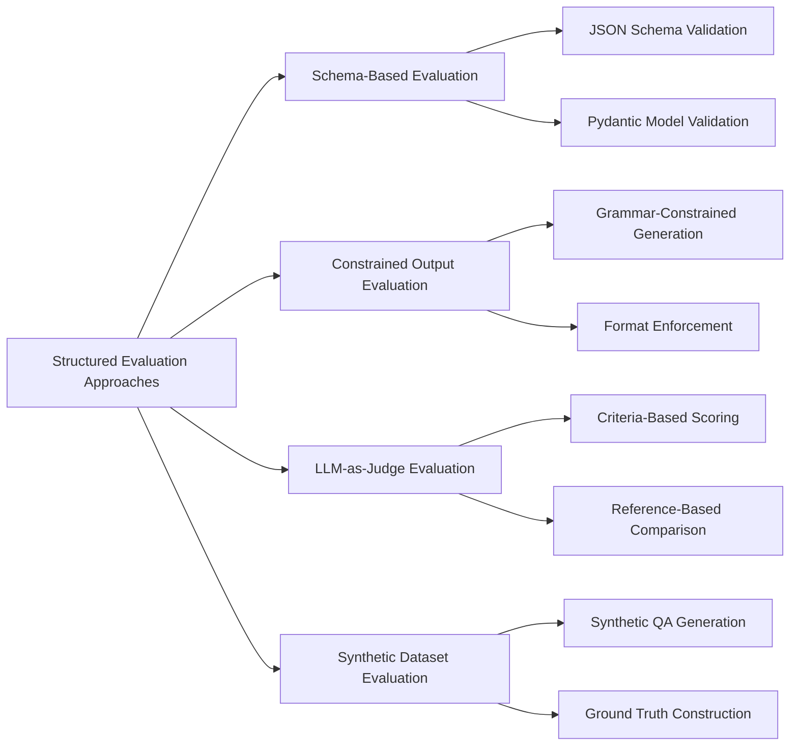
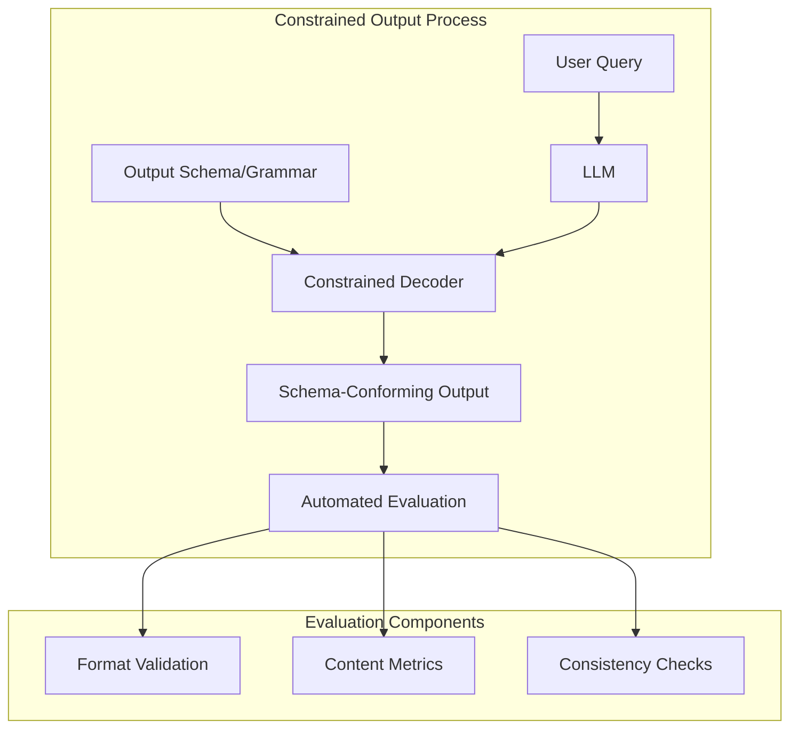
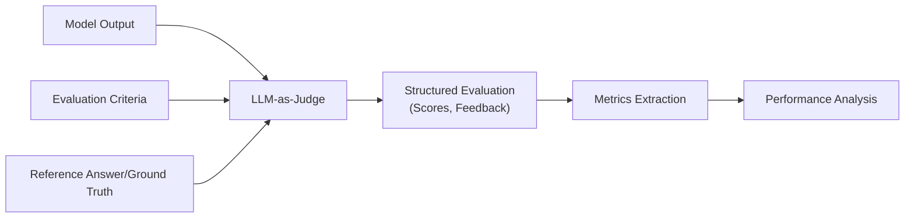
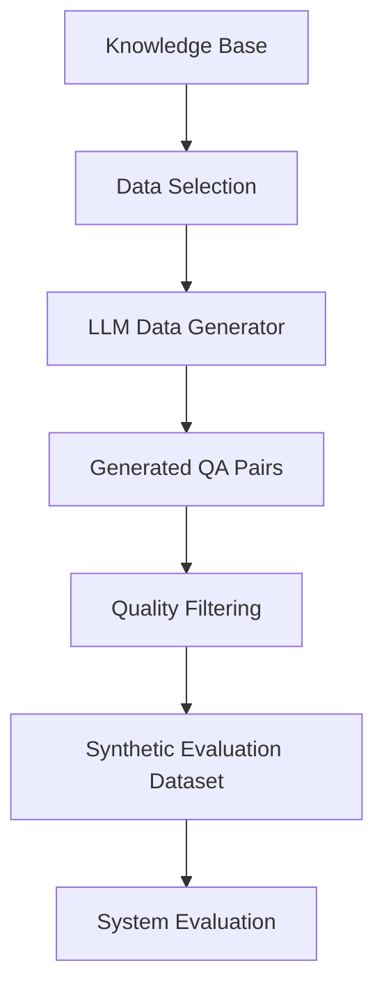
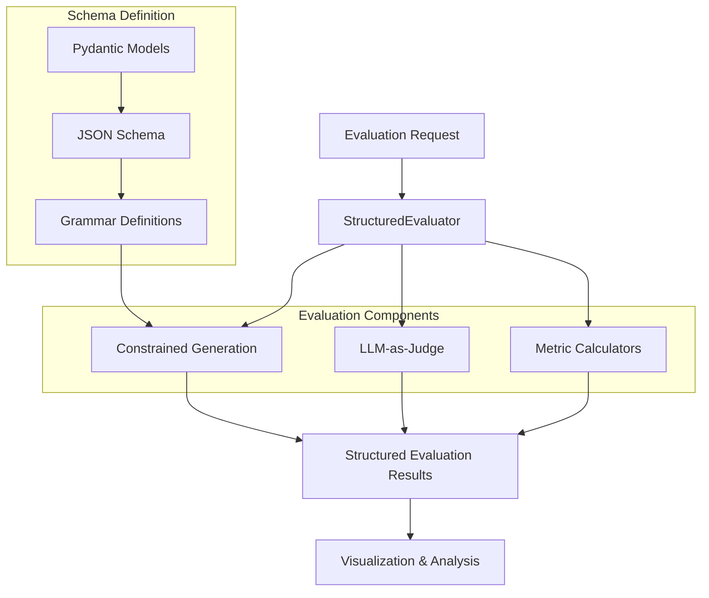
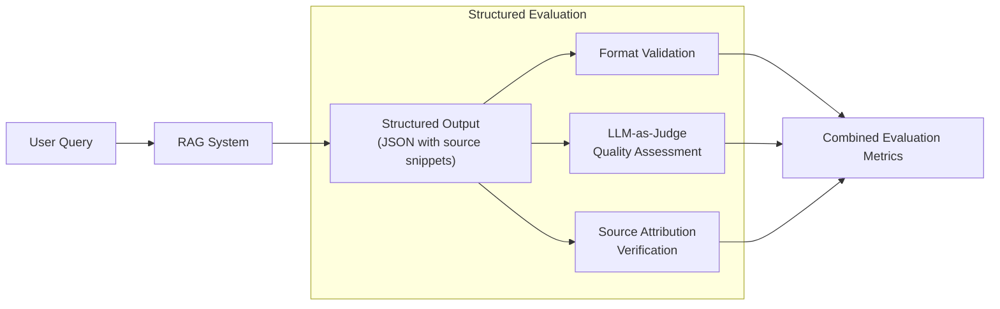
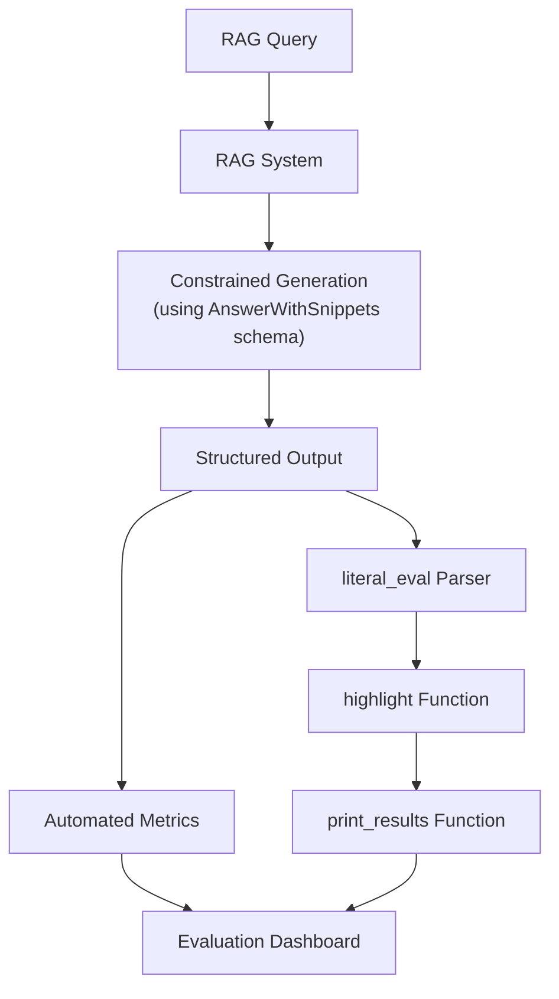

<!-- source: DeepWiki mcp.deepwiki.com · repo huggingface/cookbook · page 6.2 Structured Evaluation Approaches · fetched 2026-10-26 -->

# Structured Evaluation Approaches

<details>
<summary>Relevant source files</summary>

The following files were used as context for generating this wiki page:

- [notebooks/en/llm_judge.ipynb](notebooks/en/llm_judge.ipynb)
- [notebooks/en/structured_generation.ipynb](notebooks/en/structured_generation.ipynb)
- [notebooks/ko/advanced_ko_rag.ipynb](notebooks/ko/advanced_ko_rag.ipynb)
- [notebooks/ko/structured_generation.ipynb](notebooks/ko/structured_generation.ipynb)
- [notebooks/zh-CN/advanced_rag.ipynb](notebooks/zh-CN/advanced_rag.ipynb)
- [notebooks/zh-CN/automatic_embedding_tei_inference_endpoints.ipynb](notebooks/zh-CN/automatic_embedding_tei_inference_endpoints.ipynb)
- [notebooks/zh-CN/faiss_with_hf_datasets_and_clip.ipynb](notebooks/zh-CN/faiss_with_hf_datasets_and_clip.ipynb)
- [notebooks/zh-CN/fine_tuning_code_llm_on_single_gpu.ipynb](notebooks/zh-CN/fine_tuning_code_llm_on_single_gpu.ipynb)
- [notebooks/zh-CN/rag_evaluation.ipynb](notebooks/zh-CN/rag_evaluation.ipynb)
- [notebooks/zh-CN/rag_zephyr_langchain.ipynb](notebooks/zh-CN/rag_zephyr_langchain.ipynb)

</details>


This document covers systematic methods for evaluating AI model outputs using well-defined structures, metrics, and automation tools. Structured evaluation approaches help ensure consistent, reproducible assessments of model performance across different tasks and domains. For LLM-as-a-judge evaluation methods specifically, see [LLM-as-a-Judge Evaluation](#6.1).

## Overview of Structured Evaluation

Structured evaluation approaches focus on using well-defined formats, schemas, and methodologies to assess model outputs more rigorously than free-form human evaluation alone. These approaches enable more consistent, scalable, and reproducible evaluation processes.

Key benefits of structured evaluation:

- **Reproducibility**: Well-defined structures enable consistent evaluation across runs
- **Scalability**: Automated processes can evaluate large quantities of outputs
- **Comparability**: Standardized metrics allow comparison between different models
- **Traceability**: Structured outputs provide documentation of evaluation decisions

Sources: [notebooks/en/llm_judge.ipynb:7-26](), [notebooks/en/structured_generation.ipynb:7-28](), [notebooks/zh-CN/rag_evaluation.ipynb:9-36]()

## Types of Structured Evaluation



Sources: [notebooks/en/structured_generation.ipynb:28-60](), [notebooks/en/llm_judge.ipynb:87-156](), [notebooks/zh-CN/rag_evaluation.ipynb:115-148]()

### Schema-Based Evaluation

Schema-based evaluation approaches use predefined data structures to validate model outputs. This ensures that responses follow specific formats, making them easier to automatically process and evaluate.

#### Example: Using Pydantic for Schema Definition

```python
from pydantic import BaseModel, confloat, StringConstraints
from typing import List, Annotated

class AnswerWithSnippets(BaseModel):
    answer: Annotated[str, StringConstraints(min_length=10, max_length=100)]
    confidence: Annotated[float, confloat(ge=0.0, le=1.0)]
    source_snippets: List[Annotated[str, StringConstraints(max_length=30)]]
```

This schema definition ensures that:
- The answer is between 10-100 characters
- Confidence is a float between 0-1
- Source snippets are each less than 30 characters

Sources: [notebooks/en/structured_generation.ipynb:354-374](), [notebooks/ko/structured_generation.ipynb:367-387]()

### Constrained Output Evaluation

Constrained output evaluation forces model outputs to follow specific patterns or formats, making evaluation more systematic. This is particularly useful when evaluating factuality, consistency, or other structured aspects of model outputs.



Sources: [notebooks/en/structured_generation.ipynb:338-460](), [notebooks/ko/structured_generation.ipynb:351-473]()

## Implementation Approaches

### Using Outlines for Grammar-Constrained Generation

The `outlines` library enables constrained decoding by applying a bias to logits, ensuring the model only outputs text conforming to predefined structures.

```python
import outlines
import json

# Define schema as JSON
schema_as_str = json.dumps(AnswerWithSnippets.schema())

# Setup constrained generator
model = outlines.models.transformers(model_name)
generator = outlines.generate.json(model, schema_as_str)

# Generate constrained output
result = generator(prompt)
```

This approach is particularly valuable for evaluation as it guarantees outputs will conform to expected structures, allowing automated evaluation systems to reliably parse and analyze them.

Sources: [notebooks/en/structured_generation.ipynb:474-492](), [notebooks/ko/structured_generation.ipynb:487-506]()

### LLM-as-Judge Approach

The LLM-as-Judge approach uses an LLM to evaluate outputs from other AI systems, producing structured assessments.



Key components for implementing an LLM-as-Judge evaluation:

1. **Judge prompt construction**: Clearly defined evaluation criteria and output format
2. **Scoring system**: Numerical or categorical ratings with justifications
3. **Correlation validation**: Comparison with human judgments to establish judge reliability

Sources: [notebooks/en/llm_judge.ipynb:85-150]()

#### Example Judge Prompt Structure

```
You will be given a user_question and system_answer couple.
Your task is to provide a 'total rating' scoring how well the system_answer 
addresses the user_question.

Give your answer as a float on a scale of 0 to 10, where:
- 0 means the system_answer is not helpful at all
- 10 means the answer completely and helpfully addresses the question

Provide your feedback as follows:

Feedback:::
Total rating: (your rating, as a float between 0 and 10)

Question: {question}
Answer: {answer}
```

Sources: [notebooks/en/llm_judge.ipynb:346-359]()

### Synthetic Data Generation for Evaluation

Creating synthetic evaluation datasets allows for controlled testing environments with known ground truths. This is particularly valuable for RAG system evaluation.



The synthetic data generation process typically involves:

1. Selecting representative documents from the knowledge base
2. Creating prompts for an LLM to generate questions based on document content
3. Filtering and refining the generated QA pairs
4. Using the dataset to evaluate system performance against known answers

Sources: [notebooks/zh-CN/rag_evaluation.ipynb:115-147](), [notebooks/zh-CN/rag_evaluation.ipynb:170-203]()

#### Example QA Generation Prompt

```
Your task is to write a factoid question and an answer given a context.
Your factoid question should be answerable with a specific, concise piece 
of factual information from the context.
Your factoid question should be formulated in the same style as questions 
users could ask in a search engine.

Provide your answer as follows:

Output:::
Factoid question: (your factoid question)
Answer: (your answer to the factoid question)

Context: {context}
Output:::
```

Sources: [notebooks/zh-CN/rag_evaluation.ipynb:212-227]()

## Combining Approaches for Comprehensive Evaluation

The most robust evaluation systems often combine multiple structured approaches. Below is an architecture showing how different methods can work together:



### RAG System Evaluation Example

For evaluating RAG (Retrieval Augmented Generation) systems, a comprehensive approach might include:

1. **Generating synthetic QA pairs** from the knowledge base
2. **Enforcing structured outputs** using constrained decoding
3. **Using LLM-as-judge** to assess answer quality
4. **Extracting source snippets** to verify attribution and support



Sources: [notebooks/en/structured_generation.ipynb:86-102](), [notebooks/ko/structured_generation.ipynb:102-109](), [notebooks/zh-CN/rag_evaluation.ipynb:26-34]()

## Best Practices

When implementing structured evaluation approaches:

1. **Define clear metrics**: Establish specific, measurable criteria before starting evaluation
2. **Use diverse test sets**: Include a variety of examples across different difficulty levels
3. **Combine automated and human evaluation**: Use structured approaches to scale, but validate with human review
4. **Document evaluation methodology**: Include details on prompts, schemas, and filtering criteria
5. **Consider baseline comparisons**: Evaluate results against simpler models or approaches
6. **Test for evaluation robustness**: Validate that your structured evaluation approach itself is consistent and reliable

Sources: [notebooks/en/llm_judge.ipynb:85-150](), [notebooks/zh-CN/rag_evaluation.ipynb:26-35]()

## Limitations and Considerations

While structured evaluation offers many advantages, it's important to be aware of its limitations:

- **Schema rigidity**: Overly restrictive schemas might miss valuable but non-conforming responses
- **Judge reliability**: LLM judges may have biases or limitations in their evaluation capabilities
- **Synthetic data gaps**: Generated evaluation datasets might not fully represent real-world queries
- **Metric focus**: Focusing too heavily on metrics can miss qualitative aspects of performance

To mitigate these limitations, consider:
- Using multiple evaluation approaches
- Combining automated and human evaluation
- Regularly reviewing and updating evaluation criteria
- Testing evaluation approaches themselves for consistency

Sources: [notebooks/en/llm_judge.ipynb:156-165](), [notebooks/zh-CN/rag_evaluation.ipynb:32-35]()

## Example Implementation: Structured RAG Evaluation

This section presents a complete example of structured evaluation for a RAG system using both constrained generation and automated assessment.

The end-to-end process includes:

1. Setting up a schema for the RAG output
2. Implementing constrained generation
3. Parsing and evaluating the structured outputs
4. Visualizing evaluation results



The code components involved include:

- `AnswerWithSnippets` Pydantic model definition
- `outlines.generate.json` for constrained generation
- `literal_eval` for parsing structured outputs
- `highlight` and `print_results` functions for visualization

Sources: [notebooks/en/structured_generation.ipynb:354-410](), [notebooks/ko/structured_generation.ipynb:367-423](), [notebooks/en/structured_generation.ipynb:473-510]()

## Conclusion

Structured evaluation approaches provide systematic, reproducible methods for assessing AI model outputs. By combining schema-based validation, constrained generation, LLM-as-judge assessments, and synthetic data evaluation, you can create comprehensive evaluation pipelines that scale efficiently while maintaining consistency.

These approaches are particularly valuable for complex systems like RAG, where multiple aspects of performance (retrieval accuracy, answer quality, source attribution) need to be evaluated together.