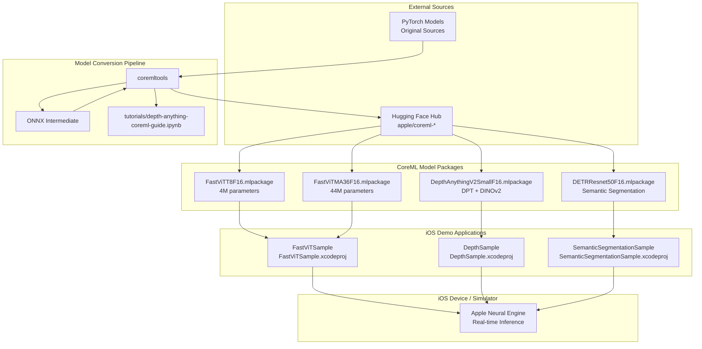
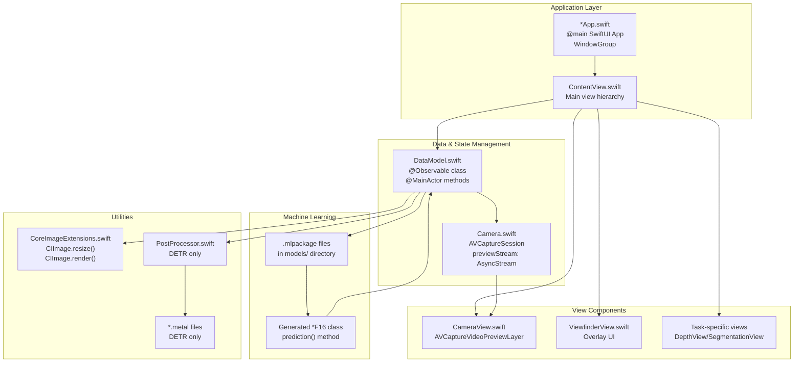
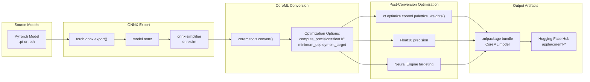
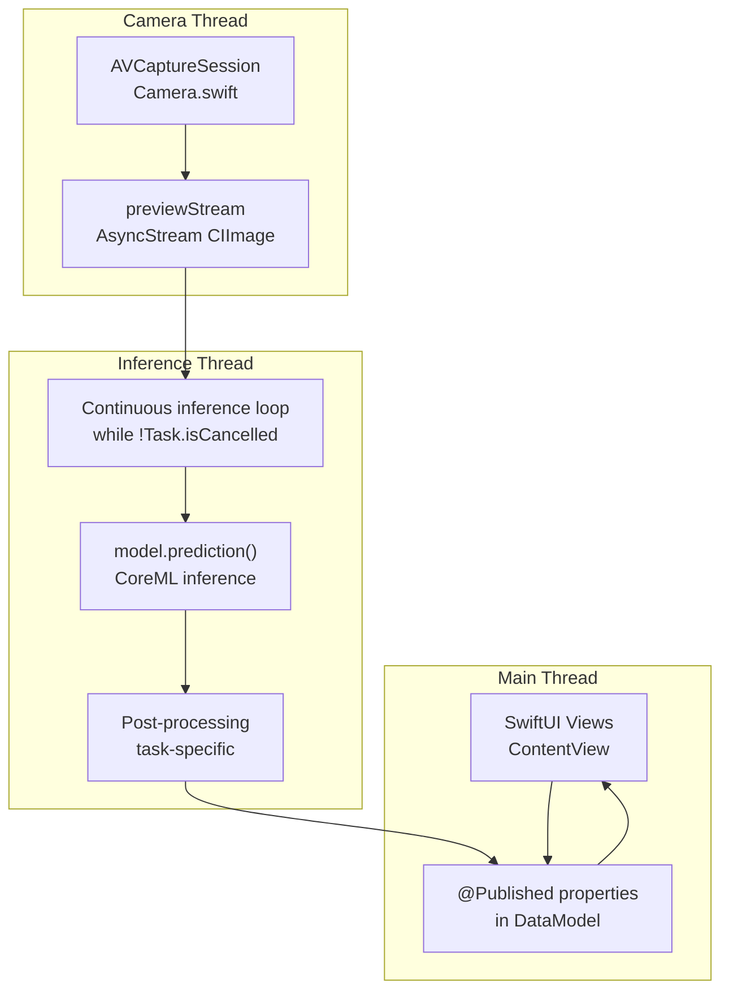

<!-- source: DeepWiki mcp.deepwiki.com · repo huggingface/coreml-examples · page 1 Overview · fetched 2026-10-26 -->

# Overview

<details>
<summary>Relevant source files</summary>

The following files were used as context for generating this wiki page:

- [README.md](README.md)
- [depth-anything-example/README.md](depth-anything-example/README.md)

</details>


This document provides a high-level introduction to the CoreML Examples repository, explaining its purpose as a showcase for optimized CoreML models running on Apple Neural Engine, and describing the three demo applications, model conversion pipeline, and shared infrastructure components.

For detailed setup instructions, see [Getting Started](#2). For in-depth coverage of individual demo applications, see [Demo Applications](#3). For model conversion procedures, see [Model Conversion Pipeline](#4).

## Purpose

The CoreML Examples repository serves as a collection of production-ready iOS sample applications demonstrating how to integrate optimized CoreML models for real-time on-device inference. The repository focuses on three machine learning tasks:

- **Image Classification** - Using FastViT models
- **Monocular Depth Estimation** - Using Depth Anything V2
- **Semantic Segmentation** - Using DETR with ResNet-50 backbone

All models are converted from PyTorch to CoreML format with optimizations specifically targeting the Apple Neural Engine (ANE), including Float16 conversion and palettization techniques. The repository also provides tutorials demonstrating the conversion process.

Sources: [README.md:1-31]()

## Repository Structure

The repository is organized into three independent demo applications, shared infrastructure, and model conversion tutorials:

```
coreml-examples/
├── FastViTSample/              # Image classification demo
│   ├── FastViTSample.xcodeproj
│   ├── FastViTApp/
│   │   ├── FastViTApp.swift
│   │   ├── DataModel.swift
│   │   ├── Camera.swift
│   │   └── models/            # FastViT .mlpackage files
│   └── README.md
├── depth-anything-example/     # Depth estimation demo
│   ├── DepthSample.xcodeproj
│   ├── DepthApp/
│   │   ├── DepthApp.swift
│   │   ├── DataModel.swift
│   │   ├── Camera.swift
│   │   └── models/            # Depth Anything .mlpackage
│   ├── DepthEstimationCLI/    # Command-line tool
│   └── README.md
├── SemanticSegmentationSample/ # Semantic segmentation demo
│   ├── SemanticSegmentationSample.xcodeproj
│   ├── SemanticSegmentationApp/
│   │   ├── SemanticSegmentationApp.swift
│   │   ├── DataModel.swift
│   │   ├── Camera.swift
│   │   ├── Shaders/           # Metal shaders
│   │   └── models/            # DETR .mlpackage
│   ├── SemanticSegmentationCLI/
│   └── README.md
└── tutorials/
    └── depth-anything-coreml-guide.ipynb
```

Each demo application is a complete, self-contained Xcode project that can be built and run independently.

Sources: [README.md:1-31](), [depth-anything-example/README.md:1-46]()

## System Architecture Overview

The following diagram shows the complete system architecture, from model sources to deployed iOS applications:

**Diagram: End-to-End System Architecture**



Sources: [README.md:1-31](), High-level system architecture diagrams (Diagram 1)

## Demo Applications

The repository includes three demo applications, each showcasing a different machine learning task:

| Application | Task | Model Architecture | Parameters | Hugging Face Hub |
|-------------|------|-------------------|------------|------------------|
| **FastViTSample** | Image Classification | FastViT (T8 & MA36 variants) | 4M / 44M | [apple/coreml-FastViT-T8](https://huggingface.co/apple/coreml-FastViT-T8)<br/>[apple/coreml-FastViT-MA36](https://huggingface.co/apple/coreml-FastViT-MA36) |
| **DepthSample** | Monocular Depth Estimation | Depth Anything V2 Small<br/>DPT + DINOv2 backbone | ~25M | [apple/coreml-depth-anything-v2-small](https://huggingface.co/apple/coreml-depth-anything-v2-small) |
| **SemanticSegmentationSample** | Semantic Segmentation | DETR ResNet-50 | ~41M | [apple/coreml-detr-semantic-segmentation](https://huggingface.co/apple/coreml-detr-semantic-segmentation) |

All applications provide real-time inference using the device camera, with frame-by-frame processing optimized for the Apple Neural Engine.

Sources: [README.md:11-18](), [depth-anything-example/README.md:1-46]()

## Core Components and File Organization

Each demo application follows a consistent architecture pattern with shared components. The following diagram maps system components to specific code entities:

**Diagram: Component-to-Code Entity Mapping**



Sources: High-level system architecture diagrams (Diagram 3, Diagram 6)

### Key Code Entities

**Application Entry Points:**
- `FastViTApp.swift` - FastViT sample app entry
- `DepthApp.swift` - Depth Anything sample app entry
- `SemanticSegmentationApp.swift` - DETR sample app entry

**Data Models (Task-Specific):**
- `FastViTApp/DataModel.swift` - Manages FastViT inference and classification results
- `DepthApp/DataModel.swift` - Manages Depth Anything inference and depth map generation
- `SemanticSegmentationApp/DataModel.swift` - Manages DETR inference and segmentation output

**Shared Infrastructure:**
- `Camera.swift` - AVFoundation camera management (identical across all three apps)
- `CameraView.swift` - SwiftUI camera preview view (shared pattern)
- `ViewfinderView.swift` - Camera overlay UI (shared pattern)
- `CoreImageExtensions.swift` - Image processing utilities (shared pattern)

**CoreML Model Packages:**
- `FastViTT8F16.mlpackage` - 4M parameter image classifier
- `FastViTMA36F16.mlpackage` - 44M parameter image classifier
- `DepthAnythingV2SmallF16.mlpackage` - Depth estimation model
- `DETRResnet50F16.mlpackage` - Semantic segmentation model

Sources: [README.md:1-31](), [depth-anything-example/README.md:1-46](), High-level system architecture diagrams (Diagram 6)

## Model Conversion and Optimization

The repository demonstrates the PyTorch-to-CoreML conversion pipeline using `coremltools`. The conversion process includes several optimization steps:

**Diagram: Model Conversion Workflow**



### Optimization Techniques

| Technique | Purpose | Impact |
|-----------|---------|--------|
| **Float16 Conversion** | Reduce model size and memory usage | ~50% size reduction, ANE compatible |
| **Palettization** | Weight quantization using lookup tables | Further size reduction, minimal accuracy loss |
| **Neural Engine Targeting** | Ensure operations run on ANE | Faster inference, lower power consumption |
| **ONNX Simplification** | Remove redundant operations | Simpler graph, better conversion |

The repository includes a complete tutorial demonstrating this process: `tutorials/depth-anything-coreml-guide.ipynb`.

Sources: [README.md:20-26](), [depth-anything-example/README.md:5](), High-level system architecture diagrams (Diagram 4)

## Model Acquisition Workflow

Models are distributed via Hugging Face Hub and can be downloaded using the `huggingface-cli` tool:

```bash
# Install CLI tool
brew install huggingface-cli

# Download a specific model package
huggingface-cli download \
  --local-dir models --local-dir-use-symlinks False \
  apple/coreml-depth-anything-v2-small \
  --include "DepthAnythingV2SmallF16.mlpackage/*"
```

The downloaded `.mlpackage` files should be placed in the respective `models/` directory of each demo application:

- `FastViTSample/FastViTApp/models/`
- `depth-anything-example/DepthApp/models/`
- `SemanticSegmentationSample/SemanticSegmentationApp/models/`

Sources: [depth-anything-example/README.md:28-46]()

## Common Architecture Pattern

All three demo applications follow the same architectural pattern:



### Key Architectural Features

1. **Three-Thread Architecture**: Separation of UI updates (main thread), camera capture (camera thread), and ML inference (background thread)
2. **Async/Await Concurrency**: Uses Swift's modern concurrency features throughout
3. **Observable State**: DataModel classes use `@Observable` macro for reactive UI updates
4. **Real-Time Processing**: Continuous inference loop processes camera frames as they arrive
5. **Thread-Safe Communication**: Proper synchronization between threads using locks and MainActor

For detailed implementation of this pattern, see [Real-Time Inference Pattern](#6.1) and [Threading & Concurrency](#6.2).

Sources: High-level system architecture diagrams (Diagram 3, Diagram 5)

## Additional Resources

The repository provides several additional resources beyond the demo applications:

- **Jupyter Notebook Tutorial**: `tutorials/depth-anything-coreml-guide.ipynb` - Step-by-step guide for converting Depth Anything V2 from PyTorch to CoreML
- **Command-Line Tools**: Batch processing utilities for Depth Anything (`DepthEstimationCLI`) and DETR (`SemanticSegmentationCLI`)
- **README Documentation**: Each demo application includes a comprehensive README explaining model architecture, usage, and download instructions

For CLI tool documentation, see [Command-Line Tools](#7). For conversion tutorials, see [Model Conversion Pipeline](#4).

Sources: [README.md:22-26](), [depth-anything-example/README.md:1-46]()

---

