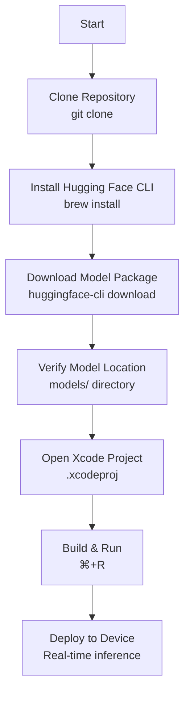
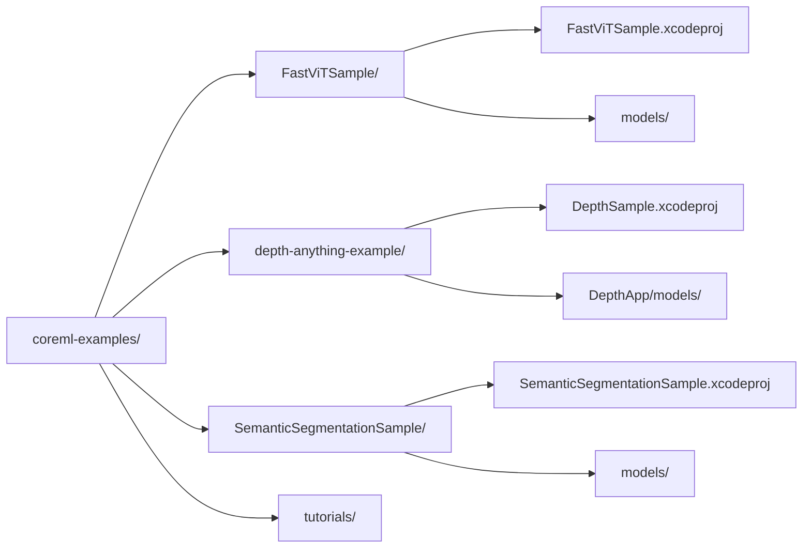
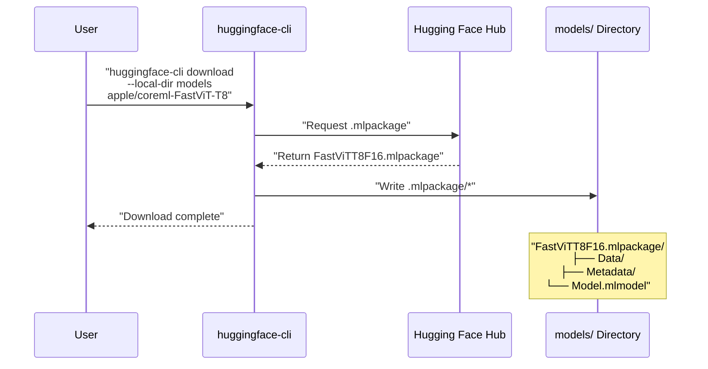
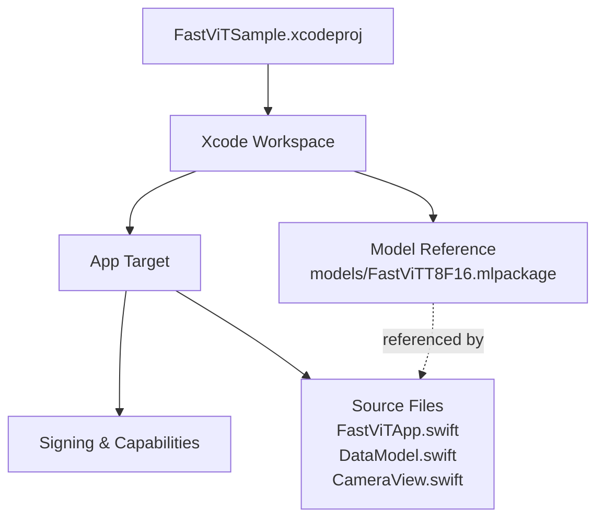
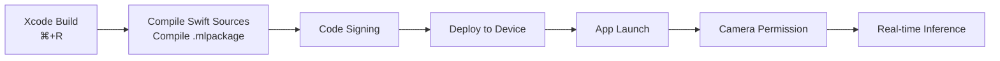
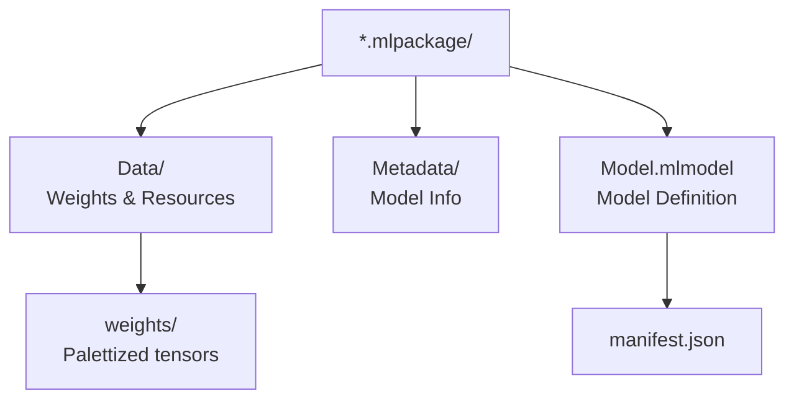

<!-- source: DeepWiki mcp.deepwiki.com · repo huggingface/coreml-examples · page 2 Getting Started · fetched 2026-10-26 -->

# Getting Started

<details>
<summary>Relevant source files</summary>

The following files were used as context for generating this wiki page:

- [FastViTSample/README.md](FastViTSample/README.md)
- [README.md](README.md)
- [depth-anything-example/README.md](depth-anything-example/README.md)

</details>


This guide walks you through setting up the CoreML Examples repository, downloading pre-optimized models from Hugging Face Hub, and running your first demo application. By the end of this guide, you will have a working iOS app performing real-time inference using CoreML models optimized for Apple Neural Engine.

For detailed information about individual demo applications, see [Demo Applications](#3). For model conversion workflows, see [Model Conversion Pipeline](#4).

---

## Prerequisites

The following software and hardware requirements must be met before proceeding:

| Requirement | Version/Specification | Notes |
|------------|----------------------|-------|
| **macOS** | 12.0 or later | Required for Xcode |
| **Xcode** | 14.0 or later | Download from Mac App Store |
| **iOS Device/Simulator** | iOS 15.0 or later | Physical device recommended for Neural Engine execution |
| **Homebrew** | Latest | Package manager for macOS |
| **Command Line Tools** | Latest | Installed with Xcode |

**Sources:** [README.md:1-31](), [depth-anything-example/README.md:1-46]()

---

## Setup Workflow

The complete setup process consists of four phases: repository acquisition, CLI tool installation, model download, and project execution.

### Phase Overview



**Sources:** [README.md:1-31](), [depth-anything-example/README.md:7-11](), [FastViTSample/README.md:6-9]()

---

## Step 1: Clone the Repository

Clone the repository to your local machine:

```bash
git clone https://github.com/huggingface/coreml-examples.git
cd coreml-examples
```

### Repository Structure

The repository contains three independent demo applications, each in its own directory:



**Sources:** [README.md:5-18](), [depth-anything-example/README.md:9](), [FastViTSample/README.md:7]()

---

## Step 2: Install Hugging Face CLI

The `huggingface-cli` tool enables model package downloads from Hugging Face Hub. Install it using Homebrew:

```bash
brew install huggingface-cli
```

Verify installation:

```bash
huggingface-cli --version
```

**Sources:** [depth-anything-example/README.md:30-34](), [FastViTSample/README.md:19-23]()

---

## Step 3: Download Model Packages

Each demo application requires one or more `.mlpackage` files downloaded from Hugging Face Hub. The packages must be placed in the correct `models/` directory for each project.

### Available Models

| Demo App | Model Repository | Package Name | Size | Task |
|----------|-----------------|--------------|------|------|
| **FastViT** | `apple/coreml-FastViT-T8` | `FastViTT8F16.mlpackage` | ~4M params | Image Classification |
| **FastViT** | `apple/coreml-FastViT-MA36` | `FastViTMA36F16.mlpackage` | ~44M params | Image Classification |
| **Depth Anything** | `apple/coreml-depth-anything-v2-small` | `DepthAnythingV2SmallF16.mlpackage` | Small variant | Depth Estimation |
| **DETR** | `apple/coreml-detr-semantic-segmentation` | `DETRResnet50F16.mlpackage` | ResNet-50 | Semantic Segmentation |

**Sources:** [README.md:13-17]()

### Download Example: FastViT

To run the FastViT sample app, download the `FastViTT8F16.mlpackage`:

```bash
cd FastViTSample
huggingface-cli download \
  --local-dir models --local-dir-use-symlinks False \
  apple/coreml-FastViT-T8 \
  --include "FastViTT8F16.mlpackage/*"
```

This command downloads the model package directly into `FastViTSample/models/` without creating symbolic links.

**Sources:** [FastViTSample/README.md:25-32]()

### Download Example: Depth Anything

For the Depth Anything demo:

```bash
cd depth-anything-example
huggingface-cli download \
  --local-dir models --local-dir-use-symlinks False \
  apple/coreml-depth-anything-v2-small \
  --include "DepthAnythingV2SmallF16.mlpackage/*"
```

The model package is placed in `depth-anything-example/models/`, which the Xcode project references as `DepthApp/models/`.

**Sources:** [depth-anything-example/README.md:36-43]()

### Model Download Workflow



**Sources:** [README.md:13-17](), [depth-anything-example/README.md:36-43](), [FastViTSample/README.md:25-32]()

---

## Step 4: Open and Configure Xcode Project

Each demo application includes an `.xcodeproj` file that references the downloaded model package.

### Opening the Project

Navigate to the demo directory and open the Xcode project:

```bash
cd FastViTSample
open FastViTSample.xcodeproj
```

Or for Depth Anything:

```bash
cd depth-anything-example
open DepthSample.xcodeproj
```

### Project Configuration



No additional configuration is required if the model package is in the correct `models/` directory. The Xcode project includes references to the `.mlpackage` files, which are automatically compiled during the build process.

**Sources:** [FastViTSample/README.md:8-9](), [depth-anything-example/README.md:10-11]()

---

## Step 5: Build and Run

### Build Configuration

Select your target device or simulator from the Xcode toolbar:

1. Click the device selector next to the scheme selector
2. Choose your connected iOS device or simulator
3. Ensure the scheme is set to the app target (e.g., `FastViTSample`)

### Building the App

Build and run using one of these methods:

- Press `⌘+R` (Command + R)
- Select **Product → Run** from the menu
- Click the **Play** button in the toolbar

### First Launch

On first launch, the app will request camera permissions. Grant access to enable real-time inference from the camera feed.



**Sources:** [FastViTSample/README.md:9](), [depth-anything-example/README.md:11]()

---

## Verification

### Confirming Successful Setup

After launching the app, you should observe:

1. **Camera Feed**: Live video preview from device camera
2. **Real-time Inference**: Model predictions updated continuously
3. **Performance Metrics**: Inference time displayed (typically < 50ms on device)

### Demo-Specific Outputs

| Demo App | Expected Output | Visual Indicator |
|----------|----------------|------------------|
| **FastViT** | Top-3 class predictions with probabilities | Text labels overlay on camera feed |
| **Depth Anything** | Depth map visualization | Grayscale depth overlay on camera feed |
| **DETR** | Semantic segmentation mask | Colored class overlay on camera feed |

**Sources:** [README.md:7-17]()

---

## Model Package Structure

All `.mlpackage` files follow the same directory structure recognized by CoreML:



The `.mlpackage` format is a directory bundle containing:

- **Data/**: Model weights and additional resources
- **Metadata/**: Model metadata and documentation
- **Model.mlmodel**: CoreML model definition with input/output specifications

Xcode automatically processes these packages during build, generating Swift classes for model interaction.

**Sources:** [README.md:20](), [depth-anything-example/README.md:5]()

---

## Troubleshooting Common Issues

### Model Package Not Found

**Symptom**: Build error stating model file cannot be found.

**Solution**: Verify the model package is in the correct directory:

```bash
# For FastViT
ls -la FastViTSample/models/FastViTT8F16.mlpackage

# For Depth Anything
ls -la depth-anything-example/models/DepthAnythingV2SmallF16.mlpackage
```

If missing, re-run the `huggingface-cli download` command.

**Sources:** [depth-anything-example/README.md:9](), [FastViTSample/README.md:7]()

### Camera Permission Denied

**Symptom**: Black camera feed or permission alert on launch.

**Solution**: 
1. Open **Settings → Privacy & Security → Camera**
2. Enable camera access for the demo app
3. Restart the app

### Slow Inference Performance

**Symptom**: Inference time > 100ms per frame.

**Solution**: 
- Ensure running on physical device (not simulator)
- Verify Neural Engine availability on device (iPhone 8 or later)
- Check that Float16 model variant is used (F16 suffix in package name)

---

## Next Steps

After successfully running your first demo app, explore:

- **[Demo Applications](#3)**: Deep dive into each demo's architecture and ML task
- **[Model Conversion Pipeline](#4)**: Learn to convert your own PyTorch models to CoreML
- **[Shared Infrastructure](#5)**: Understand reusable components across all demos
- **[Real-Time Inference Pattern](#6.1)**: Study the threading and concurrency architecture

Each demo app follows the same architectural pattern but demonstrates different ML tasks. Start with FastViT for the simplest example, then progress to Depth Anything and DETR for more complex post-processing pipelines.

**Sources:** [README.md:1-31](), [depth-anything-example/README.md:1-46](), [FastViTSample/README.md:1-35]()

---

