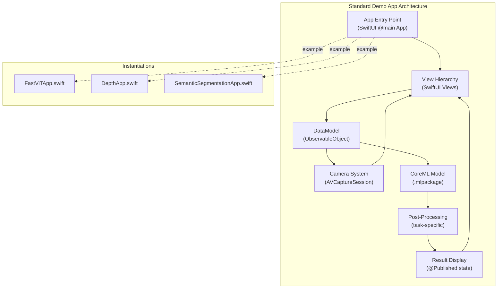
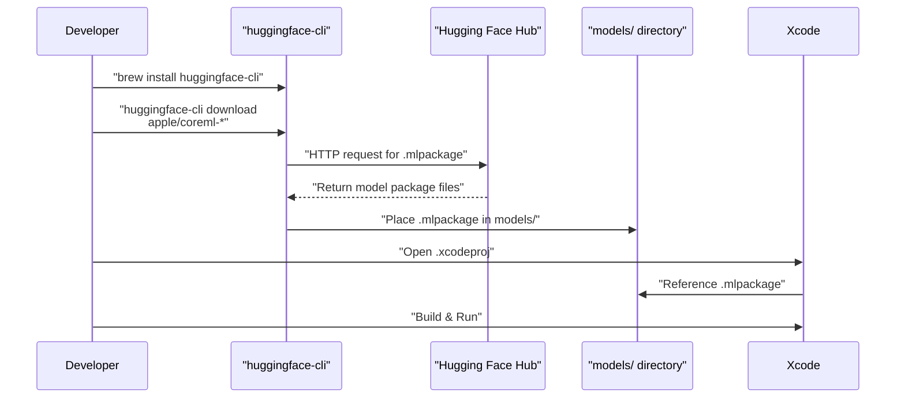
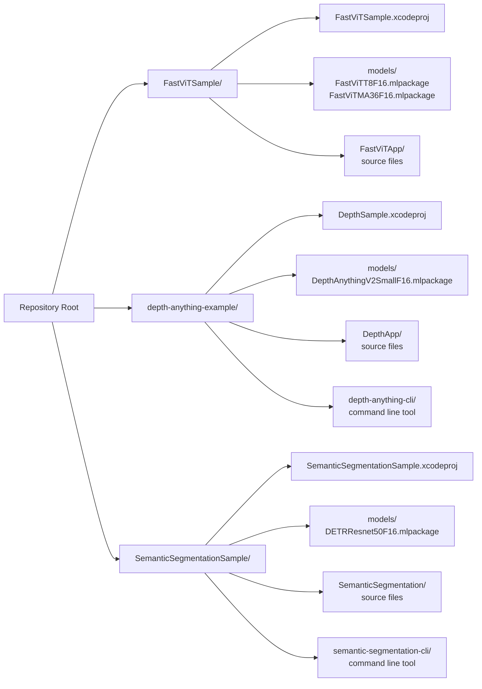

<!-- source: DeepWiki mcp.deepwiki.com · repo huggingface/coreml-examples · page 3 Demo Applications · fetched 2026-10-26 -->

# Demo Applications

Relevant source files

The following files were used as context for generating this wiki page:

- [README.md](README.md)
- [depth-anything-example/README.md](depth-anything-example/README.md)

## Purpose and Scope

This page provides an overview of the three demo applications included in the repository, their machine learning tasks, and the common architectural patterns they share. Each demo application is a complete, self-contained iOS app that demonstrates CoreML integration with real-time inference on Apple Neural Engine.

For detailed information about individual applications, see:
- [FastViT Image Classification](#3.1) - classification pipeline and model variants
- [Depth Anything Depth Estimation](#3.2) - depth estimation and visualization
- [DETR Semantic Segmentation](#3.3) - segmentation and Metal shader processing

For information about the shared infrastructure components used across all demos, see [Shared Infrastructure](#5).

**Sources:** [README.md:1-31](), [depth-anything-example/README.md:1-46]()

## Application Overview

The repository contains three demo applications showcasing different computer vision tasks. Each application follows the same acquisition and integration workflow but implements task-specific models and post-processing.

| Application | Task | CoreML Models | Location |
|------------|------|---------------|----------|
| **FastViT Sample** | Image Classification | `FastViTT8F16.mlpackage` `FastViTMA36F16.mlpackage` | `FastViTSample/` |
| **Depth Anything Sample** | Monocular Depth Estimation | `DepthAnythingV2SmallF16.mlpackage` | `depth-anything-example/` |
| **DETR Sample** | Semantic Segmentation | `DETRResnet50F16.mlpackage` | `SemanticSegmentationSample/` |

All models are pre-converted to CoreML with Neural Engine optimizations (Float16 precision, palettization) and distributed via Hugging Face Hub under the `apple/` organization namespace.

**Sources:** [README.md:11-18]()

## Common Architectural Pattern

**Standard Architecture Pattern**

Each demo application follows this consistent structure:

1. **App Entry Point** - SwiftUI `@main` App struct that defines the root view
2. **View Hierarchy** - SwiftUI views including `CameraView`, `ViewfinderView`, and task-specific result views
3. **DataModel** - `ObservableObject` that owns the `Camera`, loads the CoreML model, manages inference loop
4. **Camera System** - Shared `Camera.swift` providing `AVCaptureSession` management and frame stream
5. **CoreML Model** - Task-specific `.mlpackage` loaded via generated Swift class
6. **Post-Processing** - Task-specific result formatting (classifications, depth maps, segmentation masks)
7. **Result Display** - Updates published via `@Published` properties on `DataModel`

**Sources:** [README.md:5-18]()

## Shared Infrastructure Components

All three applications reuse the following infrastructure:

### Camera Management

- **File:** `Camera.swift` (present in each app directory)
- **Functionality:** 
  - `AVCaptureSession` lifecycle management
  - Camera authorization handling
  - Device selection (front/back camera)
  - Rotation coordination
  - Async `previewStream` of `CIImage` frames

### Image Processing

- **File:** `CoreImageExtensions.swift` (present in each app directory)
- **Functionality:**
  - `resize(to:)` - proportional image resizing
  - `withAdjustedAlpha(_:)` - alpha channel manipulation
  - `renderToPixelBuffer(pixelBuffer:context:)` - CoreImage to CVPixelBuffer
  - `savePNG(to:)` - PNG export utility

### SwiftUI Views

- **CameraView** - Live camera feed display
- **ViewfinderView** - Camera preview overlay with aspect ratio handling

These components are duplicated in each app directory rather than extracted to a shared framework, making each demo self-contained and independently buildable.

**Sources:** [README.md:1-31]()

## Model Acquisition Workflow

**Standard Model Acquisition Steps**

All applications follow the same acquisition workflow:

1. **Install CLI tool:** `brew install huggingface-cli`
2. **Download model package:** Run `huggingface-cli download` with organization `apple/` and model name
3. **Place in models directory:** Package goes in `<AppDirectory>/models/` folder
4. **Open project:** Open the `.xcodeproj` file in Xcode
5. **Build:** Xcode automatically includes `.mlpackage` in bundle

Model packages are located at:
- FastViT: [apple/coreml-FastViT-T8](https://huggingface.co/apple/coreml-FastViT-T8), [apple/coreml-FastViT-MA36](https://huggingface.co/apple/coreml-FastViT-MA36)
- Depth Anything: [apple/coreml-depth-anything-v2-small](https://huggingface.co/apple/coreml-depth-anything-v2-small)
- DETR: [apple/coreml-detr-semantic-segmentation](https://huggingface.co/apple/coreml-detr-semantic-segmentation)

**Sources:** [README.md:13-18](), [depth-anything-example/README.md:26-46]()

## Application-Specific Differences

While sharing common infrastructure, each application has task-specific components:

### FastViT Sample

**Task:** Image Classification

**Key Components:**
- `DataModel.swift` - manages either `FastViTT8F16` or `FastViTMA36F16` model
- `PredictionResult` struct - contains label and probability
- Top-3 classification display

**Output:** Array of `(label: String, probability: Float)` tuples

**Model Variants:** 
- T8: 4M parameters, faster inference
- MA36: 44M parameters, higher accuracy

### Depth Anything Sample

**Task:** Monocular Depth Estimation

**Key Components:**
- `DataModel.swift` - manages `DepthAnythingV2SmallF16` model
- `DepthView.swift` - depth map visualization with colorization
- CLI tool (`depth-anything-cli`) for batch processing
- Async inference loop with thread-safe image sharing via `OSAllocatedUnfairLock`

**Output:** Single-channel depth map resized to original image dimensions

**Architecture:** DPT (Dense Prediction Transformer) with DINOv2 backbone

### DETR Sample

**Task:** Semantic Segmentation

**Key Components:**
- `DataModel.swift` + `PostProcessor` - manages `DETRResnet50F16` and result processing
- `SemanticMapToColor.metal` - Metal compute shader for semantic class colorization
- `SegmentationView.swift` - overlay rendering with alpha blending
- CLI tool (`semantic-segmentation-cli`) for batch processing

**Output:** Multi-class segmentation mask with 133 COCO-Stuff semantic classes

**Post-Processing:** Argmax over class logits, Metal shader maps class IDs to colors

**Sources:** [README.md:11-18](), [depth-anything-example/README.md:1-46]()

## Directory Structure

**Directory Organization**

Each demo application is organized as a self-contained directory:

- **Xcode project file** (`.xcodeproj`) at the root of each directory
- **models/** subdirectory for `.mlpackage` files (user must download these)
- **App source directory** containing Swift source files
- **README.md** with app-specific setup instructions
- **CLI tools** (Depth Anything and DETR only) for batch processing

Each application can be built and run independently without dependencies on other demos.

**Sources:** [README.md:1-31](), [depth-anything-example/README.md:1-46]()

## Building and Running

Each demo application follows the same build process:

1. **Download model packages** using `huggingface-cli` (see [Model Acquisition Workflow](#model-acquisition-workflow))
2. **Open `.xcodeproj`** in Xcode
3. **Select target device** (iOS device recommended for Neural Engine execution)
4. **Build and run** - no additional configuration required

All apps require:
- Xcode 15.0 or later
- iOS 17.0 or later (target device or simulator)
- Camera permissions granted at runtime

For detailed instructions specific to each application, see their respective child pages: [FastViT](#3.1), [Depth Anything](#3.2), [DETR](#3.3).

**Sources:** [README.md:1-31](), [depth-anything-example/README.md:7-11]()

---

