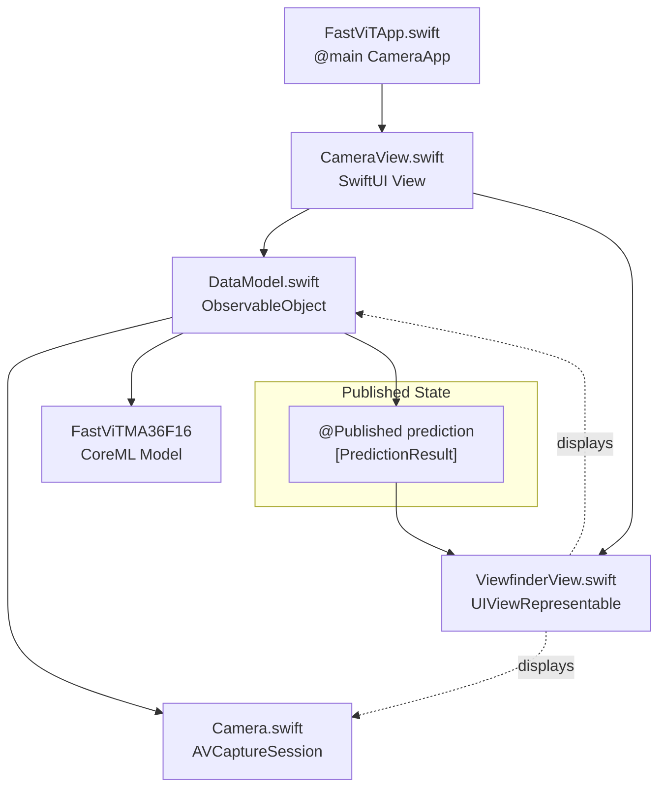
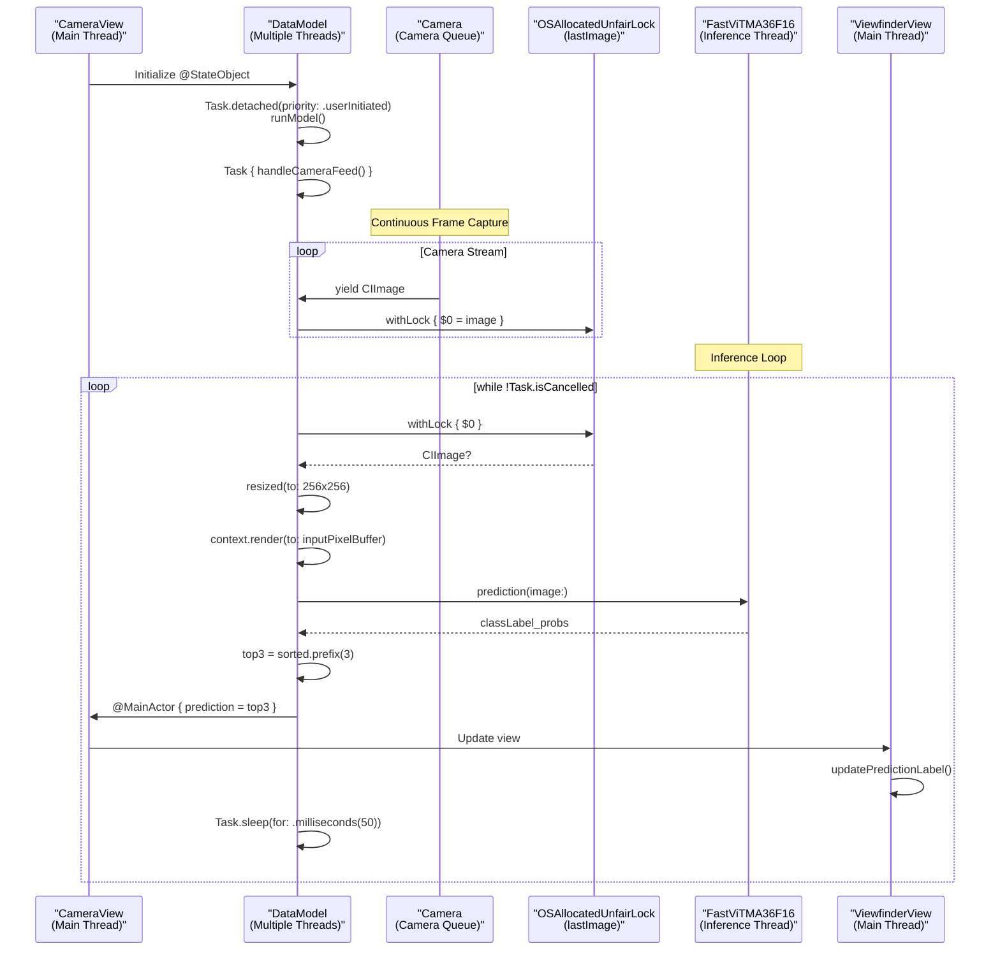
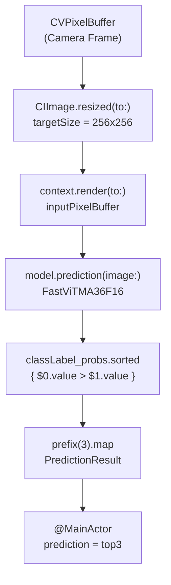
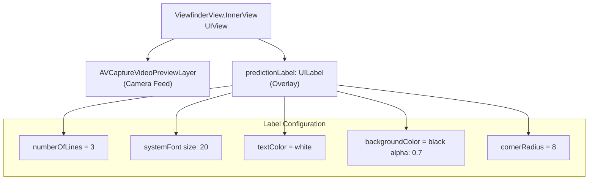

<!-- source: DeepWiki mcp.deepwiki.com · repo huggingface/coreml-examples · page 3.1 FastViT Image Classification · fetched 2026-10-26 -->

# FastViT Image Classification

<details>
<summary>Relevant source files</summary>

The following files were used as context for generating this wiki page:

- [FastViTSample/FastViTSample.xcodeproj/project.pbxproj](FastViTSample/FastViTSample.xcodeproj/project.pbxproj)
- [FastViTSample/FastViTSample/CameraView.swift](FastViTSample/FastViTSample/CameraView.swift)
- [FastViTSample/FastViTSample/DataModel.swift](FastViTSample/FastViTSample/DataModel.swift)
- [FastViTSample/FastViTSample/FastViTApp.swift](FastViTSample/FastViTSample/FastViTApp.swift)
- [FastViTSample/FastViTSample/ViewfinderView.swift](FastViTSample/FastViTSample/ViewfinderView.swift)
- [FastViTSample/README.md](FastViTSample/README.md)

</details>


## Purpose and Scope

This document covers the FastViT image classification demo application, which demonstrates real-time on-device image classification using CoreML-optimized FastViT models. The application captures live video from the device camera and displays the top-3 predicted class labels with confidence scores.

For information about the shared camera system and image processing utilities used by this application, see [Camera System](#5.1) and [Image Processing Utilities](#5.2). For details on the common DataModel pattern, see [DataModel Architecture](#5.3). For the model conversion process, see [Model Conversion Pipeline](#4).

## Overview

FastViT is a hybrid vision transformer designed for efficient inference on mobile devices. The demo application showcases two optimized CoreML variants running on Apple Neural Engine, performing real-time classification at interactive frame rates.

The application uses a continuous inference loop architecture where camera frames are captured asynchronously and processed by the CoreML model in a dedicated task, with results displayed as an overlay on the live camera feed.

**Sources:** [FastViTSample/README.md:1-35]()

## Model Variants

Two FastViT model variants are available, each converted to CoreML with Float16 precision and optimized for Apple Neural Engine execution:

| Model Variant | Parameters | Hub Location | File Name |
|--------------|------------|--------------|-----------|
| FastViT-T8 | 4M | apple/coreml-FastViT-T8 | FastViTT8F16.mlpackage |
| FastViT-MA36 | 44M | apple/coreml-FastViT-MA36 | FastViTMA36F16.mlpackage |

Both models accept 256×256 RGB images as input and output classification probabilities for 1000 ImageNet classes. The T8 variant provides faster inference at the cost of some accuracy, while MA36 offers better classification accuracy with slightly longer inference times.

The application is configured to use FastViTMA36F16 by default, but can be changed to FastViTT8F16 by modifying the model initialization in [FastViTSample/FastViTSample/DataModel.swift:96]().

**Sources:** [FastViTSample/README.md:16-34](), [FastViTSample/FastViTSample/DataModel.swift:19]()

## Application Architecture

The FastViT sample follows the standard demo application pattern with three main components:



**Component Responsibilities:**

- **CameraApp**: Application entry point with custom navigation bar styling
- **CameraView**: Root SwiftUI view managing DataModel lifecycle
- **DataModel**: Orchestrates camera feed handling and model inference
- **Camera**: Manages AVCaptureSession and provides async image stream
- **ViewfinderView**: Displays camera preview and prediction overlay
- **FastViTMA36F16**: Auto-generated CoreML model class for inference

**Sources:** [FastViTSample/FastViTSample/FastViTApp.swift:1-24](), [FastViTSample/FastViTSample/CameraView.swift:1-24](), [FastViTSample/FastViTSample/DataModel.swift:1-126]()

## Data Flow and Threading Model



**Threading Architecture:**

1. **Main Thread**: UI updates and SwiftUI view rendering
2. **Camera Queue**: Frame capture via `camera.previewStream`
3. **Inference Thread**: Dedicated `Task.detached` for model execution
4. **Lock-Protected State**: `OSAllocatedUnfairLock<CIImage?>` ensures thread-safe image access

The 50ms sleep in the inference loop prevents CPU saturation while maintaining responsive UI performance.

**Sources:** [FastViTSample/FastViTSample/DataModel.swift:47-88](), [FastViTSample/FastViTSample/DataModel.swift:24-25]()

## Core Data Structures

### PredictionResult

The `PredictionResult` struct encapsulates classification output:

```swift
struct PredictionResult: Hashable {
    let label: String
    let probability: Double
}
```

This structure is used to pass top-3 predictions from the inference thread to the main thread for display.

**Sources:** [FastViTSample/FastViTSample/DataModel.swift:9-12]()

### DataModel Properties

| Property | Type | Purpose |
|----------|------|---------|
| `camera` | `Camera` | Manages video capture session |
| `context` | `CIContext` | Reusable context for image rendering |
| `model` | `FastViTMA36F16?` | CoreML model instance |
| `inputPixelBuffer` | `CVPixelBuffer` | Pre-allocated 256×256 ARGB buffer |
| `lastImage` | `OSAllocatedUnfairLock<CIImage?>` | Thread-safe latest camera frame |
| `prediction` | `@Published [PredictionResult]?` | Top-3 classifications for UI |

The `inputPixelBuffer` is allocated once during initialization to avoid repeated memory allocation during inference.

**Sources:** [FastViTSample/FastViTSample/DataModel.swift:14-28]()

## Model Loading and Inference

### Model Initialization

Model loading occurs in the `loadModel()` method:


The model is loaded synchronously on the inference thread before the inference loop begins. Load time is measured and printed for performance monitoring.

**Sources:** [FastViTSample/FastViTSample/DataModel.swift:90-100]()

### Inference Pipeline

The `performInference()` method executes the following steps:

1. **Resize**: Input image resized to 256×256 using `CIImage.resized(to:)`
2. **Render**: Resized image rendered into pre-allocated `inputPixelBuffer`
3. **Predict**: Model invoked with `model.prediction(image:)`
4. **Sort**: Results sorted by probability in descending order
5. **Select**: Top-3 predictions extracted
6. **Publish**: Results published on `@MainActor` for UI update



**Sources:** [FastViTSample/FastViTSample/DataModel.swift:102-116](), [FastViTSample/FastViTSample/DataModel.swift:6]()

## Performance Measurement

The inference loop measures average runtime every 100 frames:

| Measurement | Implementation |
|------------|----------------|
| Clock | `ContinuousClock()` |
| Per-frame timing | `clock.measure { try? await performInference(...) }` |
| Collection | `durations.append(duration)` |
| Averaging | `total / measureInterval` every 100 frames |
| Output | Printed in milliseconds |

This provides insight into real-world inference performance on the target device.

**Sources:** [FastViTSample/FastViTSample/DataModel.swift:65-83]()

## Prediction Display

The `ViewfinderView` renders predictions using a custom UILabel overlay:

### Display Components



**Sources:** [FastViTSample/FastViTSample/ViewfinderView.swift:85-95]()

### Color-Coded Probabilities

Predictions are color-coded based on confidence:

| Probability Range | Color Interpolation |
|------------------|---------------------|
| ≥ 0.5 | Red → Yellow → Green |
| < 0.5 | Red → Yellow |

The color calculation uses a sinusoidal mapping:

```
mass = 1 + sin(probability * π)

if probability >= 0.5:
    RGB = (mass - 1, 1.0, 0.0)  // Yellow → Green
else:
    RGB = (1.0, mass - 1, 0.0)  // Red → Yellow
```

This provides visual feedback on prediction confidence without requiring the user to read numerical values.

**Sources:** [FastViTSample/FastViTSample/ViewfinderView.swift:139-147](), [FastViTSample/FastViTSample/ViewfinderView.swift:118-137]()

### Layout Constraints

The prediction label is positioned at the bottom of the screen with the following constraints:

- Leading: 16pt from left edge
- Trailing: 16pt from right edge  
- Bottom: 32pt from bottom edge
- Height: 120pt (fixed)

This ensures the label remains visible and readable across different device sizes and orientations.

**Sources:** [FastViTSample/FastViTSample/ViewfinderView.swift:107-116]()

## Configuration and Customization

### Switching Model Variants

To use FastViT-T8 instead of MA36:

1. Download FastViTT8F16.mlpackage to the `models/` directory
2. Modify [FastViTSample/FastViTSample/DataModel.swift:96]() to initialize `FastViTT8F16()` instead of `FastViTMA36F16()`
3. Update the property type at [FastViTSample/FastViTSample/DataModel.swift:19]() to `FastViTT8F16?`

### Adjusting Inference Rate

The inference loop sleep duration can be adjusted at [FastViTSample/FastViTSample/DataModel.swift:86]():

- Decrease (e.g., 10ms) for higher update rate and increased CPU usage
- Increase (e.g., 100ms) for lower update rate and reduced CPU usage

### Input Resolution

The target input size is defined at [FastViTSample/FastViTSample/DataModel.swift:6]():

```swift
fileprivate let targetSize = CGSize(width: 256, height: 256)
```

This must match the model's expected input dimensions. Both FastViT variants require 256×256 input.

**Sources:** [FastViTSample/FastViTSample/DataModel.swift:6](), [FastViTSample/FastViTSample/DataModel.swift:19](), [FastViTSample/FastViTSample/DataModel.swift:86](), [FastViTSample/FastViTSample/DataModel.swift:96]()

## Project Structure

The Xcode project is organized as follows:

```
FastViTSample/
├── FastViTSample.xcodeproj
└── FastViTSample/
    ├── models/
    │   ├── FastViTT8F16.mlpackage
    │   └── FastViTMA36F16.mlpackage
    ├── Camera.swift
    ├── CameraView.swift
    ├── CoreImageExtensions.swift
    ├── DataModel.swift
    ├── FastViTApp.swift
    ├── ViewfinderView.swift
    ├── FastViTSample.entitlements
    └── Assets.xcassets
```

The project requires the camera usage permission specified in the Info.plist:

```
NSCameraUsageDescription: "Capture video for image classification"
```

**Sources:** [FastViTSample/FastViTSample.xcodeproj/project.pbxproj:1-387](), [FastViTSample/FastViTSample.xcodeproj/project.pbxproj:312]()

## Dependencies

The application uses standard iOS frameworks:

- **SwiftUI**: UI framework for views
- **AVFoundation**: Camera capture via `AVCaptureSession`
- **CoreImage**: Image processing and resizing
- **CoreML**: On-device model inference
- **os**: Logging via `OSAllocatedUnfairLock`

Minimum deployment target: iOS 17.0

No external package dependencies are required.

**Sources:** [FastViTSample/FastViTSample.xcodeproj/project.pbxproj:318](), [FastViTSample/FastViTSample.xcodeproj/project.pbxproj:349](), [FastViTSample/FastViTSample/DataModel.swift:1-4]()

---

