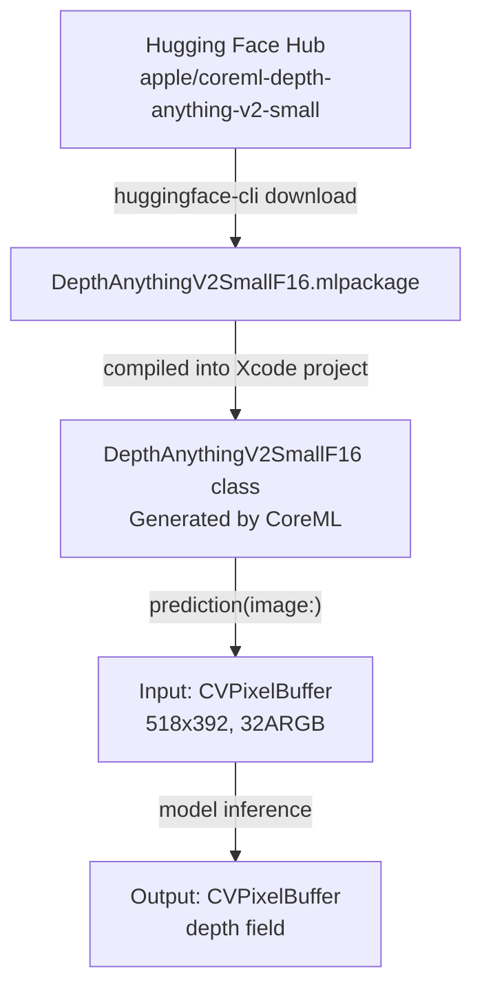
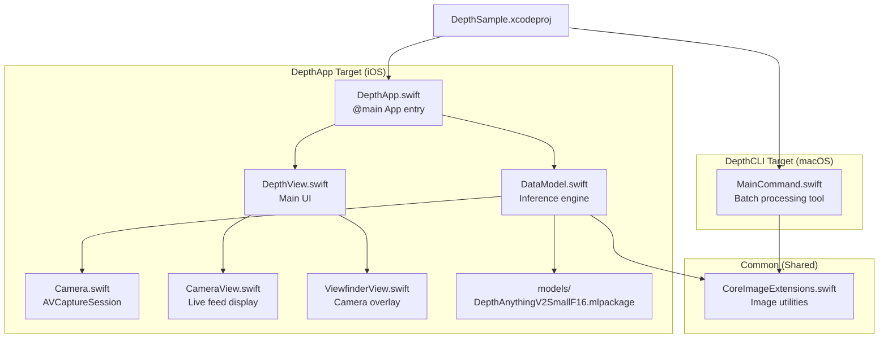
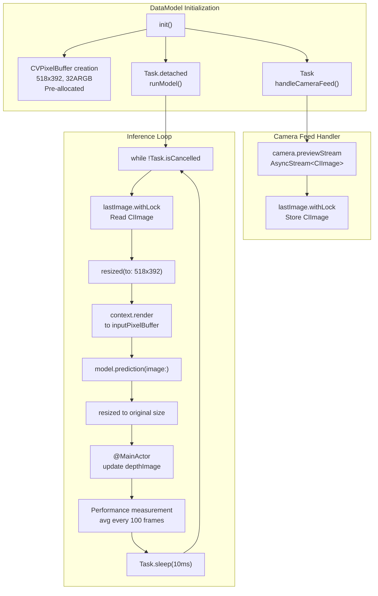
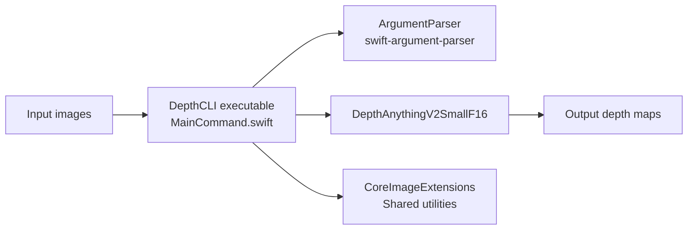
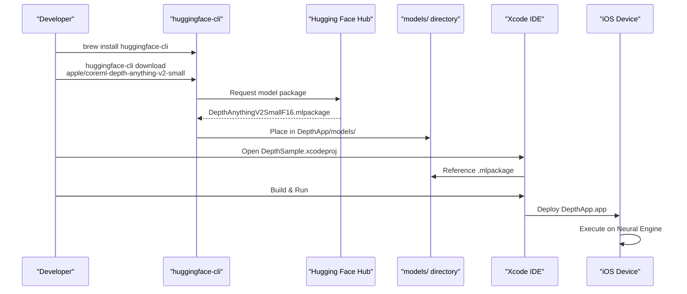
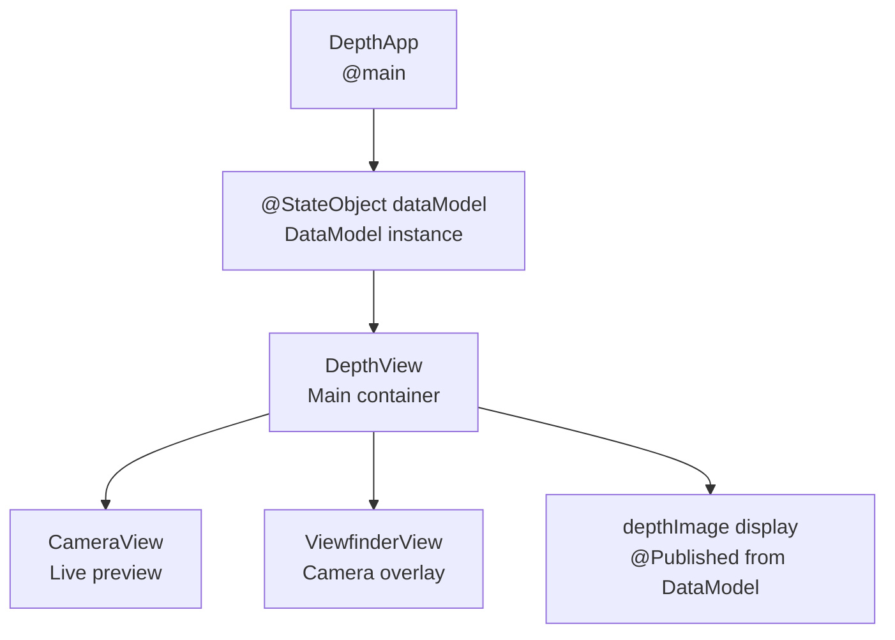

<!-- source: DeepWiki mcp.deepwiki.com · repo huggingface/coreml-examples · page 3.2 Depth Anything Depth Estimation · fetched 2026-10-26 -->

# Depth Anything Depth Estimation

<details>
<summary>Relevant source files</summary>

The following files were used as context for generating this wiki page:

- [README.md](README.md)
- [depth-anything-example/DepthApp/DataModel.swift](depth-anything-example/DepthApp/DataModel.swift)
- [depth-anything-example/DepthSample.xcodeproj/project.pbxproj](depth-anything-example/DepthSample.xcodeproj/project.pbxproj)
- [depth-anything-example/README.md](depth-anything-example/README.md)

</details>


## Purpose and Scope

This document provides comprehensive technical documentation for the Depth Anything V2 sample application, which demonstrates real-time monocular depth estimation on iOS devices using CoreML. This page covers the application architecture, inference pipeline, threading model, and integration with the DepthAnythingV2SmallF16 CoreML model.

For information about the model conversion process from PyTorch to CoreML, see [Depth Anything Conversion Tutorial](#4.1). For details about shared infrastructure components like the Camera system and image processing utilities, see [Shared Infrastructure](#5).

## Overview

The Depth Anything sample is an iOS application that performs real-time depth estimation from the device camera feed. The application uses the Depth Anything V2 (small) model, which leverages the DPT (Dense Prediction Transformer) architecture with a DINOv2 backbone. The model is optimized for Apple Neural Engine execution with Float16 precision and produces per-pixel depth maps at interactive frame rates.

**Sources:** [README.md:13-16](), [depth-anything-example/README.md:1-13]()

## Model Architecture

### Depth Anything V2 Overview

Depth Anything V2 combines two powerful architectures to achieve state-of-the-art depth estimation:

| Component | Description |
|-----------|-------------|
| **Backbone** | DINOv2 (self-supervised vision transformer) |
| **Architecture** | DPT (Dense Prediction Transformer) |
| **Training Data** | ~600K synthetic labeled images + ~62M real unlabeled images |
| **Model Variant** | Small (optimized for mobile deployment) |
| **Precision** | Float16 (FP16) |
| **Output** | Per-pixel depth map |

The model was introduced in the paper "Depth Anything V2: A More Capable Foundation Model for Monocular Depth Estimation" by Lihe Yang et al. It improves upon the original Depth Anything by using synthetic data and a larger capacity teacher model for training.

**Sources:** [depth-anything-example/README.md:13-19]()

### CoreML Model Package



**Diagram: CoreML Model Package Integration**

The CoreML model is distributed as an `.mlpackage` file from Hugging Face Hub and compiled into the application. The generated `DepthAnythingV2SmallF16` class provides a `prediction(image:)` method that accepts a CVPixelBuffer and returns a depth map.

**Sources:** [depth-anything-example/README.md:26-43](), [depth-anything-example/DepthSample.xcodeproj/project.pbxproj:22,136]()

## Application Components

### Project Structure



**Diagram: Application Component Structure**

**Sources:** [depth-anything-example/DepthSample.xcodeproj/project.pbxproj:73-140]()

### Key Classes and Their Roles

| File | Class/Type | Primary Responsibility |
|------|------------|------------------------|
| [DepthApp.swift]() | `DepthApp` | SwiftUI app entry point with `@main` attribute |
| [DataModel.swift]() | `DataModel` | Manages model lifecycle, camera integration, and inference loop |
| [Camera.swift]() | `Camera` | Wraps AVCaptureSession, provides async stream of CIImage frames |
| [DepthView.swift]() | `DepthView` | Main SwiftUI view composing camera feed and depth visualization |
| [CameraView.swift]() | `CameraView` | Displays live camera preview using AVCaptureVideoPreviewLayer |
| [ViewfinderView.swift]() | `ViewfinderView` | Overlay view for camera capture interface |
| [MainCommand.swift]() | `MainCommand` | ArgumentParser command for CLI batch processing |
| [CoreImageExtensions.swift]() | Extensions | CIImage utilities for resizing, rendering, saving |

**Sources:** [depth-anything-example/DepthSample.xcodeproj/project.pbxproj:92-122]()

## Real-Time Inference Pipeline

### DataModel Class Architecture

The `DataModel` class ([DataModel.swift:8-113]()) is the core of the inference system, implementing an `ObservableObject` that coordinates between the camera feed and model inference.



**Diagram: DataModel Initialization and Execution Flow**

**Sources:** [depth-anything-example/DepthApp/DataModel.swift:8-113]()

### Key Implementation Details

#### Pre-Allocated Pixel Buffer

The `DataModel` creates a reusable `CVPixelBuffer` during initialization to avoid allocating memory on every inference cycle:

```swift
// DataModel.swift:25-38
let inputPixelBuffer: CVPixelBuffer
```

This buffer is sized to the model's expected input dimensions (518×392) and reused via `context.render(inputImage, to: inputPixelBuffer)` ([DataModel.swift:103]()).

#### Thread-Safe Image Sharing

Camera frames are shared between threads using `OSAllocatedUnfairLock`:

```swift
// DataModel.swift:19
var lastImage = OSAllocatedUnfairLock<CIImage?>(uncheckedState: nil)
```

This lock provides thread-safe access without the overhead of `NSLock` or dispatch queues:
- **Write:** [DataModel.swift:52]() - Camera feed handler stores frames
- **Read:** [DataModel.swift:63]() - Inference loop reads frames

#### Decoupled Camera and Inference

Two separate tasks run concurrently ([DataModel.swift:41-46]()):

| Task | Priority | Purpose |
|------|----------|---------|
| `Task.detached(priority: .userInitiated)` | User Initiated | Runs the inference loop independently |
| `Task` | Default | Handles camera feed asynchronously |

This decoupling ensures the camera feed runs at its native frame rate while inference runs as fast as possible without blocking the camera.

**Sources:** [depth-anything-example/DepthApp/DataModel.swift:8-113]()

### Inference Method

```mermaid
sequenceDiagram
    participant Loop as "Inference Loop"
    participant Lock as "OSAllocatedUnfairLock"
    participant CI as "CIImage"
    participant Context as "CIContext"
    participant Buffer as "inputPixelBuffer"
    participant Model as "DepthAnythingV2SmallF16"
    participant Main as "@MainActor"
    
    Loop->>Lock: withLock (read)
    Lock-->>Loop: Optional<CIImage>
    
    opt Image exists
        Loop->>CI: pixelBuffer property
        CI-->>Loop: CVPixelBuffer (original size)
        Loop->>CI: resized(to: 518x392)
        CI-->>Loop: Resized CIImage
        Loop->>Context: render(to: inputPixelBuffer)
        Context->>Buffer: Write pixels
        Loop->>Model: prediction(image: inputPixelBuffer)
        Model-->>Loop: Output (CVPixelBuffer depth)
        Loop->>CI: CIImage(cvPixelBuffer: depth)
        Loop->>CI: resized(to: originalSize)
        Loop->>Main: Task @MainActor
        Main->>Main: depthImage = outputImage
    end
    
    Loop->>Loop: Measure duration
    Loop->>Loop: Task.sleep(10ms)
```

**Diagram: performInference Method Execution Sequence**

The `performInference` method ([DataModel.swift:96-112]()) follows these steps:

1. **Input Preparation:** Resize camera image from original dimensions to 518×392
2. **Rendering:** Render resized CIImage to pre-allocated CVPixelBuffer
3. **Model Inference:** Call `model.prediction(image:)` 
4. **Output Processing:** Convert depth CVPixelBuffer to CIImage, resize to original size
5. **UI Update:** Publish result on main thread using `@MainActor`

**Sources:** [depth-anything-example/DepthApp/DataModel.swift:96-112]()

## Data Flow Architecture

### Complete System Data Flow

```mermaid
flowchart LR
    subgraph "Camera Thread"
        CAM_HW["Camera Hardware"]
        CAM_SESSION["AVCaptureSession"]
        STREAM["AsyncStream<br/>camera.previewStream"]
        CAM_HW --> CAM_SESSION
        CAM_SESSION --> STREAM
    end
    
    subgraph "Shared State"
        LOCK["OSAllocatedUnfairLock<br/>lastImage"]
    end
    
    subgraph "Inference Thread"
        READ["Read last frame"]
        RESIZE_IN["Resize to 518x392"]
        RENDER["Render to CVPixelBuffer"]
        MODEL["DepthAnythingV2SmallF16<br/>prediction()"]
        RESIZE_OUT["Resize to original"]
    end
    
    subgraph "Main Thread"
        PUBLISHED["@Published depthImage"]
        UI["SwiftUI Views<br/>DepthView, CameraView"]
    end
    
    STREAM -->|"withLock write"| LOCK
    LOCK -->|"withLock read"| READ
    READ --> RESIZE_IN
    RESIZE_IN --> RENDER
    RENDER --> MODEL
    MODEL --> RESIZE_OUT
    RESIZE_OUT -->|"@MainActor"| PUBLISHED
    PUBLISHED --> UI
```



**Diagram: Complete Data Flow Through Application**

**Sources:** [depth-anything-example/DepthApp/DataModel.swift:8-113]()

### Target Input Size

The model expects input at a specific resolution defined as a constant:

```swift
// DataModel.swift:6
fileprivate let targetSize = CGSize(width: 518, height: 392)
```

This size is used for:
1. Pre-allocating the input pixel buffer ([DataModel.swift:28-30]())
2. Resizing camera frames before inference ([DataModel.swift:102]())

The output depth map is then resized back to the original camera frame dimensions ([DataModel.swift:106]()) for display.

**Sources:** [depth-anything-example/DepthApp/DataModel.swift:6,102,106]()

## Performance Optimization

### Optimization Techniques

| Technique | Implementation | Benefit |
|-----------|----------------|---------|
| **Pre-allocated Buffer** | `CVPixelBuffer` created once in `init()` | Eliminates allocation overhead on each frame |
| **Detached Task** | `Task.detached(priority: .userInitiated)` | Prevents blocking camera feed with inference |
| **Thread-safe Lock** | `OSAllocatedUnfairLock` | Minimal overhead for cross-thread communication |
| **Inference Throttling** | `Task.sleep(for: .milliseconds(10))` | Prevents CPU saturation, keeps UI responsive |
| **Batch Measurement** | Average over 100 frames | Low overhead performance tracking |
| **Float16 Model** | FP16 precision | Reduces memory bandwidth, faster ANE execution |

**Sources:** [depth-anything-example/DepthApp/DataModel.swift:15-82]()

### Performance Measurement

The inference loop tracks execution time using `ContinuousClock`:

```swift
// DataModel.swift:59-77
var durations = [ContinuousClock.Duration]()
// ... collect durations
let measureInterval = 100
if durations.count == measureInterval {
    let total = durations.reduce(Duration(...), +)
    let average = total / measureInterval
    print("Average model runtime: \(average.formatted(.units(allowed: [.milliseconds])))")
}
```

This approach measures only the `performInference` call ([DataModel.swift:65-67]()), averaging every 100 frames to minimize measurement overhead while providing useful performance insights.

**Sources:** [depth-anything-example/DepthApp/DataModel.swift:59-77]()

## Command-Line Tool

### DepthCLI for Batch Processing

The project includes a command-line tool for batch depth estimation on macOS:



**Diagram: DepthCLI Architecture**

The CLI tool is built as a separate target in the Xcode project ([DepthSample.xcodeproj:163-182]()) and shares the `CoreImageExtensions.swift` utility file with the iOS app ([DepthSample.xcodeproj:255]()).

**Target Configuration:**

| Property | Value |
|----------|-------|
| **Target Name** | DepthCLI |
| **Product Type** | Command-line tool |
| **Platform** | macOS 14.0+ |
| **Dependencies** | swift-argument-parser |
| **Shared Code** | CoreImageExtensions.swift |

**Sources:** [depth-anything-example/DepthSample.xcodeproj/project.pbxproj:117-122,163-182,251-259]()

## Model Loading

### Lazy Model Initialization

The model is loaded in the `loadModel()` method called at the start of the inference loop:

```swift
// DataModel.swift:84-94
func loadModel() throws {
    print("Loading model...")
    let clock = ContinuousClock()
    let start = clock.now
    model = try DepthAnythingV2SmallF16()
    let duration = clock.now - start
    print("Model loaded (took \(duration.formatted(...)))")
}
```

This approach:
- Defers model loading until actually needed
- Measures load time for performance tracking
- Allows the UI to initialize before heavy model loading

The model is stored as an optional property ([DataModel.swift:13]()) and checked for existence before each inference ([DataModel.swift:97-99]()).

**Sources:** [depth-anything-example/DepthApp/DataModel.swift:13,84-94,97-99]()

## CoreImage Processing

### Image Transformation Pipeline

The application uses CoreImage extensions for efficient image processing:

```mermaid
graph LR
    subgraph "Input Processing"
        CAM_IMG["CIImage<br/>Camera frame"]
        RESIZE_IN["resized(to: 518x392)<br/>CoreImageExtensions"]
        PIXEL_IN["CVPixelBuffer<br/>Pre-allocated"]
        CAM_IMG --> RESIZE_IN
        RESIZE_IN -->|"context.render"| PIXEL_IN
    end
    
    subgraph "Model"
        PREDICT["DepthAnythingV2SmallF16<br/>prediction()"]
        PIXEL_IN --> PREDICT
    end
    
    subgraph "Output Processing"
        PIXEL_OUT["CVPixelBuffer<br/>Depth output"]
        CI_OUT["CIImage<br/>Depth map"]
        RESIZE_OUT["resized(to: original)<br/>CoreImageExtensions"]
        SWIFTUI["Image<br/>SwiftUI display"]
        PREDICT --> PIXEL_OUT
        PIXEL_OUT -->|"CIImage(cvPixelBuffer:)"| CI_OUT
        CI_OUT --> RESIZE_OUT
        RESIZE_OUT -->|".image property"| SWIFTUI
    end
```



**Diagram: CoreImage Processing Pipeline**

The `CIImage.image` computed property ([DataModel.swift:116-121]()) converts the processed CIImage to a SwiftUI `Image`:

```swift
// DataModel.swift:116-121
var image: Image? {
    let ciContext = CIContext()
    guard let cgImage = ciContext.createCGImage(self, from: self.extent) else { return nil }
    return Image(decorative: cgImage, scale: 1, orientation: .up)
}
```

**Sources:** [depth-anything-example/DepthApp/DataModel.swift:102-107,115-121](), [Common/CoreImageExtensions.swift]()

## Setup and Execution

### Prerequisites

1. **Xcode:** Version 15.0 or later
2. **iOS Device:** iOS 17.0+ (or Simulator)
3. **Model Package:** DepthAnythingV2SmallF16.mlpackage
4. **Command-line tools:** huggingface-cli for model download

**Sources:** [depth-anything-example/DepthSample.xcodeproj/project.pbxproj:400,438]()

### Installation Steps



**Diagram: Installation and Deployment Process**

**Commands:**

```bash
# Install huggingface-cli
brew install huggingface-cli

# Download model to models directory
huggingface-cli download \
  --local-dir models --local-dir-use-symlinks False \
  apple/coreml-depth-anything-v2-small \
  --include "DepthAnythingV2SmallF16.mlpackage/*"
```

**Sources:** [depth-anything-example/README.md:7-11,26-43]()

### Camera Permissions

The application requires camera access, declared in the Info.plist:

```
NSCameraUsageDescription: "Capture photos for depth estimation"
```

This is configured in the Xcode project build settings ([DepthSample.xcodeproj:389,427]()).

**Sources:** [depth-anything-example/DepthSample.xcodeproj/project.pbxproj:389,427]()

## View Layer

### SwiftUI View Hierarchy

The application follows a standard SwiftUI structure with published state updates:



**Diagram: SwiftUI View Hierarchy**

The `DataModel` publishes the `depthImage` property ([DataModel.swift:22]()), which is automatically observed by SwiftUI views. When the inference loop updates this property on the main thread ([DataModel.swift:109-111]()), the UI automatically refreshes.

**Sources:** [depth-anything-example/DepthApp/DepthApp.swift](), [depth-anything-example/DepthApp/DepthView.swift](), [depth-anything-example/DepthApp/DataModel.swift:22,109-111]()

## Integration with Shared Infrastructure

The Depth Anything sample leverages shared components documented in [Shared Infrastructure](#5):

| Component | Usage in Depth Anything |
|-----------|-------------------------|
| **Camera** | Provides async stream of camera frames via `camera.previewStream` |
| **CoreImageExtensions** | Used for resizing images before and after inference |
| **DataModel Pattern** | Follows `ObservableObject` pattern with `@Published` properties |
| **ViewfinderView** | Shared camera overlay component |
| **CameraView** | Shared live preview component |

For detailed documentation of these components, see:
- Camera system implementation: [Camera System](#5.1)
- Image processing utilities: [Image Processing Utilities](#5.2)
- DataModel pattern details: [DataModel Architecture](#5.3)

**Sources:** [depth-anything-example/DepthApp/DataModel.swift:9,102,106](), [depth-anything-example/DepthSample.xcodeproj/project.pbxproj:125-131]()

---

