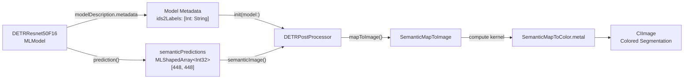
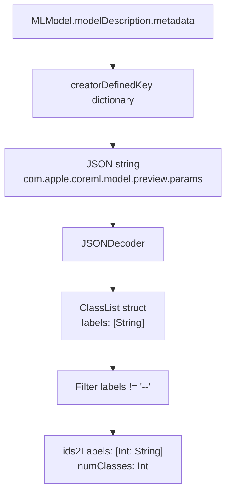
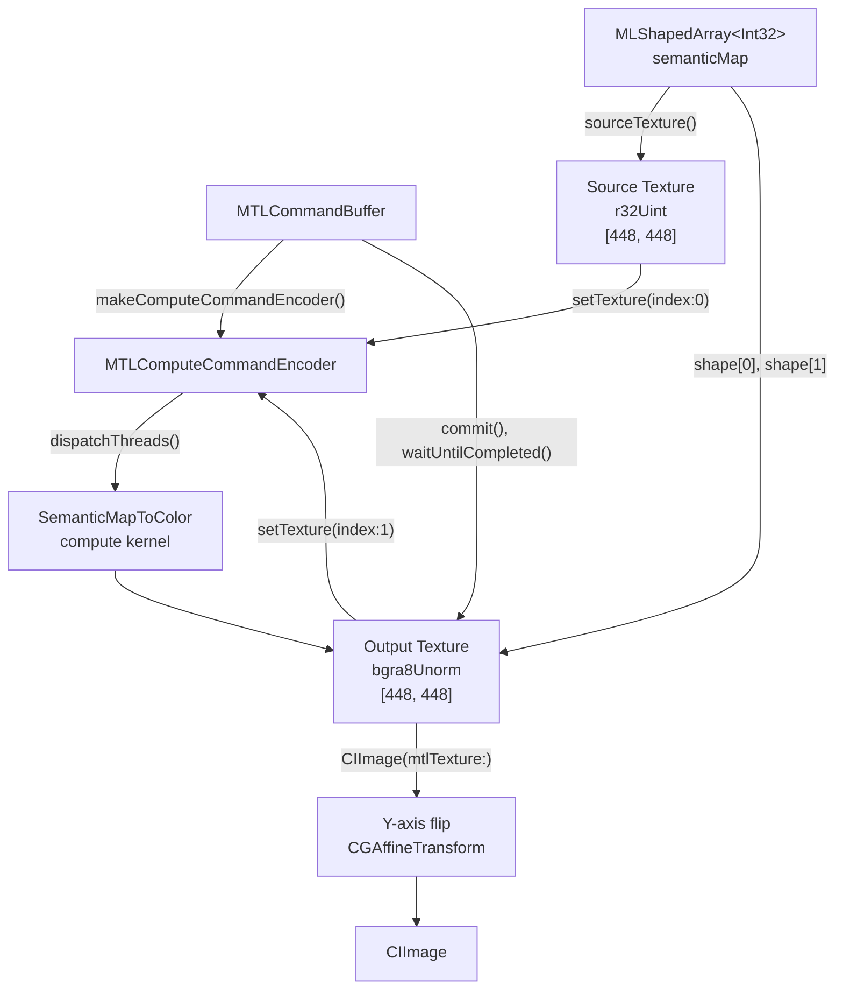
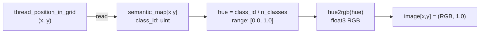
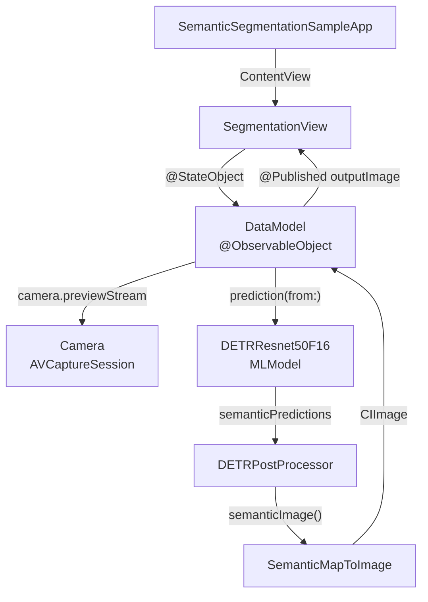
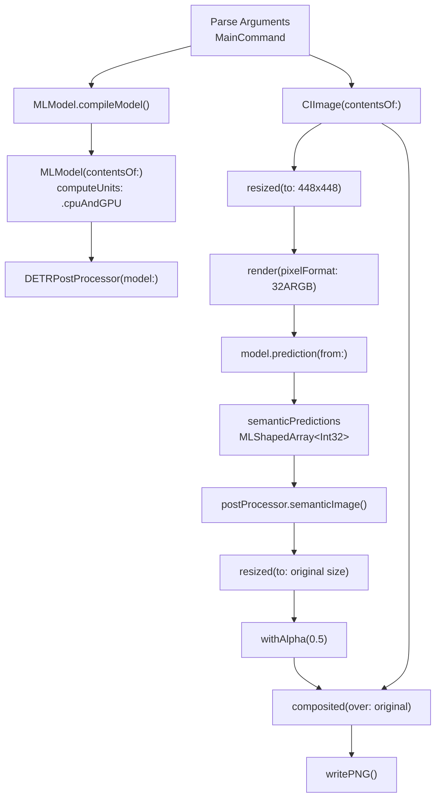

<!-- source: DeepWiki mcp.deepwiki.com · repo huggingface/coreml-examples · page 3.3 DETR Semantic Segmentation · fetched 2026-10-26 -->

# DETR Semantic Segmentation

<details>
<summary>Relevant source files</summary>

The following files were used as context for generating this wiki page:

- [SemanticSegmentationSample/Common/PostProcessing.swift](SemanticSegmentationSample/Common/PostProcessing.swift)
- [SemanticSegmentationSample/Common/SemanticMapToColor.metal](SemanticSegmentationSample/Common/SemanticMapToColor.metal)
- [SemanticSegmentationSample/Common/SemanticMapToImage.swift](SemanticSegmentationSample/Common/SemanticMapToImage.swift)
- [SemanticSegmentationSample/README.md](SemanticSegmentationSample/README.md)
- [SemanticSegmentationSample/SemanticSegmentationCLI/MainCommand.swift](SemanticSegmentationSample/SemanticSegmentationCLI/MainCommand.swift)
- [SemanticSegmentationSample/SemanticSegmentationSample.xcodeproj/project.pbxproj](SemanticSegmentationSample/SemanticSegmentationSample.xcodeproj/project.pbxproj)

</details>


This document describes the DETR semantic segmentation sample application, which demonstrates end-to-end pixel-level classification on iOS devices. The sample uses a CoreML-converted DETR (DEtection TRansformer) ResNet-50 model to perform semantic segmentation, where each pixel is classified into one of 171 semantic categories.

The document covers the DETR-specific post-processing pipeline, Metal shader implementation for color mapping, and the CLI tool for batch processing. For general camera system architecture, see [Camera System](#5.1). For the standard DataModel pattern shared across all demos, see [DataModel Architecture](#5.3). For threading and concurrency patterns, see [Threading & Concurrency](#6.2).

## Model Overview

The DETR semantic segmentation model (`DETRResnet50SemanticSegmentationF16.mlpackage`) is based on the original DETR architecture introduced in the paper "End-to-End Object Detection with Transformers" by Carion et al. The CoreML model accepts 448×448 pixel images and outputs per-pixel semantic predictions.

### Model Input/Output Specification

| Property | Specification |
|----------|--------------|
| Input Name | `image` |
| Input Type | `CVPixelBuffer` (32ARGB) |
| Input Size | 448×448 pixels |
| Output Name | `semanticPredictions` |
| Output Type | `MLShapedArray<Int32>` |
| Output Shape | [448, 448] |
| Precision | Float16 |
| Model Location | `SemanticSegmentationSample/models/` |

The model outputs a 2D array where each element contains the predicted class ID (0-170) for the corresponding pixel. Empty/unlabeled categories (marked as "--" in metadata) are filtered out during post-processing.

**Sources:** [SemanticSegmentationSample/README.md:1-34](), [SemanticSegmentationSample/SemanticSegmentationCLI/MainCommand.swift:7-86]()

## Post-Processing Pipeline

The post-processing pipeline converts raw semantic predictions into visualizable colored images. This involves two main stages: class label extraction from model metadata and semantic map to image conversion using Metal shaders.



**Sources:** [SemanticSegmentationSample/Common/PostProcessing.swift:1-47](), [SemanticSegmentationSample/Common/SemanticMapToImage.swift:1-100]()

### DETRPostProcessor Class

The `DETRPostProcessor` class handles metadata extraction and coordinates the Metal-based conversion pipeline. It is initialized with the loaded `MLModel` instance and extracts class labels from custom metadata fields.

[SemanticSegmentationSample/Common/PostProcessing.swift:10-37]()

**Class Label Extraction:**

The model's metadata contains a JSON-encoded class list under the key `com.apple.coreml.model.preview.params`. The processor:

1. Extracts the `creatorDefinedKey` metadata dictionary
2. Parses the JSON to decode a `ClassList` structure containing 171 labels
3. Filters out empty categories (labeled as "--")
4. Creates a mapping from semantic ID to class label



**Sources:** [SemanticSegmentationSample/Common/PostProcessing.swift:17-37]()

**Semantic Image Generation:**

The `semanticImage(semanticPredictions:)` method converts raw predictions to a `CIImage`:

[SemanticSegmentationSample/Common/PostProcessing.swift:39-45]()

This method delegates to `SemanticMapToImage.shared` for the actual Metal shader execution.

**Sources:** [SemanticSegmentationSample/Common/PostProcessing.swift:10-47]()

## Metal Shader Implementation

The semantic map to colored image conversion is implemented using a Metal compute shader for GPU acceleration. This approach provides significantly better performance than CPU-based pixel iteration, especially for real-time camera inference.

### SemanticMapToImage Class

The `SemanticMapToImage` class manages the Metal pipeline state and executes the compute shader. It follows the singleton pattern with a shared instance.

[SemanticSegmentationSample/Common/SemanticMapToImage.swift:6-38]()

**Initialization:**

The class initializes the Metal device, command queue, and compute pipeline state during instantiation:

| Component | Description |
|-----------|-------------|
| `device` | System default Metal device |
| `commandQueue` | Command queue for submitting work |
| `pipelineState` | Compiled `SemanticMapToColor` kernel |

**Sources:** [SemanticSegmentationSample/Common/SemanticMapToImage.swift:6-38]()

### Conversion Pipeline

The `mapToImage(semanticMap:numClasses:)` method orchestrates the Metal shader execution:



**Sources:** [SemanticSegmentationSample/Common/SemanticMapToImage.swift:40-57]()

**Texture Creation:**

[SemanticSegmentationSample/Common/SemanticMapToImage.swift:85-98]()

- **Source texture:** `r32Uint` format (single 32-bit unsigned integer channel) containing class IDs
- **Output texture:** `bgra8Unorm` format (8-bit RGBA) for colored output
- Both textures have `shaderRead` and `shaderWrite` usage flags

**Thread Dispatch:**

[SemanticSegmentationSample/Common/SemanticMapToImage.swift:73-79]()

The compute shader is dispatched with:
- Threads per grid: Full texture dimensions (448×448)
- Threads per threadgroup: Optimal size based on pipeline state properties

**Sources:** [SemanticSegmentationSample/Common/SemanticMapToImage.swift:40-98]()

### SemanticMapToColor Metal Kernel

The Metal compute kernel performs hue-based color mapping to visualize semantic classes:

[SemanticSegmentationSample/Common/SemanticMapToColor.metal:1-20]()

**Hue-to-RGB Conversion:**

The `hue2rgb()` function implements a simplified HSV-to-RGB conversion assuming saturation=1 and value=1:

[SemanticSegmentationSample/Common/SemanticMapToColor.metal:4-9]()

This creates vivid, distinct colors across the hue spectrum (0.0 to 1.0).

**Kernel Execution:**

The main kernel function processes each pixel in parallel:



**Kernel Parameters:**

| Index | Type | Description |
|-------|------|-------------|
| `texture(0)` | `texture2d<uint, access::read>` | Input semantic map (class IDs) |
| `texture(1)` | `texture2d<float, access::write>` | Output RGBA image |
| `buffer(0)` | `const device uint&` | Total number of classes |

Each thread:
1. Reads the class ID from its pixel position
2. Normalizes the class ID to a hue value (0.0-1.0)
3. Converts hue to RGB using the helper function
4. Writes the RGB value with full alpha to the output texture

**Sources:** [SemanticSegmentationSample/Common/SemanticMapToColor.metal:1-20]()

## Application Architecture

The DETR semantic segmentation app follows the same architectural pattern as other demos (see [DataModel Architecture](#5.3)) but includes DETR-specific post-processing components.



**Sources:** [SemanticSegmentationSample/SemanticSegmentationSample.xcodeproj/project.pbxproj:109-152]()

### DataModel Integration

The `DataModel` class (located at [SemanticSegmentationSample/SemanticSegmentationSample/DataModel.swift]()) follows the standard pattern with DETR-specific initialization:

1. Loads `DETRResnet50SemanticSegmentationF16` model
2. Initializes `DETRPostProcessor` with the loaded model
3. Runs async inference loop reading from camera stream
4. Post-processes predictions using `postProcessor.semanticImage()`
5. Publishes the colored segmentation overlay to the view

The inference loop maintains similar performance characteristics to other demos, with a 10ms sleep between iterations to prevent CPU saturation.

**Sources:** [SemanticSegmentationSample/SemanticSegmentationSample.xcodeproj/project.pbxproj:109-124]()

### SegmentationView Display

The `SegmentationView` (located at [SemanticSegmentationSample/SemanticSegmentationSample/SegmentationView.swift]()) displays:

- Live camera preview via `CameraView`
- Overlaid semantic segmentation with 50% alpha transparency
- Inference duration statistics
- Model selection (if multiple variants were included)

The view composites the colored segmentation map over the camera feed, allowing users to see the original scene alongside the semantic predictions.

**Sources:** [SemanticSegmentationSample/SemanticSegmentationSample.xcodeproj/project.pbxproj:22-23]()

## Command-Line Tool

The semantic segmentation CLI tool enables batch processing of static images without requiring an iOS device. The tool is implemented as a macOS command-line executable using Swift Argument Parser.

### Usage

```bash
semantic --model <mlpackage> --input <image> --output <result> [--mask <mask>]
```

**Arguments:**

| Option | Short | Description |
|--------|-------|-------------|
| `--model` | `-m` | Path to `.mlpackage` file |
| `--input` | `-i` | Input image file path |
| `--output` | `-o` | Output PNG with overlay |
| `--mask` | `-k` | Optional: Save standalone mask |

**Sources:** [SemanticSegmentationSample/SemanticSegmentationCLI/MainCommand.swift:10-28]()

### Processing Workflow

The CLI tool implements the following workflow:



**Sources:** [SemanticSegmentationSample/SemanticSegmentationCLI/MainCommand.swift:29-85]()

### Implementation Details

**Model Compilation and Loading:**

[SemanticSegmentationSample/SemanticSegmentationCLI/MainCommand.swift:30-35]()

The CLI compiles the model on-the-fly and configures it for CPU and GPU execution (no Neural Engine on macOS).

**Image Preprocessing:**

[SemanticSegmentationSample/SemanticSegmentationCLI/MainCommand.swift:38-51]()

Input images are resized to 448×448 pixels and converted to 32ARGB pixel buffers using the shared `CIContext`.

**Inference Timing:**

[SemanticSegmentationSample/SemanticSegmentationCLI/MainCommand.swift:54-63]()

The tool measures and reports inference duration using `ContinuousClock`, displaying results in seconds and milliseconds.

**Output Generation:**

[SemanticSegmentationSample/SemanticSegmentationCLI/MainCommand.swift:65-84]()

The tool generates two types of output:
1. **Overlay:** Semantic mask composited over original image at 50% opacity
2. **Mask (optional):** Standalone colored segmentation map

The segmentation is upscaled back to the original image dimensions before compositing.

**Sources:** [SemanticSegmentationSample/SemanticSegmentationCLI/MainCommand.swift:1-86]()

## Semantic Class Categories

The DETR model classifies pixels into 171 semantic categories based on the COCO-Stuff dataset. Common categories include:

| Category Type | Examples |
|---------------|----------|
| Objects | person, car, chair, bottle, laptop |
| Outdoor | sky, tree, grass, road, building |
| Indoor | wall, floor, ceiling, table, window |
| Animals | dog, cat, bird, horse, cow |
| Food | pizza, cake, apple, sandwich, banana |

The complete list of categories is embedded in the model metadata and automatically extracted by `DETRPostProcessor` during initialization. Empty categories (marked as "--") are filtered out, resulting in fewer than 171 actual displayable classes.

**Sources:** [SemanticSegmentationSample/Common/PostProcessing.swift:17-37]()

## Performance Characteristics

The DETR semantic segmentation model exhibits the following performance characteristics on iOS devices:

| Metric | Value |
|--------|-------|
| Input Resolution | 448×448 pixels |
| Model Precision | Float16 |
| Output Resolution | 448×448 pixels |
| Metal Shader | GPU-accelerated |
| Typical Inference | 20-50ms (device-dependent) |
| Post-processing | <5ms (Metal) |

The Metal shader implementation provides substantial performance benefits over CPU-based color mapping, making real-time camera inference feasible even with the post-processing overhead.

**Sources:** [SemanticSegmentationSample/Common/SemanticMapToImage.swift:1-100](), [SemanticSegmentationSample/Common/SemanticMapToColor.metal:1-20]()

---

