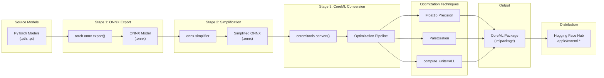
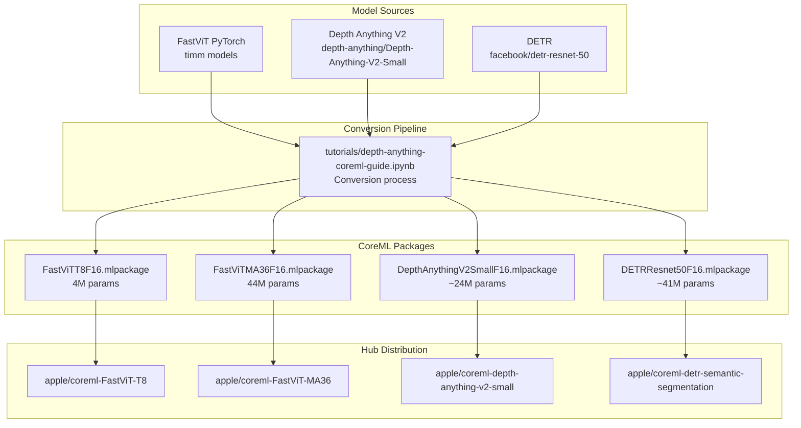
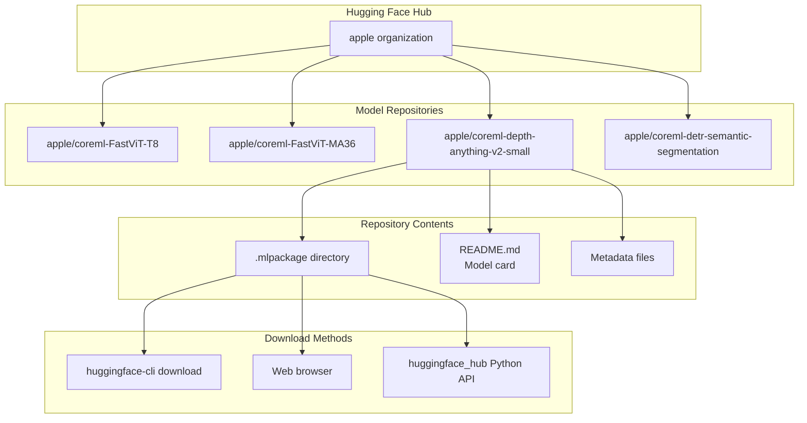
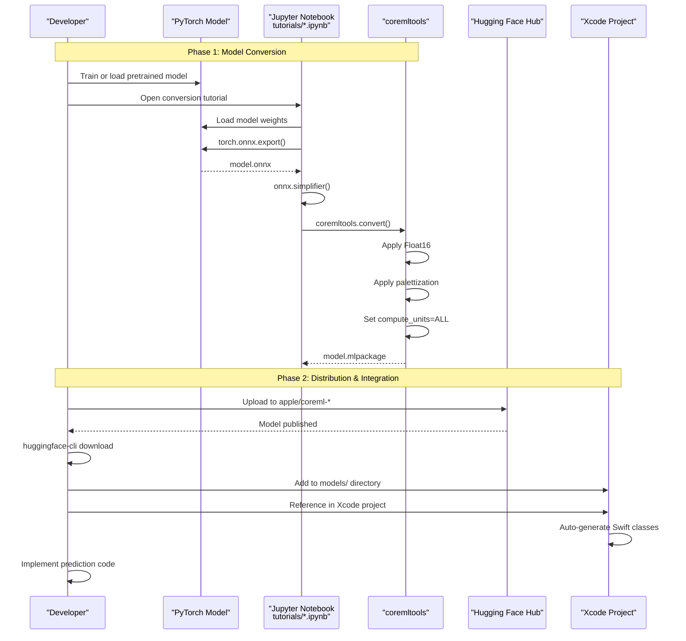
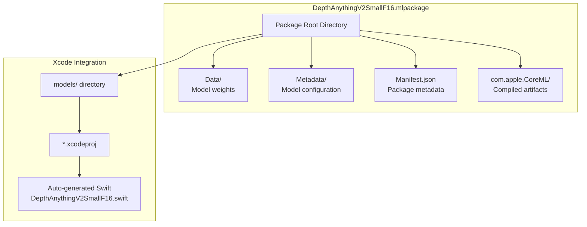

<!-- source: DeepWiki mcp.deepwiki.com · repo huggingface/coreml-examples · page 4 Model Conversion Pipeline · fetched 2026-10-26 -->

# Model Conversion Pipeline

<details>
<summary>Relevant source files</summary>

The following files were used as context for generating this wiki page:

- [README.md](README.md)
- [depth-anything-example/README.md](depth-anything-example/README.md)
- [tutorials/depth-anything-coreml-guide.ipynb](tutorials/depth-anything-coreml-guide.ipynb)

</details>


## Purpose and Scope

This document provides an overview of the model conversion pipeline used to transform PyTorch models into optimized CoreML packages that run efficiently on Apple Neural Engine. It covers the conversion workflow, tools, optimization techniques, and distribution mechanisms.

For step-by-step conversion instructions, see [Depth Anything Conversion Tutorial](#4.1). For information about how converted models are integrated into demo applications, see [Demo Applications](#3).

---

## Conversion Pipeline Overview

The model conversion pipeline transforms models from PyTorch format into CoreML `.mlpackage` files optimized for Apple devices. The pipeline consists of three main stages: ONNX export, simplification, and CoreML conversion with optimization.



**Pipeline Flow**: The conversion process begins with a trained PyTorch model, exports it to ONNX format for portability, simplifies the ONNX graph to remove redundancies, converts to CoreML format, applies optimizations for size and performance, and finally publishes the `.mlpackage` to Hugging Face Hub for distribution.

**Sources**: [README.md:20](), [depth-anything-example/README.md:5]()

---

## Tools and Technologies

### coremltools

The `coremltools` package is the primary tool for converting models to CoreML format. It provides Python APIs for model conversion, optimization, and verification.

**Key Functions**:
- `coremltools.convert()` - Main conversion API that accepts various input formats (ONNX, TensorFlow, PyTorch)
- Optimization APIs for palettization and quantization
- Model compilation and validation utilities

The repository leverages coremltools extensively for all model conversions and optimizations.

**Sources**: [README.md:20](), [depth-anything-example/README.md:5]()

### ONNX Intermediate Format

ONNX (Open Neural Network Exchange) serves as an intermediate representation between PyTorch and CoreML. This two-stage conversion approach provides:

**Advantages**:
- **Portability**: ONNX models can be inspected and validated independently
- **Optimization**: ONNX graph can be simplified before CoreML conversion
- **Debugging**: Easier to identify conversion issues at each stage

**Export Process**: PyTorch models are exported using `torch.onnx.export()` with specific input shapes and operator versions compatible with CoreML.

**Sources**: [README.md:20](), Diagram 4 from high-level architecture

### onnx-simplifier

The `onnx-simplifier` tool optimizes ONNX graphs by:
- Removing redundant operations
- Constant folding
- Eliminating identity operations
- Simplifying complex operator sequences

This simplification step reduces model size and improves CoreML conversion success rates.

**Sources**: Diagram 4 from high-level architecture

---

## Optimization Techniques

### Float16 Precision

All models in this repository are converted with Float16 precision to balance accuracy and model size. The F16 suffix in model names (e.g., `DepthAnythingV2SmallF16.mlpackage`) indicates Float16 precision.

**Benefits**:
- Reduces model size by approximately 50%
- Enables efficient Neural Engine execution
- Maintains acceptable accuracy for most vision tasks

**Implementation**: Float16 conversion is specified during `coremltools.convert()` with appropriate precision parameters.

**Sources**: [depth-anything-example/README.md:36](), model naming conventions

### Palettization

Palettization is a weight quantization technique that clusters model weights into a small number of shared values stored in a lookup table.

**Key Characteristics**:
- Reduces model size while preserving accuracy
- Particularly effective for convolutional and linear layers
- Configured through coremltools optimization APIs

The coremltools documentation provides detailed information about palettization APIs available at `apple.github.io/coremltools/docs-guides/source/opt-palettization-api.html`.

**Sources**: [README.md:20](), [depth-anything-example/README.md:5]()

### Neural Engine Optimization

Models are compiled with `compute_units=ALL` to enable execution on Apple Neural Engine alongside CPU and GPU resources.

**Configuration**:
- `compute_units` parameter in `coremltools.convert()` specifies target hardware
- `ALL` setting allows CoreML runtime to automatically select optimal compute unit per operation
- Results in efficient on-device inference optimized for Apple silicon

**Sources**: Diagram 4 from high-level architecture, [README.md:3]()

---

## Model Variants and Packages

The conversion pipeline produces multiple model variants for different use cases:

| Model | Variants | Package Names | Parameters | Hub Repository |
|-------|----------|---------------|------------|----------------|
| FastViT | T8, MA36 | `FastViTT8F16.mlpackage`<br/>`FastViTMA36F16.mlpackage` | 4M, 44M | `apple/coreml-FastViT-T8`<br/>`apple/coreml-FastViT-MA36` |
| Depth Anything V2 | Small | `DepthAnythingV2SmallF16.mlpackage` | ~24M | `apple/coreml-depth-anything-v2-small` |
| DETR | ResNet-50 | `DETRResnet50F16.mlpackage` | ~41M | `apple/coreml-detr-semantic-segmentation` |



**Package Structure**: Each `.mlpackage` is a directory containing model weights, metadata, and compiled artifacts optimized for Apple Neural Engine.

**Sources**: [README.md:13-17](), [depth-anything-example/README.md:28]()

---

## Model Distribution via Hugging Face Hub

Converted CoreML models are published to Hugging Face Hub under the `apple` organization for easy distribution and version management.

### Repository Structure

Each model has a dedicated repository following the naming convention `apple/coreml-{model-name}`:



**Download Workflow**: Users download model packages using `huggingface-cli`, which handles authentication, version control, and efficient file transfer.

**Sources**: [README.md:13-17](), [depth-anything-example/README.md:28-43]()

### Downloading Models

The recommended method for downloading models is the `huggingface-cli` command-line tool:

**Installation**:
```bash
brew install huggingface-cli
```

**Download Example** (Depth Anything V2):
```bash
huggingface-cli download \
  --local-dir models --local-dir-use-symlinks False \
  apple/coreml-depth-anything-v2-small \
  --include "DepthAnythingV2SmallF16.mlpackage/*"
```

**Parameters**:
- `--local-dir models` - Target directory for downloaded files
- `--local-dir-use-symlinks False` - Downloads actual files instead of symlinks
- `--include` - Specifies which files to download (optional, omit to download all variants)

**Sources**: [depth-anything-example/README.md:30-43]()

---

## Conversion Workflow in Practice

The practical workflow for converting and integrating a new model involves several stages:



**Workflow Stages**:

1. **Model Preparation**: Start with trained PyTorch model
2. **ONNX Export**: Convert to ONNX format using tutorials as guidance
3. **Optimization**: Apply Float16, palettization, and ANE targeting via coremltools
4. **Validation**: Test converted model for accuracy and performance
5. **Distribution**: Upload to Hugging Face Hub
6. **Integration**: Download and add to Xcode project

**Tutorial Resources**: The repository includes Jupyter notebooks in the `tutorials/` directory that provide detailed conversion examples. The Depth Anything conversion tutorial is available at `tutorials/depth-anything-coreml-guide.ipynb` and can be run in Google Colab.

**Sources**: [README.md:23-27](), Diagram 2 from high-level architecture

---

## Model Package Structure

CoreML `.mlpackage` files are directories containing organized model artifacts:



**Package Components**:
- **Data/**: Contains model weights and parameters in CoreML format
- **Metadata/**: Stores model configuration, input/output specifications
- **Manifest.json**: Package version and compatibility information
- **Compiled artifacts**: Platform-specific optimized model binaries

**Xcode Integration**: When `.mlpackage` is added to Xcode project, Swift wrapper classes are automatically generated for type-safe model inference.

**Sources**: [depth-anything-example/README.md:9-11](), model package structure conventions

---

## Performance Considerations

The optimization techniques applied during conversion directly impact runtime performance:

| Optimization | Model Size Impact | Inference Speed | Accuracy Impact |
|--------------|-------------------|-----------------|-----------------|
| Float16 | ~50% reduction | Faster on ANE | Minimal (<1% typical) |
| Palettization | 2-4x reduction | Neutral/Faster | Minimal with proper tuning |
| Neural Engine | N/A | 2-10x faster vs CPU | None |

**Measurement**: Performance metrics vary by model architecture and device. The demo applications include inference time measurement showing real-world performance. See [Real-Time Inference Pattern](#6.1) for details on performance monitoring implementation.

**Sources**: [README.md:20](), Diagram 5 from high-level architecture

---

## Summary

The model conversion pipeline provides a systematic approach to transforming PyTorch models into optimized CoreML packages:

1. **Two-stage conversion**: PyTorch → ONNX → CoreML
2. **Multiple optimizations**: Float16, palettization, Neural Engine targeting
3. **Standardized distribution**: Hugging Face Hub for version management
4. **Seamless integration**: Direct Xcode project integration with auto-generated Swift APIs

For hands-on conversion guidance, proceed to [Depth Anything Conversion Tutorial](#4.1). To understand how converted models are used in applications, see [Demo Applications](#3) and [DataModel Architecture](#5.3).

**Sources**: [README.md:1-31](), [depth-anything-example/README.md:1-46]()

---

