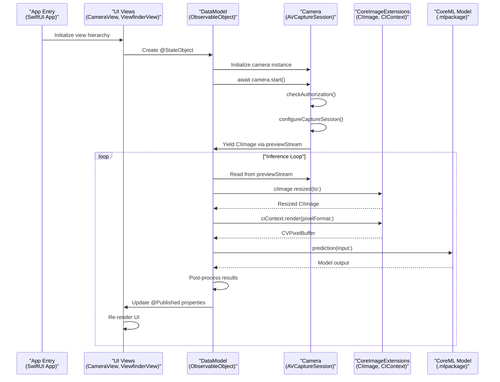
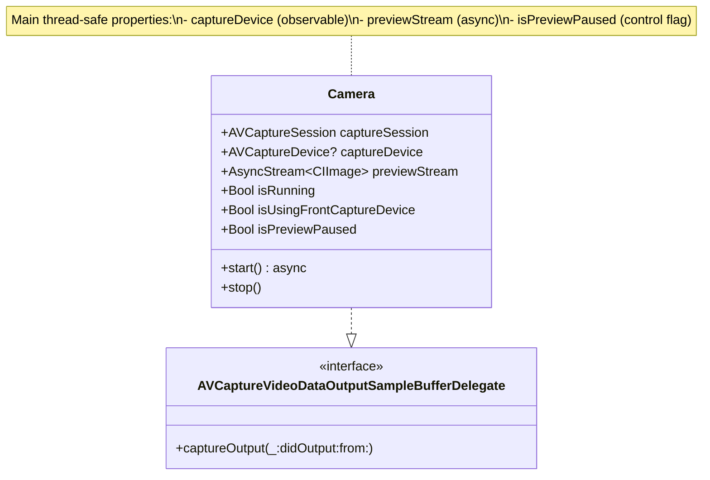
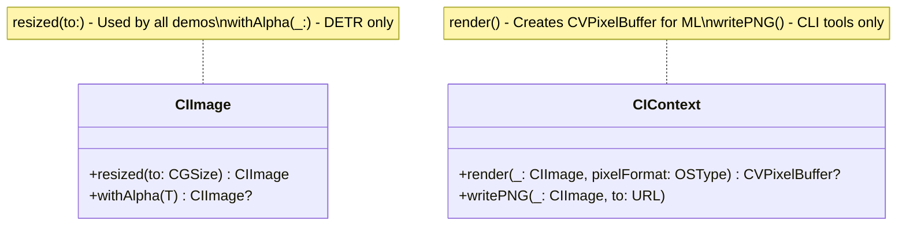
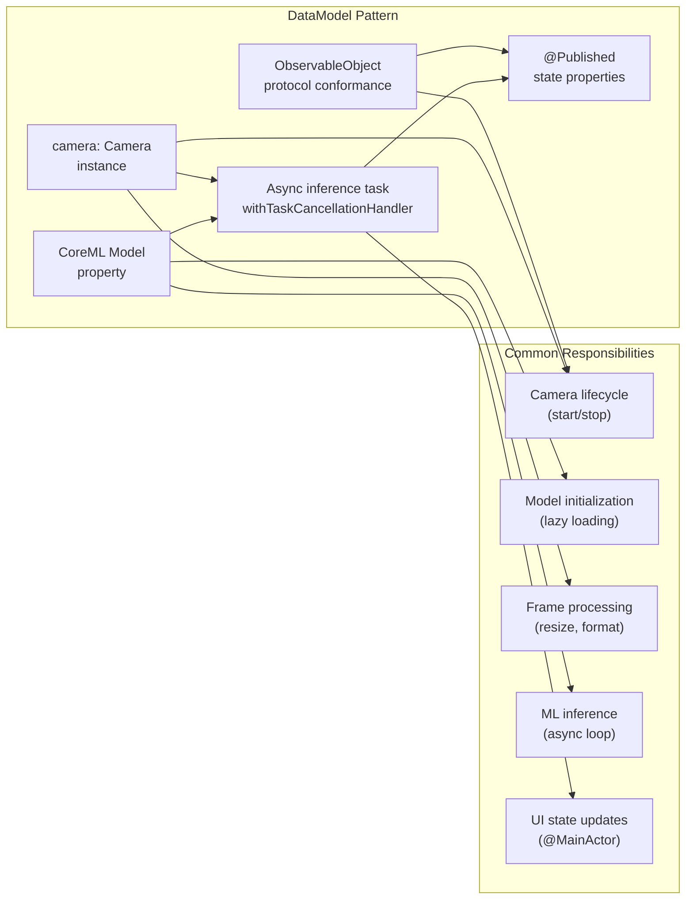
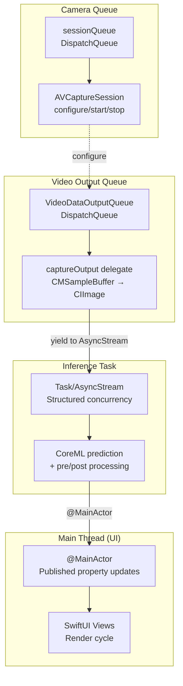

<!-- source: DeepWiki mcp.deepwiki.com · repo huggingface/coreml-examples · page 5 Shared Infrastructure · fetched 2026-10-26 -->

# Shared Infrastructure

Relevant source files

The following files were used as context for generating this wiki page:

- [FastViTSample/FastViTSample/Camera.swift](FastViTSample/FastViTSample/Camera.swift)
- [FastViTSample/FastViTSample/CoreImageExtensions.swift](FastViTSample/FastViTSample/CoreImageExtensions.swift)
- [SemanticSegmentationSample/Common/CoreImageExtensions.swift](SemanticSegmentationSample/Common/CoreImageExtensions.swift)

## Purpose and Scope

This document provides an overview of the reusable components and architectural patterns that are shared across all three demo applications in the coreml-examples repository. These shared components handle camera management, image processing, and common UI elements, enabling consistent behavior and reducing code duplication.

For detailed documentation of specific components, see:
- [Camera System](#5.1) - AVCaptureSession management and frame capture
- [Image Processing Utilities](#5.2) - CoreImage extensions for image manipulation
- [DataModel Architecture](#5.3) - Observable pattern for state management

**Note**: While these components implement similar functionality across all demos, they are physically duplicated in each sample project rather than shared as a library. This design choice ensures each demo app remains self-contained and independently buildable.

## Component Overview

The shared infrastructure consists of four primary component categories:

| Component Category | Primary Classes/Files | Responsibility |
|-------------------|----------------------|----------------|
| Camera System | `Camera.swift` | AVCaptureSession lifecycle, device management, frame streaming |
| UI Views | `CameraView.swift`, `ViewfinderView.swift` | Live camera preview, capture overlay |
| Image Processing | `CoreImageExtensions.swift` | Resizing, rendering, format conversion, PNG export |
| State Management | `DataModel` pattern | ObservableObject conformance, ML model integration |

```mermaid
graph TB
    subgraph "Shared Infrastructure Components"
        Camera["Camera<br/>(AVCaptureSession wrapper)"]
        CameraView["CameraView<br/>(SwiftUI preview)"]
        ViewfinderView["ViewfinderView<br/>(Overlay UI)"]
        CoreImageExt["CoreImageExtensions<br/>(CIImage + CIContext)"]
        DataModelPattern["DataModel Pattern<br/>(ObservableObject)"]
    end
    
    subgraph "FastViT Sample"
        FV_Camera["Camera.swift"]
        FV_CameraView["CameraView.swift"]
        FV_ViewfinderView["ViewfinderView.swift"]
        FV_CoreImage["CoreImageExtensions.swift"]
        FV_DataModel["DataModel.swift"]
    end
    
    subgraph "Depth Anything Sample"
        DA_Camera["Camera.swift"]
        DA_CameraView["CameraView.swift"]
        DA_ViewfinderView["ViewfinderView.swift"]
        DA_CoreImage["CoreImageExtensions.swift"]
        DA_DataModel["DataModel.swift"]
    end
    
    subgraph "DETR Semantic Segmentation Sample"
        SS_Camera["Camera.swift"]
        SS_CameraView["CameraView.swift"]
        SS_ViewfinderView["ViewfinderView.swift"]
        SS_CoreImage["CoreImageExtensions.swift"]
        SS_DataModel["DataModel.swift + PostProcessor.swift"]
    end
    
    Camera -.duplicated.-> FV_Camera
    Camera -.duplicated.-> DA_Camera
    Camera -.duplicated.-> SS_Camera
    
    CameraView -.duplicated.-> FV_CameraView
    CameraView -.duplicated.-> DA_CameraView
    CameraView -.duplicated.-> SS_CameraView
    
    ViewfinderView -.duplicated.-> FV_ViewfinderView
    ViewfinderView -.duplicated.-> DA_ViewfinderView
    ViewfinderView -.duplicated.-> SS_ViewfinderView
    
    CoreImageExt -.duplicated.-> FV_CoreImage
    CoreImageExt -.duplicated.-> DA_CoreImage
    CoreImageExt -.duplicated.-> SS_CoreImage
    
    DataModelPattern -.pattern.-> FV_DataModel
    DataModelPattern -.pattern.-> DA_DataModel
    DataModelPattern -.pattern.-> SS_DataModel
```

**Sources**: Diagram 6 (Component Reuse Across Demo Apps), [FastViTSample/FastViTSample/Camera.swift:1-253]()

## Component Interaction Pattern

All three demo applications follow a consistent interaction pattern between shared components. The diagram below shows how these components collaborate at runtime:

**Sources**: Diagram 3 (Demo Application Architecture Pattern), Diagram 5 (Real-Time Inference Architecture)

## File Organization

### Physical File Structure

Each demo application contains its own copy of the shared infrastructure files. The table below shows the file paths for each component:

| Component | FastViT Location | Depth Anything Location | DETR Location |
|-----------|------------------|-------------------------|---------------|
| Camera | `FastViTSample/FastViTSample/Camera.swift` | `DepthAnythingSample/DepthAnythingSample/Camera.swift` | `SemanticSegmentationSample/Common/Camera.swift` |
| CoreImageExtensions | `FastViTSample/FastViTSample/CoreImageExtensions.swift` | `DepthAnythingSample/DepthAnythingSample/CoreImageExtensions.swift` | `SemanticSegmentationSample/Common/CoreImageExtensions.swift` |
| CameraView | `FastViTSample/FastViTSample/CameraView.swift` | `DepthAnythingSample/DepthAnythingSample/CameraView.swift` | `SemanticSegmentationSample/Common/CameraView.swift` |
| ViewfinderView | `FastViTSample/FastViTSample/ViewfinderView.swift` | `DepthAnythingSample/DepthAnythingSample/ViewfinderView.swift` | `SemanticSegmentationSample/Common/ViewfinderView.swift` |

### Variations Between Implementations

While the core functionality remains identical, some implementations contain minor variations:

**Camera.swift**: All three implementations are functionally identical, with the same logger subsystem identifier `"com.apple.createml.depth"` at [FastViTSample/FastViTSample/Camera.swift:6]().

**CoreImageExtensions.swift**: The DETR sample includes an additional `withAlpha(_:)` method not present in the FastViT version:
- FastViT version: [FastViTSample/FastViTSample/CoreImageExtensions.swift:1-47]()
- DETR version with alpha: [SemanticSegmentationSample/Common/CoreImageExtensions.swift:18-26]()

## Key Component Interfaces

### Camera Class API

The `Camera` class provides the primary interface for video capture across all demos:

**Key Methods**:
- `start()`: Asynchronously checks authorization and starts capture session ([FastViTSample/FastViTSample/Camera.swift:157-177]())
- `stop()`: Stops the running capture session ([FastViTSample/FastViTSample/Camera.swift:179-187]())
- `captureOutput(_:didOutput:from:)`: Delegate method that converts `CMSampleBuffer` to `CIImage` and yields to `previewStream` ([FastViTSample/FastViTSample/Camera.swift:191-208]())

**Sources**: [FastViTSample/FastViTSample/Camera.swift:8-188]()

### CoreImage Extensions API

The `CoreImageExtensions.swift` file provides utility methods for image manipulation:

**Key Methods**:
- `CIImage.resized(to:)`: Scales and translates image to target size ([FastViTSample/FastViTSample/CoreImageExtensions.swift:7-15]())
- `CIContext.render(_:pixelFormat:)`: Creates `CVPixelBuffer` from `CIImage` ([FastViTSample/FastViTSample/CoreImageExtensions.swift:20-35]())
- `CIContext.writePNG(_:to:)`: Exports image to PNG file ([FastViTSample/FastViTSample/CoreImageExtensions.swift:38-45]())
- `CIImage.withAlpha(_:)`: Adjusts alpha channel using `CIFilter.colorMatrix()` (DETR only) ([SemanticSegmentationSample/Common/CoreImageExtensions.swift:18-26]())

**Sources**: [FastViTSample/FastViTSample/CoreImageExtensions.swift:1-47](), [SemanticSegmentationSample/Common/CoreImageExtensions.swift:1-58]()

## DataModel Pattern

While each demo implements its own `DataModel` class with task-specific logic, they all conform to a common architectural pattern:

**Common Pattern Elements**:
1. **ObservableObject Conformance**: Enables SwiftUI view updates via `@Published` properties
2. **Camera Instance**: Owns and manages the `Camera` instance lifecycle
3. **CoreML Model Property**: Lazily loads the `.mlpackage` file
4. **Async Inference Task**: Runs continuous inference loop with cancellation support
5. **MainActor Updates**: Publishes results to UI on main thread

For detailed DataModel implementation patterns, see [DataModel Architecture](#5.3).

**Sources**: Diagram 3 (Demo Application Architecture Pattern), Section 5.3 reference in table of contents

## Threading Model

The shared infrastructure implements a consistent threading model across all demos:

**Thread Coordination**:
- **sessionQueue**: Created at [FastViTSample/FastViTSample/Camera.swift:52](), handles all AVCaptureSession configuration
- **VideoDataOutputQueue**: Created at [FastViTSample/FastViTSample/Camera.swift:73](), processes video frames
- **AsyncStream**: Bridges camera output to inference loop via `previewStream` ([FastViTSample/FastViTSample/Camera.swift:39-47]())
- **MainActor**: Ensures UI updates occur on main thread

For more details on threading and concurrency patterns, see [Threading & Concurrency](#6.2).

**Sources**: [FastViTSample/FastViTSample/Camera.swift:14](), [FastViTSample/FastViTSample/Camera.swift:39-47](), [FastViTSample/FastViTSample/Camera.swift:52](), [FastViTSample/FastViTSample/Camera.swift:73]()

## Design Rationale

### Code Duplication vs. Shared Library

The repository deliberately duplicates infrastructure code across samples rather than extracting it into a shared framework or Swift package. This approach provides several benefits:

| Aspect | Duplication Approach | Shared Library Approach |
|--------|---------------------|-------------------------|
| **Build Independence** | Each sample builds standalone | Requires dependency management |
| **Sample Clarity** | All code visible in one project | Reference external code |
| **Modification Freedom** | Can customize per-sample | Changes affect all samples |
| **Distribution** | Self-contained examples | Complex project structure |

### Consistency Through Patterns

Rather than enforcing code sharing through technical means, the repository achieves consistency through:

1. **Identical Core Implementations**: Camera and CoreImage extensions are functionally equivalent
2. **Common Architectural Patterns**: All DataModels follow the same structure (see [DataModel Architecture](#5.3))
3. **Shared Documentation**: This wiki documents the patterns for maintainer reference

**Sources**: Diagram 6 (Component Reuse Across Demo Apps), architectural analysis

## Summary

The shared infrastructure provides a foundation of reusable components that enable all three demo applications to implement real-time ML inference with consistent behavior. While physically duplicated across projects, these components maintain functional consistency through common patterns and implementations.

**Core Infrastructure Components**:
- **Camera**: [Camera System](#5.1) - AVCaptureSession management with async frame streaming
- **CoreImage Extensions**: [Image Processing Utilities](#5.2) - Resize, render, and export utilities
- **DataModel Pattern**: [DataModel Architecture](#5.3) - Observable state management for ML integration
- **UI Views**: CameraView and ViewfinderView for live camera preview

This architecture enables each demo to focus on its specific ML task (classification, depth estimation, semantic segmentation) while reusing proven implementations for camera management, image processing, and state coordination.

---

