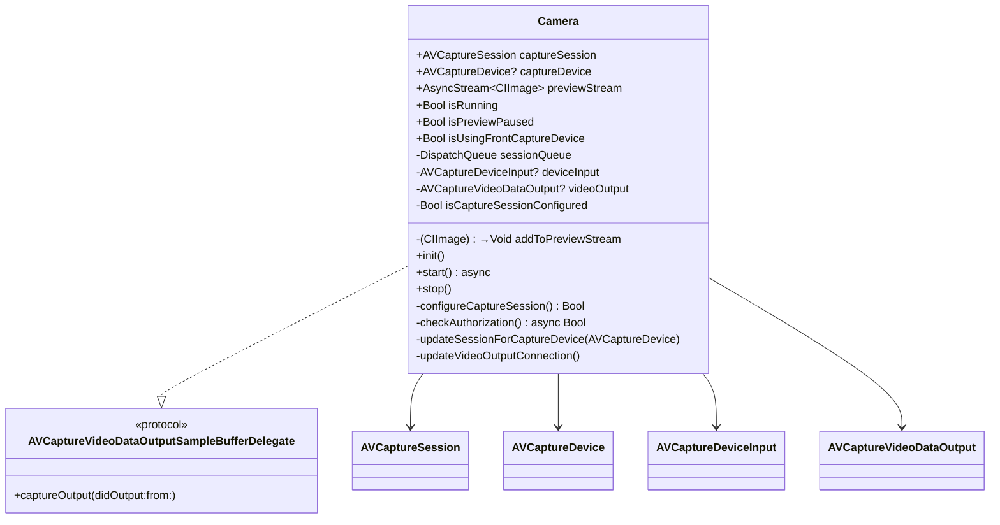
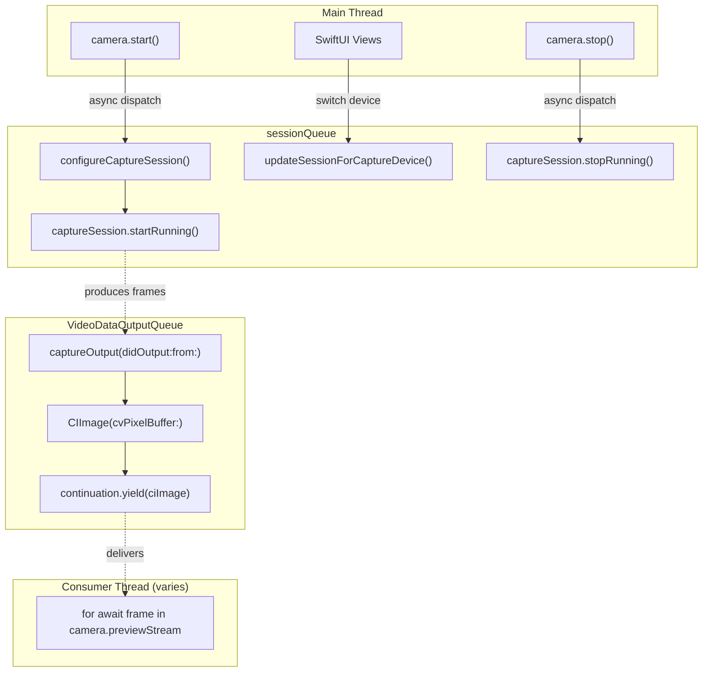
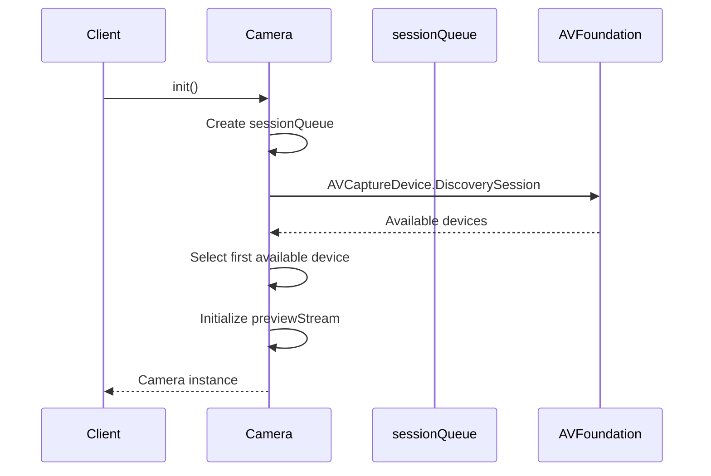
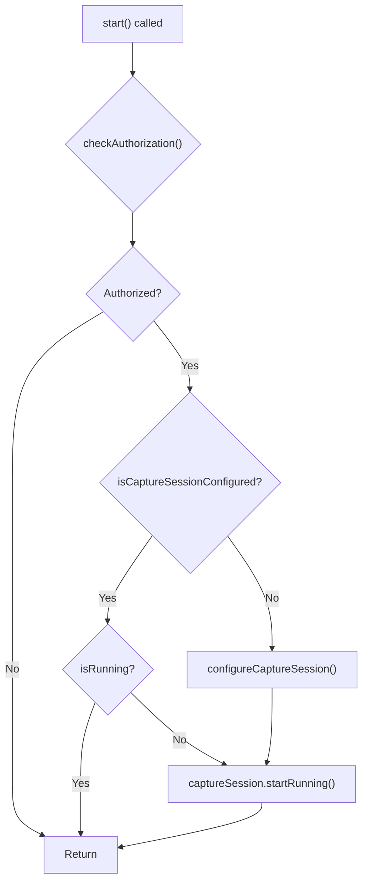
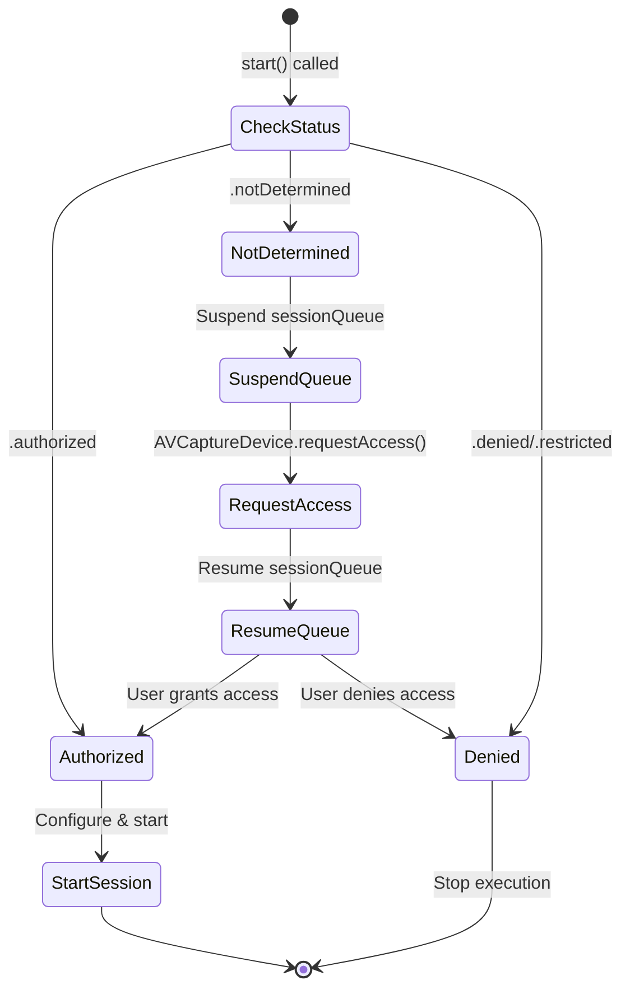
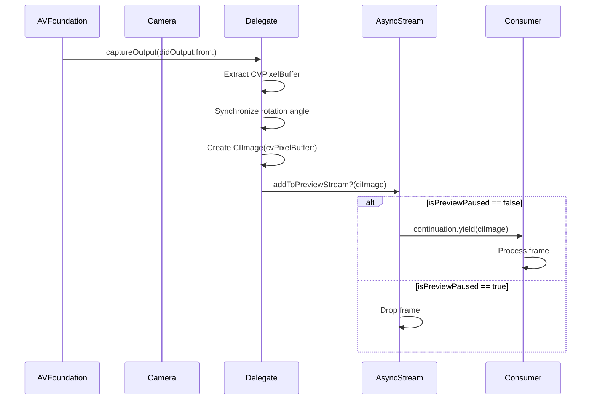
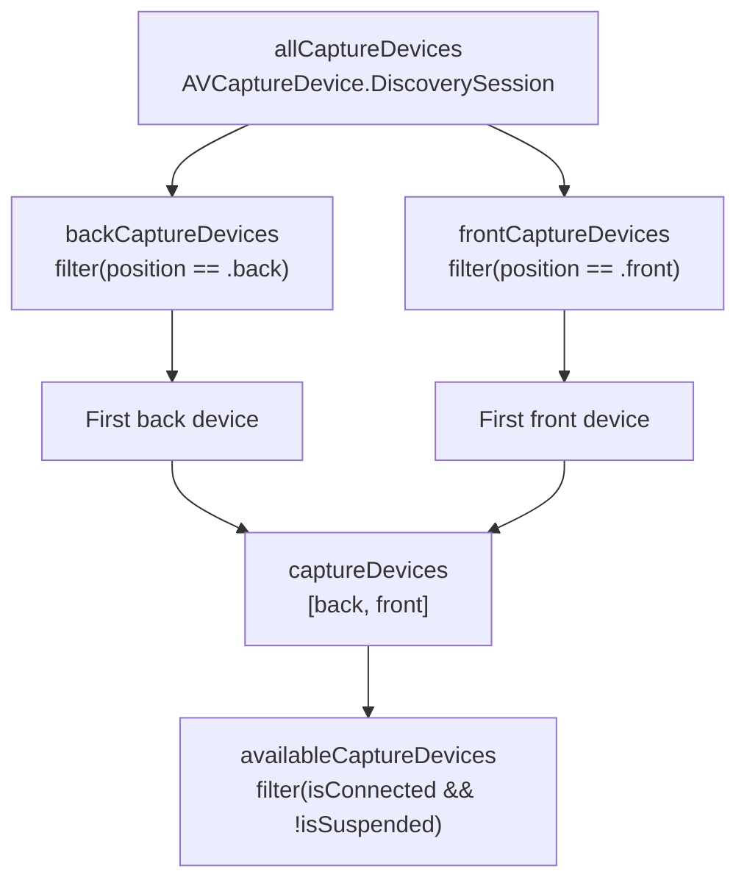
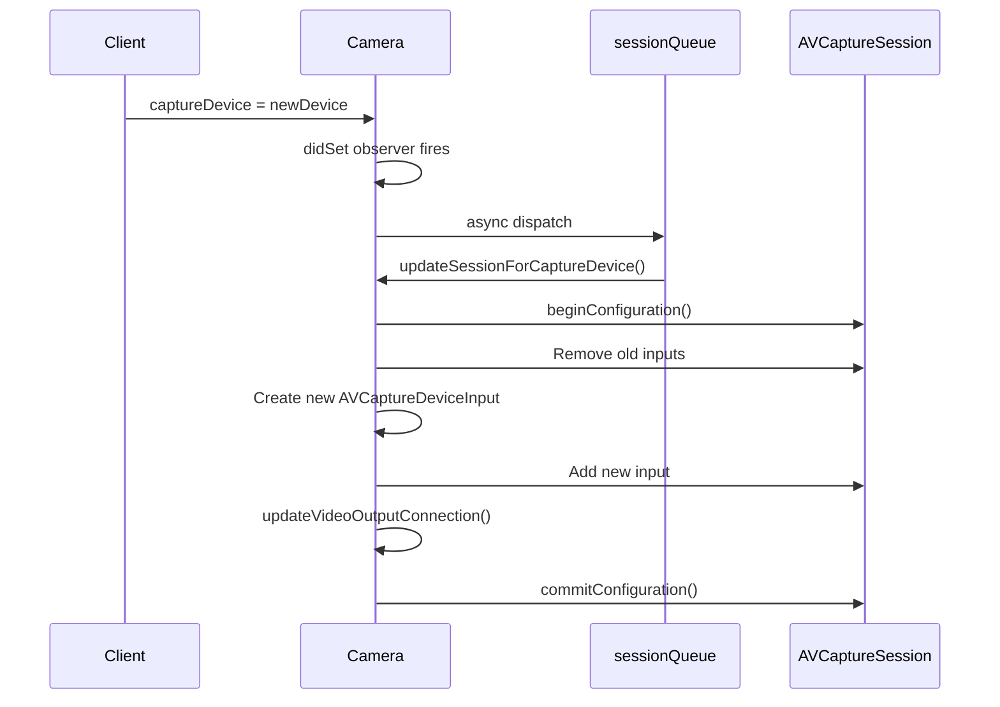
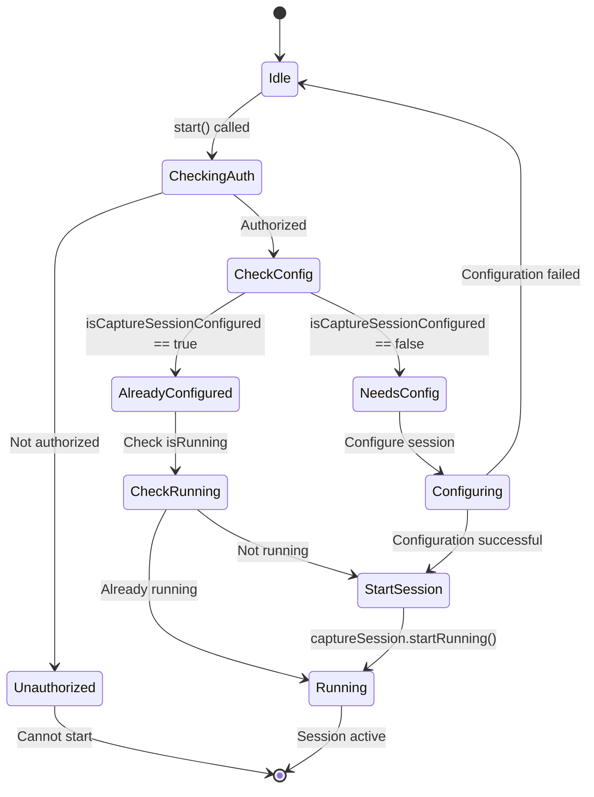
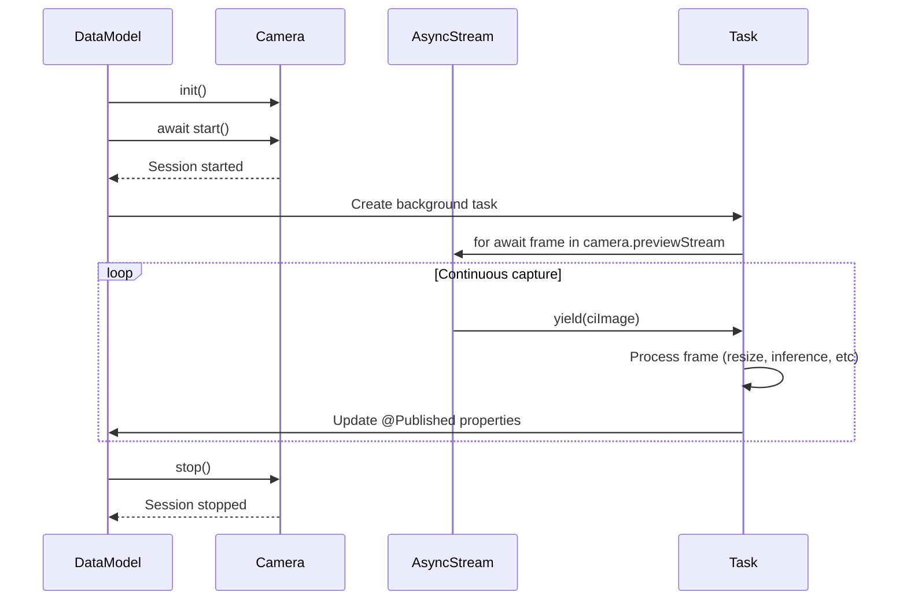

<!-- source: DeepWiki mcp.deepwiki.com · repo huggingface/coreml-examples · page 5.1 Camera System · fetched 2026-10-26 -->

# Camera System

<details>
<summary>Relevant source files</summary>

The following files were used as context for generating this wiki page:

- [FastViTSample/FastViTSample/Camera.swift](FastViTSample/FastViTSample/Camera.swift)

</details>


## Purpose and Scope

This document describes the `Camera` class, which provides a reusable AVFoundation wrapper for capturing live video frames across all demo applications. The Camera system manages AVCaptureSession lifecycle, handles device authorization, supports front/back camera selection, and delivers frames as `CIImage` objects through an `AsyncStream`.

For information about how the camera frames are processed and resized, see [Image Processing Utilities](#5.2). For information about how DataModel classes consume the camera stream, see [DataModel Architecture](#5.3).

## Class Overview

The Camera system is implemented in a single `Camera.swift` file that exists independently in each demo app directory (FastViTSample, DepthAnythingSample, SemanticSegmentationSample). While each demo has its own copy, the implementation is identical across all three applications.

| Component | Description |
|-----------|-------------|
| `Camera` | Main class managing AVCaptureSession and frame delivery |
| `captureSession` | AVCaptureSession instance for video capture |
| `sessionQueue` | DispatchQueue for thread-safe session configuration |
| `previewStream` | AsyncStream<CIImage> for frame consumption |
| `captureDevice` | Currently active AVCaptureDevice (front or back) |
| `isPreviewPaused` | Flag to pause frame delivery without stopping capture |

Sources: [FastViTSample/FastViTSample/Camera.swift:1-253]()

## Architecture

### Class Structure



Sources: [FastViTSample/FastViTSample/Camera.swift:8-188]()

### Thread Architecture

The Camera system employs a multi-threaded architecture to ensure thread-safe session management and non-blocking frame delivery:



Sources: [FastViTSample/FastViTSample/Camera.swift:14,52,73,166-176,183-186]()

## Initialization and Configuration

### Initialization Sequence

The Camera class initialization follows this sequence:

1. Create `sessionQueue` dispatch queue [Camera.swift:52]()
2. Discover available capture devices [Camera.swift:53,213-251]()
3. Set initial `captureDevice` to first available or default [Camera.swift:53]()
4. Initialize `previewStream` AsyncStream [Camera.swift:39-47]()



Sources: [FastViTSample/FastViTSample/Camera.swift:49-54]()

### Configuration Flow

Configuration occurs during the first `start()` call or when switching devices:



The `configureCaptureSession()` method [Camera.swift:56-94]() performs these steps:

1. Begin configuration with `captureSession.beginConfiguration()` [Camera.swift:57]()
2. Set session preset to `.hd1280x720` [Camera.swift:62]()
3. Create `AVCaptureDeviceInput` from current `captureDevice` [Camera.swift:64-70]()
4. Create `AVCaptureVideoDataOutput` with sample buffer delegate [Camera.swift:72-73]()
5. Add input and output to capture session [Camera.swift:84-85]()
6. Update video output connection (mirroring, rotation) [Camera.swift:90]()
7. Commit configuration with `captureSession.commitConfiguration()` [Camera.swift:59]()

Sources: [FastViTSample/FastViTSample/Camera.swift:56-94,157-177]()

## Authorization Handling

The Camera system requests and validates camera access before starting:

| Authorization Status | Behavior |
|---------------------|----------|
| `.authorized` | Proceed with capture session startup |
| `.notDetermined` | Suspend queue, request access, resume queue |
| `.denied` | Return false, prevent session startup |
| `.restricted` | Return false, prevent session startup |



Sources: [FastViTSample/FastViTSample/Camera.swift:96-116,157-162]()

## Frame Capture and Delivery

### AsyncStream Implementation

The Camera provides frames through an `AsyncStream<CIImage>` [Camera.swift:39-47]():

```swift
lazy var previewStream: AsyncStream<CIImage> = {
    AsyncStream { continuation in
        addToPreviewStream = { ciImage in
            if !self.isPreviewPaused {
                continuation.yield(ciImage)
            }
        }
    }
}()
```

This design allows:
- Multiple consumers to iterate over the stream concurrently
- Backpressure handling (if consumer is slow, frames are dropped)
- Pause/resume without stopping AVCaptureSession via `isPreviewPaused`

Sources: [FastViTSample/FastViTSample/Camera.swift:39-47]()

### Frame Delivery Pipeline



The delegate method `captureOutput(_:didOutput:from:)` [Camera.swift:191-207]():

1. Extracts `CVPixelBuffer` from `CMSampleBuffer` [Camera.swift:196-198]()
2. Coordinates rotation angle with preview connection [Camera.swift:201-204]()
3. Creates `CIImage` from pixel buffer [Camera.swift:206]()
4. Yields image to AsyncStream continuation if not paused [Camera.swift:42-44]()

Sources: [FastViTSample/FastViTSample/Camera.swift:190-207]()

## Device Discovery and Selection

### Device Discovery

The Camera class discovers available capture devices through a hierarchical query system:



The discovery session queries for these device types [Camera.swift:238-244]():
- `.builtInWideAngleCamera`
- `.builtInTripleCamera`
- `.builtInDualCamera`
- `.builtInDualWideCamera`

Sources: [FastViTSample/FastViTSample/Camera.swift:213-251]()

### Device Switching

When `captureDevice` is set, the `didSet` observer triggers device switching [Camera.swift:16-24]():



The `updateSessionForCaptureDevice()` method [Camera.swift:128-147]():
1. Returns early if session not configured [Camera.swift:129]()
2. Begins configuration transaction [Camera.swift:131]()
3. Removes all existing device inputs [Camera.swift:134-138]()
4. Creates and adds new device input [Camera.swift:140-144]()
5. Updates video output connection for mirroring [Camera.swift:146]()
6. Commits configuration [Camera.swift:132]()

Sources: [FastViTSample/FastViTSample/Camera.swift:16-24,128-147]()

## Video Output Configuration

### Video Mirroring

The Camera automatically mirrors video when using the front camera [Camera.swift:149-155]():

```swift
private func updateVideoOutputConnection() {
    if let videoOutput = videoOutput, 
       let videoOutputConnection = videoOutput.connection(with: .video) {
        if videoOutputConnection.isVideoMirroringSupported {
            videoOutputConnection.isVideoMirrored = isUsingFrontCaptureDevice
        }
    }
}
```

The `isUsingFrontCaptureDevice` computed property checks if the current device is in the front devices list [Camera.swift:30-33]().

Sources: [FastViTSample/FastViTSample/Camera.swift:30-33,149-155]()

### Rotation Coordination

During frame capture, the Camera synchronizes rotation with the preview layer connection [Camera.swift:201-204]():

```swift
if let previewConnection = captureSession.connections.first(where: { $0 != connection }),
   connection.isVideoRotationAngleSupported(previewConnection.videoRotationAngle) {
    connection.videoRotationAngle = previewConnection.videoRotationAngle
}
```

This ensures captured frames match the orientation of the preview display.

Sources: [FastViTSample/FastViTSample/Camera.swift:200-204]()

## Session Lifecycle Management

### Starting the Session

The `start()` method is async and follows this flow [Camera.swift:157-177]():

1. Check authorization with `await checkAuthorization()` [Camera.swift:158-162]()
2. If already configured and not running, start on `sessionQueue` [Camera.swift:164-170]()
3. If not configured, configure and start on `sessionQueue` [Camera.swift:173-176]()



Sources: [FastViTSample/FastViTSample/Camera.swift:157-177]()

### Stopping the Session

The `stop()` method halts capture on the session queue [Camera.swift:179-187]():

```swift
func stop() {
    guard isCaptureSessionConfigured else { return }
    
    if captureSession.isRunning {
        sessionQueue.async {
            self.captureSession.stopRunning()
        }
    }
}
```

Stopping does not reconfigure or deallocate the session, allowing fast restart.

Sources: [FastViTSample/FastViTSample/Camera.swift:179-187]()

## Logging

The Camera system uses unified logging with subsystem `"com.apple.createml.depth"` and category `"Camera"` [Camera.swift:6]():

```swift
fileprivate let logger = Logger(subsystem: "com.apple.createml.depth", category: "Camera")
```

Log events include:
- Device selection: "Using capture device: \(captureDevice.localizedName)" [Camera.swift:19]()
- Authorization results [Camera.swift:99,102,108,111]()
- Configuration errors [Camera.swift:68,76,80,123]()

Sources: [FastViTSample/FastViTSample/Camera.swift:6,19,68,76,80,99,102,108,111,123]()

## Usage Pattern

Typical usage in a DataModel class:



Sources: All three demo applications follow this pattern as described in [DataModel Architecture](#5.3)

## Thread Safety

The Camera class ensures thread safety through:

| Mechanism | Purpose |
|-----------|---------|
| `sessionQueue` | Serializes all AVCaptureSession configuration operations |
| `VideoDataOutputQueue` | Dedicated queue for sample buffer delegate callbacks |
| `AsyncStream` | Thread-safe frame delivery to consumers |
| `isPreviewPaused` | Simple boolean flag (read on delegate queue, written from any thread) |

**Important**: The `isPreviewPaused` flag does not use explicit synchronization, relying on Swift's memory model for simple boolean atomicity. For production use cases requiring strict guarantees, consider using `OSAllocatedUnfairLock` as seen in DataModel implementations (see [Threading & Concurrency](#6.2)).

Sources: [FastViTSample/FastViTSample/Camera.swift:14,37,52,73]()

---

