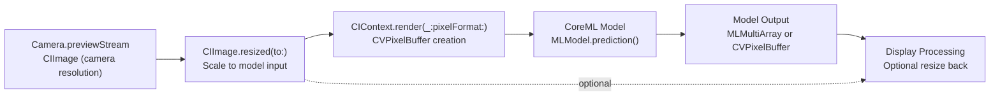

<!-- source: DeepWiki mcp.deepwiki.com · repo huggingface/coreml-examples · page 5.2 Image Processing Utilities · fetched 2026-10-26 -->

# Image Processing Utilities

<details>
<summary>Relevant source files</summary>

The following files were used as context for generating this wiki page:

- [FastViTSample/FastViTSample/CoreImageExtensions.swift](FastViTSample/FastViTSample/CoreImageExtensions.swift)
- [SemanticSegmentationSample/Common/CoreImageExtensions.swift](SemanticSegmentationSample/Common/CoreImageExtensions.swift)

</details>


## Purpose and Scope

This document covers the image processing utility functions provided as extensions to CoreImage framework types (`CIImage` and `CIContext`). These utilities are shared infrastructure components that enable image resizing, pixel buffer rendering, transparency adjustment, and PNG export across all demo applications.

For information about how these utilities integrate with the camera capture system, see [Camera System](#5.1). For details on how the DataModel pattern uses these utilities during inference, see [DataModel Architecture](#5.3).

---

## Overview

The image processing utilities are implemented as Swift extensions in `CoreImageExtensions.swift` files located in each demo application. While the implementations are duplicated across samples, they provide a consistent API for common image manipulation tasks required during the ML inference pipeline.

**Available Extensions:**

| Extension Type | Methods | Purpose |
|---------------|---------|---------|
| `CIImage` | `resized(to:)` | Scale images to model input dimensions |
| `CIImage` | `withAlpha(_:)` | Adjust transparency (Semantic Segmentation only) |
| `CIContext` | `render(_:pixelFormat:)` | Convert CIImage to CVPixelBuffer for CoreML |
| `CIContext` | `writePNG(_:to:)` | Export images to PNG files for debugging/CLI |

Sources: [FastViTSample/FastViTSample/CoreImageExtensions.swift:1-47](), [SemanticSegmentationSample/Common/CoreImageExtensions.swift:1-58]()

---

## Image Processing Pipeline

The following diagram shows how these utilities integrate into the real-time inference pipeline:

### Diagram: Image Processing Flow in Inference Loop



Sources: [FastViTSample/FastViTSample/CoreImageExtensions.swift:6-16](), [SemanticSegmentationSample/Common/CoreImageExtensions.swift:29-46]()

---

## CIImage Extensions

### resized(to:)

Scales a `CIImage` to a target size using affine transformations. This method is critical for adapting camera frames (typically 1920x1080 or similar) to model-specific input dimensions.

**Method Signature:**
```swift
func resized(to size: CGSize) -> CIImage
```

**Implementation Strategy:**
1. Calculate scale factors for X and Y dimensions based on current extent
2. Apply scale transformation
3. Translate image to remove origin offset, ensuring result starts at (0, 0)

**Usage Examples by Model:**

| Demo App | Input Size | Typical Usage |
|----------|-----------|---------------|
| FastViT | 256×256 | `ciImage.resized(to: CGSize(width: 256, height: 256))` |
| Depth Anything | 518×392 | `ciImage.resized(to: CGSize(width: 518, height: 392))` |
| DETR Semantic Segmentation | 800×800 | `ciImage.resized(to: CGSize(width: 800, height: 800))` |

**Key Implementation Details:**

[FastViTSample/FastViTSample/CoreImageExtensions.swift:7-14]() shows the transformation logic:
- `outputScaleX` and `outputScaleY` compute the scaling ratios
- `transformed(by: CGAffineTransform(scaleX:y:))` applies scaling
- Final translation ensures the extent origin is reset to (0, 0)

Sources: [FastViTSample/FastViTSample/CoreImageExtensions.swift:6-16](), [SemanticSegmentationSample/Common/CoreImageExtensions.swift:6-16]()

---

### withAlpha(_:)

Adjusts the alpha channel of a `CIImage` by applying a color matrix filter. This method is only available in the Semantic Segmentation sample and is used to create semi-transparent overlays.

**Method Signature:**
```swift
func withAlpha<T: BinaryFloatingPoint>(_ alpha: T) -> CIImage?
```

**Implementation:**
- Uses `CIFilter.colorMatrix()` to manipulate color channels
- Sets `aVector` (alpha vector) to `(0, 0, 0, alpha)` to modify transparency
- Returns `nil` if filtering fails; returns original image unchanged if `alpha == 1`

**Typical Usage:**
```swift
let overlay = segmentationMask.withAlpha(0.5)  // 50% transparent overlay
```

This enables the semantic segmentation visualization to blend the colored class map with the original camera feed.

Sources: [SemanticSegmentationSample/Common/CoreImageExtensions.swift:18-26]()

---

## CIContext Extensions

### render(_:pixelFormat:)

Creates a new `CVPixelBuffer` from a `CIImage` with the specified pixel format. This is essential for preparing images as input to CoreML models, which require `CVPixelBuffer` format.

**Method Signature:**
```swift
func render(_ image: CIImage, pixelFormat: OSType) -> CVPixelBuffer?
```

**Implementation Steps:**

[FastViTSample/FastViTSample/CoreImageExtensions.swift:20-35]() demonstrates the process:
1. Call `CVPixelBufferCreate()` with dimensions from `image.extent`
2. Specify target `pixelFormat` (commonly `kCVPixelFormatType_32BGRA`)
3. Check status code for successful allocation
4. Render image content into allocated buffer using `render(_:to:)`
5. Return `nil` on failure, otherwise return the populated buffer

**Typical Pixel Formats:**
- `kCVPixelFormatType_32BGRA` - Default for camera feeds and most models
- `kCVPixelFormatType_OneComponent32Float` - Used for depth map outputs

Sources: [FastViTSample/FastViTSample/CoreImageExtensions.swift:19-35](), [SemanticSegmentationSample/Common/CoreImageExtensions.swift:30-46]()

---

### writePNG(_:to:)

Exports a `CIImage` to a PNG file at the specified URL. This utility is primarily used in CLI tools for batch processing and debugging model outputs.

**Method Signature:**
```swift
func writePNG(_ image: CIImage, to url: URL)
```

**Implementation:**

[FastViTSample/FastViTSample/CoreImageExtensions.swift:38-45]() shows the export process:
1. Convert `CIImage` to `CGImage` using `createCGImage(_:from:)`
2. Create `CGImageDestination` for PNG format using `UTType.png`
3. Add image to destination with `CGImageDestinationAddImage()`
4. Finalize and write to disk with `CGImageDestinationFinalize()`

**Usage in CLI Tools:**

Both the Depth Anything CLI and DETR CLI tools use this method:
- Depth Anything: Exports processed depth maps as grayscale PNGs
- DETR: Exports semantic segmentation maps with color-coded classes

Sources: [FastViTSample/FastViTSample/CoreImageExtensions.swift:37-46](), [SemanticSegmentationSample/Common/CoreImageExtensions.swift:48-57]()

---

## Code Entity Mapping

The following diagram maps the extension methods to their concrete usage locations in the codebase:

### Diagram: Extension Methods to Usage Sites

```mermaid
graph TB
    subgraph "CIImage Extensions"
        RESIZE["CIImage.resized(to:)"]
        ALPHA["CIImage.withAlpha(_:)"]
    end
    
    subgraph "CIContext Extensions"
        RENDER["CIContext.render(_:pixelFormat:)"]
        WRITE["CIContext.writePNG(_:to:)"]
    end
    
    subgraph "FastViT Sample"
        FV_DM["FastViTSample/DataModel.swift\nInference loop"]
    end
    
    subgraph "Depth Anything Sample"
        DA_DM["DepthAnythingSample/DataModel.swift\nInference loop"]
        DA_CLI["DepthAnythingSample/CLI/main.swift\nBatch processing"]
    end
    
    subgraph "DETR Sample"
        SS_DM["SemanticSegmentationSample/DataModel.swift\nInference loop"]
        SS_CLI["SemanticSegmentationSample/CLI/main.swift\nBatch processing"]
        SS_POST["PostProcessor.overlayOnImage()\nVisualization"]
    end
    
    RESIZE --> FV_DM
    RESIZE --> DA_DM
    RESIZE --> DA_CLI
    RESIZE --> SS_DM
    RESIZE --> SS_CLI
    
    RENDER --> FV_DM
    RENDER --> DA_DM
    RENDER --> DA_CLI
    RENDER --> SS_DM
    RENDER --> SS_CLI
    
    WRITE --> DA_CLI
    WRITE --> SS_CLI
    
    ALPHA --> SS_POST
```



Sources: [FastViTSample/FastViTSample/CoreImageExtensions.swift:1-47](), [SemanticSegmentationSample/Common/CoreImageExtensions.swift:1-58]()

---

## Implementation Variants

While the core functionality is identical, there are two implementation files with minor differences:

### Comparison Table

| Feature | FastViT Implementation | Semantic Segmentation Implementation |
|---------|----------------------|-------------------------------------|
| Location | `FastViTSample/FastViTSample/` | `SemanticSegmentationSample/Common/` |
| Imports | `CoreImage`, `ImageIO`, `UniformTypeIdentifiers` | Same + `CoreImage.CIFilterBuiltins` |
| `resized(to:)` | ✓ | ✓ |
| `withAlpha(_:)` | ✗ | ✓ |
| `render(_:pixelFormat:)` | ✓ | ✓ |
| `writePNG(_:to:)` | ✓ | ✓ |

**Note:** The Depth Anything sample likely shares the same implementation pattern, though the specific file was not provided in this analysis.

Sources: [FastViTSample/FastViTSample/CoreImageExtensions.swift:1-4](), [SemanticSegmentationSample/Common/CoreImageExtensions.swift:1-4]()

---

## Integration with Inference Pipeline

The following diagram shows the typical sequence of calls within a DataModel's inference loop:

### Diagram: Inference Loop Processing Sequence

```mermaid
sequenceDiagram
    participant Loop as "Inference Loop\n(async Task)"
    participant Lock as "OSAllocatedUnfairLock\nlastImage"
    participant CIImage as "CIImage\nextensions"
    participant CIContext as "CIContext\nextensions"
    participant Model as "CoreML Model\nMLModel"
    
    Loop->>Lock: Read latest camera frame
    Lock-->>Loop: CIImage (camera resolution)
    
    Loop->>CIImage: resized(to: modelInputSize)
    CIImage-->>Loop: CIImage (model input dimensions)
    
    Loop->>CIContext: render(image, pixelFormat:)
    CIContext-->>Loop: CVPixelBuffer
    
    Loop->>Model: prediction(pixelBuffer)
    Model-->>Loop: Model output
    
    Note over Loop,Model: Post-processing may use\nresized() again to scale\noutput to display size
```

Sources: [FastViTSample/FastViTSample/CoreImageExtensions.swift:6-35](), [SemanticSegmentationSample/Common/CoreImageExtensions.swift:6-46]()

---

## Performance Considerations

### CIImage Transformations

The `resized(to:)` method uses CoreImage's GPU-accelerated pipeline. The transformations are lazy - actual rendering is deferred until the image is consumed by a `CIContext`. This allows for efficient chaining of operations without intermediate allocations.

### Pixel Buffer Allocation

[FastViTSample/FastViTSample/CoreImageExtensions.swift:22-29]() shows that `render(_:pixelFormat:)` allocates a new `CVPixelBuffer` on each call. For real-time inference, applications typically pre-allocate a reusable buffer to avoid allocation overhead in the hot path.

**Optimization Pattern Used in DataModels:**
```swift
// Pre-allocated buffer stored as property
private let inputPixelBuffer: CVPixelBuffer

// Reuse buffer in inference loop
ciContext.render(resizedImage, to: inputPixelBuffer)
```

### PNG Export

The `writePNG(_:to:)` method performs synchronous I/O. CLI tools should call this on a background queue when processing multiple images to avoid blocking the main thread.

Sources: [FastViTSample/FastViTSample/CoreImageExtensions.swift:20-35](), [FastViTSample/FastViTSample/CoreImageExtensions.swift:38-45]()

---

## Usage Patterns by Demo Application

### FastViT Sample

**Resize:** Camera frames (variable resolution) → 256×256 for model input  
**Render:** Convert resized CIImage to BGRA pixel buffer  
**Export:** Not used in main app; potential CLI tool usage

### Depth Anything Sample

**Resize:** Camera frames → 518×392 for model input, then output → original resolution  
**Render:** Convert resized CIImage to BGRA pixel buffer  
**Export:** CLI tool exports depth maps as PNG files

### DETR Semantic Segmentation Sample

**Resize:** Camera frames → 800×800 for model input  
**Render:** Convert resized CIImage to BGRA pixel buffer  
**Alpha:** Create semi-transparent overlay for blending segmentation with camera feed  
**Export:** CLI tool exports segmentation maps as PNG files

Sources: [FastViTSample/FastViTSample/CoreImageExtensions.swift:1-47](), [SemanticSegmentationSample/Common/CoreImageExtensions.swift:1-58]()

---

## Extension Design Rationale

These utilities are implemented as extensions rather than standalone functions for several reasons:

1. **Discoverability:** Methods appear in Xcode's autocomplete for `CIImage` and `CIContext` types
2. **Semantic Clarity:** `image.resized(to:)` is more readable than `resize(image:to:)`
3. **Chaining:** Allows method chaining: `image.resized(to:).withAlpha(0.5)`
4. **Consistency:** Follows Swift standard library conventions for extending Foundation types

The extension pattern is particularly effective for CoreImage operations, which already use a functional, transformation-based API.

Sources: [FastViTSample/FastViTSample/CoreImageExtensions.swift:5-16](), [SemanticSegmentationSample/Common/CoreImageExtensions.swift:5-27]()

---

