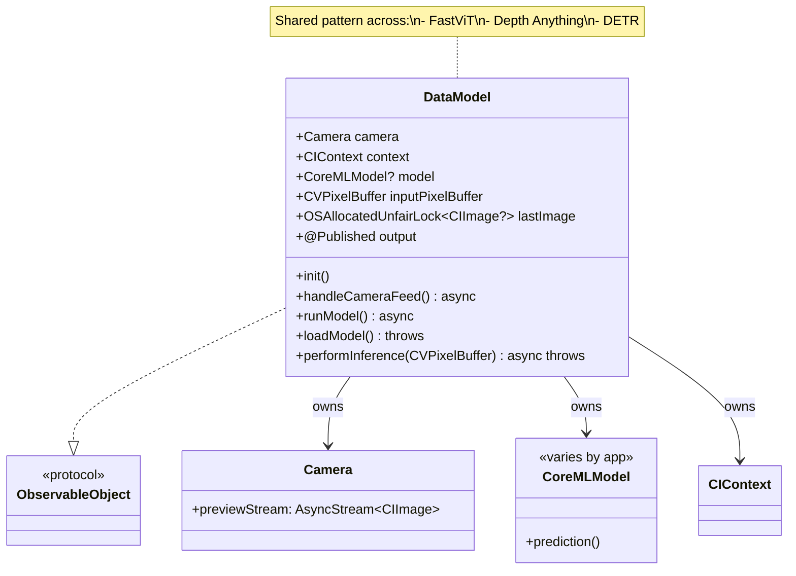
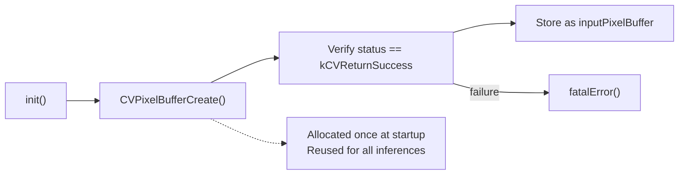
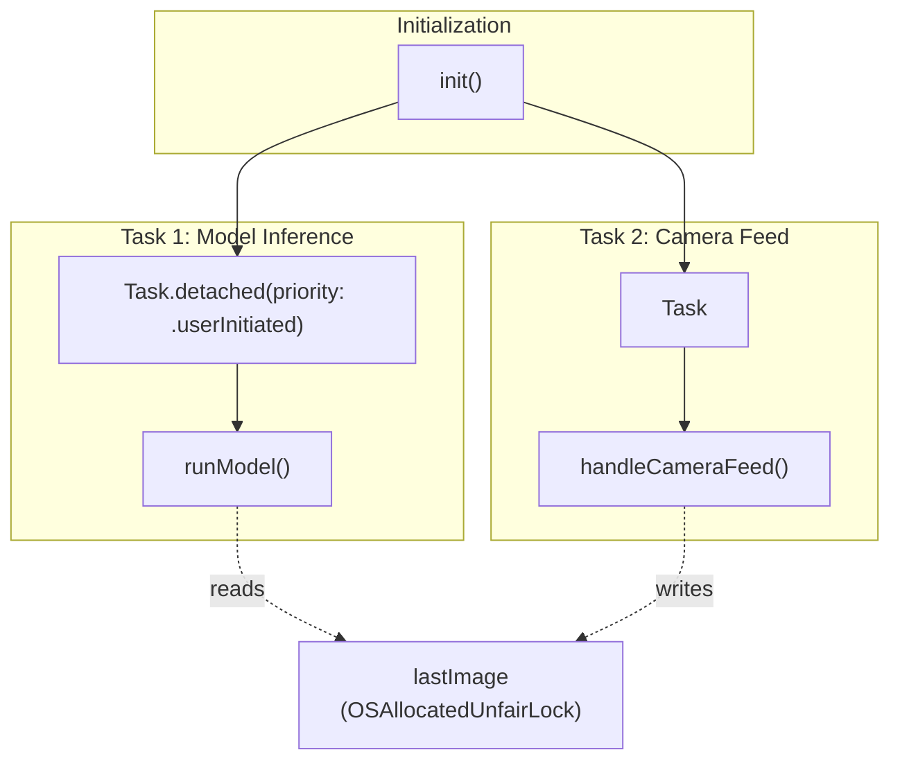
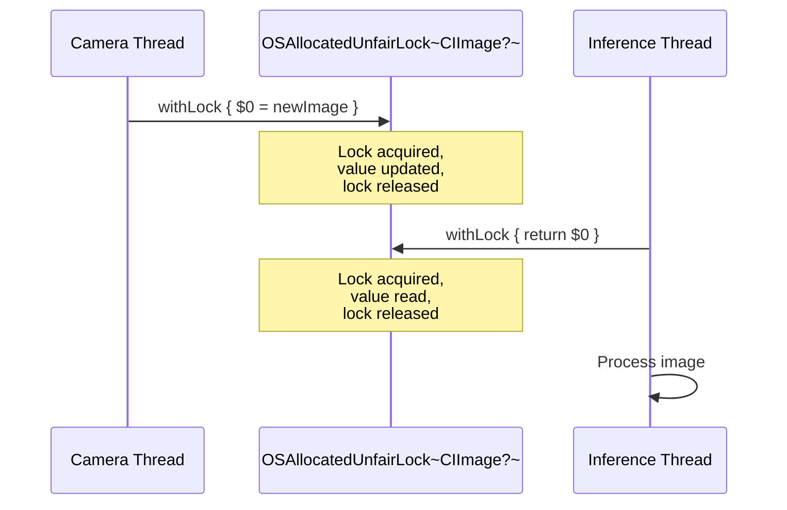
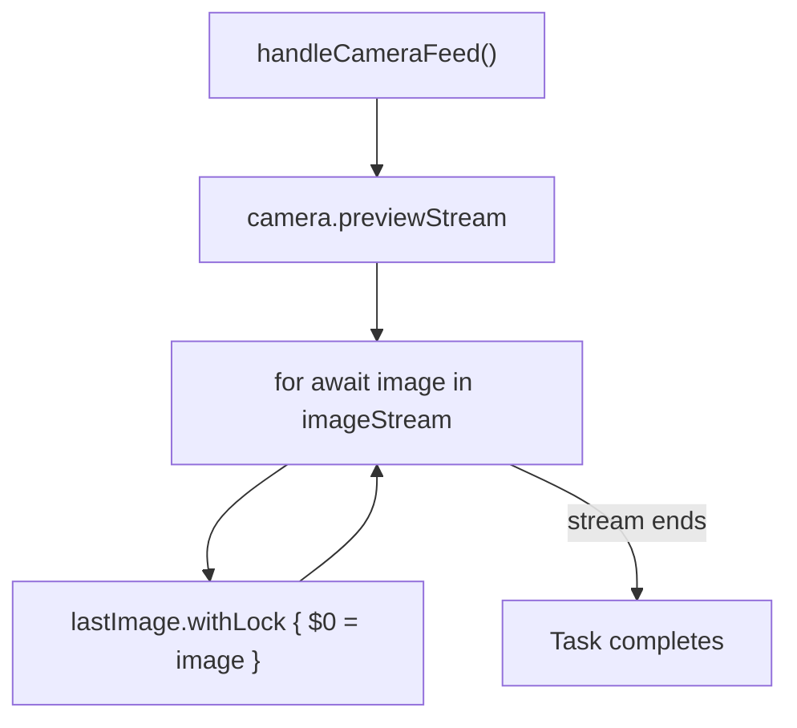
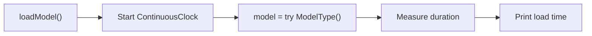
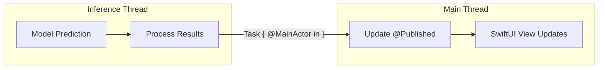
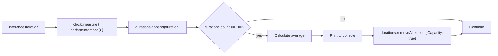
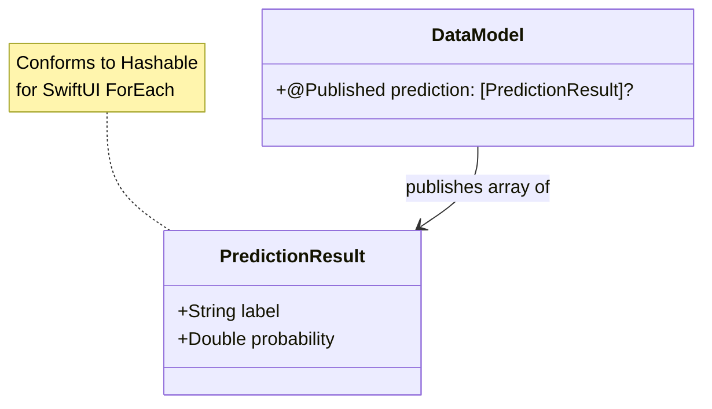
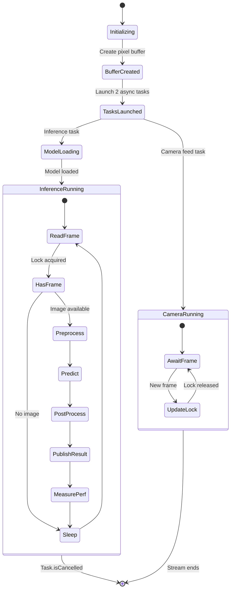

<!-- source: DeepWiki mcp.deepwiki.com · repo huggingface/coreml-examples · page 5.3 DataModel Architecture · fetched 2026-10-26 -->

# DataModel Architecture

<details>
<summary>Relevant source files</summary>

The following files were used as context for generating this wiki page:

- [FastViTSample/FastViTSample/DataModel.swift](FastViTSample/FastViTSample/DataModel.swift)
- [depth-anything-example/DepthApp/DataModel.swift](depth-anything-example/DepthApp/DataModel.swift)
- [depth-anything-example/DepthSample.xcodeproj/project.pbxproj](depth-anything-example/DepthSample.xcodeproj/project.pbxproj)

</details>


## Purpose and Scope

This document describes the `DataModel` architectural pattern used across all three demo applications in the repository. The `DataModel` class serves as the central coordination point that connects the camera system, CoreML model inference, and UI state management. It implements a consistent pattern for real-time machine learning inference with thread-safe communication and asynchronous processing.

For information about the camera system that `DataModel` integrates with, see [Camera System](#5.1). For details on the image processing utilities used within `DataModel`, see [Image Processing Utilities](#5.2). For information about the overall real-time inference architecture, see [Real-Time Inference Pattern](#6.1).

---

## Core Architecture Pattern

Each demo application implements its own `DataModel` class that conforms to the `ObservableObject` protocol, enabling SwiftUI views to reactively update when model predictions change. Despite task-specific differences, all implementations share a common architectural pattern.

### Class Structure



**Sources:** [depth-anything-example/DepthApp/DataModel.swift:8-113](), [FastViTSample/FastViTSample/DataModel.swift:14-117]()

---

## Component Overview

### Common Properties

All `DataModel` implementations include the following properties:

| Property | Type | Purpose |
|----------|------|---------|
| `camera` | `Camera` | Manages AVCaptureSession and provides frame stream |
| `context` | `CIContext` | Reusable context for image processing operations |
| `model` | `<MLModel>?` | The CoreML model instance (type varies by app) |
| `inputPixelBuffer` | `CVPixelBuffer` | Pre-allocated buffer for model input |
| `lastImage` | `OSAllocatedUnfairLock<CIImage?>` | Thread-safe storage for latest camera frame |
| `@Published` property | Varies | Published output (predictions, images, etc.) |

**Sources:** [depth-anything-example/DepthApp/DataModel.swift:9-22](), [FastViTSample/FastViTSample/DataModel.swift:15-28]()

---

## Initialization Pattern

The `DataModel` initializer establishes the foundation for real-time inference by creating a pre-allocated pixel buffer and launching two independent asynchronous tasks.

### Pixel Buffer Pre-allocation



The buffer is created with dimensions matching the model's expected input size. For Depth Anything, this is 518×392 pixels ([depth-anything-example/DepthApp/DataModel.swift:6]()), while FastViT uses 256×256 ([FastViTSample/FastViTSample/DataModel.swift:6]()).

**Sources:** [depth-anything-example/DepthApp/DataModel.swift:24-38](), [FastViTSample/FastViTSample/DataModel.swift:30-44]()

### Two-Task Architecture

The initializer launches two independent asynchronous tasks that run concurrently throughout the application's lifetime:



**Sources:** [depth-anything-example/DepthApp/DataModel.swift:41-46](), [FastViTSample/FastViTSample/DataModel.swift:47-52]()

The detached task with `.userInitiated` priority ensures that model inference runs independently without blocking the main thread or being cancelled when the parent task completes.

---

## Thread-Safe Communication

The `lastImage` property uses `OSAllocatedUnfairLock` to provide thread-safe access to the most recent camera frame without the overhead of actor isolation or heavier synchronization primitives.

### Lock-Based Data Sharing



The `withLock` method ensures atomic read/write operations:

- **Camera task:** Writes each new frame ([depth-anything-example/DepthApp/DataModel.swift:52]())
- **Inference task:** Reads the latest frame ([depth-anything-example/DepthApp/DataModel.swift:63]())

**Sources:** [depth-anything-example/DepthApp/DataModel.swift:19](), [depth-anything-example/DepthApp/DataModel.swift:49-54](), [depth-anything-example/DepthApp/DataModel.swift:62-69]()

---

## Camera Feed Handling

The `handleCameraFeed()` method runs in a dedicated task and continuously processes the camera's preview stream.



This simple loop ensures that the `lastImage` property always contains the most recent frame available from the camera, regardless of the inference speed.

**Sources:** [depth-anything-example/DepthApp/DataModel.swift:49-54](), [FastViTSample/FastViTSample/DataModel.swift:55-60]()

---

## Model Loading

The `loadModel()` method loads the CoreML model and measures the loading time for diagnostic purposes.



Model loading occurs synchronously within the inference task before the main inference loop begins ([depth-anything-example/DepthApp/DataModel.swift:57]()).

### Model Types by Application

| Application | Model Class | Input Size |
|-------------|-------------|------------|
| Depth Anything | `DepthAnythingV2SmallF16` | 518×392 |
| FastViT | `FastViTMA36F16` or `FastViTT8F16` | 256×256 |
| DETR | `DETRResnet50F16` | Varies |

**Sources:** [depth-anything-example/DepthApp/DataModel.swift:84-94](), [FastViTSample/FastViTSample/DataModel.swift:90-100]()

---

## Inference Loop Architecture

The `runModel()` method implements the continuous inference loop that processes frames as fast as possible while maintaining UI responsiveness.

### Loop Structure

```mermaid
flowchart TD
    start["runModel()"] --> loadM["loadModel()"]
    loadM --> init["Initialize performance tracking"]
    init --> check["while !Task.isCancelled"]
    
    check -->|true| read["Read lastImage with lock"]
    read --> hasImage{"Has image?"}
    
    hasImage -->|yes| resize["Resize to target size"]
    resize --> render["context.render() to inputPixelBuffer"]
    render --> predict["model.prediction()"]
    predict --> process["Process output"]
    process --> publish["Update @Published on @MainActor"]
    
    hasImage -->|no| measure
    publish --> measure["Record duration"]
    
    measure --> avgCheck{"Every 100 frames?"}
    avgCheck -->|yes| printAvg["Print average inference time"]
    avgCheck -->|no| sleep
    printAvg --> sleep["Task.sleep(10-50ms)"]
    
    sleep --> check
    check -->|false| end["Task cancelled"]
```

**Sources:** [depth-anything-example/DepthApp/DataModel.swift:56-82](), [FastViTSample/FastViTSample/DataModel.swift:62-88]()

### Rate Limiting

The inference loop includes a `Task.sleep()` call to prevent CPU saturation:
- Depth Anything: 10ms sleep ([depth-anything-example/DepthApp/DataModel.swift:80]())
- FastViT: 50ms sleep ([FastViTSample/FastViTSample/DataModel.swift:86]())

This throttling ensures the UI remains responsive while still providing near-real-time predictions.

---

## Inference Execution

The `performInference()` method handles the actual model prediction and result processing.

### Execution Flow

```mermaid
sequenceDiagram
    participant Loop as Inference Loop
    participant Method as performInference()
    participant CoreImage as CIContext
    participant Model as CoreML Model
    participant Main as @MainActor
    
    Loop->>Method: performInference(pixelBuffer)
    Method->>CoreImage: CIImage(cvPixelBuffer)
    CoreImage->>CoreImage: resized(to: targetSize)
    Method->>CoreImage: context.render(to: inputPixelBuffer)
    Method->>Model: prediction(image: inputPixelBuffer)
    Model-->>Method: Result
    Method->>Method: Process result
    Method->>Main: Task { @MainActor in ... }
    Main->>Main: Update @Published property
    Main-->>Loop: Continue
```

**Sources:** [depth-anything-example/DepthApp/DataModel.swift:96-112](), [FastViTSample/FastViTSample/DataModel.swift:102-116]()

### Image Preprocessing Steps

1. **Source conversion:** Convert `CVPixelBuffer` to `CIImage` ([depth-anything-example/DepthApp/DataModel.swift:102]())
2. **Resizing:** Scale to model's expected input size using `resized(to:)` extension ([depth-anything-example/DepthApp/DataModel.swift:102]())
3. **Rendering:** Render to pre-allocated `inputPixelBuffer` ([depth-anything-example/DepthApp/DataModel.swift:103]())
4. **Prediction:** Pass buffer to CoreML model ([depth-anything-example/DepthApp/DataModel.swift:104]())

---

## State Publishing Pattern

All result updates follow a strict pattern: processing occurs on the inference thread, but published property updates must happen on the main actor.



The `@MainActor` annotation ensures thread-safety and triggers SwiftUI's observation system:

```swift
Task { @MainActor in
    depthImage = outputImage  // or prediction = top3
}
```

**Sources:** [depth-anything-example/DepthApp/DataModel.swift:109-111](), [FastViTSample/FastViTSample/DataModel.swift:113-115]()

---

## Performance Monitoring

The `runModel()` method includes built-in performance measurement that tracks inference duration and reports averages every 100 frames.

### Measurement Implementation



The measurement uses `ContinuousClock` to ensure accurate timing that's unaffected by system clock changes. Results are formatted as milliseconds and printed to the console ([depth-anything-example/DepthApp/DataModel.swift:71-77]()).

**Sources:** [depth-anything-example/DepthApp/DataModel.swift:59-77](), [FastViTSample/FastViTSample/DataModel.swift:65-83]()

---

## Application-Specific Variations

While the core pattern remains consistent, each application customizes `DataModel` for its specific ML task.

### Published Output Types

| Application | Published Property | Type | Purpose |
|-------------|-------------------|------|---------|
| Depth Anything | `depthImage` | `Image?` | SwiftUI-compatible depth visualization |
| FastViT | `prediction` | `[PredictionResult]?` | Top-3 classification results |
| DETR | Multiple | Varies | Segmentation masks and metadata |

### FastViT Specific: PredictionResult Structure

FastViT introduces a custom result type for classification predictions:



The `performInference()` method sorts the model's probability dictionary and extracts the top 3 results ([FastViTSample/FastViTSample/DataModel.swift:110-112]()).

**Sources:** [FastViTSample/FastViTSample/DataModel.swift:9-12](), [FastViTSample/FastViTSample/DataModel.swift:110-115]()

### Depth Anything Specific: Image Conversion

Depth Anything includes a private `CIImage` extension to convert depth maps to SwiftUI `Image` objects ([depth-anything-example/DepthApp/DataModel.swift:115-121]()). The depth output is resized back to the original camera frame dimensions before display ([depth-anything-example/DepthApp/DataModel.swift:105-107]()).

**Sources:** [depth-anything-example/DepthApp/DataModel.swift:101-112](), [depth-anything-example/DepthApp/DataModel.swift:115-121]()

---

## Complete Lifecycle

The following diagram illustrates the complete lifecycle of a `DataModel` instance from initialization through steady-state operation:



**Sources:** [depth-anything-example/DepthApp/DataModel.swift:24-82](), [FastViTSample/FastViTSample/DataModel.swift:30-88]()

---

## Summary

The `DataModel` architecture provides a robust, reusable pattern for real-time CoreML inference:

- **Separation of concerns:** Camera capture, model inference, and UI updates run independently
- **Thread safety:** `OSAllocatedUnfairLock` enables efficient cross-thread communication
- **Performance optimization:** Pre-allocated buffers and throttled inference prevent resource exhaustion
- **Observable pattern:** SwiftUI integration through `ObservableObject` and `@Published`
- **Extensibility:** Core pattern easily adapted to different ML tasks and model types

This architecture is demonstrated in three production-quality demo applications, each using the same fundamental structure while customizing output processing for their specific use cases.

**Sources:** [depth-anything-example/DepthApp/DataModel.swift:1-122](), [FastViTSample/FastViTSample/DataModel.swift:1-126]()

---

