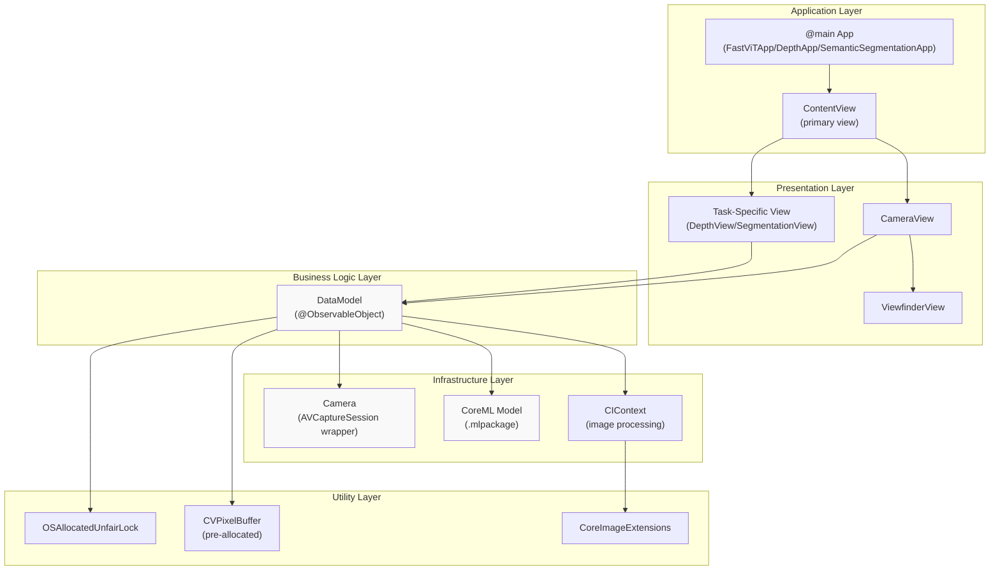
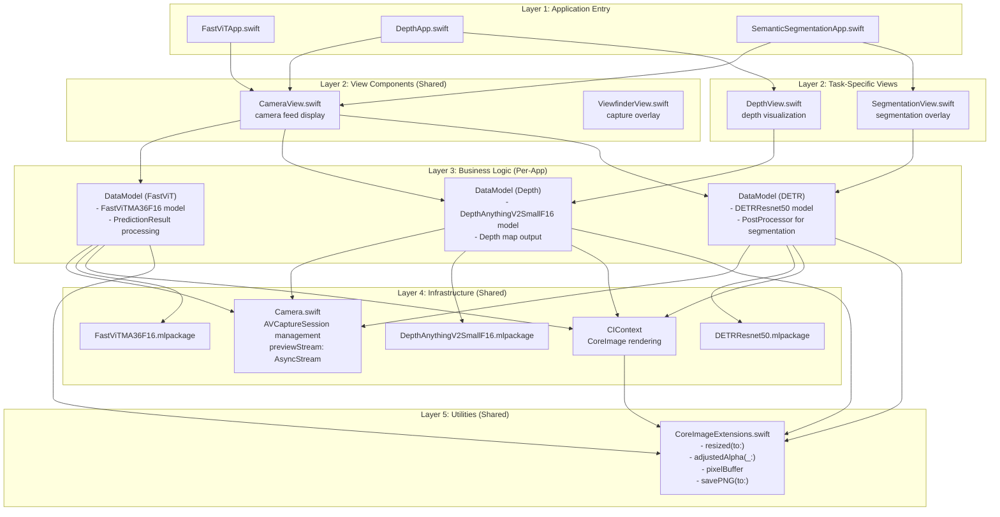
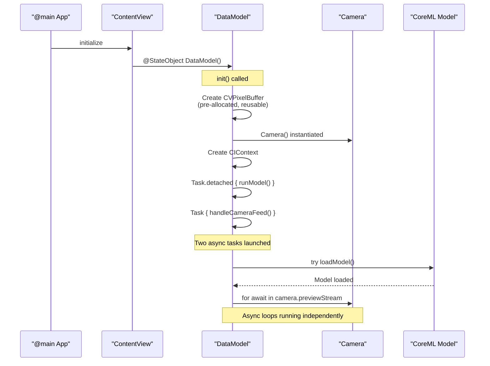
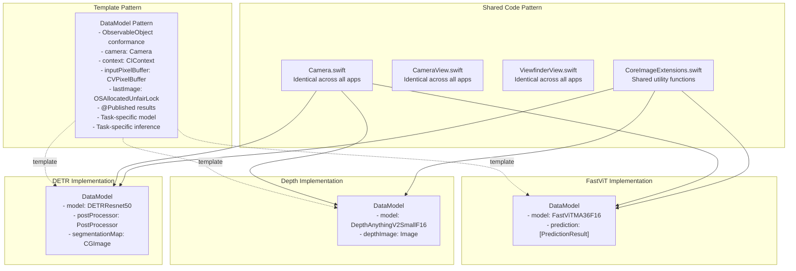

<!-- source: DeepWiki mcp.deepwiki.com · repo huggingface/coreml-examples · page 6 Architecture & Design Patterns · fetched 2026-10-26 -->

# Architecture & Design Patterns

<details>
<summary>Relevant source files</summary>

The following files were used as context for generating this wiki page:

- [FastViTSample/FastViTSample/DataModel.swift](FastViTSample/FastViTSample/DataModel.swift)
- [README.md](README.md)
- [depth-anything-example/DepthApp/DataModel.swift](depth-anything-example/DepthApp/DataModel.swift)
- [depth-anything-example/DepthSample.xcodeproj/project.pbxproj](depth-anything-example/DepthSample.xcodeproj/project.pbxproj)
- [depth-anything-example/README.md](depth-anything-example/README.md)

</details>


This document describes the high-level architectural patterns and design decisions used throughout the CoreML Examples repository. It covers the common structure shared across all three demo applications (FastViT, Depth Anything, DETR) and explains how components interact to enable real-time ML inference on iOS devices.

For detailed information about the real-time inference loop implementation, see [Real-Time Inference Pattern](#6.1). For threading and concurrency mechanisms, see [Threading & Concurrency](#6.2).

## Overview

All three demo applications in this repository follow a consistent architectural pattern that separates concerns into distinct layers: presentation (SwiftUI views), business logic (DataModel), infrastructure (Camera, CoreML), and utilities. This pattern enables code reuse, maintainable structure, and predictable behavior across different ML tasks.

## Core Architectural Pattern

Each demo application implements the same fundamental architecture with task-specific variations only in model types and post-processing logic.

### Application Structure



**Sources:** [depth-anything-example/DepthApp/DataModel.swift:1-122](), [FastViTSample/FastViTSample/DataModel.swift:1-126]()

### MVVM-Inspired Pattern

The architecture follows an MVVM-inspired pattern where the `DataModel` class acts as the ViewModel:

| Component | Role | Responsibilities |
|-----------|------|------------------|
| **App** | Entry Point | SwiftUI App protocol implementation, lifecycle management |
| **Views** | Presentation | Display camera feed, show results, handle user interactions |
| **DataModel** | ViewModel | Coordinate camera, model, state management, async tasks |
| **Camera** | Infrastructure | Manage `AVCaptureSession`, provide `AsyncStream` of frames |
| **CoreML Model** | Inference | Execute ML predictions on device (GPU/Neural Engine) |
| **Extensions** | Utilities | Reusable image processing operations |

The `DataModel` conforms to `ObservableObject` and publishes state changes to views using the `@Published` property wrapper:

```swift
final class DataModel: ObservableObject {
    let camera = Camera()
    let context = CIContext()
    var model: DepthAnythingV2SmallF16?
    let inputPixelBuffer: CVPixelBuffer
    var lastImage = OSAllocatedUnfairLock<CIImage?>(uncheckedState: nil)
    @Published var depthImage: Image?  // Published to views
}
```

**Sources:** [depth-anything-example/DepthApp/DataModel.swift:8-23]()

## Layered Architecture

The system implements a clear separation of concerns across multiple layers:

### Layer Diagram with Code Entities



**Sources:** [depth-anything-example/DepthApp/DataModel.swift:8-113](), [FastViTSample/FastViTSample/DataModel.swift:14-117]()

## Component Interaction Flow

### Initialization Sequence



**Sources:** [depth-anything-example/DepthApp/DataModel.swift:24-54]()

### Runtime Execution Flow

The system operates three concurrent execution contexts after initialization:

```mermaid
graph LR
    subgraph "Main Thread"
        UI["SwiftUI Views<br/>observe @Published"]
    end
    
    subgraph "Camera Queue"
        CAP["AVCaptureSession<br/>captures frames"]
        STREAM["previewStream.yield()<br/>emits CIImage"]
    end
    
    subgraph "Inference Task (detached)"
        READ["Read lastImage<br/>(with lock)"]
        PREP["Resize & render<br/>to inputPixelBuffer"]
        INFER["model.prediction()"]
        POST["Post-process results"]
        PUB["@MainActor update<br/>@Published properties"]
    end
    
    subgraph "Camera Task"
        LOOP["for await in<br/>previewStream"]
        WRITE["lastImage.withLock<br/>{ $0 = image }"]
    end
    
    CAP --> STREAM
    STREAM --> LOOP
    LOOP --> WRITE
    
    READ --> PREP
    PREP --> INFER
    INFER --> POST
    POST --> PUB
    PUB --> UI
    
    WRITE -.thread-safe.-> READ
```



**Sources:** [depth-anything-example/DepthApp/DataModel.swift:49-82]()

## Key Design Decisions

### 1. Decoupled Camera and Inference

The camera feed and inference loop operate independently, connected only through a thread-safe shared variable (`OSAllocatedUnfairLock<CIImage?>`). This design decision provides:

- **Non-blocking camera**: Camera continues capturing regardless of inference speed
- **Frame skipping**: Inference processes latest available frame, skipping intermediate frames if needed
- **Simplified synchronization**: Single lock point instead of complex coordination

```swift
// Camera task writes latest frame
func handleCameraFeed() async {
    let imageStream = camera.previewStream
    for await image in imageStream {
        lastImage.withLock({ $0 = image })  // Thread-safe write
    }
}

// Inference task reads latest frame
while !Task.isCancelled {
    let image = lastImage.withLock({ $0 })  // Thread-safe read
    if let pixelBuffer = image?.pixelBuffer { ... }
}
```

**Sources:** [depth-anything-example/DepthApp/DataModel.swift:49-82]()

### 2. Pre-Allocated Pixel Buffer

Each `DataModel` pre-allocates a single `CVPixelBuffer` during initialization and reuses it for all inference operations:

```swift
let inputPixelBuffer: CVPixelBuffer

init() {
    var buffer: CVPixelBuffer!
    let status = CVPixelBufferCreate(
        kCFAllocatorDefault,
        Int(targetSize.width),
        Int(targetSize.height),
        kCVPixelFormatType_32ARGB,
        nil,
        &buffer
    )
    guard status == kCVReturnSuccess else {
        fatalError("Failed to create pixel buffer")
    }
    inputPixelBuffer = buffer
    // ...
}
```

**Rationale**: Avoids repeated memory allocation/deallocation overhead during real-time inference, improving performance consistency.

**Sources:** [depth-anything-example/DepthApp/DataModel.swift:24-38]()

### 3. Task Priority and Detachment

The inference loop runs in a detached task with `.userInitiated` priority:

```swift
Task.detached(priority: .userInitiated) {
    await self.runModel()
}
```

**Rationale**: 
- **Detached**: Creates independent task not tied to parent lifecycle
- **userInitiated**: Prioritizes inference as user-facing work without blocking higher-priority UI updates

**Sources:** [depth-anything-example/DepthApp/DataModel.swift:41-43]()

### 4. MainActor Updates

All UI state updates are dispatched to the main actor:

```swift
Task { @MainActor in
    depthImage = outputImage
}
```

**Rationale**: Ensures thread-safe UI updates from background inference task, preventing race conditions and crashes.

**Sources:** [depth-anything-example/DepthApp/DataModel.swift:109-111]()

### 5. Inference Throttling

Each inference loop includes a 10-50ms sleep:

```swift
// Slow down inference to prevent freezing the UI
try? await Task.sleep(for: .milliseconds(10))
```

**Rationale**: Prevents CPU/GPU saturation that would starve the main thread and make the UI unresponsive. Different apps use different sleep durations based on model complexity.

**Sources:** [depth-anything-example/DepthApp/DataModel.swift:80](), [FastViTSample/FastViTSample/DataModel.swift:86]()

## Code Reuse Strategy

The repository maximizes code reuse through shared infrastructure components that all demos leverage:

### Shared Components Matrix

| Component | FastViT | Depth Anything | DETR | Location |
|-----------|---------|----------------|------|----------|
| `Camera.swift` | ✓ | ✓ | ✓ | Copied to each project |
| `CameraView.swift` | ✓ | ✓ | ✓ | Copied to each project |
| `ViewfinderView.swift` | ✓ | ✓ | ✓ | Copied to each project |
| `CoreImageExtensions.swift` | ✓ | ✓ | ✓ | `Common/` directory |
| `DataModel` pattern | ✓ | ✓ | ✓ | Implemented per-app |
| Task-specific views | — | `DepthView` | `SegmentationView` | Per-app |
| Post-processing | Classification | Depth map | `PostProcessor` class | Per-app |

### Component Reuse Pattern



**Sources:** [depth-anything-example/DepthApp/DataModel.swift:8-22](), [FastViTSample/FastViTSample/DataModel.swift:14-28]()

## Architectural Benefits

This architectural approach provides several key benefits:

### Consistency

All three demos follow the same pattern, making it easy to understand one after learning another. Developers can apply knowledge from one sample to others.

### Maintainability

Clear separation of concerns means changes to one layer (e.g., camera management) don't require changes to other layers (e.g., model inference).

### Performance

Design decisions like pre-allocated buffers, detached tasks, and inference throttling are applied consistently, ensuring predictable performance characteristics.

### Extensibility

Adding a new demo application requires:
1. Copy shared components (`Camera.swift`, `CameraView.swift`, etc.)
2. Implement task-specific `DataModel` following the pattern
3. Create task-specific views for result display
4. Add the CoreML model package

The pattern guides implementation without requiring architectural decisions for each new sample.

### Testability

Each layer can be tested independently:
- **Camera**: Test frame capture and stream emission
- **DataModel**: Test inference logic with mock camera feed
- **Views**: Test UI rendering with mock DataModel state
- **Extensions**: Test utility functions in isolation

**Sources:** [README.md:1-31]()

## Summary

The CoreML Examples repository implements a consistent, layered architecture across all demo applications. The core pattern separates presentation (SwiftUI views), business logic (DataModel as ViewModel), and infrastructure (Camera, CoreML, utilities). Key design decisions include decoupled camera/inference loops, pre-allocated buffers, proper thread synchronization with `OSAllocatedUnfairLock`, and main actor UI updates. This architecture enables code reuse, maintainable structure, and predictable real-time performance for on-device ML inference.

---

