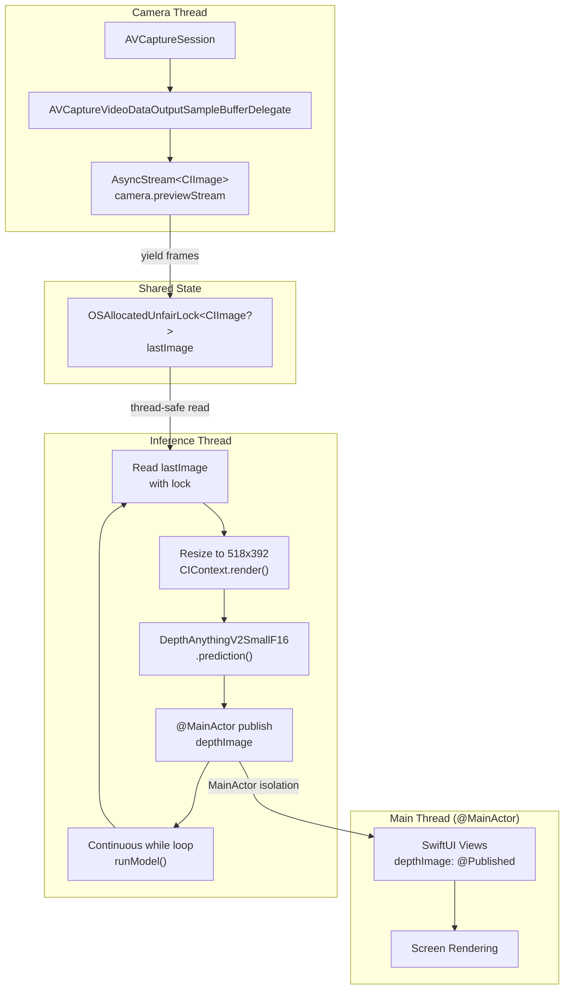
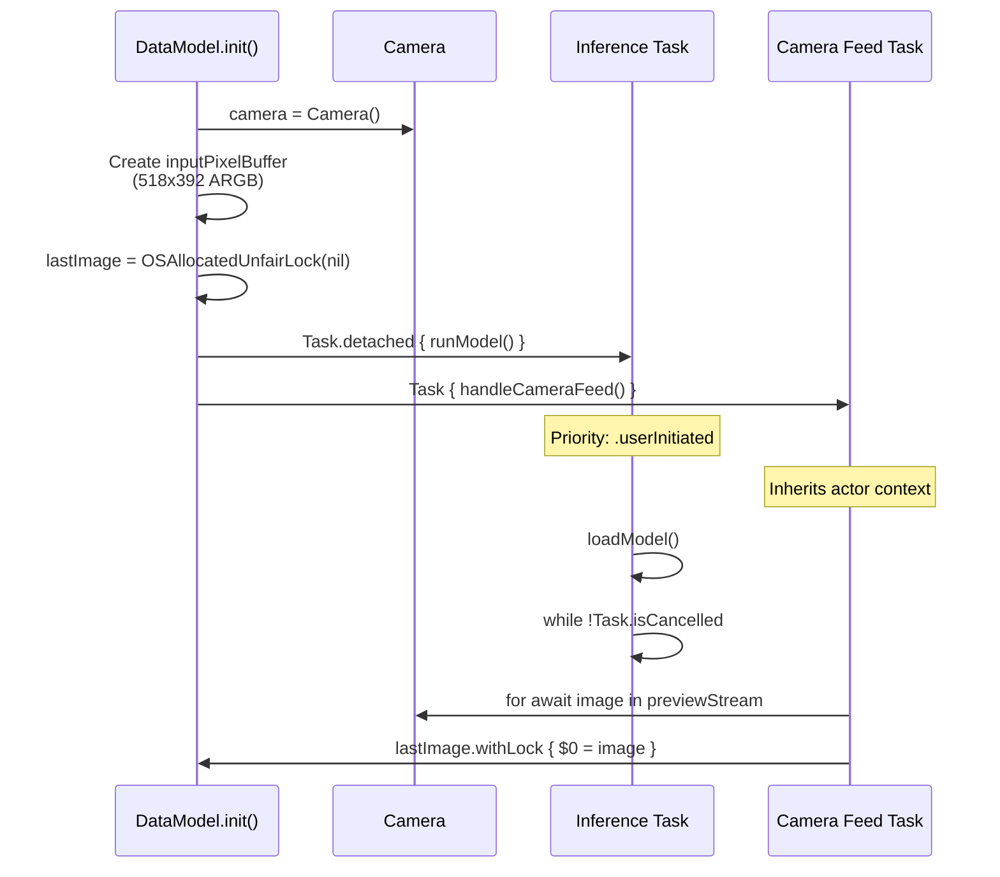
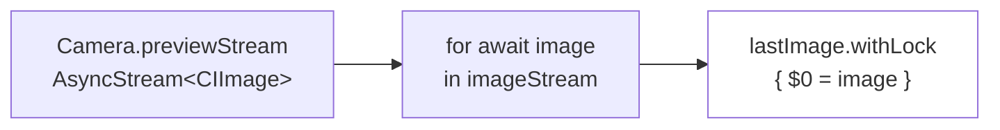
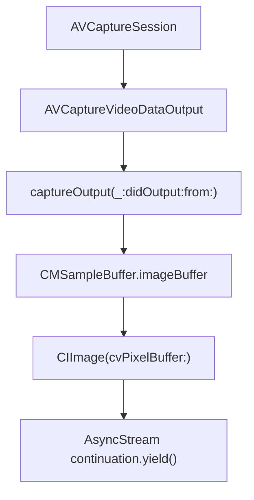
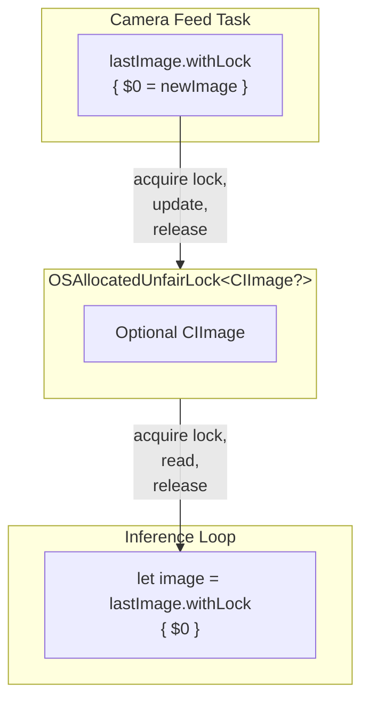
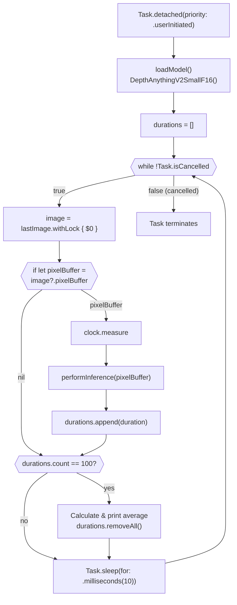
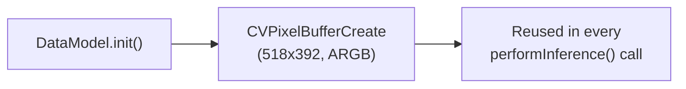
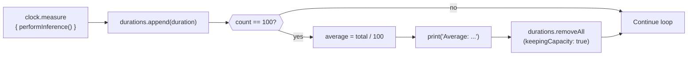
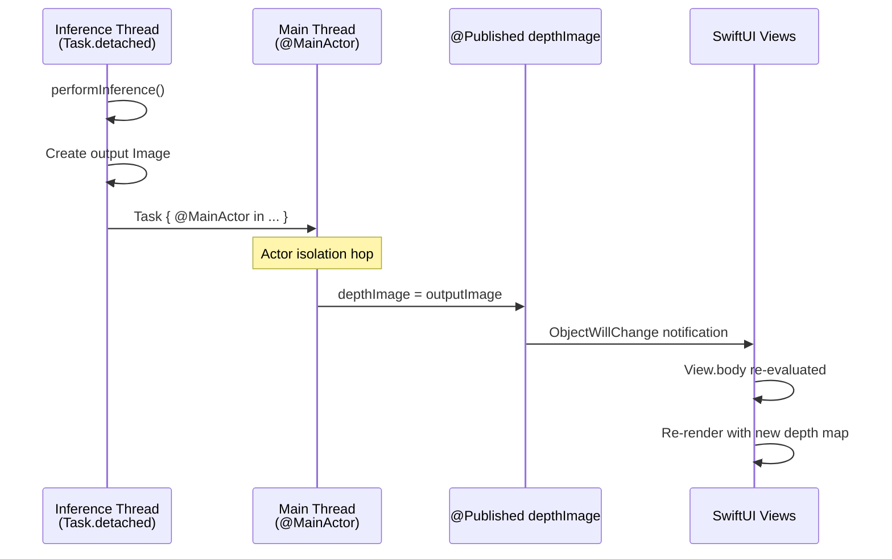

<!-- source: DeepWiki mcp.deepwiki.com · repo huggingface/coreml-examples · page 6.1 Real-Time Inference Pattern · fetched 2026-10-26 -->

# Real-Time Inference Pattern

<details>
<summary>Relevant source files</summary>

The following files were used as context for generating this wiki page:

- [FastViTSample/FastViTSample/Camera.swift](FastViTSample/FastViTSample/Camera.swift)
- [depth-anything-example/DepthApp/DataModel.swift](depth-anything-example/DepthApp/DataModel.swift)
- [depth-anything-example/DepthSample.xcodeproj/project.pbxproj](depth-anything-example/DepthSample.xcodeproj/project.pbxproj)

</details>


## Purpose and Scope

This document describes the real-time inference architecture pattern used across all demo applications in the CoreML Examples repository. The pattern enables continuous CoreML model inference on live camera feeds while maintaining responsive UI and efficient resource utilization. The Depth Anything V2 sample serves as the primary reference implementation.

For information about the threading and concurrency mechanisms underlying this pattern, see [Threading & Concurrency](#6.2). For details on the Camera system that provides input frames, see [Camera System](#5.1). For the DataModel architectural pattern, see [DataModel Architecture](#5.3).

## Architecture Overview

The real-time inference pattern employs a **three-thread architecture** that decouples camera capture, model inference, and UI updates:



**Sources:** [depth-anything-example/DepthApp/DataModel.swift:1-122]()

## Component Initialization

The `DataModel` initializer sets up all three execution contexts:

| Component | Thread/Context | Purpose |
|-----------|---------------|---------|
| `Camera()` | Creates `sessionQueue` dispatch queue | Manages AVFoundation capture |
| `inputPixelBuffer` | Main thread initialization | Pre-allocated CVPixelBuffer (518x392) |
| `lastImage` | Main thread initialization | OSAllocatedUnfairLock for thread-safe access |
| `Task.detached(priority: .userInitiated)` | Background thread | Runs continuous inference loop |
| `Task { await handleCameraFeed() }` | Async context | Consumes camera frames |



**Sources:** [depth-anything-example/DepthApp/DataModel.swift:24-47]()

## Camera Feed Handling

The `handleCameraFeed()` function bridges the camera stream to shared state:



**Key characteristics:**
- **Async iteration**: Consumes `AsyncStream<CIImage>` from Camera
- **Non-blocking writes**: `withLock` acquires lock briefly to update shared state
- **Latest-frame semantics**: Always overwrites with most recent frame (no queueing)
- **No back-pressure**: If inference is slow, intermediate frames are skipped

**Sources:** [depth-anything-example/DepthApp/DataModel.swift:49-54]()

The `Camera` class produces frames via `AVCaptureVideoDataOutputSampleBufferDelegate`:



**Sources:** [FastViTSample/FastViTSample/Camera.swift:190-208]()

## Thread-Safe Image Sharing

The `OSAllocatedUnfairLock` provides low-overhead synchronization between the camera feed task and inference loop:



**Design rationale:**
- **Unfair lock**: Prioritizes writer (camera) to prevent frame drops
- **Optional state**: Handles initialization where no frame exists yet
- **Minimal critical section**: Lock held only during pointer copy/assignment
- **No frame copying**: `CIImage` is reference-counted, only reference is copied

**Sources:** [depth-anything-example/DepthApp/DataModel.swift:19](), [depth-anything-example/DepthApp/DataModel.swift:52](), [depth-anything-example/DepthApp/DataModel.swift:63]()

## Inference Loop

The `runModel()` function implements the continuous inference pattern:



**Sources:** [depth-anything-example/DepthApp/DataModel.swift:56-82]()

### Inference Steps

The `performInference()` method executes the model prediction:

| Step | Code | Purpose |
|------|------|---------|
| 1. Get original size | `CVPixelBufferGetWidth/Height(pixelBuffer)` | For output resize |
| 2. Resize input | `CIImage(cvPixelBuffer).resized(to: targetSize)` | 518x392 required by model |
| 3. Render to buffer | `context.render(inputImage, to: inputPixelBuffer)` | Pre-allocated CVPixelBuffer |
| 4. Model prediction | `model.prediction(image: inputPixelBuffer)` | CoreML inference |
| 5. Resize output | `CIImage(cvPixelBuffer: result.depth).resized(to: originalSize)` | Match camera resolution |
| 6. Publish result | `Task { @MainActor in depthImage = outputImage }` | Thread-safe UI update |

**Sources:** [depth-anything-example/DepthApp/DataModel.swift:96-112]()

## Performance Optimization

The pattern includes several optimization strategies:

### 1. Pre-Allocated Pixel Buffer

The `inputPixelBuffer` is created once during initialization to avoid repeated allocations:



**Sources:** [depth-anything-example/DepthApp/DataModel.swift:16](), [depth-anything-example/DepthApp/DataModel.swift:26-38]()

### 2. Inference Throttling

A 10ms sleep prevents CPU saturation while maintaining ~100 FPS processing rate:

```swift
// Slow down inference to prevent freezing the UI
try? await Task.sleep(for: .milliseconds(10))
```

**Rationale:**
- Without sleep: Inference runs continuously, consuming 100% CPU
- With 10ms sleep: Maximum ~100 iterations/second, reasonable for 30 FPS camera
- UI remains responsive since inference thread doesn't monopolize resources

**Sources:** [depth-anything-example/DepthApp/DataModel.swift:79-80]()

### 3. Performance Measurement

Running average calculated every 100 frames:



**Sources:** [depth-anything-example/DepthApp/DataModel.swift:59-77]()

## Result Publishing

Results are published to the UI using `@MainActor` isolation:



**Key aspects:**
- **`@Published` property**: Triggers SwiftUI view updates automatically
- **`@MainActor` closure**: Ensures UI updates occur on main thread
- **Async dispatch**: Inference thread doesn't block waiting for UI update

**Sources:** [depth-anything-example/DepthApp/DataModel.swift:22](), [depth-anything-example/DepthApp/DataModel.swift:109-111]()

## Code Entity Mapping

### Class: `DataModel`

**Location:** [depth-anything-example/DepthApp/DataModel.swift:8-113]()

**Responsibilities:**
- Camera management
- Model loading and lifecycle
- Inference orchestration
- State publishing to UI

**Key properties:**

| Property | Type | Thread Safety | Purpose |
|----------|------|---------------|---------|
| `camera` | `Camera` | Thread-safe (internal) | AVFoundation capture session |
| `model` | `DepthAnythingV2SmallF16?` | Immutable after load | CoreML model instance |
| `inputPixelBuffer` | `CVPixelBuffer` | Single-writer (inference) | Pre-allocated input buffer |
| `lastImage` | `OSAllocatedUnfairLock<CIImage?>` | Lock-protected | Latest camera frame |
| `depthImage` | `@Published Image?` | MainActor-isolated | Output for UI |
| `context` | `CIContext` | Thread-safe | CoreImage rendering |

**Key methods:**

| Method | Async | Thread | Purpose |
|--------|-------|--------|---------|
| `init()` | No | Main | Initialize components, spawn tasks |
| `handleCameraFeed()` | Yes | Task context | Consume camera stream |
| `runModel()` | Yes | Detached task | Continuous inference loop |
| `loadModel()` | No | Inference thread | Load CoreML model |
| `performInference(_:)` | Yes | Inference thread | Single inference pass |

### Constant: `targetSize`

**Location:** [depth-anything-example/DepthApp/DataModel.swift:6]()

**Value:** `CGSize(width: 518, height: 392)`

**Purpose:** Model input dimensions required by DepthAnythingV2SmallF16

### Class: `Camera`

**Location:** [FastViTSample/FastViTSample/Camera.swift:8-253]()

**Key components:**

| Component | Type | Purpose |
|-----------|------|---------|
| `captureSession` | `AVCaptureSession` | Coordinates capture pipeline |
| `sessionQueue` | `DispatchQueue` | Serializes session configuration |
| `previewStream` | `AsyncStream<CIImage>` | Async frame delivery |
| `addToPreviewStream` | `((CIImage) -> Void)?` | AsyncStream continuation |

**Delegate method:**
- `captureOutput(_:didOutput:from:)`: Converts `CMSampleBuffer` to `CIImage` and yields to stream

**Sources:** [FastViTSample/FastViTSample/Camera.swift:8-253]()

## Pattern Variations

While Depth Anything serves as the reference implementation, other demo apps follow the same pattern with minor variations:

| Demo App | Model | Input Size | Output Type | Unique Aspect |
|----------|-------|------------|-------------|---------------|
| Depth Anything | `DepthAnythingV2SmallF16` | 518×392 | Depth map (CVPixelBuffer) | Direct grayscale output |
| FastViT | `FastViTMA36F16` / `FastViTT8F16` | 256×256 | Class probabilities | Top-3 classification results |
| DETR | `DETRResnet50F16` | 640×640 | Semantic map (MultiArray) | Requires Metal shader post-processing |

All three implement:
- Same three-thread architecture
- `OSAllocatedUnfairLock` for image sharing
- `@Published` properties for UI updates
- Performance measurement
- Inference throttling via `Task.sleep`

**Sources:** [depth-anything-example/DepthApp/DataModel.swift:1-122](), FastViT and DETR DataModel implementations (not shown in provided files)

---

