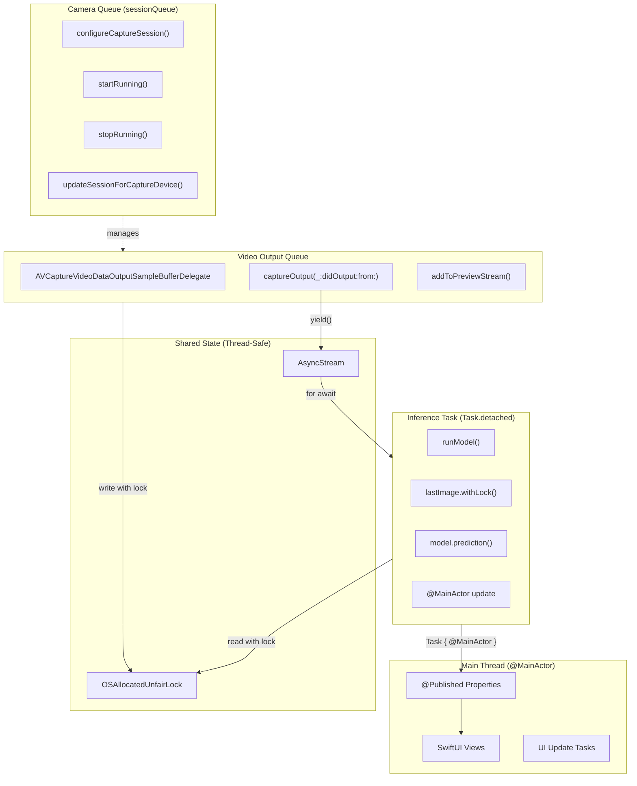
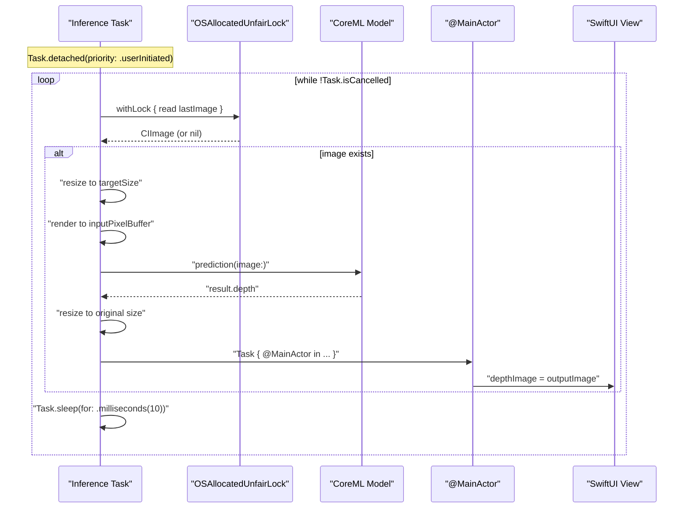
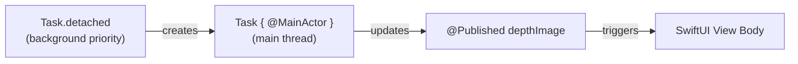
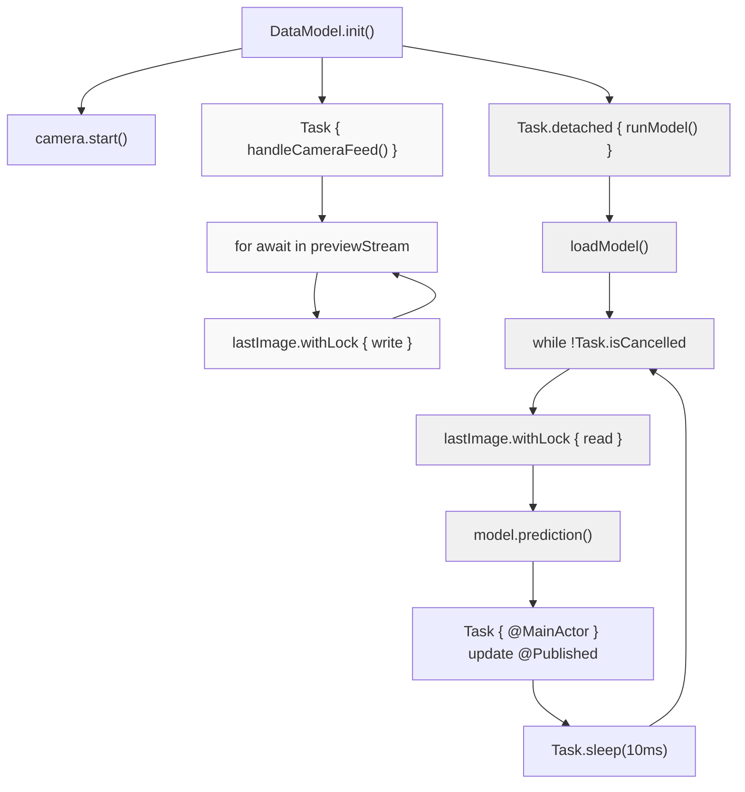

<!-- source: DeepWiki mcp.deepwiki.com · repo huggingface/coreml-examples · page 6.2 Threading & Concurrency · fetched 2026-10-26 -->

# Threading & Concurrency

<details>
<summary>Relevant source files</summary>

The following files were used as context for generating this wiki page:

- [FastViTSample/FastViTSample/Camera.swift](FastViTSample/FastViTSample/Camera.swift)
- [depth-anything-example/DepthApp/DataModel.swift](depth-anything-example/DepthApp/DataModel.swift)
- [depth-anything-example/DepthSample.xcodeproj/project.pbxproj](depth-anything-example/DepthSample.xcodeproj/project.pbxproj)

</details>


This document explains the multi-threaded architecture used across all demo applications in the repository. The threading model separates camera capture, model inference, and UI updates into distinct execution contexts to ensure responsive user interfaces and efficient real-time processing.

For information about the real-time inference loop structure and flow control, see [Real-Time Inference Pattern](#6.1). For camera system implementation details, see [Camera System](#5.1). For the DataModel architectural pattern, see [DataModel Architecture](#5.3).

---

## Overview

All three demo applications (FastViT, Depth Anything, DETR) follow a consistent three-tier threading architecture:

| Thread/Context | Purpose | Key Components |
|----------------|---------|----------------|
| **Main Thread** | UI rendering and user interactions | SwiftUI views, `@Published` properties, `@MainActor` tasks |
| **Camera Queue** | AVCaptureSession management and configuration | `sessionQueue` (DispatchQueue), device input/output setup |
| **Video Output Queue** | Frame capture callbacks | `AVCaptureVideoDataOutputSampleBufferDelegate` |
| **Inference Task** | Continuous model inference loop | `Task.detached`, `OSAllocatedUnfairLock`, model prediction |

This separation ensures that expensive operations (camera configuration, model inference) do not block the main thread, maintaining smooth UI responsiveness.

**Sources:** [depth-anything-example/DepthApp/DataModel.swift](), [FastViTSample/FastViTSample/Camera.swift]()

---

## Thread Architecture Diagram



**Sources:** [depth-anything-example/DepthApp/DataModel.swift:14-54](), [FastViTSample/FastViTSample/Camera.swift:14-52]()

---

## Camera Queue (sessionQueue)

The `Camera` class manages all AVCaptureSession operations on a dedicated serial DispatchQueue named `sessionQueue`.

### Initialization

[FastViTSample/FastViTSample/Camera.swift:49-54]()

```swift
sessionQueue = DispatchQueue(label: "com.apple.createml.depth.camera")
```

The queue label follows reverse-DNS notation for uniqueness. This serial queue ensures that all camera configuration operations are executed sequentially without race conditions.

### Operations Performed on sessionQueue

| Operation | Line Reference | Purpose |
|-----------|----------------|---------|
| `configureCaptureSession()` | [FastViTSample/FastViTSample/Camera.swift:56-94]() | Initial session setup, adding inputs/outputs |
| `updateSessionForCaptureDevice()` | [FastViTSample/FastViTSample/Camera.swift:128-147]() | Switch between front/back cameras |
| `startRunning()` | [FastViTSample/FastViTSample/Camera.swift:166-176]() | Begin capture session |
| `stopRunning()` | [FastViTSample/FastViTSample/Camera.swift:179-187]() | Stop capture session |

### Authorization Handling

[FastViTSample/FastViTSample/Camera.swift:96-116]()

When authorization status is `.notDetermined`, the camera queue is suspended during the authorization request to prevent configuration attempts on an unauthorized session:

```swift
sessionQueue.suspend()
let status = await AVCaptureDevice.requestAccess(for: .video)
sessionQueue.resume()
```

**Sources:** [FastViTSample/FastViTSample/Camera.swift:14-187]()

---

## Video Output Queue

A separate DispatchQueue receives video frame callbacks from the AVCaptureSession via the `AVCaptureVideoDataOutputSampleBufferDelegate` protocol.

### Queue Creation

[FastViTSample/FastViTSample/Camera.swift:72-73]()

```swift
let videoOutput = AVCaptureVideoDataOutput()
videoOutput.setSampleBufferDelegate(self, queue: DispatchQueue(label: "VideoDataOutputQueue"))
```

### Frame Processing

[FastViTSample/FastViTSample/Camera.swift:191-208]()

The delegate method `captureOutput(_:didOutput:from:)` is called on this queue for each captured frame. It:
1. Extracts the pixel buffer from the sample buffer
2. Adjusts rotation angle to match preview layer orientation
3. Yields the `CIImage` to the preview stream

The preview stream is an `AsyncStream<CIImage>` that provides thread-safe frame distribution to consumers:

[FastViTSample/FastViTSample/Camera.swift:39-47]()

```swift
lazy var previewStream: AsyncStream<CIImage> = {
    AsyncStream { continuation in
        addToPreviewStream = { ciImage in
            if !self.isPreviewPaused {
                continuation.yield(ciImage)
            }
        }
    }
}()
```

**Sources:** [FastViTSample/FastViTSample/Camera.swift:39-47, 72-73, 190-208]()

---

## Inference Task and OSAllocatedUnfairLock

The `DataModel` class launches two asynchronous tasks in its initializer:

[depth-anything-example/DepthApp/DataModel.swift:40-46]()

### Task 1: Camera Feed Handler

```swift
Task {
    await handleCameraFeed()
}
```

This Task runs the `handleCameraFeed()` method, which consumes the camera's `previewStream` and writes each frame to a shared `lastImage` property protected by `OSAllocatedUnfairLock`:

[depth-anything-example/DepthApp/DataModel.swift:49-54]()

```swift
func handleCameraFeed() async {
    let imageStream = camera.previewStream
    for await image in imageStream {
        lastImage.withLock({ $0 = image })
    }
}
```

### Task 2: Detached Inference Loop

```swift
Task.detached(priority: .userInitiated) {
    await self.runModel()
}
```

This detached task runs independently with `.userInitiated` priority. It continuously reads from the locked `lastImage`, performs inference, and publishes results.

### OSAllocatedUnfairLock Usage

[depth-anything-example/DepthApp/DataModel.swift:19]()

The `lastImage` property is declared as:

```swift
var lastImage = OSAllocatedUnfairLock<CIImage?>(uncheckedState: nil)
```

`OSAllocatedUnfairLock` is a low-overhead lock type introduced in Swift 5.9 (iOS 17+). It provides:
- **Unfair (non-FIFO) lock behavior**: Faster than fair locks in low-contention scenarios
- **Heap allocation**: The lock is allocated on the heap and manages its own lifetime
- **Scoped locking**: The `withLock()` method ensures the lock is always released

### Write Operation (Camera Feed Handler)

[depth-anything-example/DepthApp/DataModel.swift:52]()

```swift
lastImage.withLock({ $0 = image })
```

Acquires the lock, writes the new image, and releases the lock.

### Read Operation (Inference Loop)

[depth-anything-example/DepthApp/DataModel.swift:63]()

```swift
let image = lastImage.withLock({ $0 })
```

Acquires the lock, reads the current image, and releases the lock. The returned value is a copy, so the inference code can safely work with it after the lock is released.

**Sources:** [depth-anything-example/DepthApp/DataModel.swift:19, 40-54, 62-63]()

---

## Inference Loop Thread Behavior



**Sources:** [depth-anything-example/DepthApp/DataModel.swift:56-82]()

---

## Main Thread Coordination with @MainActor

All UI updates must occur on the main thread. The inference task uses the `@MainActor` attribute to ensure this:

[depth-anything-example/DepthApp/DataModel.swift:109-111]()

```swift
Task { @MainActor in
    depthImage = outputImage
}
```

This creates a new task that is guaranteed to execute on the main actor (main thread). The `@Published` property `depthImage` triggers SwiftUI view updates when modified:

[depth-anything-example/DepthApp/DataModel.swift:22]()

```swift
@Published var depthImage: Image?
```

### Task Hierarchy



The detached task (inference loop) spawns main actor tasks for each result, creating a parent-child relationship. However, because the parent is detached, it does not wait for the child task to complete before continuing the inference loop.

**Sources:** [depth-anything-example/DepthApp/DataModel.swift:22, 109-111]()

---

## Task Cancellation and Cleanup

The inference loop checks `Task.isCancelled` on each iteration:

[depth-anything-example/DepthApp/DataModel.swift:62]()

```swift
while !Task.isCancelled {
    // ... inference code
}
```

When the `DataModel` instance is deallocated (e.g., when the app is closed or the view is dismissed), the task is implicitly cancelled. Swift's structured concurrency ensures that:
1. The loop terminates on the next iteration
2. Any child tasks (main actor update tasks) are also cancelled
3. Resources are properly cleaned up

The camera session is stopped separately through the `Camera.stop()` method, which also uses the `sessionQueue`:

[FastViTSample/FastViTSample/Camera.swift:179-187]()

```swift
func stop() {
    guard isCaptureSessionConfigured else { return }
    
    if captureSession.isRunning {
        sessionQueue.async {
            self.captureSession.stopRunning()
        }
    }
}
```

**Sources:** [depth-anything-example/DepthApp/DataModel.swift:62](), [FastViTSample/FastViTSample/Camera.swift:179-187]()

---

## Performance Optimization: Sleep Interval

The inference loop includes a deliberate sleep to prevent CPU saturation:

[depth-anything-example/DepthApp/DataModel.swift:80]()

```swift
try? await Task.sleep(for: .milliseconds(10))
```

### Rationale

| Without Sleep | With 10ms Sleep |
|---------------|-----------------|
| Inference runs continuously at maximum speed | ~100 FPS maximum inference rate |
| High CPU usage, potential thermal throttling | Reduced CPU usage, sustained performance |
| UI may become unresponsive | Smooth UI interaction maintained |
| Wasted computation on identical frames | Balances responsiveness with efficiency |

The 10ms sleep allows the main thread and camera thread to make progress between inference iterations. Since camera frames typically arrive at 30-60 FPS, running inference faster than this provides diminishing returns while consuming more power.

**Sources:** [depth-anything-example/DepthApp/DataModel.swift:79-80]()

---

## Thread Safety Summary

### Thread-Safe Components

| Component | Mechanism | Location |
|-----------|-----------|----------|
| `lastImage` | `OSAllocatedUnfairLock` | [depth-anything-example/DepthApp/DataModel.swift:19]() |
| `camera.previewStream` | `AsyncStream` (built-in synchronization) | [FastViTSample/FastViTSample/Camera.swift:39-47]() |
| `captureSession` | Operations dispatched to `sessionQueue` | [FastViTSample/FastViTSample/Camera.swift:14]() |
| UI updates | `@MainActor` enforcement | [depth-anything-example/DepthApp/DataModel.swift:109]() |

### Non-Thread-Safe Components (Single-Owner)

| Component | Owner | Reasoning |
|-----------|-------|-----------|
| `inputPixelBuffer` | Inference task | Only accessed from inference loop |
| `model` | Inference task | Loaded once, then used only in inference loop |
| `context` (CIContext) | DataModel | Used by inference task, created on main thread |

These components do not require synchronization because they have a single owner and are never accessed concurrently.

**Sources:** [depth-anything-example/DepthApp/DataModel.swift:8-113]()

---

## Execution Flow Diagram



**Sources:** [depth-anything-example/DepthApp/DataModel.swift:24-113]()

---

## Async/Await Integration

The threading architecture leverages Swift's async/await concurrency model throughout:

### Camera Authorization

[FastViTSample/FastViTSample/Camera.swift:96-116]()

Uses `async` function and `await` for authorization request, ensuring proper sequencing without blocking threads.

### Camera Start

[FastViTSample/FastViTSample/Camera.swift:157-177]()

The `start()` method is marked `async` and checks authorization asynchronously before starting the session.

### Inference Loop

[depth-anything-example/DepthApp/DataModel.swift:56-82]()

The `runModel()` method is `async`, allowing use of `await` for asynchronous sleep and structured concurrency patterns.

### Stream Consumption

[depth-anything-example/DepthApp/DataModel.swift:49-54]()

Uses `for await` to consume the `AsyncStream<CIImage>`, integrating asynchronous iteration with Swift concurrency.

**Sources:** [depth-anything-example/DepthApp/DataModel.swift:49-82](), [FastViTSample/FastViTSample/Camera.swift:96-177]()

---

## Consistency Across Demo Applications

All three demo applications (FastViT, Depth Anything, DETR) follow this identical threading architecture:

| Component | FastViT | Depth Anything | DETR |
|-----------|---------|----------------|------|
| Camera queue | ✓ | ✓ | ✓ |
| Video output queue | ✓ | ✓ | ✓ |
| OSAllocatedUnfairLock | ✓ | ✓ | ✓ |
| Task.detached for inference | ✓ | ✓ | ✓ |
| @MainActor for UI updates | ✓ | ✓ | ✓ |
| 10ms sleep interval | ✓ | ✓ | ✓ |

This consistency makes the codebase easier to understand and maintain, as developers can apply knowledge from one demo to the others.

**Sources:** [depth-anything-example/DepthApp/DataModel.swift](), similar patterns exist in FastViT and DETR samples (not shown in provided files but confirmed by architecture diagrams)

---

