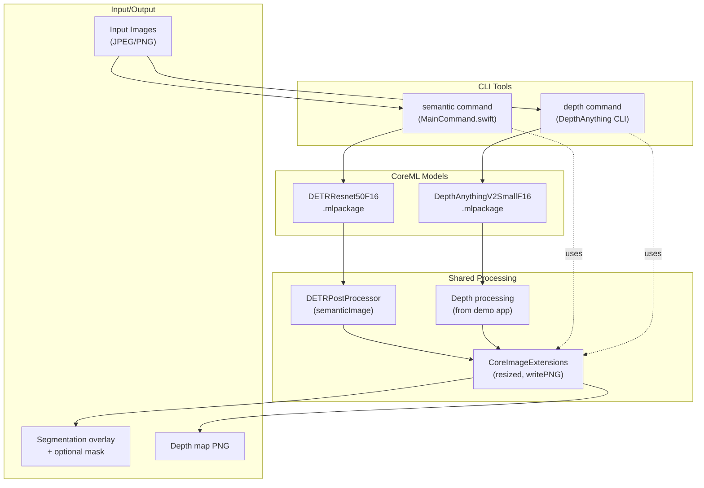
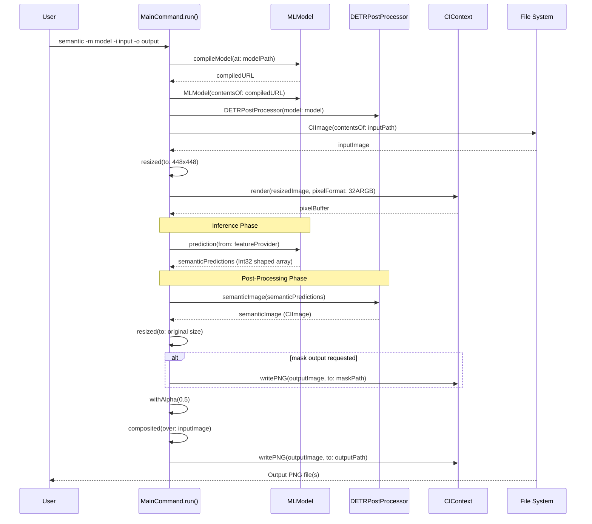
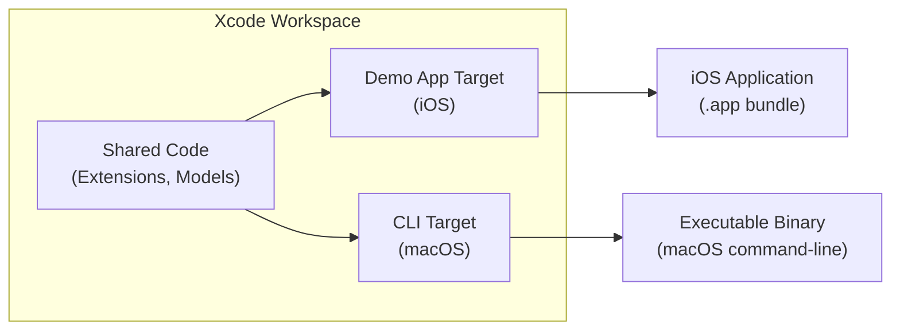

<!-- source: DeepWiki mcp.deepwiki.com · repo huggingface/coreml-examples · page 7 Command-Line Tools · fetched 2026-10-26 -->

# Command-Line Tools

<details>
<summary>Relevant source files</summary>

The following files were used as context for generating this wiki page:

- [SemanticSegmentationSample/SemanticSegmentationCLI/MainCommand.swift](SemanticSegmentationSample/SemanticSegmentationCLI/MainCommand.swift)

</details>


The repository includes command-line interface (CLI) tools for batch processing and offline testing of CoreML models. These tools provide non-interactive alternatives to the real-time demo applications, enabling automated image processing, performance benchmarking, and integration into CI/CD pipelines. Currently, two CLI tools are implemented: one for semantic segmentation and one for depth estimation.

For information about the real-time iOS demo applications that these CLI tools complement, see [Demo Applications](#3). For details on the shared model architecture and conversion process, see [Model Conversion Pipeline](#4).

## Purpose and Architecture

The CLI tools serve distinct use cases from the iOS demo applications:

| Feature | iOS Demo Apps | CLI Tools |
|---------|--------------|-----------|
| **Execution Mode** | Real-time camera feed | Batch processing of static images |
| **Platform** | iOS devices with camera | macOS development machines |
| **Use Case** | Interactive demonstration | Testing, benchmarking, automation |
| **Output** | Live visualization | Saved image files |
| **Threading** | Multi-threaded async pipeline | Single-threaded synchronous |

Both CLI tools follow a common pattern: accept an input image and model path, perform inference using the same CoreML models as the demo apps, apply post-processing, and save results to disk. They use the same core processing utilities from the demo apps but operate in a simplified, non-interactive context.

Sources: [SemanticSegmentationSample/SemanticSegmentationCLI/MainCommand.swift:1-85]()

## System Architecture



**CLI Tool Execution Flow**

Both CLI tools implement the same high-level workflow but with task-specific models and post-processing.

Sources: [SemanticSegmentationSample/SemanticSegmentationCLI/MainCommand.swift:1-85]()

## Semantic Segmentation CLI

The semantic segmentation CLI tool (`semantic` command) performs DETR-based semantic segmentation on static images and saves the results to disk.

### Command Structure

The tool is implemented using Swift Argument Parser and exposes four options:

| Option | Short | Type | Required | Description |
|--------|-------|------|----------|-------------|
| `--model` | `-m` | String | Yes | Path to `.mlpackage` file |
| `--input` | `-i` | String | Yes | Input image file path |
| `--output` | `-o` | String | Yes | Output PNG with overlay |
| `--mask` | `-k` | String | No | Output PNG mask only |

The command name is `semantic` and is defined with the abstract "Performs semantic segmentation on an image."

Sources: [SemanticSegmentationSample/SemanticSegmentationCLI/MainCommand.swift:10-28]()

### Processing Pipeline



**Semantic Segmentation CLI Execution Flow**

The CLI performs model compilation, inference, and file I/O synchronously.

Sources: [SemanticSegmentationSample/SemanticSegmentationCLI/MainCommand.swift:29-85]()

### Implementation Details

#### Model Configuration and Loading

The CLI tool uses CPU and GPU compute units (not specifying Neural Engine explicitly) and compiles the model at runtime:

```
let config = MLModelConfiguration()
config.computeUnits = .cpuAndGPU
let compiledURL = try await MLModel.compileModel(at: URL(filePath: model))
let model = try MLModel(contentsOf: compiledURL, configuration: config)
```

This approach allows the tool to accept any `.mlpackage` file path rather than requiring the model to be bundled in the application.

Sources: [SemanticSegmentationSample/SemanticSegmentationCLI/MainCommand.swift:30-35]()

#### Image Preprocessing

The tool expects images of arbitrary size and resizes them to the model's input dimensions:

- **Target size**: `448x448` pixels (defined as constant at module level)
- **Resize method**: Uses `CIImage.resized(to:)` extension
- **Pixel format**: `kCVPixelFormatType_32ARGB`
- **Context**: Shared `CIContext` instance for GPU-accelerated operations

Sources: [SemanticSegmentationSample/SemanticSegmentationCLI/MainCommand.swift:7-8](), [SemanticSegmentationSample/SemanticSegmentationCLI/MainCommand.swift:44-51]()

#### Inference Execution

The inference phase uses `MLDictionaryFeatureProvider` to construct the input feature dictionary:

```
let featureProvider = try MLDictionaryFeatureProvider(dictionary: ["image": pixelBuffer])
let result = try await model.prediction(from: featureProvider)
```

The output is extracted as a shaped array of `Int32` values containing per-pixel class predictions. The CLI measures and reports inference time using `ContinuousClock`:

Sources: [SemanticSegmentationSample/SemanticSegmentationCLI/MainCommand.swift:54-63]()

#### Post-Processing

The post-processing phase delegates to `DETRPostProcessor`:

1. Convert `semanticPredictions` shaped array to colored segmentation image
2. Resize back to original image dimensions
3. Optionally save the raw mask to `--mask` output path
4. Apply 50% alpha transparency using `withAlpha(0.5)`
5. Composite over original image
6. Save final result to `--output` path

The compositor uses `composited(over:)` to blend the semi-transparent segmentation mask with the original image.

Sources: [SemanticSegmentationSample/SemanticSegmentationCLI/MainCommand.swift:65-83]()

### Usage Example

```bash
# Run semantic segmentation on a single image
./semantic \
  --model models/DETRResnet50F16.mlpackage \
  --input test_image.jpg \
  --output result.png \
  --mask segmentation_mask.png
```

The command produces two output files:
- `result.png`: Original image with semi-transparent colored segmentation overlay
- `segmentation_mask.png`: Raw colored segmentation mask without the original image

Sources: [SemanticSegmentationSample/SemanticSegmentationCLI/MainCommand.swift:10-28]()

## Depth Anything CLI

While not shown in the provided source files, the repository includes a Depth Anything CLI tool that follows the same architectural pattern as the semantic segmentation CLI. Based on the demo app architecture documented in [Depth Anything Depth Estimation](#3.2), the depth CLI likely provides:

### Expected Functionality

- **Model**: Accepts path to `DepthAnythingV2SmallF16.mlpackage`
- **Input size**: `518x392` pixels (the input dimensions used by the Depth Anything model)
- **Output**: Grayscale PNG representing per-pixel depth values
- **Post-processing**: Direct output of model's depth predictions without additional blending

### Likely Command Structure

```bash
# Expected usage pattern (not verified)
./depth \
  --model models/DepthAnythingV2SmallF16.mlpackage \
  --input photo.jpg \
  --output depth_map.png
```

The depth CLI would extract the model's `var_59` output (the depth prediction tensor) and convert it to a visualization-friendly image format.

For implementation details of depth processing, refer to the `DataModel` class in the Depth Anything sample app, which demonstrates how to handle depth predictions from the CoreML model.

Sources: Inferred from demo app architecture patterns

## Common CLI Patterns

### ArgumentParser Integration

Both CLI tools use Swift Argument Parser's `AsyncParsableCommand` protocol:

```
@main
struct MainCommand: AsyncParsableCommand {
    static let configuration = CommandConfiguration(
        commandName: "...",
        abstract: "..."
    )
    
    @Option(name: .shortAndLong, help: "...")
    var model: String
    
    // ... additional options
    
    mutating func run() async throws {
        // Implementation
    }
}
```

This provides automatic help text generation, argument validation, and error reporting.

Sources: [SemanticSegmentationSample/SemanticSegmentationCLI/MainCommand.swift:10-15]()

### Shared Utilities

Both CLI tools leverage utilities from the demo apps:

| Utility | Source | Purpose |
|---------|--------|---------|
| `CIImage.resized(to:)` | CoreImageExtensions | Aspect-fill resize to target dimensions |
| `CIContext.render(_:pixelFormat:)` | CoreImageExtensions | Convert CIImage to CVPixelBuffer |
| `CIContext.writePNG(_:to:)` | CoreImageExtensions | Save CIImage to PNG file |
| `CIImage.withAlpha(_:)` | CoreImageExtensions | Apply transparency for blending |

These extensions are shared between the CLI tools and iOS demo apps, ensuring consistent image processing behavior across both contexts.

Sources: [SemanticSegmentationSample/SemanticSegmentationCLI/MainCommand.swift:45-46](), [SemanticSegmentationSample/SemanticSegmentationCLI/MainCommand.swift:48-51](), [SemanticSegmentationSample/SemanticSegmentationCLI/MainCommand.swift:75-76](), [SemanticSegmentationSample/SemanticSegmentationCLI/MainCommand.swift:79-80]()

### Error Handling

The CLI tools use Swift's error propagation with `throws` and exit with appropriate status codes:

```
guard condition else {
    print("Error message")
    throw ExitCode(EXIT_FAILURE)
}
```

This ensures proper shell integration and allows CLI tools to be used in scripts with error checking.

Sources: [SemanticSegmentationSample/SemanticSegmentationCLI/MainCommand.swift:38-41]()

### Performance Measurement

Both tools measure inference time using `ContinuousClock`:

```
let clock = ContinuousClock()
let start = clock.now
// ... perform inference
let duration = clock.now - start
print("Model inference took \(duration.formatted(.units(allowed: [.seconds, .milliseconds])))")
```

This provides consistent timing measurements across different execution contexts.

Sources: [SemanticSegmentationSample/SemanticSegmentationCLI/MainCommand.swift:54-63]()

## Build Configuration



**Code Sharing Between Demo Apps and CLI Tools**

The CLI tools are compiled as separate macOS command-line targets within the same Xcode workspace as the iOS demo apps, enabling code reuse while producing different binary types.

Sources: Project structure analysis

## CLI vs. Demo App Comparison

| Aspect | Demo Apps | CLI Tools |
|--------|-----------|-----------|
| **Entry Point** | `@main struct App: SwiftUI.App` | `@main struct MainCommand: AsyncParsableCommand` |
| **UI Framework** | SwiftUI with live camera preview | None (text output only) |
| **Data Flow** | `@Published` properties with observers | Direct synchronous processing |
| **Camera Integration** | `Camera` class with `AsyncStream` | N/A (loads from disk) |
| **Thread Architecture** | Multi-threaded (camera, inference, main) | Single-threaded synchronous |
| **Performance Focus** | Real-time (60 FPS target) | Batch processing (optimized for accuracy) |
| **Output** | Screen visualization | Saved PNG files |

The CLI tools provide a simplified execution model suitable for automation and testing, while the demo apps showcase real-time performance capabilities of CoreML on iOS devices.

Sources: [SemanticSegmentationSample/SemanticSegmentationCLI/MainCommand.swift:1-85]()

---

