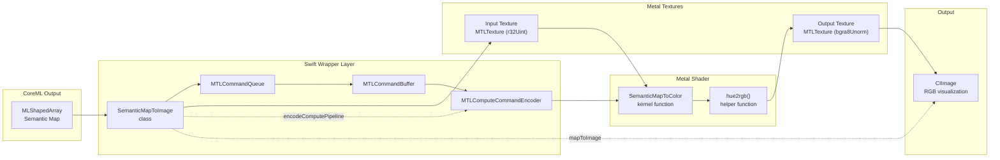
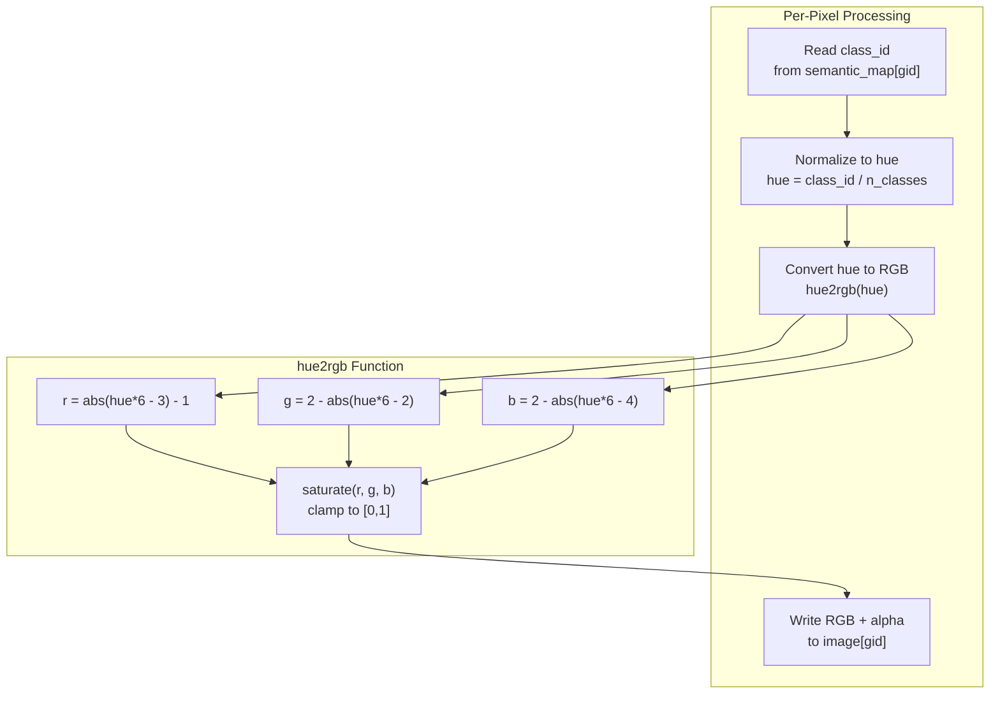
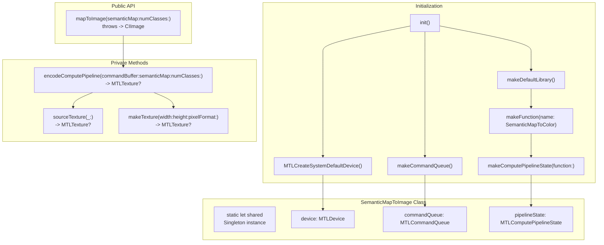
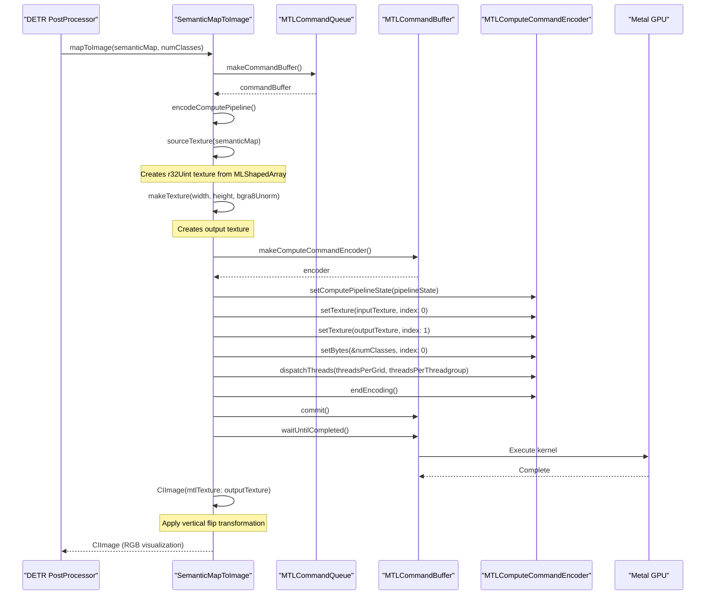

<!-- source: DeepWiki mcp.deepwiki.com · repo huggingface/coreml-examples · page 8 Metal Shaders · fetched 2026-10-26 -->

# Metal Shaders

<details>
<summary>Relevant source files</summary>

The following files were used as context for generating this wiki page:

- [SemanticSegmentationSample/Common/SemanticMapToColor.metal](SemanticSegmentationSample/Common/SemanticMapToColor.metal)
- [SemanticSegmentationSample/Common/SemanticMapToImage.swift](SemanticSegmentationSample/Common/SemanticMapToImage.swift)

</details>


This document describes the Metal compute shaders used for GPU-accelerated processing in the CoreML Examples repository. Currently, the repository contains one Metal shader implementation used in the DETR Semantic Segmentation sample for converting semantic class maps into RGB color visualizations.

For information about the DETR semantic segmentation application architecture, see [DETR Semantic Segmentation](#3.3). For details on real-time inference patterns, see [Real-Time Inference Pattern](#6.1).

## Purpose and Scope

The Metal shaders in this repository provide GPU-accelerated post-processing of CoreML model outputs. The primary use case is converting the DETR model's semantic segmentation output (a 2D array of class indices) into a human-readable color-coded visualization. This conversion must happen efficiently at frame rates suitable for real-time camera processing, making Metal compute shaders an ideal solution.

**Sources:** [SemanticSegmentationSample/Common/SemanticMapToColor.metal:1-20](), [SemanticSegmentationSample/Common/SemanticMapToImage.swift:1-100]()

## System Architecture

The Metal shader system consists of two primary components:

| Component | File | Purpose |
|-----------|------|---------|
| Metal Kernel | `SemanticMapToColor.metal` | GPU compute shader that performs parallel color mapping |
| Swift Wrapper | `SemanticMapToImage.swift` | Manages Metal device, pipeline state, and command execution |

**Metal Pipeline Data Flow**



**Sources:** [SemanticSegmentationSample/Common/SemanticMapToColor.metal:1-20](), [SemanticSegmentationSample/Common/SemanticMapToImage.swift:1-100]()

## SemanticMapToColor Kernel

The `SemanticMapToColor` kernel is a Metal compute shader that converts semantic class indices to RGB colors using a hue-based color scheme.

### Kernel Function Signature

The kernel function is defined in [SemanticMapToColor.metal:11-19]() with the following parameters:

| Parameter | Type | Access | Purpose |
|-----------|------|--------|---------|
| `semantic_map` | `texture2d<uint, access::read>` | `texture(0)` | Input texture containing class indices (0 to n_classes) |
| `image` | `texture2d<float, access::write>` | `texture(1)` | Output texture for RGB color values |
| `n_classes` | `const device uint&` | `buffer(0)` | Total number of semantic classes for normalization |
| `gid` | `uint2` | `thread_position_in_grid` | Thread position identifying the pixel to process |

**Sources:** [SemanticMapToColor.metal:11-14]()

### Color Conversion Algorithm

**Color Mapping Process**



**Sources:** [SemanticMapToColor.metal:11-19](), [SemanticMapToColor.metal:4-9]()

The conversion follows these steps:

1. **Read Class Index** [SemanticMapToColor.metal:15](): Extract the class ID from the input semantic map texture
2. **Normalize to Hue** [SemanticMapToColor.metal:16](): Convert class index to hue value in range [0, 1]
3. **Hue to RGB Conversion** [SemanticMapToColor.metal:4-9](): Use the `hue2rgb()` helper function to convert hue to RGB components
4. **Write Output** [SemanticMapToColor.metal:18](): Write the RGB color with full opacity (alpha = 1.0) to the output texture

### hue2rgb Helper Function

The `hue2rgb()` function [SemanticMapToColor.metal:4-9]() implements a standard HSV-to-RGB conversion for fully saturated colors (saturation = 1.0, value = 1.0):

```
r = saturate(|hue * 6.0 - 3.0| - 1.0)
g = saturate(2.0 - |hue * 6.0 - 2.0|)
b = saturate(2.0 - |hue * 6.0 - 4.0|)
```

This formula distributes classes evenly across the color spectrum, with class 0 mapping to red and higher classes cycling through the full hue range.

**Sources:** [SemanticMapToColor.metal:4-9]()

## Swift Integration Layer

The `SemanticMapToImage` class [SemanticMapToImage.swift:6-99]() provides the Swift interface for executing the Metal shader.

### Initialization and Setup

**SemanticMapToImage Class Structure**



**Sources:** [SemanticMapToImage.swift:6-38]()

The initialization process [SemanticMapToImage.swift:19-38]():

1. Creates the system default Metal device
2. Creates a command queue for submitting GPU work
3. Loads the default Metal library containing compiled shaders
4. Retrieves the `SemanticMapToColor` kernel function by name
5. Creates a compute pipeline state from the kernel function

The class uses a singleton pattern with `shared` property [SemanticMapToImage.swift:11]() for convenient access throughout the DETR sample.

**Sources:** [SemanticMapToImage.swift:19-38]()

### Execution Pipeline

The `mapToImage(semanticMap:numClasses:)` method [SemanticMapToImage.swift:40-57]() orchestrates the complete conversion process:

**Metal Command Execution Flow**



**Sources:** [SemanticMapToImage.swift:40-57](), [SemanticMapToImage.swift:59-83]()

### Texture Management

The wrapper manages two types of Metal textures:

**Input Texture Creation** [SemanticMapToImage.swift:85-92]():

- **Pixel Format**: `r32Uint` (32-bit unsigned integer, single channel)
- **Data Source**: `MLShapedArray<Int32>` converted to `MLMultiArray`
- **Population**: Uses `replace(region:mipmapLevel:withBytes:bytesPerRow:)` to copy class indices

**Output Texture Creation** [SemanticMapToImage.swift:94-98]():

- **Pixel Format**: `bgra8Unorm` (8-bit per channel RGBA, normalized to [0, 1])
- **Usage**: `.shaderRead` and `.shaderWrite` for GPU access
- **Purpose**: Stores the final RGB color visualization

**Sources:** [SemanticMapToImage.swift:85-98]()

### Thread Group Configuration

The compute pipeline dispatch configuration [SemanticMapToImage.swift:73-79]() optimizes GPU execution:

```
threadExecutionWidth = pipelineState.threadExecutionWidth
maxThreadsPerThreadgroup = pipelineState.maxTotalThreadsPerThreadgroup
threadsPerThreadgroup = (width: w, height: h, depth: 1)
threadsPerGrid = (width: textureWidth, height: textureHeight, depth: 1)
```

This configuration:
- Uses the pipeline state's recommended thread execution width for optimal GPU utilization
- Calculates thread group height based on maximum threads per threadgroup
- Dispatches exactly one thread per pixel in the semantic map

**Sources:** [SemanticMapToImage.swift:73-79]()

## Integration with DETR Sample

The Metal shader is invoked as part of the DETR semantic segmentation post-processing pipeline:

**DETR Post-Processing Pipeline**

```mermaid
graph LR
    subgraph "Model Output"
        DETR["DETRResnet50F16<br/>logits output"]
        ARGMAX["argmax operation<br/>class per pixel"]
        SHAPED["MLShapedArray<Int32><br/>semantic map"]
    end
    
    subgraph "Metal Processing"
        WRAPPER["SemanticMapToImage.shared"]
        KERNEL["SemanticMapToColor kernel"]
        CI_OUT["CIImage<br/>RGB visualization"]
    end
    
    subgraph "Display"
        RESIZE["Resize to camera size"]
        OVERLAY["Alpha blend with camera"]
        VIEW["SegmentationView"]
    end
    
    DETR --> ARGMAX
    ARGMAX --> SHAPED
    SHAPED --> WRAPPER
    WRAPPER --> KERNEL
    KERNEL --> CI_OUT
    CI_OUT --> RESIZE
    RESIZE --> OVERLAY
    OVERLAY --> VIEW
```



**Sources:** [SemanticMapToImage.swift:40-57]()

The Metal shader enables real-time visualization of semantic segmentation results by:

1. **Efficiency**: GPU-parallel execution processes entire semantic maps in milliseconds
2. **Simplicity**: Encapsulates complex color mapping logic in a reusable shader
3. **Quality**: Produces smooth color gradients across the full spectrum for clear class differentiation

For the complete DETR sample implementation including this Metal processing, see [DETR Semantic Segmentation](#3.3).

**Sources:** [SemanticMapToColor.metal:1-20](), [SemanticMapToImage.swift:1-100]()

## Error Handling

The `SemanticMapToImage` class defines custom errors [SemanticMapToImage.swift:13-17]():

| Error | Thrown When |
|-------|-------------|
| `MetalConversionError.commandBufferError` | Failed to create MTLCommandBuffer |
| `MetalConversionError.encoderError` | Failed to encode compute pipeline or create output texture |
| `MetalConversionError.coreImageError` | Failed to create CIImage from Metal texture |

These errors are propagated to the caller, allowing the DETR sample to handle Metal processing failures gracefully.

**Sources:** [SemanticMapToImage.swift:13-17](), [SemanticMapToImage.swift:40-57]()

## Performance Considerations

The Metal shader implementation provides several performance advantages:

1. **Parallel Execution**: Each pixel's color conversion happens independently on the GPU, maximizing throughput
2. **Minimal CPU Involvement**: After encoding the command buffer, the CPU is free to perform other work
3. **Texture-Based I/O**: Direct texture operations avoid expensive buffer copies
4. **Synchronous Waiting**: `waitUntilCompleted()` [SemanticMapToImage.swift:49]() ensures the output texture is ready before creating the CIImage

For typical semantic maps (e.g., 512×512 pixels), the GPU can process the entire conversion in under 1 millisecond, making it suitable for real-time camera-based applications.

**Sources:** [SemanticMapToImage.swift:40-57](), [SemanticMapToColor.metal:11-19]()