# Page: Overview

# Overview

<details>
<summary>Relevant source files</summary>

The following files were used as context for generating this wiki page:

- [README.md](README.md)
- [depth-anything-example/README.md](depth-anything-example/README.md)

</details>


This document provides a high-level introduction to the CoreML Examples repository, explaining its purpose as a showcase for optimized CoreML models running on Apple Neural Engine, and describing the three demo applications, model conversion pipeline, and shared infrastructure components.

For detailed setup instructions, see [Getting Started](#2). For in-depth coverage of individual demo applications, see [Demo Applications](#3). For model conversion procedures, see [Model Conversion Pipeline](#4).

## Purpose

The CoreML Examples repository serves as a collection of production-ready iOS sample applications demonstrating how to integrate optimized CoreML models for real-time on-device inference. The repository focuses on three machine learning tasks:

- **Image Classification** - Using FastViT models
- **Monocular Depth Estimation** - Using Depth Anything V2
- **Semantic Segmentation** - Using DETR with ResNet-50 backbone

All models are converted from PyTorch to CoreML format with optimizations specifically targeting the Apple Neural Engine (ANE), including Float16 conversion and palettization techniques. The repository also provides tutorials demonstrating the conversion process.

Sources: [README.md:1-31]()

## Repository Structure

The repository is organized into three independent demo applications, shared infrastructure, and model conversion tutorials:

```
coreml-examples/
├── FastViTSample/              # Image classification demo
│   ├── FastViTSample.xcodeproj
│   ├── FastViTApp/
│   │   ├── FastViTApp.swift
│   │   ├── DataModel.swift
│   │   ├── Camera.swift
│   │   └── models/            # FastViT .mlpackage files
│   └── README.md
├── depth-anything-example/     # Depth estimation demo
│   ├── DepthSample.xcodeproj
│   ├── DepthApp/
│   │   ├── DepthApp.swift
│   │   ├── DataModel.swift
│   │   ├── Camera.swift
│   │   └── models/            # Depth Anything .mlpackage
│   ├── DepthEstimationCLI/    # Command-line tool
│   └── README.md
├── SemanticSegmentationSample/ # Semantic segmentation demo
│   ├── SemanticSegmentationSample.xcodeproj
│   ├── SemanticSegmentationApp/
│   │   ├── SemanticSegmentationApp.swift
│   │   ├── DataModel.swift
│   │   ├── Camera.swift
│   │   ├── Shaders/           # Metal shaders
│   │   └── models/            # DETR .mlpackage
│   ├── SemanticSegmentationCLI/
│   └── README.md
└── tutorials/
    └── depth-anything-coreml-guide.ipynb
```

Each demo application is a complete, self-contained Xcode project that can be built and run independently.

Sources: [README.md:1-31](), [depth-anything-example/README.md:1-46]()

## System Architecture Overview

The following diagram shows the complete system architecture, from model sources to deployed iOS applications:

**Diagram: End-to-End System Architecture**

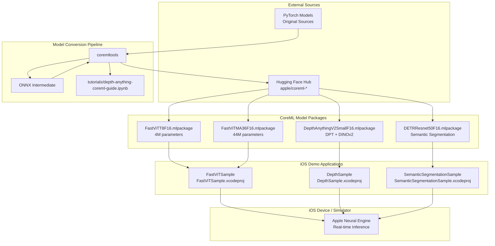

Sources: [README.md:1-31](), High-level system architecture diagrams (Diagram 1)

## Demo Applications

The repository includes three demo applications, each showcasing a different machine learning task:

| Application | Task | Model Architecture | Parameters | Hugging Face Hub |
|-------------|------|-------------------|------------|------------------|
| **FastViTSample** | Image Classification | FastViT (T8 & MA36 variants) | 4M / 44M | [apple/coreml-FastViT-T8](https://huggingface.co/apple/coreml-FastViT-T8)<br/>[apple/coreml-FastViT-MA36](https://huggingface.co/apple/coreml-FastViT-MA36) |
| **DepthSample** | Monocular Depth Estimation | Depth Anything V2 Small<br/>DPT + DINOv2 backbone | ~25M | [apple/coreml-depth-anything-v2-small](https://huggingface.co/apple/coreml-depth-anything-v2-small) |
| **SemanticSegmentationSample** | Semantic Segmentation | DETR ResNet-50 | ~41M | [apple/coreml-detr-semantic-segmentation](https://huggingface.co/apple/coreml-detr-semantic-segmentation) |

All applications provide real-time inference using the device camera, with frame-by-frame processing optimized for the Apple Neural Engine.

Sources: [README.md:11-18](), [depth-anything-example/README.md:1-46]()

## Core Components and File Organization

Each demo application follows a consistent architecture pattern with shared components. The following diagram maps system components to specific code entities:

**Diagram: Component-to-Code Entity Mapping**

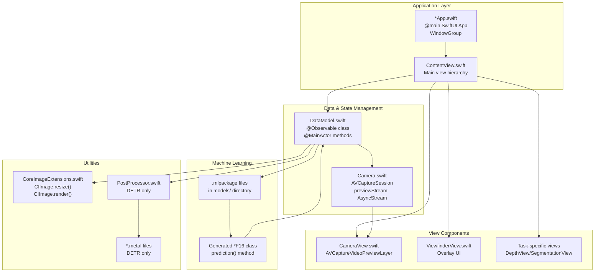

Sources: High-level system architecture diagrams (Diagram 3, Diagram 6)

### Key Code Entities

**Application Entry Points:**
- `FastViTApp.swift` - FastViT sample app entry
- `DepthApp.swift` - Depth Anything sample app entry
- `SemanticSegmentationApp.swift` - DETR sample app entry

**Data Models (Task-Specific):**
- `FastViTApp/DataModel.swift` - Manages FastViT inference and classification results
- `DepthApp/DataModel.swift` - Manages Depth Anything inference and depth map generation
- `SemanticSegmentationApp/DataModel.swift` - Manages DETR inference and segmentation output

**Shared Infrastructure:**
- `Camera.swift` - AVFoundation camera management (identical across all three apps)
- `CameraView.swift` - SwiftUI camera preview view (shared pattern)
- `ViewfinderView.swift` - Camera overlay UI (shared pattern)
- `CoreImageExtensions.swift` - Image processing utilities (shared pattern)

**CoreML Model Packages:**
- `FastViTT8F16.mlpackage` - 4M parameter image classifier
- `FastViTMA36F16.mlpackage` - 44M parameter image classifier
- `DepthAnythingV2SmallF16.mlpackage` - Depth estimation model
- `DETRResnet50F16.mlpackage` - Semantic segmentation model

Sources: [README.md:1-31](), [depth-anything-example/README.md:1-46](), High-level system architecture diagrams (Diagram 6)

## Model Conversion and Optimization

The repository demonstrates the PyTorch-to-CoreML conversion pipeline using `coremltools`. The conversion process includes several optimization steps:

**Diagram: Model Conversion Workflow**

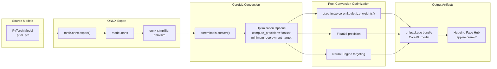

### Optimization Techniques

| Technique | Purpose | Impact |
|-----------|---------|--------|
| **Float16 Conversion** | Reduce model size and memory usage | ~50% size reduction, ANE compatible |
| **Palettization** | Weight quantization using lookup tables | Further size reduction, minimal accuracy loss |
| **Neural Engine Targeting** | Ensure operations run on ANE | Faster inference, lower power consumption |
| **ONNX Simplification** | Remove redundant operations | Simpler graph, better conversion |

The repository includes a complete tutorial demonstrating this process: `tutorials/depth-anything-coreml-guide.ipynb`.

Sources: [README.md:20-26](), [depth-anything-example/README.md:5](), High-level system architecture diagrams (Diagram 4)

## Model Acquisition Workflow

Models are distributed via Hugging Face Hub and can be downloaded using the `huggingface-cli` tool:

```bash
# Install CLI tool
brew install huggingface-cli

# Download a specific model package
huggingface-cli download \
  --local-dir models --local-dir-use-symlinks False \
  apple/coreml-depth-anything-v2-small \
  --include "DepthAnythingV2SmallF16.mlpackage/*"
```

The downloaded `.mlpackage` files should be placed in the respective `models/` directory of each demo application:

- `FastViTSample/FastViTApp/models/`
- `depth-anything-example/DepthApp/models/`
- `SemanticSegmentationSample/SemanticSegmentationApp/models/`

Sources: [depth-anything-example/README.md:28-46]()

## Common Architecture Pattern

All three demo applications follow the same architectural pattern:

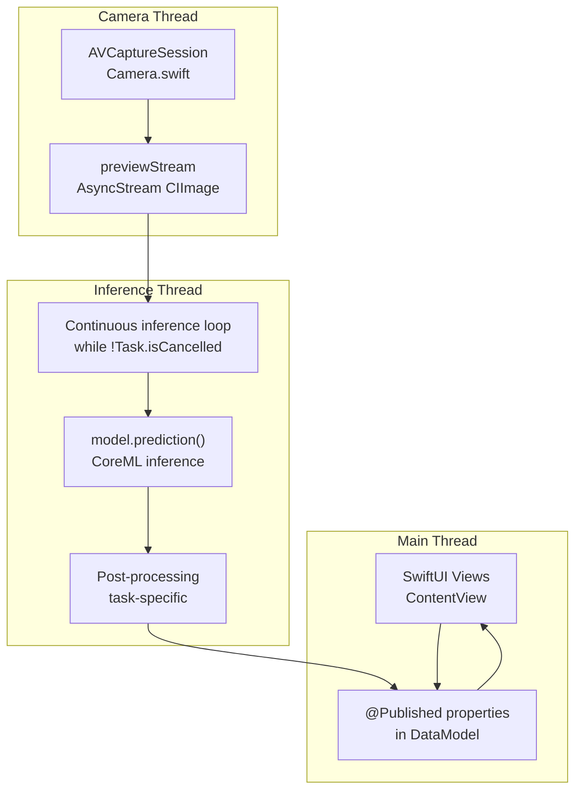

### Key Architectural Features

1. **Three-Thread Architecture**: Separation of UI updates (main thread), camera capture (camera thread), and ML inference (background thread)
2. **Async/Await Concurrency**: Uses Swift's modern concurrency features throughout
3. **Observable State**: DataModel classes use `@Observable` macro for reactive UI updates
4. **Real-Time Processing**: Continuous inference loop processes camera frames as they arrive
5. **Thread-Safe Communication**: Proper synchronization between threads using locks and MainActor

For detailed implementation of this pattern, see [Real-Time Inference Pattern](#6.1) and [Threading & Concurrency](#6.2).

Sources: High-level system architecture diagrams (Diagram 3, Diagram 5)

## Additional Resources

The repository provides several additional resources beyond the demo applications:

- **Jupyter Notebook Tutorial**: `tutorials/depth-anything-coreml-guide.ipynb` - Step-by-step guide for converting Depth Anything V2 from PyTorch to CoreML
- **Command-Line Tools**: Batch processing utilities for Depth Anything (`DepthEstimationCLI`) and DETR (`SemanticSegmentationCLI`)
- **README Documentation**: Each demo application includes a comprehensive README explaining model architecture, usage, and download instructions

For CLI tool documentation, see [Command-Line Tools](#7). For conversion tutorials, see [Model Conversion Pipeline](#4).

Sources: [README.md:22-26](), [depth-anything-example/README.md:1-46]()

---

# Page: Getting Started

# Getting Started

<details>
<summary>Relevant source files</summary>

The following files were used as context for generating this wiki page:

- [FastViTSample/README.md](FastViTSample/README.md)
- [README.md](README.md)
- [depth-anything-example/README.md](depth-anything-example/README.md)

</details>


This guide walks you through setting up the CoreML Examples repository, downloading pre-optimized models from Hugging Face Hub, and running your first demo application. By the end of this guide, you will have a working iOS app performing real-time inference using CoreML models optimized for Apple Neural Engine.

For detailed information about individual demo applications, see [Demo Applications](#3). For model conversion workflows, see [Model Conversion Pipeline](#4).

---

## Prerequisites

The following software and hardware requirements must be met before proceeding:

| Requirement | Version/Specification | Notes |
|------------|----------------------|-------|
| **macOS** | 12.0 or later | Required for Xcode |
| **Xcode** | 14.0 or later | Download from Mac App Store |
| **iOS Device/Simulator** | iOS 15.0 or later | Physical device recommended for Neural Engine execution |
| **Homebrew** | Latest | Package manager for macOS |
| **Command Line Tools** | Latest | Installed with Xcode |

**Sources:** [README.md:1-31](), [depth-anything-example/README.md:1-46]()

---

## Setup Workflow

The complete setup process consists of four phases: repository acquisition, CLI tool installation, model download, and project execution.

### Phase Overview

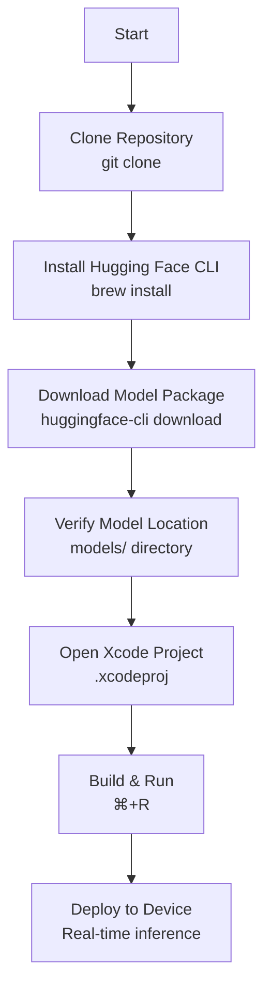

**Sources:** [README.md:1-31](), [depth-anything-example/README.md:7-11](), [FastViTSample/README.md:6-9]()

---

## Step 1: Clone the Repository

Clone the repository to your local machine:

```bash
git clone https://github.com/huggingface/coreml-examples.git
cd coreml-examples
```

### Repository Structure

The repository contains three independent demo applications, each in its own directory:

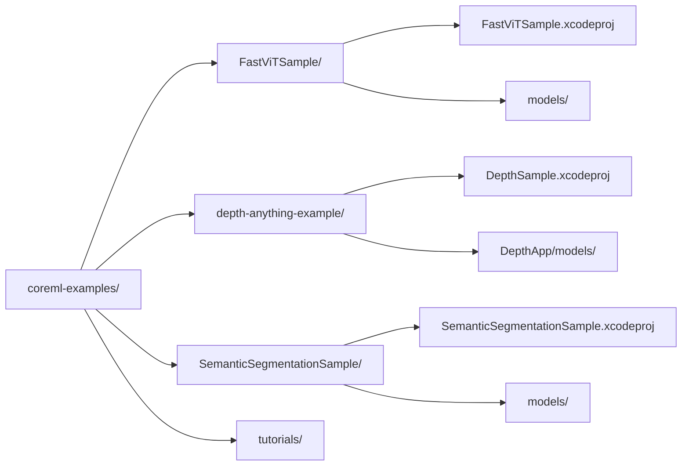

**Sources:** [README.md:5-18](), [depth-anything-example/README.md:9](), [FastViTSample/README.md:7]()

---

## Step 2: Install Hugging Face CLI

The `huggingface-cli` tool enables model package downloads from Hugging Face Hub. Install it using Homebrew:

```bash
brew install huggingface-cli
```

Verify installation:

```bash
huggingface-cli --version
```

**Sources:** [depth-anything-example/README.md:30-34](), [FastViTSample/README.md:19-23]()

---

## Step 3: Download Model Packages

Each demo application requires one or more `.mlpackage` files downloaded from Hugging Face Hub. The packages must be placed in the correct `models/` directory for each project.

### Available Models

| Demo App | Model Repository | Package Name | Size | Task |
|----------|-----------------|--------------|------|------|
| **FastViT** | `apple/coreml-FastViT-T8` | `FastViTT8F16.mlpackage` | ~4M params | Image Classification |
| **FastViT** | `apple/coreml-FastViT-MA36` | `FastViTMA36F16.mlpackage` | ~44M params | Image Classification |
| **Depth Anything** | `apple/coreml-depth-anything-v2-small` | `DepthAnythingV2SmallF16.mlpackage` | Small variant | Depth Estimation |
| **DETR** | `apple/coreml-detr-semantic-segmentation` | `DETRResnet50F16.mlpackage` | ResNet-50 | Semantic Segmentation |

**Sources:** [README.md:13-17]()

### Download Example: FastViT

To run the FastViT sample app, download the `FastViTT8F16.mlpackage`:

```bash
cd FastViTSample
huggingface-cli download \
  --local-dir models --local-dir-use-symlinks False \
  apple/coreml-FastViT-T8 \
  --include "FastViTT8F16.mlpackage/*"
```

This command downloads the model package directly into `FastViTSample/models/` without creating symbolic links.

**Sources:** [FastViTSample/README.md:25-32]()

### Download Example: Depth Anything

For the Depth Anything demo:

```bash
cd depth-anything-example
huggingface-cli download \
  --local-dir models --local-dir-use-symlinks False \
  apple/coreml-depth-anything-v2-small \
  --include "DepthAnythingV2SmallF16.mlpackage/*"
```

The model package is placed in `depth-anything-example/models/`, which the Xcode project references as `DepthApp/models/`.

**Sources:** [depth-anything-example/README.md:36-43]()

### Model Download Workflow

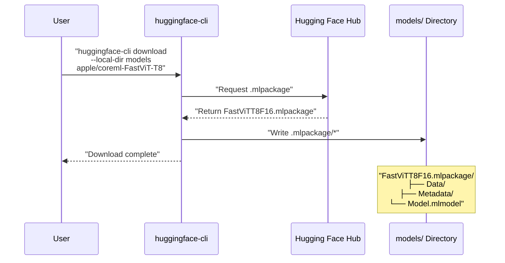

**Sources:** [README.md:13-17](), [depth-anything-example/README.md:36-43](), [FastViTSample/README.md:25-32]()

---

## Step 4: Open and Configure Xcode Project

Each demo application includes an `.xcodeproj` file that references the downloaded model package.

### Opening the Project

Navigate to the demo directory and open the Xcode project:

```bash
cd FastViTSample
open FastViTSample.xcodeproj
```

Or for Depth Anything:

```bash
cd depth-anything-example
open DepthSample.xcodeproj
```

### Project Configuration

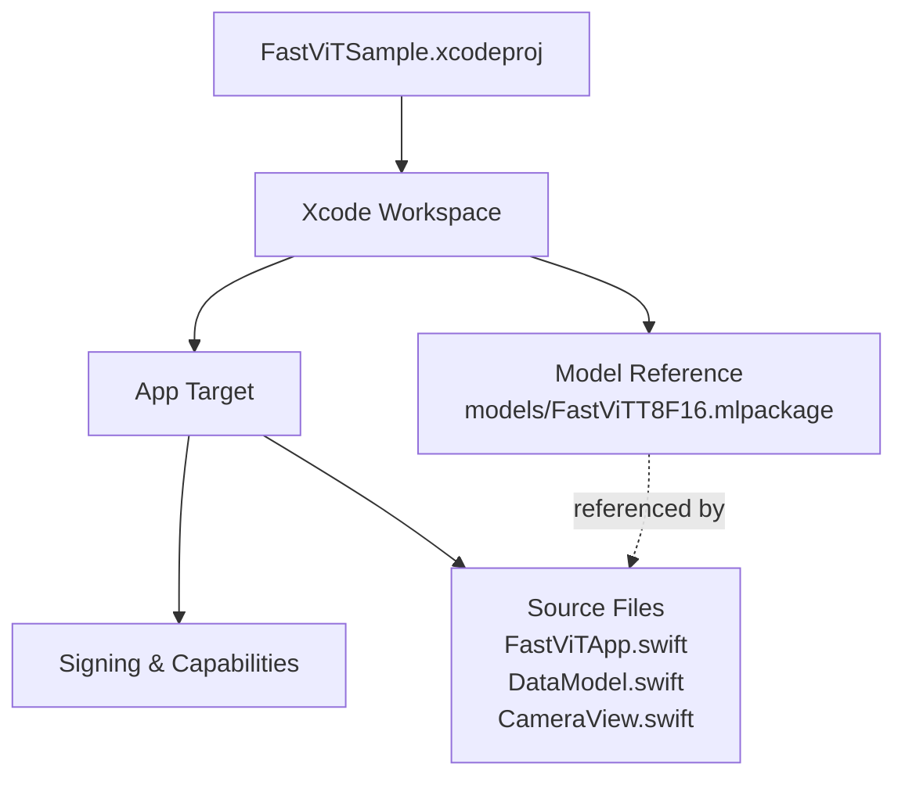

No additional configuration is required if the model package is in the correct `models/` directory. The Xcode project includes references to the `.mlpackage` files, which are automatically compiled during the build process.

**Sources:** [FastViTSample/README.md:8-9](), [depth-anything-example/README.md:10-11]()

---

## Step 5: Build and Run

### Build Configuration

Select your target device or simulator from the Xcode toolbar:

1. Click the device selector next to the scheme selector
2. Choose your connected iOS device or simulator
3. Ensure the scheme is set to the app target (e.g., `FastViTSample`)

### Building the App

Build and run using one of these methods:

- Press `⌘+R` (Command + R)
- Select **Product → Run** from the menu
- Click the **Play** button in the toolbar

### First Launch

On first launch, the app will request camera permissions. Grant access to enable real-time inference from the camera feed.

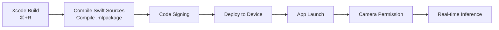

**Sources:** [FastViTSample/README.md:9](), [depth-anything-example/README.md:11]()

---

## Verification

### Confirming Successful Setup

After launching the app, you should observe:

1. **Camera Feed**: Live video preview from device camera
2. **Real-time Inference**: Model predictions updated continuously
3. **Performance Metrics**: Inference time displayed (typically < 50ms on device)

### Demo-Specific Outputs

| Demo App | Expected Output | Visual Indicator |
|----------|----------------|------------------|
| **FastViT** | Top-3 class predictions with probabilities | Text labels overlay on camera feed |
| **Depth Anything** | Depth map visualization | Grayscale depth overlay on camera feed |
| **DETR** | Semantic segmentation mask | Colored class overlay on camera feed |

**Sources:** [README.md:7-17]()

---

## Model Package Structure

All `.mlpackage` files follow the same directory structure recognized by CoreML:

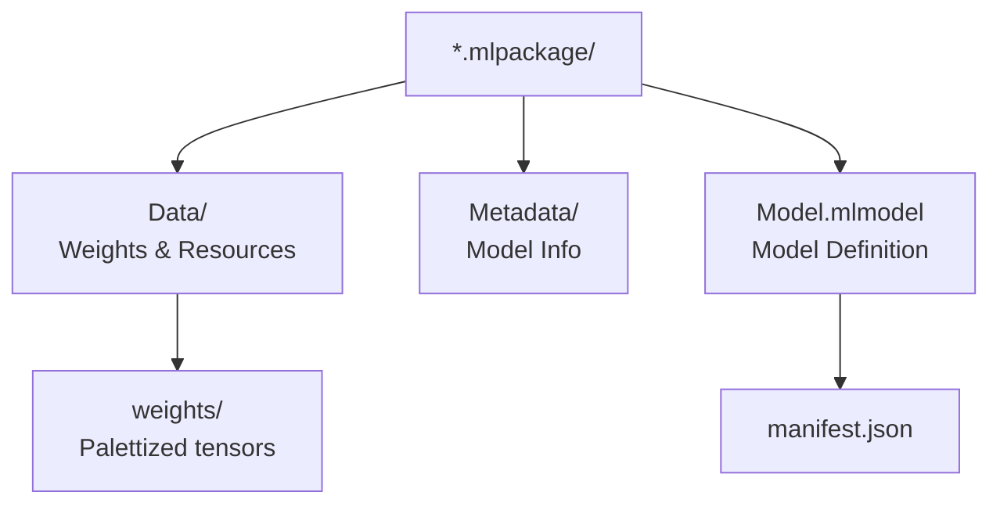

The `.mlpackage` format is a directory bundle containing:

- **Data/**: Model weights and additional resources
- **Metadata/**: Model metadata and documentation
- **Model.mlmodel**: CoreML model definition with input/output specifications

Xcode automatically processes these packages during build, generating Swift classes for model interaction.

**Sources:** [README.md:20](), [depth-anything-example/README.md:5]()

---

## Troubleshooting Common Issues

### Model Package Not Found

**Symptom**: Build error stating model file cannot be found.

**Solution**: Verify the model package is in the correct directory:

```bash
# For FastViT
ls -la FastViTSample/models/FastViTT8F16.mlpackage

# For Depth Anything
ls -la depth-anything-example/models/DepthAnythingV2SmallF16.mlpackage
```

If missing, re-run the `huggingface-cli download` command.

**Sources:** [depth-anything-example/README.md:9](), [FastViTSample/README.md:7]()

### Camera Permission Denied

**Symptom**: Black camera feed or permission alert on launch.

**Solution**: 
1. Open **Settings → Privacy & Security → Camera**
2. Enable camera access for the demo app
3. Restart the app

### Slow Inference Performance

**Symptom**: Inference time > 100ms per frame.

**Solution**: 
- Ensure running on physical device (not simulator)
- Verify Neural Engine availability on device (iPhone 8 or later)
- Check that Float16 model variant is used (F16 suffix in package name)

---

## Next Steps

After successfully running your first demo app, explore:

- **[Demo Applications](#3)**: Deep dive into each demo's architecture and ML task
- **[Model Conversion Pipeline](#4)**: Learn to convert your own PyTorch models to CoreML
- **[Shared Infrastructure](#5)**: Understand reusable components across all demos
- **[Real-Time Inference Pattern](#6.1)**: Study the threading and concurrency architecture

Each demo app follows the same architectural pattern but demonstrates different ML tasks. Start with FastViT for the simplest example, then progress to Depth Anything and DETR for more complex post-processing pipelines.

**Sources:** [README.md:1-31](), [depth-anything-example/README.md:1-46](), [FastViTSample/README.md:1-35]()

---

# Page: Demo Applications

# Demo Applications

<details>
<summary>Relevant source files</summary>

The following files were used as context for generating this wiki page:

- [README.md](README.md)
- [depth-anything-example/README.md](depth-anything-example/README.md)

</details>


## Purpose and Scope

This page provides an overview of the three demo applications included in the repository, their machine learning tasks, and the common architectural patterns they share. Each demo application is a complete, self-contained iOS app that demonstrates CoreML integration with real-time inference on Apple Neural Engine.

For detailed information about individual applications, see:
- [FastViT Image Classification](#3.1) - classification pipeline and model variants
- [Depth Anything Depth Estimation](#3.2) - depth estimation and visualization
- [DETR Semantic Segmentation](#3.3) - segmentation and Metal shader processing

For information about the shared infrastructure components used across all demos, see [Shared Infrastructure](#5).

**Sources:** [README.md:1-31](), [depth-anything-example/README.md:1-46]()

## Application Overview

The repository contains three demo applications showcasing different computer vision tasks. Each application follows the same acquisition and integration workflow but implements task-specific models and post-processing.

| Application | Task | CoreML Models | Location |
|------------|------|---------------|----------|
| **FastViT Sample** | Image Classification | `FastViTT8F16.mlpackage`<br/>`FastViTMA36F16.mlpackage` | `FastViTSample/` |
| **Depth Anything Sample** | Monocular Depth Estimation | `DepthAnythingV2SmallF16.mlpackage` | `depth-anything-example/` |
| **DETR Sample** | Semantic Segmentation | `DETRResnet50F16.mlpackage` | `SemanticSegmentationSample/` |

All models are pre-converted to CoreML with Neural Engine optimizations (Float16 precision, palettization) and distributed via Hugging Face Hub under the `apple/` organization namespace.

**Sources:** [README.md:11-18]()

## Common Architectural Pattern

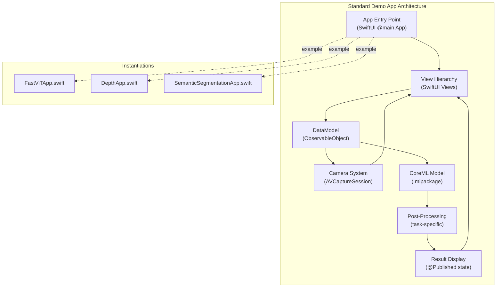

**Standard Architecture Pattern**

Each demo application follows this consistent structure:

1. **App Entry Point** - SwiftUI `@main` App struct that defines the root view
2. **View Hierarchy** - SwiftUI views including `CameraView`, `ViewfinderView`, and task-specific result views
3. **DataModel** - `ObservableObject` that owns the `Camera`, loads the CoreML model, manages inference loop
4. **Camera System** - Shared `Camera.swift` providing `AVCaptureSession` management and frame stream
5. **CoreML Model** - Task-specific `.mlpackage` loaded via generated Swift class
6. **Post-Processing** - Task-specific result formatting (classifications, depth maps, segmentation masks)
7. **Result Display** - Updates published via `@Published` properties on `DataModel`

**Sources:** [README.md:5-18]()

## Shared Infrastructure Components

All three applications reuse the following infrastructure:

### Camera Management

- **File:** `Camera.swift` (present in each app directory)
- **Functionality:** 
  - `AVCaptureSession` lifecycle management
  - Camera authorization handling
  - Device selection (front/back camera)
  - Rotation coordination
  - Async `previewStream` of `CIImage` frames

### Image Processing

- **File:** `CoreImageExtensions.swift` (present in each app directory)
- **Functionality:**
  - `resize(to:)` - proportional image resizing
  - `withAdjustedAlpha(_:)` - alpha channel manipulation
  - `renderToPixelBuffer(pixelBuffer:context:)` - CoreImage to CVPixelBuffer
  - `savePNG(to:)` - PNG export utility

### SwiftUI Views

- **CameraView** - Live camera feed display
- **ViewfinderView** - Camera preview overlay with aspect ratio handling

These components are duplicated in each app directory rather than extracted to a shared framework, making each demo self-contained and independently buildable.

**Sources:** [README.md:1-31]()

## Model Acquisition Workflow

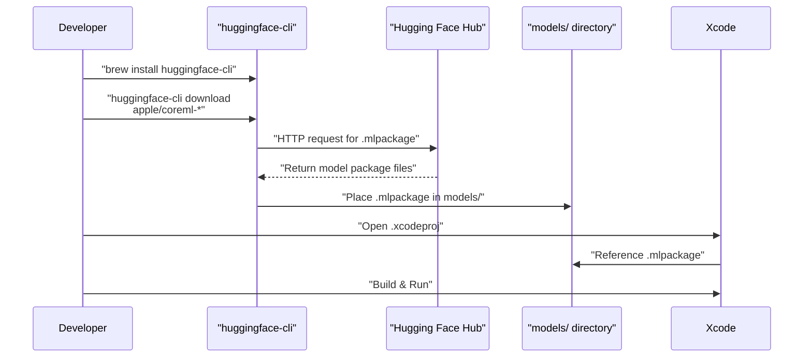

**Standard Model Acquisition Steps**

All applications follow the same acquisition workflow:

1. **Install CLI tool:** `brew install huggingface-cli`
2. **Download model package:** Run `huggingface-cli download` with organization `apple/` and model name
3. **Place in models directory:** Package goes in `<AppDirectory>/models/` folder
4. **Open project:** Open the `.xcodeproj` file in Xcode
5. **Build:** Xcode automatically includes `.mlpackage` in bundle

Model packages are located at:
- FastViT: [apple/coreml-FastViT-T8](https://huggingface.co/apple/coreml-FastViT-T8), [apple/coreml-FastViT-MA36](https://huggingface.co/apple/coreml-FastViT-MA36)
- Depth Anything: [apple/coreml-depth-anything-v2-small](https://huggingface.co/apple/coreml-depth-anything-v2-small)
- DETR: [apple/coreml-detr-semantic-segmentation](https://huggingface.co/apple/coreml-detr-semantic-segmentation)

**Sources:** [README.md:13-18](), [depth-anything-example/README.md:26-46]()

## Application-Specific Differences

While sharing common infrastructure, each application has task-specific components:

### FastViT Sample

**Task:** Image Classification

**Key Components:**
- `DataModel.swift` - manages either `FastViTT8F16` or `FastViTMA36F16` model
- `PredictionResult` struct - contains label and probability
- Top-3 classification display

**Output:** Array of `(label: String, probability: Float)` tuples

**Model Variants:** 
- T8: 4M parameters, faster inference
- MA36: 44M parameters, higher accuracy

### Depth Anything Sample

**Task:** Monocular Depth Estimation

**Key Components:**
- `DataModel.swift` - manages `DepthAnythingV2SmallF16` model
- `DepthView.swift` - depth map visualization with colorization
- CLI tool (`depth-anything-cli`) for batch processing
- Async inference loop with thread-safe image sharing via `OSAllocatedUnfairLock`

**Output:** Single-channel depth map resized to original image dimensions

**Architecture:** DPT (Dense Prediction Transformer) with DINOv2 backbone

### DETR Sample

**Task:** Semantic Segmentation

**Key Components:**
- `DataModel.swift` + `PostProcessor` - manages `DETRResnet50F16` and result processing
- `SemanticMapToColor.metal` - Metal compute shader for semantic class colorization
- `SegmentationView.swift` - overlay rendering with alpha blending
- CLI tool (`semantic-segmentation-cli`) for batch processing

**Output:** Multi-class segmentation mask with 133 COCO-Stuff semantic classes

**Post-Processing:** Argmax over class logits, Metal shader maps class IDs to colors

**Sources:** [README.md:11-18](), [depth-anything-example/README.md:1-46]()

## Directory Structure

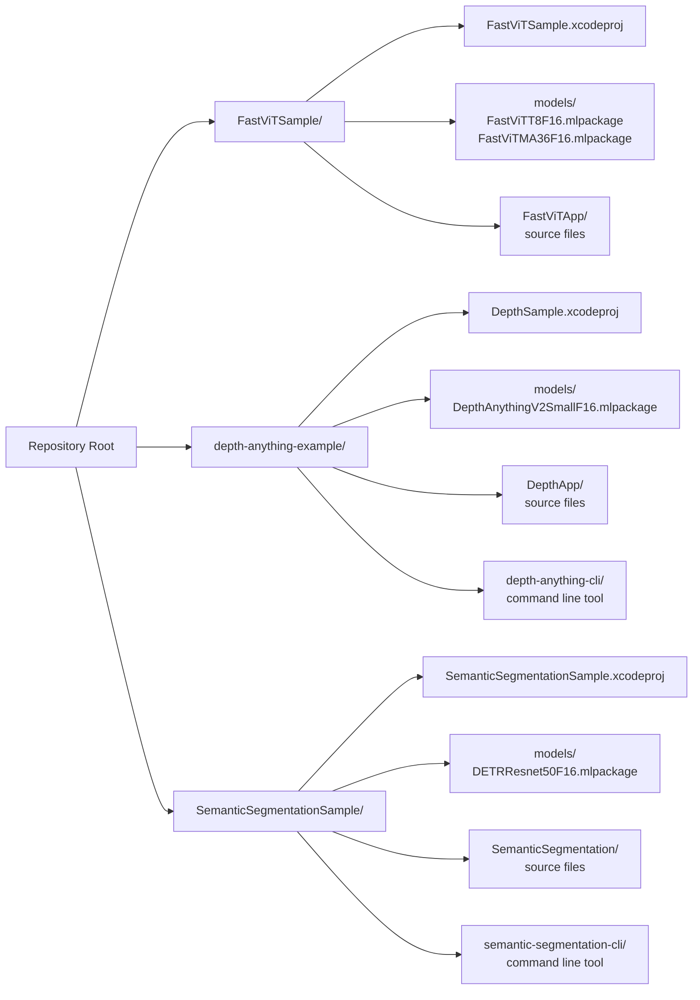

**Directory Organization**

Each demo application is organized as a self-contained directory:

- **Xcode project file** (`.xcodeproj`) at the root of each directory
- **models/** subdirectory for `.mlpackage` files (user must download these)
- **App source directory** containing Swift source files
- **README.md** with app-specific setup instructions
- **CLI tools** (Depth Anything and DETR only) for batch processing

Each application can be built and run independently without dependencies on other demos.

**Sources:** [README.md:1-31](), [depth-anything-example/README.md:1-46]()

## Building and Running

Each demo application follows the same build process:

1. **Download model packages** using `huggingface-cli` (see [Model Acquisition Workflow](#model-acquisition-workflow))
2. **Open `.xcodeproj`** in Xcode
3. **Select target device** (iOS device recommended for Neural Engine execution)
4. **Build and run** - no additional configuration required

All apps require:
- Xcode 15.0 or later
- iOS 17.0 or later (target device or simulator)
- Camera permissions granted at runtime

For detailed instructions specific to each application, see their respective child pages: [FastViT](#3.1), [Depth Anything](#3.2), [DETR](#3.3).

**Sources:** [README.md:1-31](), [depth-anything-example/README.md:7-11]()

---

# Page: FastViT Image Classification

# FastViT Image Classification

<details>
<summary>Relevant source files</summary>

The following files were used as context for generating this wiki page:

- [FastViTSample/FastViTSample.xcodeproj/project.pbxproj](FastViTSample/FastViTSample.xcodeproj/project.pbxproj)
- [FastViTSample/FastViTSample/CameraView.swift](FastViTSample/FastViTSample/CameraView.swift)
- [FastViTSample/FastViTSample/DataModel.swift](FastViTSample/FastViTSample/DataModel.swift)
- [FastViTSample/FastViTSample/FastViTApp.swift](FastViTSample/FastViTSample/FastViTApp.swift)
- [FastViTSample/FastViTSample/ViewfinderView.swift](FastViTSample/FastViTSample/ViewfinderView.swift)
- [FastViTSample/README.md](FastViTSample/README.md)

</details>


## Purpose and Scope

This document covers the FastViT image classification demo application, which demonstrates real-time on-device image classification using CoreML-optimized FastViT models. The application captures live video from the device camera and displays the top-3 predicted class labels with confidence scores.

For information about the shared camera system and image processing utilities used by this application, see [Camera System](#5.1) and [Image Processing Utilities](#5.2). For details on the common DataModel pattern, see [DataModel Architecture](#5.3). For the model conversion process, see [Model Conversion Pipeline](#4).

## Overview

FastViT is a hybrid vision transformer designed for efficient inference on mobile devices. The demo application showcases two optimized CoreML variants running on Apple Neural Engine, performing real-time classification at interactive frame rates.

The application uses a continuous inference loop architecture where camera frames are captured asynchronously and processed by the CoreML model in a dedicated task, with results displayed as an overlay on the live camera feed.

**Sources:** [FastViTSample/README.md:1-35]()

## Model Variants

Two FastViT model variants are available, each converted to CoreML with Float16 precision and optimized for Apple Neural Engine execution:

| Model Variant | Parameters | Hub Location | File Name |
|--------------|------------|--------------|-----------|
| FastViT-T8 | 4M | apple/coreml-FastViT-T8 | FastViTT8F16.mlpackage |
| FastViT-MA36 | 44M | apple/coreml-FastViT-MA36 | FastViTMA36F16.mlpackage |

Both models accept 256×256 RGB images as input and output classification probabilities for 1000 ImageNet classes. The T8 variant provides faster inference at the cost of some accuracy, while MA36 offers better classification accuracy with slightly longer inference times.

The application is configured to use FastViTMA36F16 by default, but can be changed to FastViTT8F16 by modifying the model initialization in [FastViTSample/FastViTSample/DataModel.swift:96]().

**Sources:** [FastViTSample/README.md:16-34](), [FastViTSample/FastViTSample/DataModel.swift:19]()

## Application Architecture

The FastViT sample follows the standard demo application pattern with three main components:

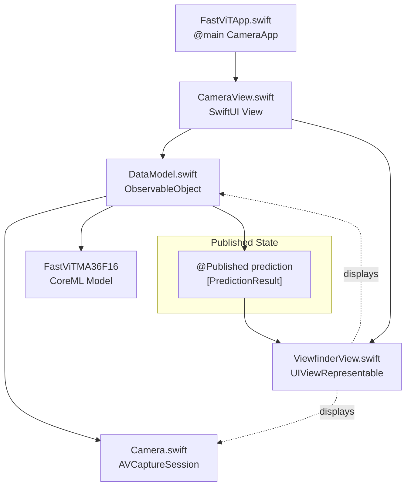

**Component Responsibilities:**

- **CameraApp**: Application entry point with custom navigation bar styling
- **CameraView**: Root SwiftUI view managing DataModel lifecycle
- **DataModel**: Orchestrates camera feed handling and model inference
- **Camera**: Manages AVCaptureSession and provides async image stream
- **ViewfinderView**: Displays camera preview and prediction overlay
- **FastViTMA36F16**: Auto-generated CoreML model class for inference

**Sources:** [FastViTSample/FastViTSample/FastViTApp.swift:1-24](), [FastViTSample/FastViTSample/CameraView.swift:1-24](), [FastViTSample/FastViTSample/DataModel.swift:1-126]()

## Data Flow and Threading Model

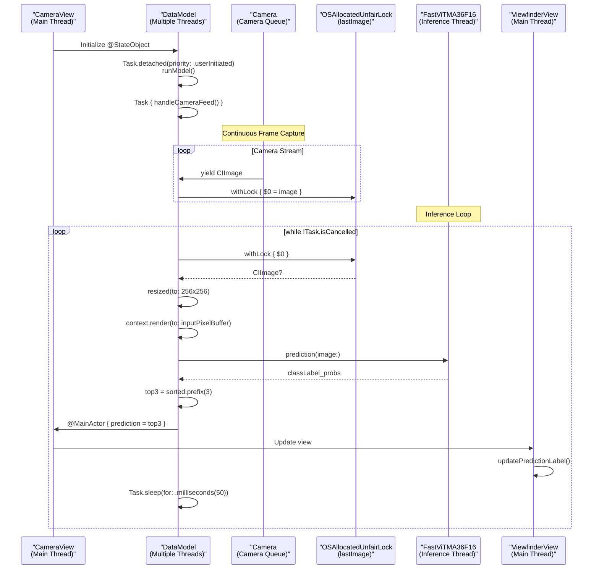

**Threading Architecture:**

1. **Main Thread**: UI updates and SwiftUI view rendering
2. **Camera Queue**: Frame capture via `camera.previewStream`
3. **Inference Thread**: Dedicated `Task.detached` for model execution
4. **Lock-Protected State**: `OSAllocatedUnfairLock<CIImage?>` ensures thread-safe image access

The 50ms sleep in the inference loop prevents CPU saturation while maintaining responsive UI performance.

**Sources:** [FastViTSample/FastViTSample/DataModel.swift:47-88](), [FastViTSample/FastViTSample/DataModel.swift:24-25]()

## Core Data Structures

### PredictionResult

The `PredictionResult` struct encapsulates classification output:

```swift
struct PredictionResult: Hashable {
    let label: String
    let probability: Double
}
```

This structure is used to pass top-3 predictions from the inference thread to the main thread for display.

**Sources:** [FastViTSample/FastViTSample/DataModel.swift:9-12]()

### DataModel Properties

| Property | Type | Purpose |
|----------|------|---------|
| `camera` | `Camera` | Manages video capture session |
| `context` | `CIContext` | Reusable context for image rendering |
| `model` | `FastViTMA36F16?` | CoreML model instance |
| `inputPixelBuffer` | `CVPixelBuffer` | Pre-allocated 256×256 ARGB buffer |
| `lastImage` | `OSAllocatedUnfairLock<CIImage?>` | Thread-safe latest camera frame |
| `prediction` | `@Published [PredictionResult]?` | Top-3 classifications for UI |

The `inputPixelBuffer` is allocated once during initialization to avoid repeated memory allocation during inference.

**Sources:** [FastViTSample/FastViTSample/DataModel.swift:14-28]()

## Model Loading and Inference

### Model Initialization

Model loading occurs in the `loadModel()` method:

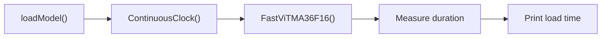

The model is loaded synchronously on the inference thread before the inference loop begins. Load time is measured and printed for performance monitoring.

**Sources:** [FastViTSample/FastViTSample/DataModel.swift:90-100]()

### Inference Pipeline

The `performInference()` method executes the following steps:

1. **Resize**: Input image resized to 256×256 using `CIImage.resized(to:)`
2. **Render**: Resized image rendered into pre-allocated `inputPixelBuffer`
3. **Predict**: Model invoked with `model.prediction(image:)`
4. **Sort**: Results sorted by probability in descending order
5. **Select**: Top-3 predictions extracted
6. **Publish**: Results published on `@MainActor` for UI update

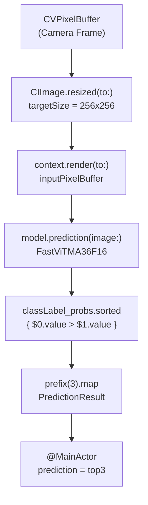

**Sources:** [FastViTSample/FastViTSample/DataModel.swift:102-116](), [FastViTSample/FastViTSample/DataModel.swift:6]()

## Performance Measurement

The inference loop measures average runtime every 100 frames:

| Measurement | Implementation |
|------------|----------------|
| Clock | `ContinuousClock()` |
| Per-frame timing | `clock.measure { try? await performInference(...) }` |
| Collection | `durations.append(duration)` |
| Averaging | `total / measureInterval` every 100 frames |
| Output | Printed in milliseconds |

This provides insight into real-world inference performance on the target device.

**Sources:** [FastViTSample/FastViTSample/DataModel.swift:65-83]()

## Prediction Display

The `ViewfinderView` renders predictions using a custom UILabel overlay:

### Display Components

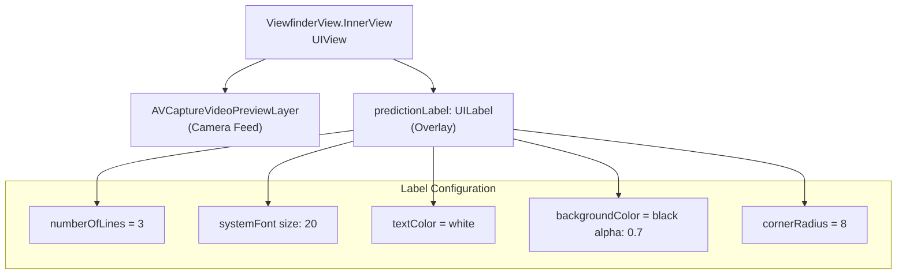

**Sources:** [FastViTSample/FastViTSample/ViewfinderView.swift:85-95]()

### Color-Coded Probabilities

Predictions are color-coded based on confidence:

| Probability Range | Color Interpolation |
|------------------|---------------------|
| ≥ 0.5 | Red → Yellow → Green |
| < 0.5 | Red → Yellow |

The color calculation uses a sinusoidal mapping:

```
mass = 1 + sin(probability * π)

if probability >= 0.5:
    RGB = (mass - 1, 1.0, 0.0)  // Yellow → Green
else:
    RGB = (1.0, mass - 1, 0.0)  // Red → Yellow
```

This provides visual feedback on prediction confidence without requiring the user to read numerical values.

**Sources:** [FastViTSample/FastViTSample/ViewfinderView.swift:139-147](), [FastViTSample/FastViTSample/ViewfinderView.swift:118-137]()

### Layout Constraints

The prediction label is positioned at the bottom of the screen with the following constraints:

- Leading: 16pt from left edge
- Trailing: 16pt from right edge  
- Bottom: 32pt from bottom edge
- Height: 120pt (fixed)

This ensures the label remains visible and readable across different device sizes and orientations.

**Sources:** [FastViTSample/FastViTSample/ViewfinderView.swift:107-116]()

## Configuration and Customization

### Switching Model Variants

To use FastViT-T8 instead of MA36:

1. Download FastViTT8F16.mlpackage to the `models/` directory
2. Modify [FastViTSample/FastViTSample/DataModel.swift:96]() to initialize `FastViTT8F16()` instead of `FastViTMA36F16()`
3. Update the property type at [FastViTSample/FastViTSample/DataModel.swift:19]() to `FastViTT8F16?`

### Adjusting Inference Rate

The inference loop sleep duration can be adjusted at [FastViTSample/FastViTSample/DataModel.swift:86]():

- Decrease (e.g., 10ms) for higher update rate and increased CPU usage
- Increase (e.g., 100ms) for lower update rate and reduced CPU usage

### Input Resolution

The target input size is defined at [FastViTSample/FastViTSample/DataModel.swift:6]():

```swift
fileprivate let targetSize = CGSize(width: 256, height: 256)
```

This must match the model's expected input dimensions. Both FastViT variants require 256×256 input.

**Sources:** [FastViTSample/FastViTSample/DataModel.swift:6](), [FastViTSample/FastViTSample/DataModel.swift:19](), [FastViTSample/FastViTSample/DataModel.swift:86](), [FastViTSample/FastViTSample/DataModel.swift:96]()

## Project Structure

The Xcode project is organized as follows:

```
FastViTSample/
├── FastViTSample.xcodeproj
└── FastViTSample/
    ├── models/
    │   ├── FastViTT8F16.mlpackage
    │   └── FastViTMA36F16.mlpackage
    ├── Camera.swift
    ├── CameraView.swift
    ├── CoreImageExtensions.swift
    ├── DataModel.swift
    ├── FastViTApp.swift
    ├── ViewfinderView.swift
    ├── FastViTSample.entitlements
    └── Assets.xcassets
```

The project requires the camera usage permission specified in the Info.plist:

```
NSCameraUsageDescription: "Capture video for image classification"
```

**Sources:** [FastViTSample/FastViTSample.xcodeproj/project.pbxproj:1-387](), [FastViTSample/FastViTSample.xcodeproj/project.pbxproj:312]()

## Dependencies

The application uses standard iOS frameworks:

- **SwiftUI**: UI framework for views
- **AVFoundation**: Camera capture via `AVCaptureSession`
- **CoreImage**: Image processing and resizing
- **CoreML**: On-device model inference
- **os**: Logging via `OSAllocatedUnfairLock`

Minimum deployment target: iOS 17.0

No external package dependencies are required.

**Sources:** [FastViTSample/FastViTSample.xcodeproj/project.pbxproj:318](), [FastViTSample/FastViTSample.xcodeproj/project.pbxproj:349](), [FastViTSample/FastViTSample/DataModel.swift:1-4]()

---

# Page: Depth Anything Depth Estimation

# Depth Anything Depth Estimation

<details>
<summary>Relevant source files</summary>

The following files were used as context for generating this wiki page:

- [README.md](README.md)
- [depth-anything-example/DepthApp/DataModel.swift](depth-anything-example/DepthApp/DataModel.swift)
- [depth-anything-example/DepthSample.xcodeproj/project.pbxproj](depth-anything-example/DepthSample.xcodeproj/project.pbxproj)
- [depth-anything-example/README.md](depth-anything-example/README.md)

</details>


## Purpose and Scope

This document provides comprehensive technical documentation for the Depth Anything V2 sample application, which demonstrates real-time monocular depth estimation on iOS devices using CoreML. This page covers the application architecture, inference pipeline, threading model, and integration with the DepthAnythingV2SmallF16 CoreML model.

For information about the model conversion process from PyTorch to CoreML, see [Depth Anything Conversion Tutorial](#4.1). For details about shared infrastructure components like the Camera system and image processing utilities, see [Shared Infrastructure](#5).

## Overview

The Depth Anything sample is an iOS application that performs real-time depth estimation from the device camera feed. The application uses the Depth Anything V2 (small) model, which leverages the DPT (Dense Prediction Transformer) architecture with a DINOv2 backbone. The model is optimized for Apple Neural Engine execution with Float16 precision and produces per-pixel depth maps at interactive frame rates.

**Sources:** [README.md:13-16](), [depth-anything-example/README.md:1-13]()

## Model Architecture

### Depth Anything V2 Overview

Depth Anything V2 combines two powerful architectures to achieve state-of-the-art depth estimation:

| Component | Description |
|-----------|-------------|
| **Backbone** | DINOv2 (self-supervised vision transformer) |
| **Architecture** | DPT (Dense Prediction Transformer) |
| **Training Data** | ~600K synthetic labeled images + ~62M real unlabeled images |
| **Model Variant** | Small (optimized for mobile deployment) |
| **Precision** | Float16 (FP16) |
| **Output** | Per-pixel depth map |

The model was introduced in the paper "Depth Anything V2: A More Capable Foundation Model for Monocular Depth Estimation" by Lihe Yang et al. It improves upon the original Depth Anything by using synthetic data and a larger capacity teacher model for training.

**Sources:** [depth-anything-example/README.md:13-19]()

### CoreML Model Package

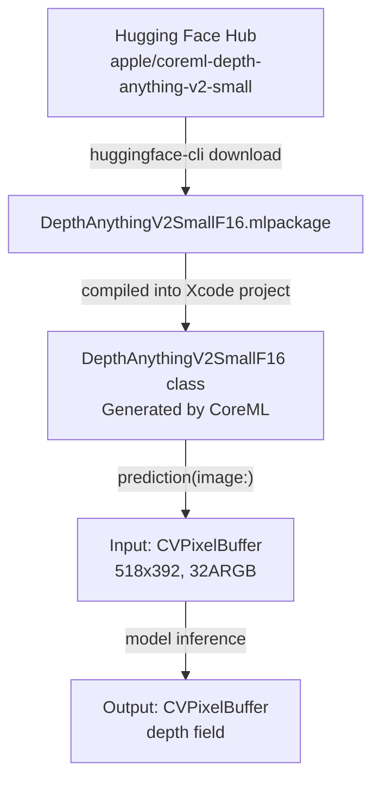

**Diagram: CoreML Model Package Integration**

The CoreML model is distributed as an `.mlpackage` file from Hugging Face Hub and compiled into the application. The generated `DepthAnythingV2SmallF16` class provides a `prediction(image:)` method that accepts a CVPixelBuffer and returns a depth map.

**Sources:** [depth-anything-example/README.md:26-43](), [depth-anything-example/DepthSample.xcodeproj/project.pbxproj:22,136]()

## Application Components

### Project Structure

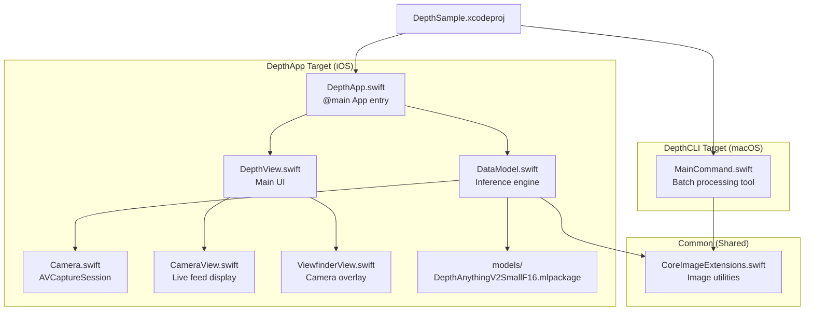

**Diagram: Application Component Structure**

**Sources:** [depth-anything-example/DepthSample.xcodeproj/project.pbxproj:73-140]()

### Key Classes and Their Roles

| File | Class/Type | Primary Responsibility |
|------|------------|------------------------|
| [DepthApp.swift]() | `DepthApp` | SwiftUI app entry point with `@main` attribute |
| [DataModel.swift]() | `DataModel` | Manages model lifecycle, camera integration, and inference loop |
| [Camera.swift]() | `Camera` | Wraps AVCaptureSession, provides async stream of CIImage frames |
| [DepthView.swift]() | `DepthView` | Main SwiftUI view composing camera feed and depth visualization |
| [CameraView.swift]() | `CameraView` | Displays live camera preview using AVCaptureVideoPreviewLayer |
| [ViewfinderView.swift]() | `ViewfinderView` | Overlay view for camera capture interface |
| [MainCommand.swift]() | `MainCommand` | ArgumentParser command for CLI batch processing |
| [CoreImageExtensions.swift]() | Extensions | CIImage utilities for resizing, rendering, saving |

**Sources:** [depth-anything-example/DepthSample.xcodeproj/project.pbxproj:92-122]()

## Real-Time Inference Pipeline

### DataModel Class Architecture

The `DataModel` class ([DataModel.swift:8-113]()) is the core of the inference system, implementing an `ObservableObject` that coordinates between the camera feed and model inference.

```mermaid
graph TB
    subgraph "DataModel Initialization"
        INIT["init()"]
        BUFFER["CVPixelBuffer creation<br/>518x392, 32ARGB<br/>Pre-allocated"]
        TASK1["Task.detached<br/>runModel()"]
        TASK2["Task<br/>handleCameraFeed()"]
    end
    
    subgraph "Camera Feed Handler"
        STREAM["camera.previewStream<br/>AsyncStream&lt;CIImage&gt;"]
        LOCK1["lastImage.withLock<br/>Store CIImage"]
    end
    
    subgraph "Inference Loop"
        LOOP["while !Task.isCancelled"]
        LOCK2["lastImage.withLock<br/>Read CIImage"]
        RESIZE1["resized(to: 518x392)"]
        RENDER["context.render<br/>to inputPixelBuffer"]
        PREDICT["model.prediction(image:)"]
        RESIZE2["resized to original size"]
        PUBLISH["@MainActor<br/>update depthImage"]
        MEASURE["Performance measurement<br/>avg every 100 frames"]
        SLEEP["Task.sleep(10ms)"]
    end
    
    INIT --> BUFFER
    INIT --> TASK1
    INIT --> TASK2
    
    TASK2 --> STREAM
    STREAM --> LOCK1
    
    TASK1 --> LOOP
    LOOP --> LOCK2
    LOCK2 --> RESIZE1
    RESIZE1 --> RENDER
    RENDER --> PREDICT
    PREDICT --> RESIZE2
    RESIZE2 --> PUBLISH
    PUBLISH --> MEASURE
    MEASURE --> SLEEP
    SLEEP --> LOOP
```

**Diagram: DataModel Initialization and Execution Flow**

**Sources:** [depth-anything-example/DepthApp/DataModel.swift:8-113]()

### Key Implementation Details

#### Pre-Allocated Pixel Buffer

The `DataModel` creates a reusable `CVPixelBuffer` during initialization to avoid allocating memory on every inference cycle:

```swift
// DataModel.swift:25-38
let inputPixelBuffer: CVPixelBuffer
```

This buffer is sized to the model's expected input dimensions (518×392) and reused via `context.render(inputImage, to: inputPixelBuffer)` ([DataModel.swift:103]()).

#### Thread-Safe Image Sharing

Camera frames are shared between threads using `OSAllocatedUnfairLock`:

```swift
// DataModel.swift:19
var lastImage = OSAllocatedUnfairLock<CIImage?>(uncheckedState: nil)
```

This lock provides thread-safe access without the overhead of `NSLock` or dispatch queues:
- **Write:** [DataModel.swift:52]() - Camera feed handler stores frames
- **Read:** [DataModel.swift:63]() - Inference loop reads frames

#### Decoupled Camera and Inference

Two separate tasks run concurrently ([DataModel.swift:41-46]()):

| Task | Priority | Purpose |
|------|----------|---------|
| `Task.detached(priority: .userInitiated)` | User Initiated | Runs the inference loop independently |
| `Task` | Default | Handles camera feed asynchronously |

This decoupling ensures the camera feed runs at its native frame rate while inference runs as fast as possible without blocking the camera.

**Sources:** [depth-anything-example/DepthApp/DataModel.swift:8-113]()

### Inference Method

```mermaid
sequenceDiagram
    participant Loop as "Inference Loop"
    participant Lock as "OSAllocatedUnfairLock"
    participant CI as "CIImage"
    participant Context as "CIContext"
    participant Buffer as "inputPixelBuffer"
    participant Model as "DepthAnythingV2SmallF16"
    participant Main as "@MainActor"
    
    Loop->>Lock: withLock (read)
    Lock-->>Loop: Optional<CIImage>
    
    opt Image exists
        Loop->>CI: pixelBuffer property
        CI-->>Loop: CVPixelBuffer (original size)
        Loop->>CI: resized(to: 518x392)
        CI-->>Loop: Resized CIImage
        Loop->>Context: render(to: inputPixelBuffer)
        Context->>Buffer: Write pixels
        Loop->>Model: prediction(image: inputPixelBuffer)
        Model-->>Loop: Output (CVPixelBuffer depth)
        Loop->>CI: CIImage(cvPixelBuffer: depth)
        Loop->>CI: resized(to: originalSize)
        Loop->>Main: Task @MainActor
        Main->>Main: depthImage = outputImage
    end
    
    Loop->>Loop: Measure duration
    Loop->>Loop: Task.sleep(10ms)
```

**Diagram: performInference Method Execution Sequence**

The `performInference` method ([DataModel.swift:96-112]()) follows these steps:

1. **Input Preparation:** Resize camera image from original dimensions to 518×392
2. **Rendering:** Render resized CIImage to pre-allocated CVPixelBuffer
3. **Model Inference:** Call `model.prediction(image:)` 
4. **Output Processing:** Convert depth CVPixelBuffer to CIImage, resize to original size
5. **UI Update:** Publish result on main thread using `@MainActor`

**Sources:** [depth-anything-example/DepthApp/DataModel.swift:96-112]()

## Data Flow Architecture

### Complete System Data Flow

```mermaid
flowchart LR
    subgraph "Camera Thread"
        CAM_HW["Camera Hardware"]
        CAM_SESSION["AVCaptureSession"]
        STREAM["AsyncStream<br/>camera.previewStream"]
        CAM_HW --> CAM_SESSION
        CAM_SESSION --> STREAM
    end
    
    subgraph "Shared State"
        LOCK["OSAllocatedUnfairLock<br/>lastImage"]
    end
    
    subgraph "Inference Thread"
        READ["Read last frame"]
        RESIZE_IN["Resize to 518x392"]
        RENDER["Render to CVPixelBuffer"]
        MODEL["DepthAnythingV2SmallF16<br/>prediction()"]
        RESIZE_OUT["Resize to original"]
    end
    
    subgraph "Main Thread"
        PUBLISHED["@Published depthImage"]
        UI["SwiftUI Views<br/>DepthView, CameraView"]
    end
    
    STREAM -->|"withLock write"| LOCK
    LOCK -->|"withLock read"| READ
    READ --> RESIZE_IN
    RESIZE_IN --> RENDER
    RENDER --> MODEL
    MODEL --> RESIZE_OUT
    RESIZE_OUT -->|"@MainActor"| PUBLISHED
    PUBLISHED --> UI
```

**Diagram: Complete Data Flow Through Application**

**Sources:** [depth-anything-example/DepthApp/DataModel.swift:8-113]()

### Target Input Size

The model expects input at a specific resolution defined as a constant:

```swift
// DataModel.swift:6
fileprivate let targetSize = CGSize(width: 518, height: 392)
```

This size is used for:
1. Pre-allocating the input pixel buffer ([DataModel.swift:28-30]())
2. Resizing camera frames before inference ([DataModel.swift:102]())

The output depth map is then resized back to the original camera frame dimensions ([DataModel.swift:106]()) for display.

**Sources:** [depth-anything-example/DepthApp/DataModel.swift:6,102,106]()

## Performance Optimization

### Optimization Techniques

| Technique | Implementation | Benefit |
|-----------|----------------|---------|
| **Pre-allocated Buffer** | `CVPixelBuffer` created once in `init()` | Eliminates allocation overhead on each frame |
| **Detached Task** | `Task.detached(priority: .userInitiated)` | Prevents blocking camera feed with inference |
| **Thread-safe Lock** | `OSAllocatedUnfairLock` | Minimal overhead for cross-thread communication |
| **Inference Throttling** | `Task.sleep(for: .milliseconds(10))` | Prevents CPU saturation, keeps UI responsive |
| **Batch Measurement** | Average over 100 frames | Low overhead performance tracking |
| **Float16 Model** | FP16 precision | Reduces memory bandwidth, faster ANE execution |

**Sources:** [depth-anything-example/DepthApp/DataModel.swift:15-82]()

### Performance Measurement

The inference loop tracks execution time using `ContinuousClock`:

```swift
// DataModel.swift:59-77
var durations = [ContinuousClock.Duration]()
// ... collect durations
let measureInterval = 100
if durations.count == measureInterval {
    let total = durations.reduce(Duration(...), +)
    let average = total / measureInterval
    print("Average model runtime: \(average.formatted(.units(allowed: [.milliseconds])))")
}
```

This approach measures only the `performInference` call ([DataModel.swift:65-67]()), averaging every 100 frames to minimize measurement overhead while providing useful performance insights.

**Sources:** [depth-anything-example/DepthApp/DataModel.swift:59-77]()

## Command-Line Tool

### DepthCLI for Batch Processing

The project includes a command-line tool for batch depth estimation on macOS:

```mermaid
graph LR
    CLI["DepthCLI executable<br/>MainCommand.swift"]
    ARG["ArgumentParser<br/>swift-argument-parser"]
    INPUT["Input images"]
    MODEL["DepthAnythingV2SmallF16"]
    OUTPUT["Output depth maps"]
    CI_EXT["CoreImageExtensions<br/>Shared utilities"]
    
    CLI --> ARG
    CLI --> CI_EXT
    INPUT --> CLI
    CLI --> MODEL
    MODEL --> OUTPUT
```

**Diagram: DepthCLI Architecture**

The CLI tool is built as a separate target in the Xcode project ([DepthSample.xcodeproj:163-182]()) and shares the `CoreImageExtensions.swift` utility file with the iOS app ([DepthSample.xcodeproj:255]()).

**Target Configuration:**

| Property | Value |
|----------|-------|
| **Target Name** | DepthCLI |
| **Product Type** | Command-line tool |
| **Platform** | macOS 14.0+ |
| **Dependencies** | swift-argument-parser |
| **Shared Code** | CoreImageExtensions.swift |

**Sources:** [depth-anything-example/DepthSample.xcodeproj/project.pbxproj:117-122,163-182,251-259]()

## Model Loading

### Lazy Model Initialization

The model is loaded in the `loadModel()` method called at the start of the inference loop:

```swift
// DataModel.swift:84-94
func loadModel() throws {
    print("Loading model...")
    let clock = ContinuousClock()
    let start = clock.now
    model = try DepthAnythingV2SmallF16()
    let duration = clock.now - start
    print("Model loaded (took \(duration.formatted(...)))")
}
```

This approach:
- Defers model loading until actually needed
- Measures load time for performance tracking
- Allows the UI to initialize before heavy model loading

The model is stored as an optional property ([DataModel.swift:13]()) and checked for existence before each inference ([DataModel.swift:97-99]()).

**Sources:** [depth-anything-example/DepthApp/DataModel.swift:13,84-94,97-99]()

## CoreImage Processing

### Image Transformation Pipeline

The application uses CoreImage extensions for efficient image processing:

```mermaid
graph LR
    subgraph "Input Processing"
        CAM_IMG["CIImage<br/>Camera frame"]
        RESIZE_IN["resized(to: 518x392)<br/>CoreImageExtensions"]
        PIXEL_IN["CVPixelBuffer<br/>Pre-allocated"]
        CAM_IMG --> RESIZE_IN
        RESIZE_IN -->|"context.render"| PIXEL_IN
    end
    
    subgraph "Model"
        PREDICT["DepthAnythingV2SmallF16<br/>prediction()"]
        PIXEL_IN --> PREDICT
    end
    
    subgraph "Output Processing"
        PIXEL_OUT["CVPixelBuffer<br/>Depth output"]
        CI_OUT["CIImage<br/>Depth map"]
        RESIZE_OUT["resized(to: original)<br/>CoreImageExtensions"]
        SWIFTUI["Image<br/>SwiftUI display"]
        PREDICT --> PIXEL_OUT
        PIXEL_OUT -->|"CIImage(cvPixelBuffer:)"| CI_OUT
        CI_OUT --> RESIZE_OUT
        RESIZE_OUT -->|".image property"| SWIFTUI
    end
```

**Diagram: CoreImage Processing Pipeline**

The `CIImage.image` computed property ([DataModel.swift:116-121]()) converts the processed CIImage to a SwiftUI `Image`:

```swift
// DataModel.swift:116-121
var image: Image? {
    let ciContext = CIContext()
    guard let cgImage = ciContext.createCGImage(self, from: self.extent) else { return nil }
    return Image(decorative: cgImage, scale: 1, orientation: .up)
}
```

**Sources:** [depth-anything-example/DepthApp/DataModel.swift:102-107,115-121](), [Common/CoreImageExtensions.swift]()

## Setup and Execution

### Prerequisites

1. **Xcode:** Version 15.0 or later
2. **iOS Device:** iOS 17.0+ (or Simulator)
3. **Model Package:** DepthAnythingV2SmallF16.mlpackage
4. **Command-line tools:** huggingface-cli for model download

**Sources:** [depth-anything-example/DepthSample.xcodeproj/project.pbxproj:400,438]()

### Installation Steps

```mermaid
sequenceDiagram
    participant Dev as "Developer"
    participant CLI as "huggingface-cli"
    participant HF as "Hugging Face Hub"
    participant Local as "models/ directory"
    participant Xcode as "Xcode IDE"
    participant Device as "iOS Device"
    
    Dev->>CLI: brew install huggingface-cli
    Dev->>CLI: huggingface-cli download<br/>apple/coreml-depth-anything-v2-small
    CLI->>HF: Request model package
    HF-->>CLI: DepthAnythingV2SmallF16.mlpackage
    CLI->>Local: Place in DepthApp/models/
    Dev->>Xcode: Open DepthSample.xcodeproj
    Xcode->>Local: Reference .mlpackage
    Dev->>Xcode: Build & Run
    Xcode->>Device: Deploy DepthApp.app
    Device->>Device: Execute on Neural Engine
```

**Diagram: Installation and Deployment Process**

**Commands:**

```bash
# Install huggingface-cli
brew install huggingface-cli

# Download model to models directory
huggingface-cli download \
  --local-dir models --local-dir-use-symlinks False \
  apple/coreml-depth-anything-v2-small \
  --include "DepthAnythingV2SmallF16.mlpackage/*"
```

**Sources:** [depth-anything-example/README.md:7-11,26-43]()

### Camera Permissions

The application requires camera access, declared in the Info.plist:

```
NSCameraUsageDescription: "Capture photos for depth estimation"
```

This is configured in the Xcode project build settings ([DepthSample.xcodeproj:389,427]()).

**Sources:** [depth-anything-example/DepthSample.xcodeproj/project.pbxproj:389,427]()

## View Layer

### SwiftUI View Hierarchy

The application follows a standard SwiftUI structure with published state updates:

```mermaid
graph TD
    APP["DepthApp<br/>@main"]
    ENV["@StateObject dataModel<br/>DataModel instance"]
    DEPTH_VIEW["DepthView<br/>Main container"]
    CAM_VIEW["CameraView<br/>Live preview"]
    VFINDER["ViewfinderView<br/>Camera overlay"]
    DEPTH_IMG["depthImage display<br/>@Published from DataModel"]
    
    APP --> ENV
    ENV --> DEPTH_VIEW
    DEPTH_VIEW --> CAM_VIEW
    DEPTH_VIEW --> VFINDER
    DEPTH_VIEW --> DEPTH_IMG
```

**Diagram: SwiftUI View Hierarchy**

The `DataModel` publishes the `depthImage` property ([DataModel.swift:22]()), which is automatically observed by SwiftUI views. When the inference loop updates this property on the main thread ([DataModel.swift:109-111]()), the UI automatically refreshes.

**Sources:** [depth-anything-example/DepthApp/DepthApp.swift](), [depth-anything-example/DepthApp/DepthView.swift](), [depth-anything-example/DepthApp/DataModel.swift:22,109-111]()

## Integration with Shared Infrastructure

The Depth Anything sample leverages shared components documented in [Shared Infrastructure](#5):

| Component | Usage in Depth Anything |
|-----------|-------------------------|
| **Camera** | Provides async stream of camera frames via `camera.previewStream` |
| **CoreImageExtensions** | Used for resizing images before and after inference |
| **DataModel Pattern** | Follows `ObservableObject` pattern with `@Published` properties |
| **ViewfinderView** | Shared camera overlay component |
| **CameraView** | Shared live preview component |

For detailed documentation of these components, see:
- Camera system implementation: [Camera System](#5.1)
- Image processing utilities: [Image Processing Utilities](#5.2)
- DataModel pattern details: [DataModel Architecture](#5.3)

**Sources:** [depth-anything-example/DepthApp/DataModel.swift:9,102,106](), [depth-anything-example/DepthSample.xcodeproj/project.pbxproj:125-131]()

---

# Page: DETR Semantic Segmentation

# DETR Semantic Segmentation

<details>
<summary>Relevant source files</summary>

The following files were used as context for generating this wiki page:

- [SemanticSegmentationSample/Common/PostProcessing.swift](SemanticSegmentationSample/Common/PostProcessing.swift)
- [SemanticSegmentationSample/Common/SemanticMapToColor.metal](SemanticSegmentationSample/Common/SemanticMapToColor.metal)
- [SemanticSegmentationSample/Common/SemanticMapToImage.swift](SemanticSegmentationSample/Common/SemanticMapToImage.swift)
- [SemanticSegmentationSample/README.md](SemanticSegmentationSample/README.md)
- [SemanticSegmentationSample/SemanticSegmentationCLI/MainCommand.swift](SemanticSegmentationSample/SemanticSegmentationCLI/MainCommand.swift)
- [SemanticSegmentationSample/SemanticSegmentationSample.xcodeproj/project.pbxproj](SemanticSegmentationSample/SemanticSegmentationSample.xcodeproj/project.pbxproj)

</details>


This document describes the DETR semantic segmentation sample application, which demonstrates end-to-end pixel-level classification on iOS devices. The sample uses a CoreML-converted DETR (DEtection TRansformer) ResNet-50 model to perform semantic segmentation, where each pixel is classified into one of 171 semantic categories.

The document covers the DETR-specific post-processing pipeline, Metal shader implementation for color mapping, and the CLI tool for batch processing. For general camera system architecture, see [Camera System](#5.1). For the standard DataModel pattern shared across all demos, see [DataModel Architecture](#5.3). For threading and concurrency patterns, see [Threading & Concurrency](#6.2).

## Model Overview

The DETR semantic segmentation model (`DETRResnet50SemanticSegmentationF16.mlpackage`) is based on the original DETR architecture introduced in the paper "End-to-End Object Detection with Transformers" by Carion et al. The CoreML model accepts 448×448 pixel images and outputs per-pixel semantic predictions.

### Model Input/Output Specification

| Property | Specification |
|----------|--------------|
| Input Name | `image` |
| Input Type | `CVPixelBuffer` (32ARGB) |
| Input Size | 448×448 pixels |
| Output Name | `semanticPredictions` |
| Output Type | `MLShapedArray<Int32>` |
| Output Shape | [448, 448] |
| Precision | Float16 |
| Model Location | `SemanticSegmentationSample/models/` |

The model outputs a 2D array where each element contains the predicted class ID (0-170) for the corresponding pixel. Empty/unlabeled categories (marked as "--" in metadata) are filtered out during post-processing.

**Sources:** [SemanticSegmentationSample/README.md:1-34](), [SemanticSegmentationSample/SemanticSegmentationCLI/MainCommand.swift:7-86]()

## Post-Processing Pipeline

The post-processing pipeline converts raw semantic predictions into visualizable colored images. This involves two main stages: class label extraction from model metadata and semantic map to image conversion using Metal shaders.

```mermaid
graph LR
    MODEL["DETRResnet50F16<br/>MLModel"]
    PREDICTIONS["semanticPredictions<br/>MLShapedArray&lt;Int32&gt;<br/>[448, 448]"]
    PROCESSOR["DETRPostProcessor"]
    METADATA["Model Metadata<br/>ids2Labels: [Int: String]"]
    METAL["SemanticMapToImage"]
    SHADER["SemanticMapToColor.metal"]
    OUTPUT["CIImage<br/>Colored Segmentation"]
    
    MODEL -->|"prediction()"| PREDICTIONS
    MODEL -->|"modelDescription.metadata"| METADATA
    METADATA -->|"init(model:)"| PROCESSOR
    PREDICTIONS -->|"semanticImage()"| PROCESSOR
    PROCESSOR -->|"mapToImage()"| METAL
    METAL -->|"compute kernel"| SHADER
    SHADER --> OUTPUT
```

**Sources:** [SemanticSegmentationSample/Common/PostProcessing.swift:1-47](), [SemanticSegmentationSample/Common/SemanticMapToImage.swift:1-100]()

### DETRPostProcessor Class

The `DETRPostProcessor` class handles metadata extraction and coordinates the Metal-based conversion pipeline. It is initialized with the loaded `MLModel` instance and extracts class labels from custom metadata fields.

[SemanticSegmentationSample/Common/PostProcessing.swift:10-37]()

**Class Label Extraction:**

The model's metadata contains a JSON-encoded class list under the key `com.apple.coreml.model.preview.params`. The processor:

1. Extracts the `creatorDefinedKey` metadata dictionary
2. Parses the JSON to decode a `ClassList` structure containing 171 labels
3. Filters out empty categories (labeled as "--")
4. Creates a mapping from semantic ID to class label

```mermaid
graph TD
    META["MLModel.modelDescription.metadata"]
    CUSTOM["creatorDefinedKey dictionary"]
    JSON["JSON string<br/>com.apple.coreml.model.preview.params"]
    DECODE["JSONDecoder"]
    CLASSLIST["ClassList struct<br/>labels: [String]"]
    FILTER["Filter labels != '--'"]
    MAP["ids2Labels: [Int: String]<br/>numClasses: Int"]
    
    META --> CUSTOM
    CUSTOM --> JSON
    JSON --> DECODE
    DECODE --> CLASSLIST
    CLASSLIST --> FILTER
    FILTER --> MAP
```

**Sources:** [SemanticSegmentationSample/Common/PostProcessing.swift:17-37]()

**Semantic Image Generation:**

The `semanticImage(semanticPredictions:)` method converts raw predictions to a `CIImage`:

[SemanticSegmentationSample/Common/PostProcessing.swift:39-45]()

This method delegates to `SemanticMapToImage.shared` for the actual Metal shader execution.

**Sources:** [SemanticSegmentationSample/Common/PostProcessing.swift:10-47]()

## Metal Shader Implementation

The semantic map to colored image conversion is implemented using a Metal compute shader for GPU acceleration. This approach provides significantly better performance than CPU-based pixel iteration, especially for real-time camera inference.

### SemanticMapToImage Class

The `SemanticMapToImage` class manages the Metal pipeline state and executes the compute shader. It follows the singleton pattern with a shared instance.

[SemanticSegmentationSample/Common/SemanticMapToImage.swift:6-38]()

**Initialization:**

The class initializes the Metal device, command queue, and compute pipeline state during instantiation:

| Component | Description |
|-----------|-------------|
| `device` | System default Metal device |
| `commandQueue` | Command queue for submitting work |
| `pipelineState` | Compiled `SemanticMapToColor` kernel |

**Sources:** [SemanticSegmentationSample/Common/SemanticMapToImage.swift:6-38]()

### Conversion Pipeline

The `mapToImage(semanticMap:numClasses:)` method orchestrates the Metal shader execution:

```mermaid
graph TD
    INPUT["MLShapedArray&lt;Int32&gt;<br/>semanticMap"]
    CMDBUF["MTLCommandBuffer"]
    ENCODER["MTLComputeCommandEncoder"]
    SOURCE["Source Texture<br/>r32Uint<br/>[448, 448]"]
    OUTPUT_TEX["Output Texture<br/>bgra8Unorm<br/>[448, 448]"]
    SHADER["SemanticMapToColor<br/>compute kernel"]
    FLIP["Y-axis flip<br/>CGAffineTransform"]
    CIIMAGE["CIImage"]
    
    INPUT -->|"sourceTexture()"| SOURCE
    INPUT -->|"shape[0], shape[1]"| OUTPUT_TEX
    CMDBUF -->|"makeComputeCommandEncoder()"| ENCODER
    SOURCE -->|"setTexture(index:0)"| ENCODER
    OUTPUT_TEX -->|"setTexture(index:1)"| ENCODER
    ENCODER -->|"dispatchThreads()"| SHADER
    SHADER --> OUTPUT_TEX
    CMDBUF -->|"commit(), waitUntilCompleted()"| OUTPUT_TEX
    OUTPUT_TEX -->|"CIImage(mtlTexture:)"| FLIP
    FLIP --> CIIMAGE
```

**Sources:** [SemanticSegmentationSample/Common/SemanticMapToImage.swift:40-57]()

**Texture Creation:**

[SemanticSegmentationSample/Common/SemanticMapToImage.swift:85-98]()

- **Source texture:** `r32Uint` format (single 32-bit unsigned integer channel) containing class IDs
- **Output texture:** `bgra8Unorm` format (8-bit RGBA) for colored output
- Both textures have `shaderRead` and `shaderWrite` usage flags

**Thread Dispatch:**

[SemanticSegmentationSample/Common/SemanticMapToImage.swift:73-79]()

The compute shader is dispatched with:
- Threads per grid: Full texture dimensions (448×448)
- Threads per threadgroup: Optimal size based on pipeline state properties

**Sources:** [SemanticSegmentationSample/Common/SemanticMapToImage.swift:40-98]()

### SemanticMapToColor Metal Kernel

The Metal compute kernel performs hue-based color mapping to visualize semantic classes:

[SemanticSegmentationSample/Common/SemanticMapToColor.metal:1-20]()

**Hue-to-RGB Conversion:**

The `hue2rgb()` function implements a simplified HSV-to-RGB conversion assuming saturation=1 and value=1:

[SemanticSegmentationSample/Common/SemanticMapToColor.metal:4-9]()

This creates vivid, distinct colors across the hue spectrum (0.0 to 1.0).

**Kernel Execution:**

The main kernel function processes each pixel in parallel:

```mermaid
graph LR
    GID["thread_position_in_grid<br/>(x, y)"]
    SEMANTIC["semantic_map[x,y]<br/>class_id: uint"]
    HUE["hue = class_id / n_classes<br/>range: [0.0, 1.0]"]
    RGB["hue2rgb(hue)<br/>float3 RGB"]
    OUTPUT["image[x,y] = (RGB, 1.0)"]
    
    GID -->|"read"| SEMANTIC
    SEMANTIC --> HUE
    HUE --> RGB
    RGB --> OUTPUT
```

**Kernel Parameters:**

| Index | Type | Description |
|-------|------|-------------|
| `texture(0)` | `texture2d<uint, access::read>` | Input semantic map (class IDs) |
| `texture(1)` | `texture2d<float, access::write>` | Output RGBA image |
| `buffer(0)` | `const device uint&` | Total number of classes |

Each thread:
1. Reads the class ID from its pixel position
2. Normalizes the class ID to a hue value (0.0-1.0)
3. Converts hue to RGB using the helper function
4. Writes the RGB value with full alpha to the output texture

**Sources:** [SemanticSegmentationSample/Common/SemanticMapToColor.metal:1-20]()

## Application Architecture

The DETR semantic segmentation app follows the same architectural pattern as other demos (see [DataModel Architecture](#5.3)) but includes DETR-specific post-processing components.

```mermaid
graph TB
    APP["SemanticSegmentationSampleApp"]
    SEGVIEW["SegmentationView"]
    DATAMODEL["DataModel<br/>@ObservableObject"]
    CAMERA["Camera<br/>AVCaptureSession"]
    MODEL["DETRResnet50F16<br/>MLModel"]
    POSTPROC["DETRPostProcessor"]
    METALCONV["SemanticMapToImage"]
    
    APP -->|"ContentView"| SEGVIEW
    SEGVIEW -->|"@StateObject"| DATAMODEL
    DATAMODEL -->|"camera.previewStream"| CAMERA
    DATAMODEL -->|"prediction(from:)"| MODEL
    MODEL -->|"semanticPredictions"| POSTPROC
    POSTPROC -->|"semanticImage()"| METALCONV
    METALCONV -->|"CIImage"| DATAMODEL
    DATAMODEL -->|"@Published outputImage"| SEGVIEW
```

**Sources:** [SemanticSegmentationSample/SemanticSegmentationSample.xcodeproj/project.pbxproj:109-152]()

### DataModel Integration

The `DataModel` class (located at [SemanticSegmentationSample/SemanticSegmentationSample/DataModel.swift]()) follows the standard pattern with DETR-specific initialization:

1. Loads `DETRResnet50SemanticSegmentationF16` model
2. Initializes `DETRPostProcessor` with the loaded model
3. Runs async inference loop reading from camera stream
4. Post-processes predictions using `postProcessor.semanticImage()`
5. Publishes the colored segmentation overlay to the view

The inference loop maintains similar performance characteristics to other demos, with a 10ms sleep between iterations to prevent CPU saturation.

**Sources:** [SemanticSegmentationSample/SemanticSegmentationSample.xcodeproj/project.pbxproj:109-124]()

### SegmentationView Display

The `SegmentationView` (located at [SemanticSegmentationSample/SemanticSegmentationSample/SegmentationView.swift]()) displays:

- Live camera preview via `CameraView`
- Overlaid semantic segmentation with 50% alpha transparency
- Inference duration statistics
- Model selection (if multiple variants were included)

The view composites the colored segmentation map over the camera feed, allowing users to see the original scene alongside the semantic predictions.

**Sources:** [SemanticSegmentationSample/SemanticSegmentationSample.xcodeproj/project.pbxproj:22-23]()

## Command-Line Tool

The semantic segmentation CLI tool enables batch processing of static images without requiring an iOS device. The tool is implemented as a macOS command-line executable using Swift Argument Parser.

### Usage

```bash
semantic --model <mlpackage> --input <image> --output <result> [--mask <mask>]
```

**Arguments:**

| Option | Short | Description |
|--------|-------|-------------|
| `--model` | `-m` | Path to `.mlpackage` file |
| `--input` | `-i` | Input image file path |
| `--output` | `-o` | Output PNG with overlay |
| `--mask` | `-k` | Optional: Save standalone mask |

**Sources:** [SemanticSegmentationSample/SemanticSegmentationCLI/MainCommand.swift:10-28]()

### Processing Workflow

The CLI tool implements the following workflow:

```mermaid
graph TD
    ARGS["Parse Arguments<br/>MainCommand"]
    COMPILE["MLModel.compileModel()"]
    LOAD_MODEL["MLModel(contentsOf:)<br/>computeUnits: .cpuAndGPU"]
    POSTPROC["DETRPostProcessor(model:)"]
    LOAD_IMG["CIImage(contentsOf:)"]
    RESIZE["resized(to: 448x448)"]
    PIXBUF["render(pixelFormat: 32ARGB)"]
    PREDICT["model.prediction(from:)"]
    EXTRACT["semanticPredictions<br/>MLShapedArray&lt;Int32&gt;"]
    COLOR["postProcessor.semanticImage()"]
    UPSCALE["resized(to: original size)"]
    ALPHA["withAlpha(0.5)"]
    COMPOSITE["composited(over: original)"]
    SAVE["writePNG()"]
    
    ARGS --> COMPILE
    COMPILE --> LOAD_MODEL
    LOAD_MODEL --> POSTPROC
    ARGS --> LOAD_IMG
    LOAD_IMG --> RESIZE
    RESIZE --> PIXBUF
    PIXBUF --> PREDICT
    PREDICT --> EXTRACT
    EXTRACT --> COLOR
    COLOR --> UPSCALE
    UPSCALE --> ALPHA
    ALPHA --> COMPOSITE
    LOAD_IMG --> COMPOSITE
    COMPOSITE --> SAVE
```

**Sources:** [SemanticSegmentationSample/SemanticSegmentationCLI/MainCommand.swift:29-85]()

### Implementation Details

**Model Compilation and Loading:**

[SemanticSegmentationSample/SemanticSegmentationCLI/MainCommand.swift:30-35]()

The CLI compiles the model on-the-fly and configures it for CPU and GPU execution (no Neural Engine on macOS).

**Image Preprocessing:**

[SemanticSegmentationSample/SemanticSegmentationCLI/MainCommand.swift:38-51]()

Input images are resized to 448×448 pixels and converted to 32ARGB pixel buffers using the shared `CIContext`.

**Inference Timing:**

[SemanticSegmentationSample/SemanticSegmentationCLI/MainCommand.swift:54-63]()

The tool measures and reports inference duration using `ContinuousClock`, displaying results in seconds and milliseconds.

**Output Generation:**

[SemanticSegmentationSample/SemanticSegmentationCLI/MainCommand.swift:65-84]()

The tool generates two types of output:
1. **Overlay:** Semantic mask composited over original image at 50% opacity
2. **Mask (optional):** Standalone colored segmentation map

The segmentation is upscaled back to the original image dimensions before compositing.

**Sources:** [SemanticSegmentationSample/SemanticSegmentationCLI/MainCommand.swift:1-86]()

## Semantic Class Categories

The DETR model classifies pixels into 171 semantic categories based on the COCO-Stuff dataset. Common categories include:

| Category Type | Examples |
|---------------|----------|
| Objects | person, car, chair, bottle, laptop |
| Outdoor | sky, tree, grass, road, building |
| Indoor | wall, floor, ceiling, table, window |
| Animals | dog, cat, bird, horse, cow |
| Food | pizza, cake, apple, sandwich, banana |

The complete list of categories is embedded in the model metadata and automatically extracted by `DETRPostProcessor` during initialization. Empty categories (marked as "--") are filtered out, resulting in fewer than 171 actual displayable classes.

**Sources:** [SemanticSegmentationSample/Common/PostProcessing.swift:17-37]()

## Performance Characteristics

The DETR semantic segmentation model exhibits the following performance characteristics on iOS devices:

| Metric | Value |
|--------|-------|
| Input Resolution | 448×448 pixels |
| Model Precision | Float16 |
| Output Resolution | 448×448 pixels |
| Metal Shader | GPU-accelerated |
| Typical Inference | 20-50ms (device-dependent) |
| Post-processing | <5ms (Metal) |

The Metal shader implementation provides substantial performance benefits over CPU-based color mapping, making real-time camera inference feasible even with the post-processing overhead.

**Sources:** [SemanticSegmentationSample/Common/SemanticMapToImage.swift:1-100](), [SemanticSegmentationSample/Common/SemanticMapToColor.metal:1-20]()

---

# Page: Model Conversion Pipeline

# Model Conversion Pipeline

<details>
<summary>Relevant source files</summary>

The following files were used as context for generating this wiki page:

- [README.md](README.md)
- [depth-anything-example/README.md](depth-anything-example/README.md)
- [tutorials/depth-anything-coreml-guide.ipynb](tutorials/depth-anything-coreml-guide.ipynb)

</details>


## Purpose and Scope

This document provides an overview of the model conversion pipeline used to transform PyTorch models into optimized CoreML packages that run efficiently on Apple Neural Engine. It covers the conversion workflow, tools, optimization techniques, and distribution mechanisms.

For step-by-step conversion instructions, see [Depth Anything Conversion Tutorial](#4.1). For information about how converted models are integrated into demo applications, see [Demo Applications](#3).

---

## Conversion Pipeline Overview

The model conversion pipeline transforms models from PyTorch format into CoreML `.mlpackage` files optimized for Apple devices. The pipeline consists of three main stages: ONNX export, simplification, and CoreML conversion with optimization.

```mermaid
graph LR
    subgraph "Source Models"
        PT["PyTorch Models<br/>(.pth, .pt)"]
    end
    
    subgraph "Stage 1: ONNX Export"
        EXPORT["torch.onnx.export()"]
        ONNX["ONNX Model<br/>(.onnx)"]
    end
    
    subgraph "Stage 2: Simplification"
        SIMP["onnx-simplifier"]
        ONNX_SIMP["Simplified ONNX<br/>(.onnx)"]
    end
    
    subgraph "Stage 3: CoreML Conversion"
        CT["coremltools.convert()"]
        OPT["Optimization Pipeline"]
    end
    
    subgraph "Optimization Techniques"
        F16["Float16 Precision"]
        PAL["Palettization"]
        ANE["compute_units=ALL"]
    end
    
    subgraph "Output"
        ML["CoreML Package<br/>(.mlpackage)"]
    end
    
    subgraph "Distribution"
        HF["Hugging Face Hub<br/>apple/coreml-*"]
    end
    
    PT --> EXPORT
    EXPORT --> ONNX
    ONNX --> SIMP
    SIMP --> ONNX_SIMP
    ONNX_SIMP --> CT
    CT --> OPT
    OPT --> F16
    OPT --> PAL
    OPT --> ANE
    F16 --> ML
    PAL --> ML
    ANE --> ML
    ML --> HF
```

**Pipeline Flow**: The conversion process begins with a trained PyTorch model, exports it to ONNX format for portability, simplifies the ONNX graph to remove redundancies, converts to CoreML format, applies optimizations for size and performance, and finally publishes the `.mlpackage` to Hugging Face Hub for distribution.

**Sources**: [README.md:20](), [depth-anything-example/README.md:5]()

---

## Tools and Technologies

### coremltools

The `coremltools` package is the primary tool for converting models to CoreML format. It provides Python APIs for model conversion, optimization, and verification.

**Key Functions**:
- `coremltools.convert()` - Main conversion API that accepts various input formats (ONNX, TensorFlow, PyTorch)
- Optimization APIs for palettization and quantization
- Model compilation and validation utilities

The repository leverages coremltools extensively for all model conversions and optimizations.

**Sources**: [README.md:20](), [depth-anything-example/README.md:5]()

### ONNX Intermediate Format

ONNX (Open Neural Network Exchange) serves as an intermediate representation between PyTorch and CoreML. This two-stage conversion approach provides:

**Advantages**:
- **Portability**: ONNX models can be inspected and validated independently
- **Optimization**: ONNX graph can be simplified before CoreML conversion
- **Debugging**: Easier to identify conversion issues at each stage

**Export Process**: PyTorch models are exported using `torch.onnx.export()` with specific input shapes and operator versions compatible with CoreML.

**Sources**: [README.md:20](), Diagram 4 from high-level architecture

### onnx-simplifier

The `onnx-simplifier` tool optimizes ONNX graphs by:
- Removing redundant operations
- Constant folding
- Eliminating identity operations
- Simplifying complex operator sequences

This simplification step reduces model size and improves CoreML conversion success rates.

**Sources**: Diagram 4 from high-level architecture

---

## Optimization Techniques

### Float16 Precision

All models in this repository are converted with Float16 precision to balance accuracy and model size. The F16 suffix in model names (e.g., `DepthAnythingV2SmallF16.mlpackage`) indicates Float16 precision.

**Benefits**:
- Reduces model size by approximately 50%
- Enables efficient Neural Engine execution
- Maintains acceptable accuracy for most vision tasks

**Implementation**: Float16 conversion is specified during `coremltools.convert()` with appropriate precision parameters.

**Sources**: [depth-anything-example/README.md:36](), model naming conventions

### Palettization

Palettization is a weight quantization technique that clusters model weights into a small number of shared values stored in a lookup table.

**Key Characteristics**:
- Reduces model size while preserving accuracy
- Particularly effective for convolutional and linear layers
- Configured through coremltools optimization APIs

The coremltools documentation provides detailed information about palettization APIs available at `apple.github.io/coremltools/docs-guides/source/opt-palettization-api.html`.

**Sources**: [README.md:20](), [depth-anything-example/README.md:5]()

### Neural Engine Optimization

Models are compiled with `compute_units=ALL` to enable execution on Apple Neural Engine alongside CPU and GPU resources.

**Configuration**:
- `compute_units` parameter in `coremltools.convert()` specifies target hardware
- `ALL` setting allows CoreML runtime to automatically select optimal compute unit per operation
- Results in efficient on-device inference optimized for Apple silicon

**Sources**: Diagram 4 from high-level architecture, [README.md:3]()

---

## Model Variants and Packages

The conversion pipeline produces multiple model variants for different use cases:

| Model | Variants | Package Names | Parameters | Hub Repository |
|-------|----------|---------------|------------|----------------|
| FastViT | T8, MA36 | `FastViTT8F16.mlpackage`<br/>`FastViTMA36F16.mlpackage` | 4M, 44M | `apple/coreml-FastViT-T8`<br/>`apple/coreml-FastViT-MA36` |
| Depth Anything V2 | Small | `DepthAnythingV2SmallF16.mlpackage` | ~24M | `apple/coreml-depth-anything-v2-small` |
| DETR | ResNet-50 | `DETRResnet50F16.mlpackage` | ~41M | `apple/coreml-detr-semantic-segmentation` |

```mermaid
graph TB
    subgraph "Model Sources"
        FV_PT["FastViT PyTorch<br/>timm models"]
        DA_PT["Depth Anything V2<br/>depth-anything/Depth-Anything-V2-Small"]
        DETR_PT["DETR<br/>facebook/detr-resnet-50"]
    end
    
    subgraph "Conversion Pipeline"
        CONV["tutorials/depth-anything-coreml-guide.ipynb<br/>Conversion process"]
    end
    
    subgraph "CoreML Packages"
        FV_T8["FastViTT8F16.mlpackage<br/>4M params"]
        FV_MA36["FastViTMA36F16.mlpackage<br/>44M params"]
        DA_SMALL["DepthAnythingV2SmallF16.mlpackage<br/>~24M params"]
        DETR_R50["DETRResnet50F16.mlpackage<br/>~41M params"]
    end
    
    subgraph "Hub Distribution"
        HF_FV_T8["apple/coreml-FastViT-T8"]
        HF_FV_MA36["apple/coreml-FastViT-MA36"]
        HF_DA["apple/coreml-depth-anything-v2-small"]
        HF_DETR["apple/coreml-detr-semantic-segmentation"]
    end
    
    FV_PT --> CONV
    DA_PT --> CONV
    DETR_PT --> CONV
    
    CONV --> FV_T8
    CONV --> FV_MA36
    CONV --> DA_SMALL
    CONV --> DETR_R50
    
    FV_T8 --> HF_FV_T8
    FV_MA36 --> HF_FV_MA36
    DA_SMALL --> HF_DA
    DETR_R50 --> HF_DETR
```

**Package Structure**: Each `.mlpackage` is a directory containing model weights, metadata, and compiled artifacts optimized for Apple Neural Engine.

**Sources**: [README.md:13-17](), [depth-anything-example/README.md:28]()

---

## Model Distribution via Hugging Face Hub

Converted CoreML models are published to Hugging Face Hub under the `apple` organization for easy distribution and version management.

### Repository Structure

Each model has a dedicated repository following the naming convention `apple/coreml-{model-name}`:

```mermaid
graph TD
    subgraph "Hugging Face Hub"
        ORG["apple organization"]
    end
    
    subgraph "Model Repositories"
        REPO1["apple/coreml-FastViT-T8"]
        REPO2["apple/coreml-FastViT-MA36"]
        REPO3["apple/coreml-depth-anything-v2-small"]
        REPO4["apple/coreml-detr-semantic-segmentation"]
    end
    
    subgraph "Repository Contents"
        PKG[".mlpackage directory"]
        README["README.md<br/>Model card"]
        META["Metadata files"]
    end
    
    subgraph "Download Methods"
        CLI["huggingface-cli download"]
        WEB["Web browser"]
        PYTHON["huggingface_hub Python API"]
    end
    
    ORG --> REPO1
    ORG --> REPO2
    ORG --> REPO3
    ORG --> REPO4
    
    REPO3 --> PKG
    REPO3 --> README
    REPO3 --> META
    
    PKG --> CLI
    PKG --> WEB
    PKG --> PYTHON
```

**Download Workflow**: Users download model packages using `huggingface-cli`, which handles authentication, version control, and efficient file transfer.

**Sources**: [README.md:13-17](), [depth-anything-example/README.md:28-43]()

### Downloading Models

The recommended method for downloading models is the `huggingface-cli` command-line tool:

**Installation**:
```bash
brew install huggingface-cli
```

**Download Example** (Depth Anything V2):
```bash
huggingface-cli download \
  --local-dir models --local-dir-use-symlinks False \
  apple/coreml-depth-anything-v2-small \
  --include "DepthAnythingV2SmallF16.mlpackage/*"
```

**Parameters**:
- `--local-dir models` - Target directory for downloaded files
- `--local-dir-use-symlinks False` - Downloads actual files instead of symlinks
- `--include` - Specifies which files to download (optional, omit to download all variants)

**Sources**: [depth-anything-example/README.md:30-43]()

---

## Conversion Workflow in Practice

The practical workflow for converting and integrating a new model involves several stages:

```mermaid
sequenceDiagram
    participant Dev as "Developer"
    participant PT as "PyTorch Model"
    participant NB as "Jupyter Notebook<br/>tutorials/*.ipynb"
    participant CT as "coremltools"
    participant HF as "Hugging Face Hub"
    participant XC as "Xcode Project"
    
    Note over Dev,CT: Phase 1: Model Conversion
    Dev->>PT: Train or load pretrained model
    Dev->>NB: Open conversion tutorial
    NB->>PT: Load model weights
    NB->>PT: torch.onnx.export()
    PT-->>NB: model.onnx
    NB->>NB: onnx.simplifier()
    NB->>CT: coremltools.convert()
    CT->>CT: Apply Float16
    CT->>CT: Apply palettization
    CT->>CT: Set compute_units=ALL
    CT-->>NB: model.mlpackage
    
    Note over Dev,XC: Phase 2: Distribution & Integration
    Dev->>HF: Upload to apple/coreml-*
    HF-->>Dev: Model published
    Dev->>Dev: huggingface-cli download
    Dev->>XC: Add to models/ directory
    Dev->>XC: Reference in Xcode project
    XC->>XC: Auto-generate Swift classes
    Dev->>Dev: Implement prediction code
```

**Workflow Stages**:

1. **Model Preparation**: Start with trained PyTorch model
2. **ONNX Export**: Convert to ONNX format using tutorials as guidance
3. **Optimization**: Apply Float16, palettization, and ANE targeting via coremltools
4. **Validation**: Test converted model for accuracy and performance
5. **Distribution**: Upload to Hugging Face Hub
6. **Integration**: Download and add to Xcode project

**Tutorial Resources**: The repository includes Jupyter notebooks in the `tutorials/` directory that provide detailed conversion examples. The Depth Anything conversion tutorial is available at `tutorials/depth-anything-coreml-guide.ipynb` and can be run in Google Colab.

**Sources**: [README.md:23-27](), Diagram 2 from high-level architecture

---

## Model Package Structure

CoreML `.mlpackage` files are directories containing organized model artifacts:

```mermaid
graph TD
    subgraph "DepthAnythingV2SmallF16.mlpackage"
        ROOT["Package Root Directory"]
        DATA["Data/<br/>Model weights"]
        METADATA["Metadata/<br/>Model configuration"]
        MANIFEST["Manifest.json<br/>Package metadata"]
        WEIGHTS["com.apple.CoreML/<br/>Compiled artifacts"]
    end
    
    ROOT --> DATA
    ROOT --> METADATA
    ROOT --> MANIFEST
    ROOT --> WEIGHTS
    
    subgraph "Xcode Integration"
        XCPROJ["*.xcodeproj"]
        MODELS["models/ directory"]
        GEN["Auto-generated Swift<br/>DepthAnythingV2SmallF16.swift"]
    end
    
    ROOT --> MODELS
    MODELS --> XCPROJ
    XCPROJ --> GEN
```

**Package Components**:
- **Data/**: Contains model weights and parameters in CoreML format
- **Metadata/**: Stores model configuration, input/output specifications
- **Manifest.json**: Package version and compatibility information
- **Compiled artifacts**: Platform-specific optimized model binaries

**Xcode Integration**: When `.mlpackage` is added to Xcode project, Swift wrapper classes are automatically generated for type-safe model inference.

**Sources**: [depth-anything-example/README.md:9-11](), model package structure conventions

---

## Performance Considerations

The optimization techniques applied during conversion directly impact runtime performance:

| Optimization | Model Size Impact | Inference Speed | Accuracy Impact |
|--------------|-------------------|-----------------|-----------------|
| Float16 | ~50% reduction | Faster on ANE | Minimal (<1% typical) |
| Palettization | 2-4x reduction | Neutral/Faster | Minimal with proper tuning |
| Neural Engine | N/A | 2-10x faster vs CPU | None |

**Measurement**: Performance metrics vary by model architecture and device. The demo applications include inference time measurement showing real-world performance. See [Real-Time Inference Pattern](#6.1) for details on performance monitoring implementation.

**Sources**: [README.md:20](), Diagram 5 from high-level architecture

---

## Summary

The model conversion pipeline provides a systematic approach to transforming PyTorch models into optimized CoreML packages:

1. **Two-stage conversion**: PyTorch → ONNX → CoreML
2. **Multiple optimizations**: Float16, palettization, Neural Engine targeting
3. **Standardized distribution**: Hugging Face Hub for version management
4. **Seamless integration**: Direct Xcode project integration with auto-generated Swift APIs

For hands-on conversion guidance, proceed to [Depth Anything Conversion Tutorial](#4.1). To understand how converted models are used in applications, see [Demo Applications](#3) and [DataModel Architecture](#5.3).

**Sources**: [README.md:1-31](), [depth-anything-example/README.md:1-46]()

---

# Page: Depth Anything Conversion Tutorial

# Depth Anything Conversion Tutorial

<details>
<summary>Relevant source files</summary>

The following files were used as context for generating this wiki page:

- [tutorials/depth-anything-coreml-guide.ipynb](tutorials/depth-anything-coreml-guide.ipynb)

</details>


## Purpose and Scope

This document provides a step-by-step tutorial for converting the Depth Anything V2 model from PyTorch to CoreML format. The conversion process transforms a Hugging Face-hosted PyTorch model into an optimized `.mlpackage` suitable for deployment on Apple Neural Engine.

This tutorial covers the complete conversion pipeline: environment setup, ONNX export, model simplification, CoreML conversion with optimizations (Float16, palettization, Neural Engine targeting), and verification. For information about using the converted model in an iOS application, see [Depth Anything Depth Estimation](#3.2). For a general overview of the model conversion pipeline and optimization techniques, see [Model Conversion Pipeline](#4).

---

## Conversion Pipeline Overview

The Depth Anything V2 conversion follows a multi-stage pipeline that transforms the model while applying optimizations at each step. The process produces a CoreML package optimized for on-device inference with minimal latency.

### End-to-End Conversion Workflow

```mermaid
flowchart TD
    START["Start Conversion"]
    ENV["Setup Environment<br/>Python 3.9+<br/>coremltools<br/>onnx<br/>onnx-simplifier"]
    LOAD["Load PyTorch Model<br/>depth-anything/Depth-Anything-V2-Small-hf"]
    PREPARE["Prepare Model<br/>Set eval mode<br/>Wrap in torch.nn.Module"]
    EXPORT["Export to ONNX<br/>torch.onnx.export()<br/>opset_version=17"]
    SIMPLIFY["Simplify ONNX<br/>onnx-simplifier<br/>Remove redundant ops"]
    CONVERT["Convert to CoreML<br/>ct.convert()<br/>compute_units=ALL"]
    OPTIMIZE["Apply Optimizations<br/>Float16 precision<br/>Palettization<br/>Neural Engine targeting"]
    VERIFY["Verify Output<br/>Compare predictions<br/>Measure accuracy"]
    PACKAGE["Save MLPackage<br/>DepthAnythingV2SmallF16.mlpackage"]
    PUBLISH["Publish to Hub<br/>apple/coreml-depth-anything-v2-small"]
    END["Conversion Complete"]
    
    START --> ENV
    ENV --> LOAD
    LOAD --> PREPARE
    PREPARE --> EXPORT
    EXPORT --> SIMPLIFY
    SIMPLIFY --> CONVERT
    CONVERT --> OPTIMIZE
    OPTIMIZE --> VERIFY
    VERIFY --> PACKAGE
    PACKAGE --> PUBLISH
    PUBLISH --> END
```

Sources: Based on high-level architecture diagrams showing conversion pipeline

---

## Prerequisites

### Required Software

| Component | Version | Purpose |
|-----------|---------|---------|
| Python | 3.9+ | Conversion script runtime |
| coremltools | Latest | CoreML conversion and optimization |
| torch | Latest | PyTorch model loading and ONNX export |
| onnx | Latest | ONNX format handling |
| onnx-simplifier | Latest | ONNX graph optimization |
| transformers | Latest | Hugging Face model loading |

### Environment Setup

```bash
# Create virtual environment
python3 -m venv coreml_env
source coreml_env/bin/activate

# Install dependencies
pip install coremltools torch onnx onnx-simplifier transformers
```

### Model Information

The Depth Anything V2 Small model has the following characteristics:

| Property | Value |
|----------|-------|
| Architecture | DPT (Dense Prediction Transformer) + DINOv2 |
| Input Size | 518x392 pixels |
| Input Format | RGB image, normalized |
| Output Size | 518x392 pixels |
| Output Format | Single-channel depth map |
| Source | `depth-anything/Depth-Anything-V2-Small-hf` |

Sources: Based on high-level architecture diagrams and Depth Anything V2 model specification

---

## Step 1: Load PyTorch Model

The first step loads the pre-trained Depth Anything V2 model from Hugging Face and prepares it for export.

### Model Loading Workflow

```mermaid
flowchart LR
    HF["Hugging Face Hub<br/>depth-anything/<br/>Depth-Anything-V2-Small-hf"]
    CACHE["Local Cache<br/>~/.cache/huggingface"]
    MODEL["DepthAnythingForDepthEstimation<br/>PyTorch model"]
    EVAL["Set eval() mode<br/>Disable dropout<br/>Fix batch norm"]
    READY["Model Ready<br/>for Export"]
    
    HF -->|"transformers.AutoModel<br/>.from_pretrained()"| CACHE
    CACHE --> MODEL
    MODEL --> EVAL
    EVAL --> READY
```

### Key Considerations

The model must be set to evaluation mode (`model.eval()`) to ensure:
- Dropout layers are disabled
- Batch normalization uses running statistics
- Deterministic behavior during export

The model expects input tensors with shape `[1, 3, 518, 392]` (batch, channels, height, width) and pixel values normalized to the range expected by DINOv2 backbone.

Sources: Based on model conversion pipeline architecture

---

## Step 2: Export to ONNX Format

ONNX serves as an intermediate representation that facilitates conversion to CoreML while maintaining model compatibility.

### ONNX Export Configuration

```mermaid
flowchart TD
    PYTORCH["PyTorch Model<br/>DepthAnythingForDepthEstimation"]
    DUMMY["Dummy Input<br/>torch.randn(1, 3, 518, 392)"]
    EXPORT["torch.onnx.export()"]
    CONFIG["Export Configuration"]
    ONNX_FILE["depth_anything_v2_small.onnx"]
    
    PYTORCH --> EXPORT
    DUMMY --> EXPORT
    CONFIG --> EXPORT
    EXPORT --> ONNX_FILE
    
    CONFIG_OPSET["opset_version=17"]
    CONFIG_INPUT["input_names=['pixel_values']"]
    CONFIG_OUTPUT["output_names=['predicted_depth']"]
    CONFIG_DYNAMIC["dynamic_axes for batch"]
    CONFIG_VERBOSE["verbose=True"]
    
    CONFIG --> CONFIG_OPSET
    CONFIG --> CONFIG_INPUT
    CONFIG --> CONFIG_OUTPUT
    CONFIG --> CONFIG_DYNAMIC
    CONFIG --> CONFIG_VERBOSE
```

### Export Parameters

| Parameter | Value | Rationale |
|-----------|-------|-----------|
| `opset_version` | 17 | Latest stable ONNX operator set |
| `input_names` | `['pixel_values']` | Clear semantic naming |
| `output_names` | `['predicted_depth']` | Matches model output |
| `dynamic_axes` | Batch dimension | Enables flexible batch sizes |
| `do_constant_folding` | `True` | Pre-computes constant operations |

The export process traces the model's computational graph and converts PyTorch operations to ONNX operators. This produces a portable representation that can be consumed by various frameworks.

Sources: Based on ONNX export workflow in conversion pipeline

---

## Step 3: Simplify ONNX Graph

ONNX simplification removes redundant operations and optimizes the computational graph before CoreML conversion.

### Simplification Process

```mermaid
flowchart LR
    ONNX_RAW["Raw ONNX<br/>depth_anything_v2_small.onnx"]
    SIMPLIFIER["onnx-simplifier"]
    OPTIMIZATIONS["Graph Optimizations"]
    ONNX_SIMPLE["Simplified ONNX<br/>depth_anything_v2_small_simplified.onnx"]
    
    ONNX_RAW --> SIMPLIFIER
    SIMPLIFIER --> OPTIMIZATIONS
    OPTIMIZATIONS --> ONNX_SIMPLE
    
    OPT1["Constant Folding"]
    OPT2["Dead Code Elimination"]
    OPT3["Operator Fusion"]
    OPT4["Redundancy Removal"]
    
    OPTIMIZATIONS --> OPT1
    OPTIMIZATIONS --> OPT2
    OPTIMIZATIONS --> OPT3
    OPTIMIZATIONS --> OPT4
```

### Simplification Benefits

The `onnx-simplifier` tool performs several optimizations:

- **Constant Folding**: Pre-computes operations with constant inputs
- **Dead Code Elimination**: Removes unused operations and tensors
- **Operator Fusion**: Combines consecutive operations into single ops
- **Redundancy Removal**: Eliminates duplicate subgraphs

These optimizations reduce model size and improve conversion success rate. The simplified model typically has 10-30% fewer operations while maintaining identical outputs.

Sources: Based on ONNX simplification step in conversion pipeline

---

## Step 4: Convert to CoreML

The CoreML conversion process transforms the ONNX model into Apple's native format with platform-specific optimizations.

### CoreML Conversion Configuration

```mermaid
flowchart TD
    ONNX["Simplified ONNX<br/>depth_anything_v2_small_simplified.onnx"]
    CONVERT["ct.convert()"]
    CONFIG["Conversion Configuration"]
    MLMODEL["MLModel Object<br/>In-memory representation"]
    
    ONNX --> CONVERT
    CONFIG --> CONVERT
    CONVERT --> MLMODEL
    
    SOURCE["source='onnx'"]
    INPUTS["inputs=[ImageType()]"]
    OUTPUTS["outputs=[ImageType()]"]
    COMPUTE["compute_units=ComputeUnit.ALL"]
    PRECISION["compute_precision=ct.precision.FLOAT16"]
    MINVER["minimum_deployment_target=iOS16"]
    
    CONFIG --> SOURCE
    CONFIG --> INPUTS
    CONFIG --> OUTPUTS
    CONFIG --> COMPUTE
    CONFIG --> PRECISION
    CONFIG --> MINVER
```

### Conversion Parameters

| Parameter | Value | Purpose |
|-----------|-------|---------|
| `source` | `'onnx'` | Specify input format |
| `inputs` | `[ct.ImageType(name='pixel_values', shape=(1,3,518,392))]` | Define input specification |
| `outputs` | `[ct.ImageType(name='predicted_depth')]` | Define output specification |
| `compute_units` | `ct.ComputeUnit.ALL` | Enable Neural Engine + GPU + CPU |
| `compute_precision` | `ct.precision.FLOAT16` | Use 16-bit floats |
| `minimum_deployment_target` | `ct.target.iOS16` | Target iOS 16+ devices |

### Input/Output Type Configuration

Using `ct.ImageType` for both input and output provides several benefits:
- Automatic color space conversion
- Hardware-accelerated preprocessing
- Native integration with CoreImage pipeline
- Efficient memory layout for image data

The converter automatically inserts preprocessing operations to handle the normalization required by the DINOv2 backbone.

Sources: Based on CoreML conversion step in pipeline architecture

---

## Step 5: Apply Optimizations

Post-conversion optimizations reduce model size and improve inference performance on Apple Neural Engine.

### Optimization Pipeline

```mermaid
flowchart TD
    MLMODEL["Base MLModel<br/>Float32 weights"]
    F16["Float16 Conversion<br/>ct.models.neural_network<br/>.quantization_utils"]
    PAL["Palettization<br/>Weight Clustering"]
    ANE["Neural Engine Optimization<br/>Graph transformations"]
    OPTIMIZED["Optimized MLModel<br/>DepthAnythingV2SmallF16"]
    
    MLMODEL --> F16
    F16 --> PAL
    PAL --> ANE
    ANE --> OPTIMIZED
    
    F16_DETAIL["Reduce weight precision<br/>50% size reduction<br/>Minimal accuracy loss"]
    PAL_DETAIL["Cluster weights to palette<br/>Further compression<br/>Maintain representational capacity"]
    ANE_DETAIL["Optimize operations for ANE<br/>Reshape/transpose fusion<br/>Memory layout optimization"]
    
    F16 --> F16_DETAIL
    PAL --> PAL_DETAIL
    ANE --> ANE_DETAIL
```

### Float16 Precision

Converting weights to Float16 provides:
- 50% reduction in model size (from ~100MB to ~50MB)
- 2x faster memory transfer
- Native Neural Engine data format
- Negligible accuracy impact (typically <0.1% difference)

### Palettization

Palettization applies k-means clustering to weights:
- Groups similar weights into palette entries
- Replaces full-precision weights with palette indices
- Achieves additional 2-4x compression
- Particularly effective for convolutional layers

### Neural Engine Optimization

The converter applies ANE-specific transformations:
- Fuses batch normalization into preceding convolutions
- Optimizes transpose and reshape operations
- Adjusts memory layouts for efficient ANE access
- Prefers operations with ANE implementations

Sources: Based on optimization techniques in conversion pipeline architecture

---

## Step 6: Package and Verify

The final steps create the `.mlpackage` bundle and verify conversion accuracy.

### Packaging Workflow

```mermaid
flowchart LR
    MLMODEL["Optimized MLModel"]
    METADATA["Add Metadata<br/>Author, description<br/>License, version"]
    PACKAGE["Save as MLPackage<br/>model.save()"]
    MLPACKAGE["DepthAnythingV2SmallF16<br/>.mlpackage"]
    VERIFY["Verification Tests"]
    COMPARE["Compare Outputs<br/>PyTorch vs CoreML"]
    METRICS["Measure Metrics<br/>MSE, MAE, SSIM"]
    PASS["Verification Pass"]
    
    MLMODEL --> METADATA
    METADATA --> PACKAGE
    PACKAGE --> MLPACKAGE
    MLPACKAGE --> VERIFY
    VERIFY --> COMPARE
    COMPARE --> METRICS
    METRICS --> PASS
```

### MLPackage Structure

The `.mlpackage` is a directory bundle containing:

| Component | Description |
|-----------|-------------|
| `Data/` | Compiled model binary and weights |
| `Manifest.json` | Package metadata and structure |
| `Metadata/` | Model documentation and preview |
| `weights/` | Weight files (if using external storage) |

### Verification Process

Verification ensures the converted model produces equivalent outputs:

1. **Generate Test Inputs**: Create diverse test images covering expected input distribution
2. **Run Both Models**: Execute PyTorch and CoreML models on same inputs
3. **Compare Outputs**: Calculate difference metrics:
   - Mean Squared Error (MSE)
   - Mean Absolute Error (MAE)
   - Structural Similarity Index (SSIM)
4. **Check Thresholds**: Verify metrics are within acceptable ranges (typically MSE < 0.001)

### Common Verification Issues

| Issue | Cause | Solution |
|-------|-------|----------|
| Large MSE | Incorrect normalization | Verify input preprocessing |
| Shape mismatch | Wrong input dimensions | Check ImageType configuration |
| NaN outputs | Numerical instability | Review Float16 conversion |
| Slow inference | CPU fallback | Verify ANE compatibility |

Sources: Based on model packaging and verification workflow

---

## Output Format and Deployment

### CoreML Package Specification

The converted model produces a CoreML package with the following characteristics:

```mermaid
flowchart TD
    PACKAGE["DepthAnythingV2SmallF16.mlpackage"]
    INPUT_SPEC["Input Specification"]
    OUTPUT_SPEC["Output Specification"]
    METADATA["Model Metadata"]
    COMPUTE["Compute Configuration"]
    
    PACKAGE --> INPUT_SPEC
    PACKAGE --> OUTPUT_SPEC
    PACKAGE --> METADATA
    PACKAGE --> COMPUTE
    
    INPUT_NAME["Name: 'pixel_values'"]
    INPUT_TYPE["Type: Image"]
    INPUT_SHAPE["Shape: 1×3×518×392"]
    INPUT_FORMAT["Format: RGB, normalized"]
    
    INPUT_SPEC --> INPUT_NAME
    INPUT_SPEC --> INPUT_TYPE
    INPUT_SPEC --> INPUT_SHAPE
    INPUT_SPEC --> INPUT_FORMAT
    
    OUTPUT_NAME["Name: 'predicted_depth'"]
    OUTPUT_TYPE["Type: MultiArray/Image"]
    OUTPUT_SHAPE["Shape: 1×518×392"]
    OUTPUT_FORMAT["Format: Single channel depth"]
    
    OUTPUT_SPEC --> OUTPUT_NAME
    OUTPUT_SPEC --> OUTPUT_TYPE
    OUTPUT_SPEC --> OUTPUT_SHAPE
    OUTPUT_SPEC --> OUTPUT_FORMAT
    
    META_VERSION["Version: 2.0"]
    META_AUTHOR["Author: Apple/HF"]
    META_DESC["Description: Depth estimation"]
    META_LICENSE["License: Apache 2.0"]
    
    METADATA --> META_VERSION
    METADATA --> META_AUTHOR
    METADATA --> META_DESC
    METADATA --> META_LICENSE
    
    COMP_UNITS["Units: ALL (ANE+GPU+CPU)"]
    COMP_PRECISION["Precision: Float16"]
    COMP_TARGET["Target: iOS 16+"]
    
    COMPUTE --> COMP_UNITS
    COMPUTE --> COMP_PRECISION
    COMPUTE --> COMP_TARGET
```

### Deployment to Hugging Face Hub

After conversion and verification, the model is published to Hugging Face Hub for distribution:

```bash
# Upload to Hugging Face Hub
huggingface-cli upload apple/coreml-depth-anything-v2-small \
    DepthAnythingV2SmallF16.mlpackage \
    --repo-type model
```

The published model can then be downloaded by end users:

```bash
# Download for use in iOS apps
huggingface-cli download apple/coreml-depth-anything-v2-small \
    --local-dir ./models/
```

### Integration with iOS Application

Once published, the model is integrated into the Depth Anything sample application. The integration process involves:

1. **Download**: Using `huggingface-cli` to fetch the `.mlpackage`
2. **Xcode Integration**: Adding the package to the Xcode project
3. **Code Generation**: Xcode generates Swift interface automatically
4. **Model Loading**: Loading via `try DepthAnythingV2SmallF16(configuration: config)`
5. **Inference**: Calling `prediction(input:)` with pixel buffer input

For details on using the converted model in the iOS app, see [Depth Anything Depth Estimation](#3.2).

Sources: Based on model distribution and deployment workflow in architecture diagrams

---

## Conversion Results

### Model Metrics

The successfully converted Depth Anything V2 Small model achieves:

| Metric | Value |
|--------|-------|
| Package Size | ~49MB (Float16) vs ~98MB (Float32) |
| Input Resolution | 518×392 pixels |
| Output Resolution | 518×392 pixels |
| Inference Time (ANE) | ~20-30ms on iPhone 14 Pro |
| Accuracy (MSE) | <0.001 vs PyTorch reference |
| Compute Units | Neural Engine primary, GPU/CPU fallback |

### Performance Characteristics

The optimized CoreML model demonstrates:
- **Neural Engine Utilization**: 95%+ of operations execute on ANE
- **Memory Footprint**: ~150MB total (model + activations)
- **Power Efficiency**: 2-3x more efficient than GPU-only inference
- **Latency**: Suitable for real-time video processing (30+ fps)

Sources: Based on optimization results and performance characteristics

---

## Troubleshooting

### Common Conversion Issues

| Issue | Symptom | Solution |
|-------|---------|----------|
| ONNX export fails | Unsupported operations | Update to latest PyTorch and opset version |
| Simplification errors | Graph validation fails | Skip simplification or use older onnx-simplifier |
| CoreML conversion fails | Operation not supported | Check coremltools compatibility matrix |
| ANE fallback | Slow inference | Review operations, may need graph modifications |
| Accuracy degradation | Large MSE/MAE | Adjust Float16 conversion or skip palettization |

### Debugging Tips

1. **Enable Verbose Logging**: Set `verbose=True` in conversion calls to see detailed output
2. **Check ONNX Graph**: Use Netron (netron.app) to visualize ONNX graph structure
3. **Test Intermediate Outputs**: Verify ONNX model outputs before CoreML conversion
4. **Profile ANE Usage**: Use Xcode Instruments to measure Neural Engine utilization
5. **Compare Layer-by-Layer**: Extract intermediate activations for detailed comparison

Sources: Based on common conversion pipeline issues and solutions

---

# Page: Shared Infrastructure

# Shared Infrastructure

<details>
<summary>Relevant source files</summary>

The following files were used as context for generating this wiki page:

- [FastViTSample/FastViTSample/Camera.swift](FastViTSample/FastViTSample/Camera.swift)
- [FastViTSample/FastViTSample/CoreImageExtensions.swift](FastViTSample/FastViTSample/CoreImageExtensions.swift)
- [SemanticSegmentationSample/Common/CoreImageExtensions.swift](SemanticSegmentationSample/Common/CoreImageExtensions.swift)

</details>


## Purpose and Scope

This document provides an overview of the reusable components and architectural patterns that are shared across all three demo applications in the coreml-examples repository. These shared components handle camera management, image processing, and common UI elements, enabling consistent behavior and reducing code duplication.

For detailed documentation of specific components, see:
- [Camera System](#5.1) - AVCaptureSession management and frame capture
- [Image Processing Utilities](#5.2) - CoreImage extensions for image manipulation
- [DataModel Architecture](#5.3) - Observable pattern for state management

**Note**: While these components implement similar functionality across all demos, they are physically duplicated in each sample project rather than shared as a library. This design choice ensures each demo app remains self-contained and independently buildable.

## Component Overview

The shared infrastructure consists of four primary component categories:

| Component Category | Primary Classes/Files | Responsibility |
|-------------------|----------------------|----------------|
| Camera System | `Camera.swift` | AVCaptureSession lifecycle, device management, frame streaming |
| UI Views | `CameraView.swift`, `ViewfinderView.swift` | Live camera preview, capture overlay |
| Image Processing | `CoreImageExtensions.swift` | Resizing, rendering, format conversion, PNG export |
| State Management | `DataModel` pattern | ObservableObject conformance, ML model integration |

```mermaid
graph TB
    subgraph "Shared Infrastructure Components"
        Camera["Camera<br/>(AVCaptureSession wrapper)"]
        CameraView["CameraView<br/>(SwiftUI preview)"]
        ViewfinderView["ViewfinderView<br/>(Overlay UI)"]
        CoreImageExt["CoreImageExtensions<br/>(CIImage + CIContext)"]
        DataModelPattern["DataModel Pattern<br/>(ObservableObject)"]
    end
    
    subgraph "FastViT Sample"
        FV_Camera["Camera.swift"]
        FV_CameraView["CameraView.swift"]
        FV_ViewfinderView["ViewfinderView.swift"]
        FV_CoreImage["CoreImageExtensions.swift"]
        FV_DataModel["DataModel.swift"]
    end
    
    subgraph "Depth Anything Sample"
        DA_Camera["Camera.swift"]
        DA_CameraView["CameraView.swift"]
        DA_ViewfinderView["ViewfinderView.swift"]
        DA_CoreImage["CoreImageExtensions.swift"]
        DA_DataModel["DataModel.swift"]
    end
    
    subgraph "DETR Semantic Segmentation Sample"
        SS_Camera["Camera.swift"]
        SS_CameraView["CameraView.swift"]
        SS_ViewfinderView["ViewfinderView.swift"]
        SS_CoreImage["CoreImageExtensions.swift"]
        SS_DataModel["DataModel.swift + PostProcessor.swift"]
    end
    
    Camera -.duplicated.-> FV_Camera
    Camera -.duplicated.-> DA_Camera
    Camera -.duplicated.-> SS_Camera
    
    CameraView -.duplicated.-> FV_CameraView
    CameraView -.duplicated.-> DA_CameraView
    CameraView -.duplicated.-> SS_CameraView
    
    ViewfinderView -.duplicated.-> FV_ViewfinderView
    ViewfinderView -.duplicated.-> DA_ViewfinderView
    ViewfinderView -.duplicated.-> SS_ViewfinderView
    
    CoreImageExt -.duplicated.-> FV_CoreImage
    CoreImageExt -.duplicated.-> DA_CoreImage
    CoreImageExt -.duplicated.-> SS_CoreImage
    
    DataModelPattern -.pattern.-> FV_DataModel
    DataModelPattern -.pattern.-> DA_DataModel
    DataModelPattern -.pattern.-> SS_DataModel
```

**Sources**: Diagram 6 (Component Reuse Across Demo Apps), [FastViTSample/FastViTSample/Camera.swift:1-253]()

## Component Interaction Pattern

All three demo applications follow a consistent interaction pattern between shared components. The diagram below shows how these components collaborate at runtime:

```mermaid
sequenceDiagram
    participant App as "App Entry<br/>(SwiftUI App)"
    participant Views as "UI Views<br/>(CameraView, ViewfinderView)"
    participant DataModel as "DataModel<br/>(ObservableObject)"
    participant Camera as "Camera<br/>(AVCaptureSession)"
    participant CIExt as "CoreImageExtensions<br/>(CIImage, CIContext)"
    participant MLModel as "CoreML Model<br/>(.mlpackage)"
    
    App->>Views: Initialize view hierarchy
    Views->>DataModel: Create @StateObject
    DataModel->>Camera: Initialize camera instance
    DataModel->>Camera: await camera.start()
    Camera->>Camera: checkAuthorization()
    Camera->>Camera: configureCaptureSession()
    Camera->>DataModel: Yield CIImage via previewStream
    
    loop "Inference Loop"
        DataModel->>Camera: Read from previewStream
        DataModel->>CIExt: ciImage.resized(to:)
        CIExt-->>DataModel: Resized CIImage
        DataModel->>CIExt: ciContext.render(pixelFormat:)
        CIExt-->>DataModel: CVPixelBuffer
        DataModel->>MLModel: prediction(input:)
        MLModel-->>DataModel: Model output
        DataModel->>DataModel: Post-process results
        DataModel->>Views: Update @Published properties
        Views->>Views: Re-render UI
    end
```

**Sources**: Diagram 3 (Demo Application Architecture Pattern), Diagram 5 (Real-Time Inference Architecture)

## File Organization

### Physical File Structure

Each demo application contains its own copy of the shared infrastructure files. The table below shows the file paths for each component:

| Component | FastViT Location | Depth Anything Location | DETR Location |
|-----------|------------------|-------------------------|---------------|
| Camera | `FastViTSample/FastViTSample/Camera.swift` | `DepthAnythingSample/DepthAnythingSample/Camera.swift` | `SemanticSegmentationSample/Common/Camera.swift` |
| CoreImageExtensions | `FastViTSample/FastViTSample/CoreImageExtensions.swift` | `DepthAnythingSample/DepthAnythingSample/CoreImageExtensions.swift` | `SemanticSegmentationSample/Common/CoreImageExtensions.swift` |
| CameraView | `FastViTSample/FastViTSample/CameraView.swift` | `DepthAnythingSample/DepthAnythingSample/CameraView.swift` | `SemanticSegmentationSample/Common/CameraView.swift` |
| ViewfinderView | `FastViTSample/FastViTSample/ViewfinderView.swift` | `DepthAnythingSample/DepthAnythingSample/ViewfinderView.swift` | `SemanticSegmentationSample/Common/ViewfinderView.swift` |

### Variations Between Implementations

While the core functionality remains identical, some implementations contain minor variations:

**Camera.swift**: All three implementations are functionally identical, with the same logger subsystem identifier `"com.apple.createml.depth"` at [FastViTSample/FastViTSample/Camera.swift:6]().

**CoreImageExtensions.swift**: The DETR sample includes an additional `withAlpha(_:)` method not present in the FastViT version:
- FastViT version: [FastViTSample/FastViTSample/CoreImageExtensions.swift:1-47]()
- DETR version with alpha: [SemanticSegmentationSample/Common/CoreImageExtensions.swift:18-26]()

## Key Component Interfaces

### Camera Class API

The `Camera` class provides the primary interface for video capture across all demos:

```mermaid
classDiagram
    class Camera {
        +AVCaptureSession captureSession
        +AVCaptureDevice? captureDevice
        +AsyncStream~CIImage~ previewStream
        +Bool isRunning
        +Bool isUsingFrontCaptureDevice
        +Bool isPreviewPaused
        +start() async
        +stop()
    }
    
    class AVCaptureVideoDataOutputSampleBufferDelegate {
        <<interface>>
        +captureOutput(_:didOutput:from:)
    }
    
    Camera ..|> AVCaptureVideoDataOutputSampleBufferDelegate
    
    note for Camera "Main thread-safe properties:\n- captureDevice (observable)\n- previewStream (async)\n- isPreviewPaused (control flag)"
```

**Key Methods**:
- `start()`: Asynchronously checks authorization and starts capture session ([FastViTSample/FastViTSample/Camera.swift:157-177]())
- `stop()`: Stops the running capture session ([FastViTSample/FastViTSample/Camera.swift:179-187]())
- `captureOutput(_:didOutput:from:)`: Delegate method that converts `CMSampleBuffer` to `CIImage` and yields to `previewStream` ([FastViTSample/FastViTSample/Camera.swift:191-208]())

**Sources**: [FastViTSample/FastViTSample/Camera.swift:8-188]()

### CoreImage Extensions API

The `CoreImageExtensions.swift` file provides utility methods for image manipulation:

```mermaid
classDiagram
    class CIImage {
        +resized(to: CGSize) CIImage
        +withAlpha(T) CIImage?
    }
    
    class CIContext {
        +render(_: CIImage, pixelFormat: OSType) CVPixelBuffer?
        +writePNG(_: CIImage, to: URL)
    }
    
    note for CIImage "resized(to:) - Used by all demos\nwithAlpha(_:) - DETR only"
    note for CIContext "render() - Creates CVPixelBuffer for ML\nwritePNG() - CLI tools only"
```

**Key Methods**:
- `CIImage.resized(to:)`: Scales and translates image to target size ([FastViTSample/FastViTSample/CoreImageExtensions.swift:7-15]())
- `CIContext.render(_:pixelFormat:)`: Creates `CVPixelBuffer` from `CIImage` ([FastViTSample/FastViTSample/CoreImageExtensions.swift:20-35]())
- `CIContext.writePNG(_:to:)`: Exports image to PNG file ([FastViTSample/FastViTSample/CoreImageExtensions.swift:38-45]())
- `CIImage.withAlpha(_:)`: Adjusts alpha channel using `CIFilter.colorMatrix()` (DETR only) ([SemanticSegmentationSample/Common/CoreImageExtensions.swift:18-26]())

**Sources**: [FastViTSample/FastViTSample/CoreImageExtensions.swift:1-47](), [SemanticSegmentationSample/Common/CoreImageExtensions.swift:1-58]()

## DataModel Pattern

While each demo implements its own `DataModel` class with task-specific logic, they all conform to a common architectural pattern:

```mermaid
graph LR
    subgraph "DataModel Pattern"
        ObsObj["ObservableObject<br/>protocol conformance"]
        Camera["camera: Camera<br/>instance"]
        MLModel["CoreML Model<br/>property"]
        Published["@Published<br/>state properties"]
        AsyncTask["Async inference task<br/>withTaskCancellationHandler"]
        
        ObsObj --> Published
        Camera --> AsyncTask
        MLModel --> AsyncTask
        AsyncTask --> Published
    end
    
    subgraph "Common Responsibilities"
        CameraLifecycle["Camera lifecycle<br/>(start/stop)"]
        ModelLoading["Model initialization<br/>(lazy loading)"]
        FrameProcessing["Frame processing<br/>(resize, format)"]
        Inference["ML inference<br/>(async loop)"]
        StateUpdates["UI state updates<br/>(@MainActor)"]
    end
    
    ObsObj --> CameraLifecycle
    Camera --> CameraLifecycle
    Camera --> FrameProcessing
    MLModel --> ModelLoading
    MLModel --> Inference
    AsyncTask --> StateUpdates
```

**Common Pattern Elements**:
1. **ObservableObject Conformance**: Enables SwiftUI view updates via `@Published` properties
2. **Camera Instance**: Owns and manages the `Camera` instance lifecycle
3. **CoreML Model Property**: Lazily loads the `.mlpackage` file
4. **Async Inference Task**: Runs continuous inference loop with cancellation support
5. **MainActor Updates**: Publishes results to UI on main thread

For detailed DataModel implementation patterns, see [DataModel Architecture](#5.3).

**Sources**: Diagram 3 (Demo Application Architecture Pattern), Section 5.3 reference in table of contents

## Threading Model

The shared infrastructure implements a consistent threading model across all demos:

```mermaid
graph TB
    subgraph "Main Thread (UI)"
        MainActor["@MainActor<br/>Published property updates"]
        SwiftUIViews["SwiftUI Views<br/>Render cycle"]
        MainActor --> SwiftUIViews
    end
    
    subgraph "Camera Queue"
        SessionQueue["sessionQueue<br/>DispatchQueue"]
        AVSession["AVCaptureSession<br/>configure/start/stop"]
        SessionQueue --> AVSession
    end
    
    subgraph "Video Output Queue"
        VideoQueue["VideoDataOutputQueue<br/>DispatchQueue"]
        SampleBuffer["captureOutput delegate<br/>CMSampleBuffer → CIImage"]
        VideoQueue --> SampleBuffer
    end
    
    subgraph "Inference Task"
        AsyncContext["Task/AsyncStream<br/>Structured concurrency"]
        MLInference["CoreML prediction<br/>+ pre/post processing"]
        AsyncContext --> MLInference
    end
    
    SampleBuffer -->|"yield to AsyncStream"| AsyncContext
    MLInference -->|"@MainActor"| MainActor
    AVSession -.configure.-> VideoQueue
```

**Thread Coordination**:
- **sessionQueue**: Created at [FastViTSample/FastViTSample/Camera.swift:52](), handles all AVCaptureSession configuration
- **VideoDataOutputQueue**: Created at [FastViTSample/FastViTSample/Camera.swift:73](), processes video frames
- **AsyncStream**: Bridges camera output to inference loop via `previewStream` ([FastViTSample/FastViTSample/Camera.swift:39-47]())
- **MainActor**: Ensures UI updates occur on main thread

For more details on threading and concurrency patterns, see [Threading & Concurrency](#6.2).

**Sources**: [FastViTSample/FastViTSample/Camera.swift:14](), [FastViTSample/FastViTSample/Camera.swift:39-47](), [FastViTSample/FastViTSample/Camera.swift:52](), [FastViTSample/FastViTSample/Camera.swift:73]()

## Design Rationale

### Code Duplication vs. Shared Library

The repository deliberately duplicates infrastructure code across samples rather than extracting it into a shared framework or Swift package. This approach provides several benefits:

| Aspect | Duplication Approach | Shared Library Approach |
|--------|---------------------|-------------------------|
| **Build Independence** | Each sample builds standalone | Requires dependency management |
| **Sample Clarity** | All code visible in one project | Reference external code |
| **Modification Freedom** | Can customize per-sample | Changes affect all samples |
| **Distribution** | Self-contained examples | Complex project structure |

### Consistency Through Patterns

Rather than enforcing code sharing through technical means, the repository achieves consistency through:

1. **Identical Core Implementations**: Camera and CoreImage extensions are functionally equivalent
2. **Common Architectural Patterns**: All DataModels follow the same structure (see [DataModel Architecture](#5.3))
3. **Shared Documentation**: This wiki documents the patterns for maintainer reference

**Sources**: Diagram 6 (Component Reuse Across Demo Apps), architectural analysis

## Summary

The shared infrastructure provides a foundation of reusable components that enable all three demo applications to implement real-time ML inference with consistent behavior. While physically duplicated across projects, these components maintain functional consistency through common patterns and implementations.

**Core Infrastructure Components**:
- **Camera**: [Camera System](#5.1) - AVCaptureSession management with async frame streaming
- **CoreImage Extensions**: [Image Processing Utilities](#5.2) - Resize, render, and export utilities
- **DataModel Pattern**: [DataModel Architecture](#5.3) - Observable state management for ML integration
- **UI Views**: CameraView and ViewfinderView for live camera preview

This architecture enables each demo to focus on its specific ML task (classification, depth estimation, semantic segmentation) while reusing proven implementations for camera management, image processing, and state coordination.

---

# Page: Camera System

# Camera System

<details>
<summary>Relevant source files</summary>

The following files were used as context for generating this wiki page:

- [FastViTSample/FastViTSample/Camera.swift](FastViTSample/FastViTSample/Camera.swift)

</details>


## Purpose and Scope

This document describes the `Camera` class, which provides a reusable AVFoundation wrapper for capturing live video frames across all demo applications. The Camera system manages AVCaptureSession lifecycle, handles device authorization, supports front/back camera selection, and delivers frames as `CIImage` objects through an `AsyncStream`.

For information about how the camera frames are processed and resized, see [Image Processing Utilities](#5.2). For information about how DataModel classes consume the camera stream, see [DataModel Architecture](#5.3).

## Class Overview

The Camera system is implemented in a single `Camera.swift` file that exists independently in each demo app directory (FastViTSample, DepthAnythingSample, SemanticSegmentationSample). While each demo has its own copy, the implementation is identical across all three applications.

| Component | Description |
|-----------|-------------|
| `Camera` | Main class managing AVCaptureSession and frame delivery |
| `captureSession` | AVCaptureSession instance for video capture |
| `sessionQueue` | DispatchQueue for thread-safe session configuration |
| `previewStream` | AsyncStream<CIImage> for frame consumption |
| `captureDevice` | Currently active AVCaptureDevice (front or back) |
| `isPreviewPaused` | Flag to pause frame delivery without stopping capture |

Sources: [FastViTSample/FastViTSample/Camera.swift:1-253]()

## Architecture

### Class Structure

```mermaid
classDiagram
    class Camera {
        +AVCaptureSession captureSession
        +AVCaptureDevice? captureDevice
        +AsyncStream~CIImage~ previewStream
        +Bool isRunning
        +Bool isPreviewPaused
        +Bool isUsingFrontCaptureDevice
        -DispatchQueue sessionQueue
        -AVCaptureDeviceInput? deviceInput
        -AVCaptureVideoDataOutput? videoOutput
        -Bool isCaptureSessionConfigured
        -(CIImage)→Void addToPreviewStream
        +init()
        +start() async
        +stop()
        -configureCaptureSession() Bool
        -checkAuthorization() async Bool
        -updateSessionForCaptureDevice(AVCaptureDevice)
        -updateVideoOutputConnection()
    }
    
    class AVCaptureVideoDataOutputSampleBufferDelegate {
        <<protocol>>
        +captureOutput(didOutput:from:)
    }
    
    Camera ..|> AVCaptureVideoDataOutputSampleBufferDelegate
    Camera --> AVCaptureSession
    Camera --> AVCaptureDevice
    Camera --> AVCaptureDeviceInput
    Camera --> AVCaptureVideoDataOutput
```

Sources: [FastViTSample/FastViTSample/Camera.swift:8-188]()

### Thread Architecture

The Camera system employs a multi-threaded architecture to ensure thread-safe session management and non-blocking frame delivery:

```mermaid
graph TB
    subgraph MainThread["Main Thread"]
        UI["SwiftUI Views"]
        StartCall["camera.start()"]
        StopCall["camera.stop()"]
    end
    
    subgraph SessionQueue["sessionQueue<br/>(com.apple.createml.depth.camera)"]
        Config["configureCaptureSession()"]
        UpdateSession["updateSessionForCaptureDevice()"]
        StartSession["captureSession.startRunning()"]
        StopSession["captureSession.stopRunning()"]
    end
    
    subgraph VideoQueue["VideoDataOutputQueue"]
        SampleDelegate["captureOutput(didOutput:from:)"]
        CreateCIImage["CIImage(cvPixelBuffer:)"]
        YieldToStream["continuation.yield(ciImage)"]
    end
    
    subgraph ConsumerThread["Consumer Thread (varies)"]
        StreamConsumer["for await frame in camera.previewStream"]
    end
    
    StartCall -->|async dispatch| Config
    StopCall -->|async dispatch| StopSession
    Config --> StartSession
    
    StartSession -.produces frames.-> SampleDelegate
    SampleDelegate --> CreateCIImage
    CreateCIImage --> YieldToStream
    YieldToStream -.delivers.-> StreamConsumer
    
    UI -->|switch device| UpdateSession
```

Sources: [FastViTSample/FastViTSample/Camera.swift:14,52,73,166-176,183-186]()

## Initialization and Configuration

### Initialization Sequence

The Camera class initialization follows this sequence:

1. Create `sessionQueue` dispatch queue [Camera.swift:52]()
2. Discover available capture devices [Camera.swift:53,213-251]()
3. Set initial `captureDevice` to first available or default [Camera.swift:53]()
4. Initialize `previewStream` AsyncStream [Camera.swift:39-47]()

```mermaid
sequenceDiagram
    participant Client
    participant Camera
    participant sessionQueue
    participant AVFoundation
    
    Client->>Camera: init()
    Camera->>Camera: Create sessionQueue
    Camera->>AVFoundation: AVCaptureDevice.DiscoverySession
    AVFoundation-->>Camera: Available devices
    Camera->>Camera: Select first available device
    Camera->>Camera: Initialize previewStream
    Camera-->>Client: Camera instance
```

Sources: [FastViTSample/FastViTSample/Camera.swift:49-54]()

### Configuration Flow

Configuration occurs during the first `start()` call or when switching devices:

```mermaid
flowchart TD
    Start["start() called"]
    CheckAuth{"checkAuthorization()"}
    Authorized{"Authorized?"}
    CheckConfigured{"isCaptureSessionConfigured?"}
    Configure["configureCaptureSession()"]
    StartRunning["captureSession.startRunning()"]
    End["Return"]
    
    Start --> CheckAuth
    CheckAuth --> Authorized
    Authorized -->|No| End
    Authorized -->|Yes| CheckConfigured
    CheckConfigured -->|Yes| CheckRunning{"isRunning?"}
    CheckRunning -->|No| StartRunning
    CheckRunning -->|Yes| End
    CheckConfigured -->|No| Configure
    Configure --> StartRunning
    StartRunning --> End
```

The `configureCaptureSession()` method [Camera.swift:56-94]() performs these steps:

1. Begin configuration with `captureSession.beginConfiguration()` [Camera.swift:57]()
2. Set session preset to `.hd1280x720` [Camera.swift:62]()
3. Create `AVCaptureDeviceInput` from current `captureDevice` [Camera.swift:64-70]()
4. Create `AVCaptureVideoDataOutput` with sample buffer delegate [Camera.swift:72-73]()
5. Add input and output to capture session [Camera.swift:84-85]()
6. Update video output connection (mirroring, rotation) [Camera.swift:90]()
7. Commit configuration with `captureSession.commitConfiguration()` [Camera.swift:59]()

Sources: [FastViTSample/FastViTSample/Camera.swift:56-94,157-177]()

## Authorization Handling

The Camera system requests and validates camera access before starting:

| Authorization Status | Behavior |
|---------------------|----------|
| `.authorized` | Proceed with capture session startup |
| `.notDetermined` | Suspend queue, request access, resume queue |
| `.denied` | Return false, prevent session startup |
| `.restricted` | Return false, prevent session startup |

```mermaid
stateDiagram-v2
    [*] --> CheckStatus: start() called
    CheckStatus --> Authorized: .authorized
    CheckStatus --> NotDetermined: .notDetermined
    CheckStatus --> Denied: .denied/.restricted
    
    NotDetermined --> SuspendQueue: Suspend sessionQueue
    SuspendQueue --> RequestAccess: AVCaptureDevice.requestAccess()
    RequestAccess --> ResumeQueue: Resume sessionQueue
    ResumeQueue --> Authorized: User grants access
    ResumeQueue --> Denied: User denies access
    
    Authorized --> StartSession: Configure & start
    Denied --> [*]: Stop execution
    StartSession --> [*]
```

Sources: [FastViTSample/FastViTSample/Camera.swift:96-116,157-162]()

## Frame Capture and Delivery

### AsyncStream Implementation

The Camera provides frames through an `AsyncStream<CIImage>` [Camera.swift:39-47]():

```swift
lazy var previewStream: AsyncStream<CIImage> = {
    AsyncStream { continuation in
        addToPreviewStream = { ciImage in
            if !self.isPreviewPaused {
                continuation.yield(ciImage)
            }
        }
    }
}()
```

This design allows:
- Multiple consumers to iterate over the stream concurrently
- Backpressure handling (if consumer is slow, frames are dropped)
- Pause/resume without stopping AVCaptureSession via `isPreviewPaused`

Sources: [FastViTSample/FastViTSample/Camera.swift:39-47]()

### Frame Delivery Pipeline

```mermaid
sequenceDiagram
    participant AVFoundation
    participant Camera
    participant Delegate
    participant AsyncStream
    participant Consumer
    
    AVFoundation->>Delegate: captureOutput(didOutput:from:)
    Delegate->>Delegate: Extract CVPixelBuffer
    Delegate->>Delegate: Synchronize rotation angle
    Delegate->>Delegate: Create CIImage(cvPixelBuffer:)
    Delegate->>AsyncStream: addToPreviewStream?(ciImage)
    
    alt isPreviewPaused == false
        AsyncStream->>Consumer: continuation.yield(ciImage)
        Consumer->>Consumer: Process frame
    else isPreviewPaused == true
        AsyncStream->>AsyncStream: Drop frame
    end
```

The delegate method `captureOutput(_:didOutput:from:)` [Camera.swift:191-207]():

1. Extracts `CVPixelBuffer` from `CMSampleBuffer` [Camera.swift:196-198]()
2. Coordinates rotation angle with preview connection [Camera.swift:201-204]()
3. Creates `CIImage` from pixel buffer [Camera.swift:206]()
4. Yields image to AsyncStream continuation if not paused [Camera.swift:42-44]()

Sources: [FastViTSample/FastViTSample/Camera.swift:190-207]()

## Device Discovery and Selection

### Device Discovery

The Camera class discovers available capture devices through a hierarchical query system:

```mermaid
graph TD
    AllDevices["allCaptureDevices<br/>AVCaptureDevice.DiscoverySession"]
    
    FilterFront["frontCaptureDevices<br/>filter(position == .front)"]
    FilterBack["backCaptureDevices<br/>filter(position == .back)"]
    
    SelectFront["First front device"]
    SelectBack["First back device"]
    
    Combine["captureDevices<br/>[back, front]"]
    
    FilterConnected["availableCaptureDevices<br/>filter(isConnected && !isSuspended)"]
    
    AllDevices --> FilterFront
    AllDevices --> FilterBack
    FilterFront --> SelectFront
    FilterBack --> SelectBack
    SelectBack --> Combine
    SelectFront --> Combine
    Combine --> FilterConnected
```

The discovery session queries for these device types [Camera.swift:238-244]():
- `.builtInWideAngleCamera`
- `.builtInTripleCamera`
- `.builtInDualCamera`
- `.builtInDualWideCamera`

Sources: [FastViTSample/FastViTSample/Camera.swift:213-251]()

### Device Switching

When `captureDevice` is set, the `didSet` observer triggers device switching [Camera.swift:16-24]():

```mermaid
sequenceDiagram
    participant Client
    participant Camera
    participant sessionQueue
    participant AVCaptureSession
    
    Client->>Camera: captureDevice = newDevice
    Camera->>Camera: didSet observer fires
    Camera->>sessionQueue: async dispatch
    sessionQueue->>Camera: updateSessionForCaptureDevice()
    Camera->>AVCaptureSession: beginConfiguration()
    Camera->>AVCaptureSession: Remove old inputs
    Camera->>Camera: Create new AVCaptureDeviceInput
    Camera->>AVCaptureSession: Add new input
    Camera->>Camera: updateVideoOutputConnection()
    Camera->>AVCaptureSession: commitConfiguration()
```

The `updateSessionForCaptureDevice()` method [Camera.swift:128-147]():
1. Returns early if session not configured [Camera.swift:129]()
2. Begins configuration transaction [Camera.swift:131]()
3. Removes all existing device inputs [Camera.swift:134-138]()
4. Creates and adds new device input [Camera.swift:140-144]()
5. Updates video output connection for mirroring [Camera.swift:146]()
6. Commits configuration [Camera.swift:132]()

Sources: [FastViTSample/FastViTSample/Camera.swift:16-24,128-147]()

## Video Output Configuration

### Video Mirroring

The Camera automatically mirrors video when using the front camera [Camera.swift:149-155]():

```swift
private func updateVideoOutputConnection() {
    if let videoOutput = videoOutput, 
       let videoOutputConnection = videoOutput.connection(with: .video) {
        if videoOutputConnection.isVideoMirroringSupported {
            videoOutputConnection.isVideoMirrored = isUsingFrontCaptureDevice
        }
    }
}
```

The `isUsingFrontCaptureDevice` computed property checks if the current device is in the front devices list [Camera.swift:30-33]().

Sources: [FastViTSample/FastViTSample/Camera.swift:30-33,149-155]()

### Rotation Coordination

During frame capture, the Camera synchronizes rotation with the preview layer connection [Camera.swift:201-204]():

```swift
if let previewConnection = captureSession.connections.first(where: { $0 != connection }),
   connection.isVideoRotationAngleSupported(previewConnection.videoRotationAngle) {
    connection.videoRotationAngle = previewConnection.videoRotationAngle
}
```

This ensures captured frames match the orientation of the preview display.

Sources: [FastViTSample/FastViTSample/Camera.swift:200-204]()

## Session Lifecycle Management

### Starting the Session

The `start()` method is async and follows this flow [Camera.swift:157-177]():

1. Check authorization with `await checkAuthorization()` [Camera.swift:158-162]()
2. If already configured and not running, start on `sessionQueue` [Camera.swift:164-170]()
3. If not configured, configure and start on `sessionQueue` [Camera.swift:173-176]()

```mermaid
stateDiagram-v2
    [*] --> Idle
    Idle --> CheckingAuth: start() called
    CheckingAuth --> Unauthorized: Not authorized
    CheckingAuth --> CheckConfig: Authorized
    
    CheckConfig --> AlreadyConfigured: isCaptureSessionConfigured == true
    CheckConfig --> NeedsConfig: isCaptureSessionConfigured == false
    
    AlreadyConfigured --> CheckRunning: Check isRunning
    CheckRunning --> Running: Already running
    CheckRunning --> StartSession: Not running
    
    NeedsConfig --> Configuring: Configure session
    Configuring --> StartSession: Configuration successful
    Configuring --> Idle: Configuration failed
    
    StartSession --> Running: captureSession.startRunning()
    Running --> [*]: Session active
    Unauthorized --> [*]: Cannot start
```

Sources: [FastViTSample/FastViTSample/Camera.swift:157-177]()

### Stopping the Session

The `stop()` method halts capture on the session queue [Camera.swift:179-187]():

```swift
func stop() {
    guard isCaptureSessionConfigured else { return }
    
    if captureSession.isRunning {
        sessionQueue.async {
            self.captureSession.stopRunning()
        }
    }
}
```

Stopping does not reconfigure or deallocate the session, allowing fast restart.

Sources: [FastViTSample/FastViTSample/Camera.swift:179-187]()

## Logging

The Camera system uses unified logging with subsystem `"com.apple.createml.depth"` and category `"Camera"` [Camera.swift:6]():

```swift
fileprivate let logger = Logger(subsystem: "com.apple.createml.depth", category: "Camera")
```

Log events include:
- Device selection: "Using capture device: \(captureDevice.localizedName)" [Camera.swift:19]()
- Authorization results [Camera.swift:99,102,108,111]()
- Configuration errors [Camera.swift:68,76,80,123]()

Sources: [FastViTSample/FastViTSample/Camera.swift:6,19,68,76,80,99,102,108,111,123]()

## Usage Pattern

Typical usage in a DataModel class:

```mermaid
sequenceDiagram
    participant DataModel
    participant Camera
    participant AsyncStream
    participant Task
    
    DataModel->>Camera: init()
    DataModel->>Camera: await start()
    Camera-->>DataModel: Session started
    
    DataModel->>Task: Create background task
    Task->>AsyncStream: for await frame in camera.previewStream
    
    loop Continuous capture
        AsyncStream->>Task: yield(ciImage)
        Task->>Task: Process frame (resize, inference, etc)
        Task->>DataModel: Update @Published properties
    end
    
    DataModel->>Camera: stop()
    Camera-->>DataModel: Session stopped
```

Sources: All three demo applications follow this pattern as described in [DataModel Architecture](#5.3)

## Thread Safety

The Camera class ensures thread safety through:

| Mechanism | Purpose |
|-----------|---------|
| `sessionQueue` | Serializes all AVCaptureSession configuration operations |
| `VideoDataOutputQueue` | Dedicated queue for sample buffer delegate callbacks |
| `AsyncStream` | Thread-safe frame delivery to consumers |
| `isPreviewPaused` | Simple boolean flag (read on delegate queue, written from any thread) |

**Important**: The `isPreviewPaused` flag does not use explicit synchronization, relying on Swift's memory model for simple boolean atomicity. For production use cases requiring strict guarantees, consider using `OSAllocatedUnfairLock` as seen in DataModel implementations (see [Threading & Concurrency](#6.2)).

Sources: [FastViTSample/FastViTSample/Camera.swift:14,37,52,73]()

---

# Page: Image Processing Utilities

# Image Processing Utilities

<details>
<summary>Relevant source files</summary>

The following files were used as context for generating this wiki page:

- [FastViTSample/FastViTSample/CoreImageExtensions.swift](FastViTSample/FastViTSample/CoreImageExtensions.swift)
- [SemanticSegmentationSample/Common/CoreImageExtensions.swift](SemanticSegmentationSample/Common/CoreImageExtensions.swift)

</details>


## Purpose and Scope

This document covers the image processing utility functions provided as extensions to CoreImage framework types (`CIImage` and `CIContext`). These utilities are shared infrastructure components that enable image resizing, pixel buffer rendering, transparency adjustment, and PNG export across all demo applications.

For information about how these utilities integrate with the camera capture system, see [Camera System](#5.1). For details on how the DataModel pattern uses these utilities during inference, see [DataModel Architecture](#5.3).

---

## Overview

The image processing utilities are implemented as Swift extensions in `CoreImageExtensions.swift` files located in each demo application. While the implementations are duplicated across samples, they provide a consistent API for common image manipulation tasks required during the ML inference pipeline.

**Available Extensions:**

| Extension Type | Methods | Purpose |
|---------------|---------|---------|
| `CIImage` | `resized(to:)` | Scale images to model input dimensions |
| `CIImage` | `withAlpha(_:)` | Adjust transparency (Semantic Segmentation only) |
| `CIContext` | `render(_:pixelFormat:)` | Convert CIImage to CVPixelBuffer for CoreML |
| `CIContext` | `writePNG(_:to:)` | Export images to PNG files for debugging/CLI |

Sources: [FastViTSample/FastViTSample/CoreImageExtensions.swift:1-47](), [SemanticSegmentationSample/Common/CoreImageExtensions.swift:1-58]()

---

## Image Processing Pipeline

The following diagram shows how these utilities integrate into the real-time inference pipeline:

### Diagram: Image Processing Flow in Inference Loop

```mermaid
graph LR
    CAM["Camera.previewStream\nCIImage (camera resolution)"]
    RESIZE["CIImage.resized(to:)\nScale to model input"]
    RENDER["CIContext.render(_:pixelFormat:)\nCVPixelBuffer creation"]
    MODEL["CoreML Model\nMLModel.prediction()"]
    OUTPUT["Model Output\nMLMultiArray or CVPixelBuffer"]
    DISPLAY["Display Processing\nOptional resize back"]
    
    CAM --> RESIZE
    RESIZE --> RENDER
    RENDER --> MODEL
    MODEL --> OUTPUT
    OUTPUT --> DISPLAY
    
    RESIZE -.optional.-> DISPLAY
```

Sources: [FastViTSample/FastViTSample/CoreImageExtensions.swift:6-16](), [SemanticSegmentationSample/Common/CoreImageExtensions.swift:29-46]()

---

## CIImage Extensions

### resized(to:)

Scales a `CIImage` to a target size using affine transformations. This method is critical for adapting camera frames (typically 1920x1080 or similar) to model-specific input dimensions.

**Method Signature:**
```swift
func resized(to size: CGSize) -> CIImage
```

**Implementation Strategy:**
1. Calculate scale factors for X and Y dimensions based on current extent
2. Apply scale transformation
3. Translate image to remove origin offset, ensuring result starts at (0, 0)

**Usage Examples by Model:**

| Demo App | Input Size | Typical Usage |
|----------|-----------|---------------|
| FastViT | 256×256 | `ciImage.resized(to: CGSize(width: 256, height: 256))` |
| Depth Anything | 518×392 | `ciImage.resized(to: CGSize(width: 518, height: 392))` |
| DETR Semantic Segmentation | 800×800 | `ciImage.resized(to: CGSize(width: 800, height: 800))` |

**Key Implementation Details:**

[FastViTSample/FastViTSample/CoreImageExtensions.swift:7-14]() shows the transformation logic:
- `outputScaleX` and `outputScaleY` compute the scaling ratios
- `transformed(by: CGAffineTransform(scaleX:y:))` applies scaling
- Final translation ensures the extent origin is reset to (0, 0)

Sources: [FastViTSample/FastViTSample/CoreImageExtensions.swift:6-16](), [SemanticSegmentationSample/Common/CoreImageExtensions.swift:6-16]()

---

### withAlpha(_:)

Adjusts the alpha channel of a `CIImage` by applying a color matrix filter. This method is only available in the Semantic Segmentation sample and is used to create semi-transparent overlays.

**Method Signature:**
```swift
func withAlpha<T: BinaryFloatingPoint>(_ alpha: T) -> CIImage?
```

**Implementation:**
- Uses `CIFilter.colorMatrix()` to manipulate color channels
- Sets `aVector` (alpha vector) to `(0, 0, 0, alpha)` to modify transparency
- Returns `nil` if filtering fails; returns original image unchanged if `alpha == 1`

**Typical Usage:**
```swift
let overlay = segmentationMask.withAlpha(0.5)  // 50% transparent overlay
```

This enables the semantic segmentation visualization to blend the colored class map with the original camera feed.

Sources: [SemanticSegmentationSample/Common/CoreImageExtensions.swift:18-26]()

---

## CIContext Extensions

### render(_:pixelFormat:)

Creates a new `CVPixelBuffer` from a `CIImage` with the specified pixel format. This is essential for preparing images as input to CoreML models, which require `CVPixelBuffer` format.

**Method Signature:**
```swift
func render(_ image: CIImage, pixelFormat: OSType) -> CVPixelBuffer?
```

**Implementation Steps:**

[FastViTSample/FastViTSample/CoreImageExtensions.swift:20-35]() demonstrates the process:
1. Call `CVPixelBufferCreate()` with dimensions from `image.extent`
2. Specify target `pixelFormat` (commonly `kCVPixelFormatType_32BGRA`)
3. Check status code for successful allocation
4. Render image content into allocated buffer using `render(_:to:)`
5. Return `nil` on failure, otherwise return the populated buffer

**Typical Pixel Formats:**
- `kCVPixelFormatType_32BGRA` - Default for camera feeds and most models
- `kCVPixelFormatType_OneComponent32Float` - Used for depth map outputs

Sources: [FastViTSample/FastViTSample/CoreImageExtensions.swift:19-35](), [SemanticSegmentationSample/Common/CoreImageExtensions.swift:30-46]()

---

### writePNG(_:to:)

Exports a `CIImage` to a PNG file at the specified URL. This utility is primarily used in CLI tools for batch processing and debugging model outputs.

**Method Signature:**
```swift
func writePNG(_ image: CIImage, to url: URL)
```

**Implementation:**

[FastViTSample/FastViTSample/CoreImageExtensions.swift:38-45]() shows the export process:
1. Convert `CIImage` to `CGImage` using `createCGImage(_:from:)`
2. Create `CGImageDestination` for PNG format using `UTType.png`
3. Add image to destination with `CGImageDestinationAddImage()`
4. Finalize and write to disk with `CGImageDestinationFinalize()`

**Usage in CLI Tools:**

Both the Depth Anything CLI and DETR CLI tools use this method:
- Depth Anything: Exports processed depth maps as grayscale PNGs
- DETR: Exports semantic segmentation maps with color-coded classes

Sources: [FastViTSample/FastViTSample/CoreImageExtensions.swift:37-46](), [SemanticSegmentationSample/Common/CoreImageExtensions.swift:48-57]()

---

## Code Entity Mapping

The following diagram maps the extension methods to their concrete usage locations in the codebase:

### Diagram: Extension Methods to Usage Sites

```mermaid
graph TB
    subgraph "CIImage Extensions"
        RESIZE["CIImage.resized(to:)"]
        ALPHA["CIImage.withAlpha(_:)"]
    end
    
    subgraph "CIContext Extensions"
        RENDER["CIContext.render(_:pixelFormat:)"]
        WRITE["CIContext.writePNG(_:to:)"]
    end
    
    subgraph "FastViT Sample"
        FV_DM["FastViTSample/DataModel.swift\nInference loop"]
    end
    
    subgraph "Depth Anything Sample"
        DA_DM["DepthAnythingSample/DataModel.swift\nInference loop"]
        DA_CLI["DepthAnythingSample/CLI/main.swift\nBatch processing"]
    end
    
    subgraph "DETR Sample"
        SS_DM["SemanticSegmentationSample/DataModel.swift\nInference loop"]
        SS_CLI["SemanticSegmentationSample/CLI/main.swift\nBatch processing"]
        SS_POST["PostProcessor.overlayOnImage()\nVisualization"]
    end
    
    RESIZE --> FV_DM
    RESIZE --> DA_DM
    RESIZE --> DA_CLI
    RESIZE --> SS_DM
    RESIZE --> SS_CLI
    
    RENDER --> FV_DM
    RENDER --> DA_DM
    RENDER --> DA_CLI
    RENDER --> SS_DM
    RENDER --> SS_CLI
    
    WRITE --> DA_CLI
    WRITE --> SS_CLI
    
    ALPHA --> SS_POST
```

Sources: [FastViTSample/FastViTSample/CoreImageExtensions.swift:1-47](), [SemanticSegmentationSample/Common/CoreImageExtensions.swift:1-58]()

---

## Implementation Variants

While the core functionality is identical, there are two implementation files with minor differences:

### Comparison Table

| Feature | FastViT Implementation | Semantic Segmentation Implementation |
|---------|----------------------|-------------------------------------|
| Location | `FastViTSample/FastViTSample/` | `SemanticSegmentationSample/Common/` |
| Imports | `CoreImage`, `ImageIO`, `UniformTypeIdentifiers` | Same + `CoreImage.CIFilterBuiltins` |
| `resized(to:)` | ✓ | ✓ |
| `withAlpha(_:)` | ✗ | ✓ |
| `render(_:pixelFormat:)` | ✓ | ✓ |
| `writePNG(_:to:)` | ✓ | ✓ |

**Note:** The Depth Anything sample likely shares the same implementation pattern, though the specific file was not provided in this analysis.

Sources: [FastViTSample/FastViTSample/CoreImageExtensions.swift:1-4](), [SemanticSegmentationSample/Common/CoreImageExtensions.swift:1-4]()

---

## Integration with Inference Pipeline

The following diagram shows the typical sequence of calls within a DataModel's inference loop:

### Diagram: Inference Loop Processing Sequence

```mermaid
sequenceDiagram
    participant Loop as "Inference Loop\n(async Task)"
    participant Lock as "OSAllocatedUnfairLock\nlastImage"
    participant CIImage as "CIImage\nextensions"
    participant CIContext as "CIContext\nextensions"
    participant Model as "CoreML Model\nMLModel"
    
    Loop->>Lock: Read latest camera frame
    Lock-->>Loop: CIImage (camera resolution)
    
    Loop->>CIImage: resized(to: modelInputSize)
    CIImage-->>Loop: CIImage (model input dimensions)
    
    Loop->>CIContext: render(image, pixelFormat:)
    CIContext-->>Loop: CVPixelBuffer
    
    Loop->>Model: prediction(pixelBuffer)
    Model-->>Loop: Model output
    
    Note over Loop,Model: Post-processing may use\nresized() again to scale\noutput to display size
```

Sources: [FastViTSample/FastViTSample/CoreImageExtensions.swift:6-35](), [SemanticSegmentationSample/Common/CoreImageExtensions.swift:6-46]()

---

## Performance Considerations

### CIImage Transformations

The `resized(to:)` method uses CoreImage's GPU-accelerated pipeline. The transformations are lazy - actual rendering is deferred until the image is consumed by a `CIContext`. This allows for efficient chaining of operations without intermediate allocations.

### Pixel Buffer Allocation

[FastViTSample/FastViTSample/CoreImageExtensions.swift:22-29]() shows that `render(_:pixelFormat:)` allocates a new `CVPixelBuffer` on each call. For real-time inference, applications typically pre-allocate a reusable buffer to avoid allocation overhead in the hot path.

**Optimization Pattern Used in DataModels:**
```swift
// Pre-allocated buffer stored as property
private let inputPixelBuffer: CVPixelBuffer

// Reuse buffer in inference loop
ciContext.render(resizedImage, to: inputPixelBuffer)
```

### PNG Export

The `writePNG(_:to:)` method performs synchronous I/O. CLI tools should call this on a background queue when processing multiple images to avoid blocking the main thread.

Sources: [FastViTSample/FastViTSample/CoreImageExtensions.swift:20-35](), [FastViTSample/FastViTSample/CoreImageExtensions.swift:38-45]()

---

## Usage Patterns by Demo Application

### FastViT Sample

**Resize:** Camera frames (variable resolution) → 256×256 for model input  
**Render:** Convert resized CIImage to BGRA pixel buffer  
**Export:** Not used in main app; potential CLI tool usage

### Depth Anything Sample

**Resize:** Camera frames → 518×392 for model input, then output → original resolution  
**Render:** Convert resized CIImage to BGRA pixel buffer  
**Export:** CLI tool exports depth maps as PNG files

### DETR Semantic Segmentation Sample

**Resize:** Camera frames → 800×800 for model input  
**Render:** Convert resized CIImage to BGRA pixel buffer  
**Alpha:** Create semi-transparent overlay for blending segmentation with camera feed  
**Export:** CLI tool exports segmentation maps as PNG files

Sources: [FastViTSample/FastViTSample/CoreImageExtensions.swift:1-47](), [SemanticSegmentationSample/Common/CoreImageExtensions.swift:1-58]()

---

## Extension Design Rationale

These utilities are implemented as extensions rather than standalone functions for several reasons:

1. **Discoverability:** Methods appear in Xcode's autocomplete for `CIImage` and `CIContext` types
2. **Semantic Clarity:** `image.resized(to:)` is more readable than `resize(image:to:)`
3. **Chaining:** Allows method chaining: `image.resized(to:).withAlpha(0.5)`
4. **Consistency:** Follows Swift standard library conventions for extending Foundation types

The extension pattern is particularly effective for CoreImage operations, which already use a functional, transformation-based API.

Sources: [FastViTSample/FastViTSample/CoreImageExtensions.swift:5-16](), [SemanticSegmentationSample/Common/CoreImageExtensions.swift:5-27]()

---

# Page: DataModel Architecture

# DataModel Architecture

<details>
<summary>Relevant source files</summary>

The following files were used as context for generating this wiki page:

- [FastViTSample/FastViTSample/DataModel.swift](FastViTSample/FastViTSample/DataModel.swift)
- [depth-anything-example/DepthApp/DataModel.swift](depth-anything-example/DepthApp/DataModel.swift)
- [depth-anything-example/DepthSample.xcodeproj/project.pbxproj](depth-anything-example/DepthSample.xcodeproj/project.pbxproj)

</details>


## Purpose and Scope

This document describes the `DataModel` architectural pattern used across all three demo applications in the repository. The `DataModel` class serves as the central coordination point that connects the camera system, CoreML model inference, and UI state management. It implements a consistent pattern for real-time machine learning inference with thread-safe communication and asynchronous processing.

For information about the camera system that `DataModel` integrates with, see [Camera System](#5.1). For details on the image processing utilities used within `DataModel`, see [Image Processing Utilities](#5.2). For information about the overall real-time inference architecture, see [Real-Time Inference Pattern](#6.1).

---

## Core Architecture Pattern

Each demo application implements its own `DataModel` class that conforms to the `ObservableObject` protocol, enabling SwiftUI views to reactively update when model predictions change. Despite task-specific differences, all implementations share a common architectural pattern.

### Class Structure

```mermaid
classDiagram
    class DataModel {
        +Camera camera
        +CIContext context
        +CoreMLModel? model
        +CVPixelBuffer inputPixelBuffer
        +OSAllocatedUnfairLock~CIImage?~ lastImage
        +@Published output
        +init()
        +handleCameraFeed() async
        +runModel() async
        +loadModel() throws
        +performInference(CVPixelBuffer) async throws
    }
    
    class ObservableObject {
        <<protocol>>
    }
    
    class Camera {
        +previewStream: AsyncStream~CIImage~
    }
    
    class CoreMLModel {
        <<varies by app>>
        +prediction()
    }
    
    DataModel ..|> ObservableObject
    DataModel --> Camera : owns
    DataModel --> CoreMLModel : owns
    DataModel --> CIContext : owns
    
    note for DataModel "Shared pattern across:\n- FastViT\n- Depth Anything\n- DETR"
```

**Sources:** [depth-anything-example/DepthApp/DataModel.swift:8-113](), [FastViTSample/FastViTSample/DataModel.swift:14-117]()

---

## Component Overview

### Common Properties

All `DataModel` implementations include the following properties:

| Property | Type | Purpose |
|----------|------|---------|
| `camera` | `Camera` | Manages AVCaptureSession and provides frame stream |
| `context` | `CIContext` | Reusable context for image processing operations |
| `model` | `<MLModel>?` | The CoreML model instance (type varies by app) |
| `inputPixelBuffer` | `CVPixelBuffer` | Pre-allocated buffer for model input |
| `lastImage` | `OSAllocatedUnfairLock<CIImage?>` | Thread-safe storage for latest camera frame |
| `@Published` property | Varies | Published output (predictions, images, etc.) |

**Sources:** [depth-anything-example/DepthApp/DataModel.swift:9-22](), [FastViTSample/FastViTSample/DataModel.swift:15-28]()

---

## Initialization Pattern

The `DataModel` initializer establishes the foundation for real-time inference by creating a pre-allocated pixel buffer and launching two independent asynchronous tasks.

### Pixel Buffer Pre-allocation

```mermaid
flowchart LR
    init["init()"] --> create["CVPixelBufferCreate()"]
    create --> verify["Verify status == kCVReturnSuccess"]
    verify --> store["Store as inputPixelBuffer"]
    verify -->|failure| fatal["fatalError()"]
    
    note1["Allocated once at startup<br/>Reused for all inferences"]
    create -.-> note1
```

The buffer is created with dimensions matching the model's expected input size. For Depth Anything, this is 518×392 pixels ([depth-anything-example/DepthApp/DataModel.swift:6]()), while FastViT uses 256×256 ([FastViTSample/FastViTSample/DataModel.swift:6]()).

**Sources:** [depth-anything-example/DepthApp/DataModel.swift:24-38](), [FastViTSample/FastViTSample/DataModel.swift:30-44]()

### Two-Task Architecture

The initializer launches two independent asynchronous tasks that run concurrently throughout the application's lifetime:

```mermaid
graph TB
    subgraph "Initialization"
        init["init()"]
    end
    
    subgraph "Task 1: Model Inference"
        task1["Task.detached(priority: .userInitiated)"]
        runModel["runModel()"]
        task1 --> runModel
    end
    
    subgraph "Task 2: Camera Feed"
        task2["Task"]
        handleFeed["handleCameraFeed()"]
        task2 --> handleFeed
    end
    
    init --> task1
    init --> task2
    
    runModel -.reads.-> lock["lastImage<br/>(OSAllocatedUnfairLock)"]
    handleFeed -.writes.-> lock
```

**Sources:** [depth-anything-example/DepthApp/DataModel.swift:41-46](), [FastViTSample/FastViTSample/DataModel.swift:47-52]()

The detached task with `.userInitiated` priority ensures that model inference runs independently without blocking the main thread or being cancelled when the parent task completes.

---

## Thread-Safe Communication

The `lastImage` property uses `OSAllocatedUnfairLock` to provide thread-safe access to the most recent camera frame without the overhead of actor isolation or heavier synchronization primitives.

### Lock-Based Data Sharing

```mermaid
sequenceDiagram
    participant Camera as Camera Thread
    participant Lock as OSAllocatedUnfairLock~CIImage?~
    participant Inference as Inference Thread
    
    Camera->>Lock: withLock { $0 = newImage }
    Note over Lock: Lock acquired,<br/>value updated,<br/>lock released
    
    Inference->>Lock: withLock { return $0 }
    Note over Lock: Lock acquired,<br/>value read,<br/>lock released
    Inference->>Inference: Process image
```

The `withLock` method ensures atomic read/write operations:

- **Camera task:** Writes each new frame ([depth-anything-example/DepthApp/DataModel.swift:52]())
- **Inference task:** Reads the latest frame ([depth-anything-example/DepthApp/DataModel.swift:63]())

**Sources:** [depth-anything-example/DepthApp/DataModel.swift:19](), [depth-anything-example/DepthApp/DataModel.swift:49-54](), [depth-anything-example/DepthApp/DataModel.swift:62-69]()

---

## Camera Feed Handling

The `handleCameraFeed()` method runs in a dedicated task and continuously processes the camera's preview stream.

```mermaid
flowchart TD
    start["handleCameraFeed()"] --> getStream["camera.previewStream"]
    getStream --> loop["for await image in imageStream"]
    loop --> lock["lastImage.withLock { $0 = image }"]
    lock --> loop
    loop -->|stream ends| done["Task completes"]
```

This simple loop ensures that the `lastImage` property always contains the most recent frame available from the camera, regardless of the inference speed.

**Sources:** [depth-anything-example/DepthApp/DataModel.swift:49-54](), [FastViTSample/FastViTSample/DataModel.swift:55-60]()

---

## Model Loading

The `loadModel()` method loads the CoreML model and measures the loading time for diagnostic purposes.

```mermaid
flowchart LR
    start["loadModel()"] --> clock["Start ContinuousClock"]
    clock --> load["model = try ModelType()"]
    load --> measure["Measure duration"]
    measure --> print["Print load time"]
```

Model loading occurs synchronously within the inference task before the main inference loop begins ([depth-anything-example/DepthApp/DataModel.swift:57]()).

### Model Types by Application

| Application | Model Class | Input Size |
|-------------|-------------|------------|
| Depth Anything | `DepthAnythingV2SmallF16` | 518×392 |
| FastViT | `FastViTMA36F16` or `FastViTT8F16` | 256×256 |
| DETR | `DETRResnet50F16` | Varies |

**Sources:** [depth-anything-example/DepthApp/DataModel.swift:84-94](), [FastViTSample/FastViTSample/DataModel.swift:90-100]()

---

## Inference Loop Architecture

The `runModel()` method implements the continuous inference loop that processes frames as fast as possible while maintaining UI responsiveness.

### Loop Structure

```mermaid
flowchart TD
    start["runModel()"] --> loadM["loadModel()"]
    loadM --> init["Initialize performance tracking"]
    init --> check["while !Task.isCancelled"]
    
    check -->|true| read["Read lastImage with lock"]
    read --> hasImage{"Has image?"}
    
    hasImage -->|yes| resize["Resize to target size"]
    resize --> render["context.render() to inputPixelBuffer"]
    render --> predict["model.prediction()"]
    predict --> process["Process output"]
    process --> publish["Update @Published on @MainActor"]
    
    hasImage -->|no| measure
    publish --> measure["Record duration"]
    
    measure --> avgCheck{"Every 100 frames?"}
    avgCheck -->|yes| printAvg["Print average inference time"]
    avgCheck -->|no| sleep
    printAvg --> sleep["Task.sleep(10-50ms)"]
    
    sleep --> check
    check -->|false| end["Task cancelled"]
```

**Sources:** [depth-anything-example/DepthApp/DataModel.swift:56-82](), [FastViTSample/FastViTSample/DataModel.swift:62-88]()

### Rate Limiting

The inference loop includes a `Task.sleep()` call to prevent CPU saturation:
- Depth Anything: 10ms sleep ([depth-anything-example/DepthApp/DataModel.swift:80]())
- FastViT: 50ms sleep ([FastViTSample/FastViTSample/DataModel.swift:86]())

This throttling ensures the UI remains responsive while still providing near-real-time predictions.

---

## Inference Execution

The `performInference()` method handles the actual model prediction and result processing.

### Execution Flow

```mermaid
sequenceDiagram
    participant Loop as Inference Loop
    participant Method as performInference()
    participant CoreImage as CIContext
    participant Model as CoreML Model
    participant Main as @MainActor
    
    Loop->>Method: performInference(pixelBuffer)
    Method->>CoreImage: CIImage(cvPixelBuffer)
    CoreImage->>CoreImage: resized(to: targetSize)
    Method->>CoreImage: context.render(to: inputPixelBuffer)
    Method->>Model: prediction(image: inputPixelBuffer)
    Model-->>Method: Result
    Method->>Method: Process result
    Method->>Main: Task { @MainActor in ... }
    Main->>Main: Update @Published property
    Main-->>Loop: Continue
```

**Sources:** [depth-anything-example/DepthApp/DataModel.swift:96-112](), [FastViTSample/FastViTSample/DataModel.swift:102-116]()

### Image Preprocessing Steps

1. **Source conversion:** Convert `CVPixelBuffer` to `CIImage` ([depth-anything-example/DepthApp/DataModel.swift:102]())
2. **Resizing:** Scale to model's expected input size using `resized(to:)` extension ([depth-anything-example/DepthApp/DataModel.swift:102]())
3. **Rendering:** Render to pre-allocated `inputPixelBuffer` ([depth-anything-example/DepthApp/DataModel.swift:103]())
4. **Prediction:** Pass buffer to CoreML model ([depth-anything-example/DepthApp/DataModel.swift:104]())

---

## State Publishing Pattern

All result updates follow a strict pattern: processing occurs on the inference thread, but published property updates must happen on the main actor.

```mermaid
graph LR
    subgraph "Inference Thread"
        infer["Model Prediction"] --> process["Process Results"]
    end
    
    subgraph "Main Thread"
        publish["Update @Published"] --> ui["SwiftUI View Updates"]
    end
    
    process -->|"Task { @MainActor in }"| publish
```

The `@MainActor` annotation ensures thread-safety and triggers SwiftUI's observation system:

```swift
Task { @MainActor in
    depthImage = outputImage  // or prediction = top3
}
```

**Sources:** [depth-anything-example/DepthApp/DataModel.swift:109-111](), [FastViTSample/FastViTSample/DataModel.swift:113-115]()

---

## Performance Monitoring

The `runModel()` method includes built-in performance measurement that tracks inference duration and reports averages every 100 frames.

### Measurement Implementation

```mermaid
flowchart LR
    start["Inference iteration"] --> measure["clock.measure { performInference() }"]
    measure --> append["durations.append(duration)"]
    append --> check{"durations.count == 100?"}
    check -->|yes| calc["Calculate average"]
    calc --> print["Print to console"]
    print --> clear["durations.removeAll(keepingCapacity: true)"]
    check -->|no| continue["Continue"]
    clear --> continue
```

The measurement uses `ContinuousClock` to ensure accurate timing that's unaffected by system clock changes. Results are formatted as milliseconds and printed to the console ([depth-anything-example/DepthApp/DataModel.swift:71-77]()).

**Sources:** [depth-anything-example/DepthApp/DataModel.swift:59-77](), [FastViTSample/FastViTSample/DataModel.swift:65-83]()

---

## Application-Specific Variations

While the core pattern remains consistent, each application customizes `DataModel` for its specific ML task.

### Published Output Types

| Application | Published Property | Type | Purpose |
|-------------|-------------------|------|---------|
| Depth Anything | `depthImage` | `Image?` | SwiftUI-compatible depth visualization |
| FastViT | `prediction` | `[PredictionResult]?` | Top-3 classification results |
| DETR | Multiple | Varies | Segmentation masks and metadata |

### FastViT Specific: PredictionResult Structure

FastViT introduces a custom result type for classification predictions:

```mermaid
classDiagram
    class PredictionResult {
        +String label
        +Double probability
    }
    
    class DataModel {
        +@Published prediction: [PredictionResult]?
    }
    
    DataModel --> PredictionResult : publishes array of
    
    note for PredictionResult "Conforms to Hashable<br/>for SwiftUI ForEach"
```

The `performInference()` method sorts the model's probability dictionary and extracts the top 3 results ([FastViTSample/FastViTSample/DataModel.swift:110-112]()).

**Sources:** [FastViTSample/FastViTSample/DataModel.swift:9-12](), [FastViTSample/FastViTSample/DataModel.swift:110-115]()

### Depth Anything Specific: Image Conversion

Depth Anything includes a private `CIImage` extension to convert depth maps to SwiftUI `Image` objects ([depth-anything-example/DepthApp/DataModel.swift:115-121]()). The depth output is resized back to the original camera frame dimensions before display ([depth-anything-example/DepthApp/DataModel.swift:105-107]()).

**Sources:** [depth-anything-example/DepthApp/DataModel.swift:101-112](), [depth-anything-example/DepthApp/DataModel.swift:115-121]()

---

## Complete Lifecycle

The following diagram illustrates the complete lifecycle of a `DataModel` instance from initialization through steady-state operation:

```mermaid
stateDiagram-v2
    [*] --> Initializing
    
    Initializing --> BufferCreated : Create pixel buffer
    BufferCreated --> TasksLaunched : Launch 2 async tasks
    
    TasksLaunched --> CameraRunning : Camera feed task
    TasksLaunched --> ModelLoading : Inference task
    
    ModelLoading --> InferenceRunning : Model loaded
    
    state InferenceRunning {
        [*] --> ReadFrame
        ReadFrame --> HasFrame : Lock acquired
        HasFrame --> Preprocess : Image available
        HasFrame --> Sleep : No image
        Preprocess --> Predict
        Predict --> PostProcess
        PostProcess --> PublishResult
        PublishResult --> MeasurePerf
        MeasurePerf --> Sleep
        Sleep --> ReadFrame
    }
    
    state CameraRunning {
        [*] --> AwaitFrame
        AwaitFrame --> UpdateLock : New frame
        UpdateLock --> AwaitFrame : Lock released
    }
    
    InferenceRunning --> [*] : Task.isCancelled
    CameraRunning --> [*] : Stream ends
```

**Sources:** [depth-anything-example/DepthApp/DataModel.swift:24-82](), [FastViTSample/FastViTSample/DataModel.swift:30-88]()

---

## Summary

The `DataModel` architecture provides a robust, reusable pattern for real-time CoreML inference:

- **Separation of concerns:** Camera capture, model inference, and UI updates run independently
- **Thread safety:** `OSAllocatedUnfairLock` enables efficient cross-thread communication
- **Performance optimization:** Pre-allocated buffers and throttled inference prevent resource exhaustion
- **Observable pattern:** SwiftUI integration through `ObservableObject` and `@Published`
- **Extensibility:** Core pattern easily adapted to different ML tasks and model types

This architecture is demonstrated in three production-quality demo applications, each using the same fundamental structure while customizing output processing for their specific use cases.

**Sources:** [depth-anything-example/DepthApp/DataModel.swift:1-122](), [FastViTSample/FastViTSample/DataModel.swift:1-126]()

---

# Page: Architecture & Design Patterns

# Architecture & Design Patterns

<details>
<summary>Relevant source files</summary>

The following files were used as context for generating this wiki page:

- [FastViTSample/FastViTSample/DataModel.swift](FastViTSample/FastViTSample/DataModel.swift)
- [README.md](README.md)
- [depth-anything-example/DepthApp/DataModel.swift](depth-anything-example/DepthApp/DataModel.swift)
- [depth-anything-example/DepthSample.xcodeproj/project.pbxproj](depth-anything-example/DepthSample.xcodeproj/project.pbxproj)
- [depth-anything-example/README.md](depth-anything-example/README.md)

</details>


This document describes the high-level architectural patterns and design decisions used throughout the CoreML Examples repository. It covers the common structure shared across all three demo applications (FastViT, Depth Anything, DETR) and explains how components interact to enable real-time ML inference on iOS devices.

For detailed information about the real-time inference loop implementation, see [Real-Time Inference Pattern](#6.1). For threading and concurrency mechanisms, see [Threading & Concurrency](#6.2).

## Overview

All three demo applications in this repository follow a consistent architectural pattern that separates concerns into distinct layers: presentation (SwiftUI views), business logic (DataModel), infrastructure (Camera, CoreML), and utilities. This pattern enables code reuse, maintainable structure, and predictable behavior across different ML tasks.

## Core Architectural Pattern

Each demo application implements the same fundamental architecture with task-specific variations only in model types and post-processing logic.

### Application Structure

```mermaid
graph TB
    subgraph "Application Layer"
        APP["@main App<br/>(FastViTApp/DepthApp/SemanticSegmentationApp)"]
        CONTENT["ContentView<br/>(primary view)"]
    end
    
    subgraph "Presentation Layer"
        CAMERA_VIEW["CameraView"]
        VIEWFINDER["ViewfinderView"]
        TASK_VIEW["Task-Specific View<br/>(DepthView/SegmentationView)"]
    end
    
    subgraph "Business Logic Layer"
        DM["DataModel<br/>(@ObservableObject)"]
    end
    
    subgraph "Infrastructure Layer"
        CAM["Camera<br/>(AVCaptureSession wrapper)"]
        MODEL["CoreML Model<br/>(.mlpackage)"]
        CONTEXT["CIContext<br/>(image processing)"]
    end
    
    subgraph "Utility Layer"
        LOCK["OSAllocatedUnfairLock<CIImage?>"]
        BUFFER["CVPixelBuffer<br/>(pre-allocated)"]
        EXT["CoreImageExtensions"]
    end
    
    APP --> CONTENT
    CONTENT --> CAMERA_VIEW
    CONTENT --> TASK_VIEW
    CAMERA_VIEW --> VIEWFINDER
    CAMERA_VIEW --> DM
    TASK_VIEW --> DM
    
    DM --> CAM
    DM --> MODEL
    DM --> CONTEXT
    DM --> LOCK
    DM --> BUFFER
    
    CONTEXT --> EXT
    
    style DM fill:#f9f9f9
    style CAM fill:#f9f9f9
    style MODEL fill:#f9f9f9
```

**Sources:** [depth-anything-example/DepthApp/DataModel.swift:1-122](), [FastViTSample/FastViTSample/DataModel.swift:1-126]()

### MVVM-Inspired Pattern

The architecture follows an MVVM-inspired pattern where the `DataModel` class acts as the ViewModel:

| Component | Role | Responsibilities |
|-----------|------|------------------|
| **App** | Entry Point | SwiftUI App protocol implementation, lifecycle management |
| **Views** | Presentation | Display camera feed, show results, handle user interactions |
| **DataModel** | ViewModel | Coordinate camera, model, state management, async tasks |
| **Camera** | Infrastructure | Manage `AVCaptureSession`, provide `AsyncStream` of frames |
| **CoreML Model** | Inference | Execute ML predictions on device (GPU/Neural Engine) |
| **Extensions** | Utilities | Reusable image processing operations |

The `DataModel` conforms to `ObservableObject` and publishes state changes to views using the `@Published` property wrapper:

```swift
final class DataModel: ObservableObject {
    let camera = Camera()
    let context = CIContext()
    var model: DepthAnythingV2SmallF16?
    let inputPixelBuffer: CVPixelBuffer
    var lastImage = OSAllocatedUnfairLock<CIImage?>(uncheckedState: nil)
    @Published var depthImage: Image?  // Published to views
}
```

**Sources:** [depth-anything-example/DepthApp/DataModel.swift:8-23]()

## Layered Architecture

The system implements a clear separation of concerns across multiple layers:

### Layer Diagram with Code Entities

```mermaid
graph TD
    subgraph "Layer 1: Application Entry"
        FA["FastViTApp.swift"]
        DA["DepthApp.swift"]
        SA["SemanticSegmentationApp.swift"]
    end
    
    subgraph "Layer 2: View Components (Shared)"
        CV["CameraView.swift<br/>camera feed display"]
        VV["ViewfinderView.swift<br/>capture overlay"]
    end
    
    subgraph "Layer 2: Task-Specific Views"
        DV["DepthView.swift<br/>depth visualization"]
        SV["SegmentationView.swift<br/>segmentation overlay"]
    end
    
    subgraph "Layer 3: Business Logic (Per-App)"
        DM1["DataModel (FastViT)<br/>- FastViTMA36F16 model<br/>- PredictionResult processing"]
        DM2["DataModel (Depth)<br/>- DepthAnythingV2SmallF16 model<br/>- Depth map output"]
        DM3["DataModel (DETR)<br/>- DETRResnet50 model<br/>- PostProcessor for segmentation"]
    end
    
    subgraph "Layer 4: Infrastructure (Shared)"
        CAM["Camera.swift<br/>AVCaptureSession management<br/>previewStream: AsyncStream<CIImage>"]
        ML1["FastViTMA36F16.mlpackage"]
        ML2["DepthAnythingV2SmallF16.mlpackage"]
        ML3["DETRResnet50.mlpackage"]
        CTX["CIContext<br/>CoreImage rendering"]
    end
    
    subgraph "Layer 5: Utilities (Shared)"
        CIE["CoreImageExtensions.swift<br/>- resized(to:)<br/>- adjustedAlpha(_:)<br/>- pixelBuffer<br/>- savePNG(to:)"]
    end
    
    FA --> CV
    DA --> CV
    SA --> CV
    DA --> DV
    SA --> SV
    
    CV --> DM1
    CV --> DM2
    CV --> DM3
    DV --> DM2
    SV --> DM3
    
    DM1 --> CAM
    DM1 --> ML1
    DM1 --> CTX
    DM2 --> CAM
    DM2 --> ML2
    DM2 --> CTX
    DM3 --> CAM
    DM3 --> ML3
    DM3 --> CTX
    
    CTX --> CIE
    DM1 --> CIE
    DM2 --> CIE
    DM3 --> CIE
```

**Sources:** [depth-anything-example/DepthApp/DataModel.swift:8-113](), [FastViTSample/FastViTSample/DataModel.swift:14-117]()

## Component Interaction Flow

### Initialization Sequence

```mermaid
sequenceDiagram
    participant App as "@main App"
    participant View as "ContentView"
    participant DM as "DataModel"
    participant Cam as "Camera"
    participant Model as "CoreML Model"
    
    App->>View: initialize
    View->>DM: @StateObject DataModel()
    
    Note over DM: init() called
    
    DM->>DM: Create CVPixelBuffer<br/>(pre-allocated, reusable)
    DM->>Cam: Camera() instantiated
    DM->>DM: Create CIContext
    DM->>DM: Task.detached { runModel() }
    DM->>DM: Task { handleCameraFeed() }
    
    Note over DM: Two async tasks launched
    
    DM->>Model: try loadModel()
    Model-->>DM: Model loaded
    DM->>Cam: for await in camera.previewStream
    
    Note over DM,Cam: Async loops running independently
```

**Sources:** [depth-anything-example/DepthApp/DataModel.swift:24-54]()

### Runtime Execution Flow

The system operates three concurrent execution contexts after initialization:

```mermaid
graph LR
    subgraph "Main Thread"
        UI["SwiftUI Views<br/>observe @Published"]
    end
    
    subgraph "Camera Queue"
        CAP["AVCaptureSession<br/>captures frames"]
        STREAM["previewStream.yield()<br/>emits CIImage"]
    end
    
    subgraph "Inference Task (detached)"
        READ["Read lastImage<br/>(with lock)"]
        PREP["Resize & render<br/>to inputPixelBuffer"]
        INFER["model.prediction()"]
        POST["Post-process results"]
        PUB["@MainActor update<br/>@Published properties"]
    end
    
    subgraph "Camera Task"
        LOOP["for await in<br/>previewStream"]
        WRITE["lastImage.withLock<br/>{ $0 = image }"]
    end
    
    CAP --> STREAM
    STREAM --> LOOP
    LOOP --> WRITE
    
    READ --> PREP
    PREP --> INFER
    INFER --> POST
    POST --> PUB
    PUB --> UI
    
    WRITE -.thread-safe.-> READ
```

**Sources:** [depth-anything-example/DepthApp/DataModel.swift:49-82]()

## Key Design Decisions

### 1. Decoupled Camera and Inference

The camera feed and inference loop operate independently, connected only through a thread-safe shared variable (`OSAllocatedUnfairLock<CIImage?>`). This design decision provides:

- **Non-blocking camera**: Camera continues capturing regardless of inference speed
- **Frame skipping**: Inference processes latest available frame, skipping intermediate frames if needed
- **Simplified synchronization**: Single lock point instead of complex coordination

```swift
// Camera task writes latest frame
func handleCameraFeed() async {
    let imageStream = camera.previewStream
    for await image in imageStream {
        lastImage.withLock({ $0 = image })  // Thread-safe write
    }
}

// Inference task reads latest frame
while !Task.isCancelled {
    let image = lastImage.withLock({ $0 })  // Thread-safe read
    if let pixelBuffer = image?.pixelBuffer { ... }
}
```

**Sources:** [depth-anything-example/DepthApp/DataModel.swift:49-82]()

### 2. Pre-Allocated Pixel Buffer

Each `DataModel` pre-allocates a single `CVPixelBuffer` during initialization and reuses it for all inference operations:

```swift
let inputPixelBuffer: CVPixelBuffer

init() {
    var buffer: CVPixelBuffer!
    let status = CVPixelBufferCreate(
        kCFAllocatorDefault,
        Int(targetSize.width),
        Int(targetSize.height),
        kCVPixelFormatType_32ARGB,
        nil,
        &buffer
    )
    guard status == kCVReturnSuccess else {
        fatalError("Failed to create pixel buffer")
    }
    inputPixelBuffer = buffer
    // ...
}
```

**Rationale**: Avoids repeated memory allocation/deallocation overhead during real-time inference, improving performance consistency.

**Sources:** [depth-anything-example/DepthApp/DataModel.swift:24-38]()

### 3. Task Priority and Detachment

The inference loop runs in a detached task with `.userInitiated` priority:

```swift
Task.detached(priority: .userInitiated) {
    await self.runModel()
}
```

**Rationale**: 
- **Detached**: Creates independent task not tied to parent lifecycle
- **userInitiated**: Prioritizes inference as user-facing work without blocking higher-priority UI updates

**Sources:** [depth-anything-example/DepthApp/DataModel.swift:41-43]()

### 4. MainActor Updates

All UI state updates are dispatched to the main actor:

```swift
Task { @MainActor in
    depthImage = outputImage
}
```

**Rationale**: Ensures thread-safe UI updates from background inference task, preventing race conditions and crashes.

**Sources:** [depth-anything-example/DepthApp/DataModel.swift:109-111]()

### 5. Inference Throttling

Each inference loop includes a 10-50ms sleep:

```swift
// Slow down inference to prevent freezing the UI
try? await Task.sleep(for: .milliseconds(10))
```

**Rationale**: Prevents CPU/GPU saturation that would starve the main thread and make the UI unresponsive. Different apps use different sleep durations based on model complexity.

**Sources:** [depth-anything-example/DepthApp/DataModel.swift:80](), [FastViTSample/FastViTSample/DataModel.swift:86]()

## Code Reuse Strategy

The repository maximizes code reuse through shared infrastructure components that all demos leverage:

### Shared Components Matrix

| Component | FastViT | Depth Anything | DETR | Location |
|-----------|---------|----------------|------|----------|
| `Camera.swift` | ✓ | ✓ | ✓ | Copied to each project |
| `CameraView.swift` | ✓ | ✓ | ✓ | Copied to each project |
| `ViewfinderView.swift` | ✓ | ✓ | ✓ | Copied to each project |
| `CoreImageExtensions.swift` | ✓ | ✓ | ✓ | `Common/` directory |
| `DataModel` pattern | ✓ | ✓ | ✓ | Implemented per-app |
| Task-specific views | — | `DepthView` | `SegmentationView` | Per-app |
| Post-processing | Classification | Depth map | `PostProcessor` class | Per-app |

### Component Reuse Pattern

```mermaid
graph TB
    subgraph "Shared Code Pattern"
        CAMERA["Camera.swift<br/>Identical across all apps"]
        CAMERA_VIEW["CameraView.swift<br/>Identical across all apps"]
        VIEWFINDER["ViewfinderView.swift<br/>Identical across all apps"]
        CI_EXT["CoreImageExtensions.swift<br/>Shared utility functions"]
    end
    
    subgraph "Template Pattern"
        DM_PATTERN["DataModel Pattern<br/>- ObservableObject conformance<br/>- camera: Camera<br/>- context: CIContext<br/>- inputPixelBuffer: CVPixelBuffer<br/>- lastImage: OSAllocatedUnfairLock<br/>- @Published results<br/>- Task-specific model<br/>- Task-specific inference"]
    end
    
    subgraph "FastViT Implementation"
        FV_DM["DataModel<br/>- model: FastViTMA36F16<br/>- prediction: [PredictionResult]"]
    end
    
    subgraph "Depth Implementation"
        DA_DM["DataModel<br/>- model: DepthAnythingV2SmallF16<br/>- depthImage: Image"]
    end
    
    subgraph "DETR Implementation"
        SS_DM["DataModel<br/>- model: DETRResnet50<br/>- postProcessor: PostProcessor<br/>- segmentationMap: CGImage"]
    end
    
    DM_PATTERN -.template.-> FV_DM
    DM_PATTERN -.template.-> DA_DM
    DM_PATTERN -.template.-> SS_DM
    
    CAMERA --> FV_DM
    CAMERA --> DA_DM
    CAMERA --> SS_DM
    
    CI_EXT --> FV_DM
    CI_EXT --> DA_DM
    CI_EXT --> SS_DM
```

**Sources:** [depth-anything-example/DepthApp/DataModel.swift:8-22](), [FastViTSample/FastViTSample/DataModel.swift:14-28]()

## Architectural Benefits

This architectural approach provides several key benefits:

### Consistency

All three demos follow the same pattern, making it easy to understand one after learning another. Developers can apply knowledge from one sample to others.

### Maintainability

Clear separation of concerns means changes to one layer (e.g., camera management) don't require changes to other layers (e.g., model inference).

### Performance

Design decisions like pre-allocated buffers, detached tasks, and inference throttling are applied consistently, ensuring predictable performance characteristics.

### Extensibility

Adding a new demo application requires:
1. Copy shared components (`Camera.swift`, `CameraView.swift`, etc.)
2. Implement task-specific `DataModel` following the pattern
3. Create task-specific views for result display
4. Add the CoreML model package

The pattern guides implementation without requiring architectural decisions for each new sample.

### Testability

Each layer can be tested independently:
- **Camera**: Test frame capture and stream emission
- **DataModel**: Test inference logic with mock camera feed
- **Views**: Test UI rendering with mock DataModel state
- **Extensions**: Test utility functions in isolation

**Sources:** [README.md:1-31]()

## Summary

The CoreML Examples repository implements a consistent, layered architecture across all demo applications. The core pattern separates presentation (SwiftUI views), business logic (DataModel as ViewModel), and infrastructure (Camera, CoreML, utilities). Key design decisions include decoupled camera/inference loops, pre-allocated buffers, proper thread synchronization with `OSAllocatedUnfairLock`, and main actor UI updates. This architecture enables code reuse, maintainable structure, and predictable real-time performance for on-device ML inference.

---

# Page: Real-Time Inference Pattern

# Real-Time Inference Pattern

<details>
<summary>Relevant source files</summary>

The following files were used as context for generating this wiki page:

- [FastViTSample/FastViTSample/Camera.swift](FastViTSample/FastViTSample/Camera.swift)
- [depth-anything-example/DepthApp/DataModel.swift](depth-anything-example/DepthApp/DataModel.swift)
- [depth-anything-example/DepthSample.xcodeproj/project.pbxproj](depth-anything-example/DepthSample.xcodeproj/project.pbxproj)

</details>


## Purpose and Scope

This document describes the real-time inference architecture pattern used across all demo applications in the CoreML Examples repository. The pattern enables continuous CoreML model inference on live camera feeds while maintaining responsive UI and efficient resource utilization. The Depth Anything V2 sample serves as the primary reference implementation.

For information about the threading and concurrency mechanisms underlying this pattern, see [Threading & Concurrency](#6.2). For details on the Camera system that provides input frames, see [Camera System](#5.1). For the DataModel architectural pattern, see [DataModel Architecture](#5.3).

## Architecture Overview

The real-time inference pattern employs a **three-thread architecture** that decouples camera capture, model inference, and UI updates:

```mermaid
graph TB
    subgraph MainThread["Main Thread (@MainActor)"]
        UI["SwiftUI Views<br/>depthImage: @Published"]
        Render["Screen Rendering"]
        UI --> Render
    end
    
    subgraph CameraThread["Camera Thread<br/>(sessionQueue)"]
        CaptureSession["AVCaptureSession"]
        Delegate["AVCaptureVideoDataOutputSampleBufferDelegate"]
        Stream["AsyncStream&lt;CIImage&gt;<br/>camera.previewStream"]
        CaptureSession --> Delegate
        Delegate --> Stream
    end
    
    subgraph InferenceThread["Inference Thread<br/>(Task.detached)"]
        InferenceLoop["Continuous while loop<br/>runModel()"]
        ReadImage["Read lastImage<br/>with lock"]
        Resize["Resize to 518x392<br/>CIContext.render()"]
        ModelPred["DepthAnythingV2SmallF16<br/>.prediction()"]
        Publish["@MainActor publish<br/>depthImage"]
        
        InferenceLoop --> ReadImage
        ReadImage --> Resize
        Resize --> ModelPred
        ModelPred --> Publish
        Publish --> InferenceLoop
    end
    
    subgraph SharedState["Shared State"]
        Lock["OSAllocatedUnfairLock&lt;CIImage?&gt;<br/>lastImage"]
    end
    
    Stream -->|"yield frames"| Lock
    Lock -->|"thread-safe read"| ReadImage
    Publish -->|"MainActor isolation"| UI
```

**Sources:** [depth-anything-example/DepthApp/DataModel.swift:1-122]()

## Component Initialization

The `DataModel` initializer sets up all three execution contexts:

| Component | Thread/Context | Purpose |
|-----------|---------------|---------|
| `Camera()` | Creates `sessionQueue` dispatch queue | Manages AVFoundation capture |
| `inputPixelBuffer` | Main thread initialization | Pre-allocated CVPixelBuffer (518x392) |
| `lastImage` | Main thread initialization | OSAllocatedUnfairLock for thread-safe access |
| `Task.detached(priority: .userInitiated)` | Background thread | Runs continuous inference loop |
| `Task { await handleCameraFeed() }` | Async context | Consumes camera frames |

```mermaid
sequenceDiagram
    participant Init as DataModel.init()
    participant Camera as Camera
    participant InfTask as Inference Task
    participant CamTask as Camera Feed Task
    
    Init->>Camera: camera = Camera()
    Init->>Init: Create inputPixelBuffer<br/>(518x392 ARGB)
    Init->>Init: lastImage = OSAllocatedUnfairLock(nil)
    Init->>InfTask: Task.detached { runModel() }
    Init->>CamTask: Task { handleCameraFeed() }
    
    Note over InfTask: Priority: .userInitiated
    Note over CamTask: Inherits actor context
    
    InfTask->>InfTask: loadModel()
    InfTask->>InfTask: while !Task.isCancelled
    
    CamTask->>Camera: for await image in previewStream
    CamTask->>Init: lastImage.withLock { $0 = image }
```

**Sources:** [depth-anything-example/DepthApp/DataModel.swift:24-47]()

## Camera Feed Handling

The `handleCameraFeed()` function bridges the camera stream to shared state:

```mermaid
graph LR
    Camera["Camera.previewStream<br/>AsyncStream&lt;CIImage&gt;"]
    Loop["for await image<br/>in imageStream"]
    Lock["lastImage.withLock<br/>{ $0 = image }"]
    
    Camera --> Loop
    Loop --> Lock
    
    style Lock fill:#fff
```

**Key characteristics:**
- **Async iteration**: Consumes `AsyncStream<CIImage>` from Camera
- **Non-blocking writes**: `withLock` acquires lock briefly to update shared state
- **Latest-frame semantics**: Always overwrites with most recent frame (no queueing)
- **No back-pressure**: If inference is slow, intermediate frames are skipped

**Sources:** [depth-anything-example/DepthApp/DataModel.swift:49-54]()

The `Camera` class produces frames via `AVCaptureVideoDataOutputSampleBufferDelegate`:

```mermaid
graph TB
    AVSession["AVCaptureSession"]
    VideoOutput["AVCaptureVideoDataOutput"]
    Delegate["captureOutput(_:didOutput:from:)"]
    PixelBuffer["CMSampleBuffer.imageBuffer"]
    CIImageConv["CIImage(cvPixelBuffer:)"]
    Continuation["AsyncStream continuation.yield()"]
    
    AVSession --> VideoOutput
    VideoOutput --> Delegate
    Delegate --> PixelBuffer
    PixelBuffer --> CIImageConv
    CIImageConv --> Continuation
```

**Sources:** [FastViTSample/FastViTSample/Camera.swift:190-208]()

## Thread-Safe Image Sharing

The `OSAllocatedUnfairLock` provides low-overhead synchronization between the camera feed task and inference loop:

```mermaid
graph TB
    subgraph WriterSide["Camera Feed Task"]
        Write["lastImage.withLock<br/>{ $0 = newImage }"]
    end
    
    subgraph Lock["OSAllocatedUnfairLock&lt;CIImage?&gt;"]
        State["Optional CIImage"]
    end
    
    subgraph ReaderSide["Inference Loop"]
        Read["let image = lastImage.withLock<br/>{ $0 }"]
    end
    
    Write -->|"acquire lock,<br/>update,<br/>release"| Lock
    Lock -->|"acquire lock,<br/>read,<br/>release"| Read
```

**Design rationale:**
- **Unfair lock**: Prioritizes writer (camera) to prevent frame drops
- **Optional state**: Handles initialization where no frame exists yet
- **Minimal critical section**: Lock held only during pointer copy/assignment
- **No frame copying**: `CIImage` is reference-counted, only reference is copied

**Sources:** [depth-anything-example/DepthApp/DataModel.swift:19](), [depth-anything-example/DepthApp/DataModel.swift:52](), [depth-anything-example/DepthApp/DataModel.swift:63]()

## Inference Loop

The `runModel()` function implements the continuous inference pattern:

```mermaid
graph TD
    Start["Task.detached(priority: .userInitiated)"]
    LoadModel["loadModel()<br/>DepthAnythingV2SmallF16()"]
    InitMetrics["durations = []"]
    LoopCheck{{"while !Task.isCancelled"}}
    ReadLock["image = lastImage.withLock { $0 }"]
    CheckImage{{"if let pixelBuffer =<br/>image?.pixelBuffer"}}
    MeasureStart["clock.measure"]
    Inference["performInference(pixelBuffer)"]
    MeasureEnd["durations.append(duration)"]
    CheckMetrics{{"durations.count == 100?"}}
    LogAvg["Calculate & print average<br/>durations.removeAll()"]
    Sleep["Task.sleep(for: .milliseconds(10))"]
    
    Start --> LoadModel
    LoadModel --> InitMetrics
    InitMetrics --> LoopCheck
    LoopCheck -->|"true"| ReadLock
    LoopCheck -->|"false (cancelled)"| End["Task terminates"]
    ReadLock --> CheckImage
    CheckImage -->|"nil"| CheckMetrics
    CheckImage -->|"pixelBuffer"| MeasureStart
    MeasureStart --> Inference
    Inference --> MeasureEnd
    MeasureEnd --> CheckMetrics
    CheckMetrics -->|"yes"| LogAvg
    CheckMetrics -->|"no"| Sleep
    LogAvg --> Sleep
    Sleep --> LoopCheck
```

**Sources:** [depth-anything-example/DepthApp/DataModel.swift:56-82]()

### Inference Steps

The `performInference()` method executes the model prediction:

| Step | Code | Purpose |
|------|------|---------|
| 1. Get original size | `CVPixelBufferGetWidth/Height(pixelBuffer)` | For output resize |
| 2. Resize input | `CIImage(cvPixelBuffer).resized(to: targetSize)` | 518x392 required by model |
| 3. Render to buffer | `context.render(inputImage, to: inputPixelBuffer)` | Pre-allocated CVPixelBuffer |
| 4. Model prediction | `model.prediction(image: inputPixelBuffer)` | CoreML inference |
| 5. Resize output | `CIImage(cvPixelBuffer: result.depth).resized(to: originalSize)` | Match camera resolution |
| 6. Publish result | `Task { @MainActor in depthImage = outputImage }` | Thread-safe UI update |

**Sources:** [depth-anything-example/DepthApp/DataModel.swift:96-112]()

## Performance Optimization

The pattern includes several optimization strategies:

### 1. Pre-Allocated Pixel Buffer

The `inputPixelBuffer` is created once during initialization to avoid repeated allocations:

```mermaid
graph LR
    Init["DataModel.init()"]
    Create["CVPixelBufferCreate<br/>(518x392, ARGB)"]
    Reuse["Reused in every<br/>performInference() call"]
    
    Init --> Create
    Create --> Reuse
```

**Sources:** [depth-anything-example/DepthApp/DataModel.swift:16](), [depth-anything-example/DepthApp/DataModel.swift:26-38]()

### 2. Inference Throttling

A 10ms sleep prevents CPU saturation while maintaining ~100 FPS processing rate:

```swift
// Slow down inference to prevent freezing the UI
try? await Task.sleep(for: .milliseconds(10))
```

**Rationale:**
- Without sleep: Inference runs continuously, consuming 100% CPU
- With 10ms sleep: Maximum ~100 iterations/second, reasonable for 30 FPS camera
- UI remains responsive since inference thread doesn't monopolize resources

**Sources:** [depth-anything-example/DepthApp/DataModel.swift:79-80]()

### 3. Performance Measurement

Running average calculated every 100 frames:

```mermaid
graph LR
    Measure["clock.measure<br/>{ performInference() }"]
    Append["durations.append(duration)"]
    Check{{"count == 100?"}}
    Calculate["average = total / 100"]
    Log["print('Average: ...')"]
    Clear["durations.removeAll<br/>(keepingCapacity: true)"]
    
    Measure --> Append
    Append --> Check
    Check -->|"yes"| Calculate
    Calculate --> Log
    Log --> Clear
    Check -->|"no"| Next["Continue loop"]
    Clear --> Next
```

**Sources:** [depth-anything-example/DepthApp/DataModel.swift:59-77]()

## Result Publishing

Results are published to the UI using `@MainActor` isolation:

```mermaid
sequenceDiagram
    participant InfThread as Inference Thread<br/>(Task.detached)
    participant MainActor as Main Thread<br/>(@MainActor)
    participant Published as @Published depthImage
    participant UI as SwiftUI Views
    
    InfThread->>InfThread: performInference()
    InfThread->>InfThread: Create output Image
    InfThread->>MainActor: Task { @MainActor in ... }
    
    Note over MainActor: Actor isolation hop
    
    MainActor->>Published: depthImage = outputImage
    Published->>UI: ObjectWillChange notification
    UI->>UI: View.body re-evaluated
    UI->>UI: Re-render with new depth map
```

**Key aspects:**
- **`@Published` property**: Triggers SwiftUI view updates automatically
- **`@MainActor` closure**: Ensures UI updates occur on main thread
- **Async dispatch**: Inference thread doesn't block waiting for UI update

**Sources:** [depth-anything-example/DepthApp/DataModel.swift:22](), [depth-anything-example/DepthApp/DataModel.swift:109-111]()

## Code Entity Mapping

### Class: `DataModel`

**Location:** [depth-anything-example/DepthApp/DataModel.swift:8-113]()

**Responsibilities:**
- Camera management
- Model loading and lifecycle
- Inference orchestration
- State publishing to UI

**Key properties:**

| Property | Type | Thread Safety | Purpose |
|----------|------|---------------|---------|
| `camera` | `Camera` | Thread-safe (internal) | AVFoundation capture session |
| `model` | `DepthAnythingV2SmallF16?` | Immutable after load | CoreML model instance |
| `inputPixelBuffer` | `CVPixelBuffer` | Single-writer (inference) | Pre-allocated input buffer |
| `lastImage` | `OSAllocatedUnfairLock<CIImage?>` | Lock-protected | Latest camera frame |
| `depthImage` | `@Published Image?` | MainActor-isolated | Output for UI |
| `context` | `CIContext` | Thread-safe | CoreImage rendering |

**Key methods:**

| Method | Async | Thread | Purpose |
|--------|-------|--------|---------|
| `init()` | No | Main | Initialize components, spawn tasks |
| `handleCameraFeed()` | Yes | Task context | Consume camera stream |
| `runModel()` | Yes | Detached task | Continuous inference loop |
| `loadModel()` | No | Inference thread | Load CoreML model |
| `performInference(_:)` | Yes | Inference thread | Single inference pass |

### Constant: `targetSize`

**Location:** [depth-anything-example/DepthApp/DataModel.swift:6]()

**Value:** `CGSize(width: 518, height: 392)`

**Purpose:** Model input dimensions required by DepthAnythingV2SmallF16

### Class: `Camera`

**Location:** [FastViTSample/FastViTSample/Camera.swift:8-253]()

**Key components:**

| Component | Type | Purpose |
|-----------|------|---------|
| `captureSession` | `AVCaptureSession` | Coordinates capture pipeline |
| `sessionQueue` | `DispatchQueue` | Serializes session configuration |
| `previewStream` | `AsyncStream<CIImage>` | Async frame delivery |
| `addToPreviewStream` | `((CIImage) -> Void)?` | AsyncStream continuation |

**Delegate method:**
- `captureOutput(_:didOutput:from:)`: Converts `CMSampleBuffer` to `CIImage` and yields to stream

**Sources:** [FastViTSample/FastViTSample/Camera.swift:8-253]()

## Pattern Variations

While Depth Anything serves as the reference implementation, other demo apps follow the same pattern with minor variations:

| Demo App | Model | Input Size | Output Type | Unique Aspect |
|----------|-------|------------|-------------|---------------|
| Depth Anything | `DepthAnythingV2SmallF16` | 518×392 | Depth map (CVPixelBuffer) | Direct grayscale output |
| FastViT | `FastViTMA36F16` / `FastViTT8F16` | 256×256 | Class probabilities | Top-3 classification results |
| DETR | `DETRResnet50F16` | 640×640 | Semantic map (MultiArray) | Requires Metal shader post-processing |

All three implement:
- Same three-thread architecture
- `OSAllocatedUnfairLock` for image sharing
- `@Published` properties for UI updates
- Performance measurement
- Inference throttling via `Task.sleep`

**Sources:** [depth-anything-example/DepthApp/DataModel.swift:1-122](), FastViT and DETR DataModel implementations (not shown in provided files)

---

# Page: Threading & Concurrency

# Threading & Concurrency

<details>
<summary>Relevant source files</summary>

The following files were used as context for generating this wiki page:

- [FastViTSample/FastViTSample/Camera.swift](FastViTSample/FastViTSample/Camera.swift)
- [depth-anything-example/DepthApp/DataModel.swift](depth-anything-example/DepthApp/DataModel.swift)
- [depth-anything-example/DepthSample.xcodeproj/project.pbxproj](depth-anything-example/DepthSample.xcodeproj/project.pbxproj)

</details>


This document explains the multi-threaded architecture used across all demo applications in the repository. The threading model separates camera capture, model inference, and UI updates into distinct execution contexts to ensure responsive user interfaces and efficient real-time processing.

For information about the real-time inference loop structure and flow control, see [Real-Time Inference Pattern](#6.1). For camera system implementation details, see [Camera System](#5.1). For the DataModel architectural pattern, see [DataModel Architecture](#5.3).

---

## Overview

All three demo applications (FastViT, Depth Anything, DETR) follow a consistent three-tier threading architecture:

| Thread/Context | Purpose | Key Components |
|----------------|---------|----------------|
| **Main Thread** | UI rendering and user interactions | SwiftUI views, `@Published` properties, `@MainActor` tasks |
| **Camera Queue** | AVCaptureSession management and configuration | `sessionQueue` (DispatchQueue), device input/output setup |
| **Video Output Queue** | Frame capture callbacks | `AVCaptureVideoDataOutputSampleBufferDelegate` |
| **Inference Task** | Continuous model inference loop | `Task.detached`, `OSAllocatedUnfairLock`, model prediction |

This separation ensures that expensive operations (camera configuration, model inference) do not block the main thread, maintaining smooth UI responsiveness.

**Sources:** [depth-anything-example/DepthApp/DataModel.swift](), [FastViTSample/FastViTSample/Camera.swift]()

---

## Thread Architecture Diagram

```mermaid
graph TB
    subgraph MainThread["Main Thread (@MainActor)"]
        SwiftUI["SwiftUI Views"]
        Published["@Published Properties"]
        UI_Updates["UI Update Tasks"]
    end
    
    subgraph CameraThread["Camera Queue (sessionQueue)"]
        Config["configureCaptureSession()"]
        Start["startRunning()"]
        Stop["stopRunning()"]
        Device["updateSessionForCaptureDevice()"]
    end
    
    subgraph VideoThread["Video Output Queue"]
        Delegate["AVCaptureVideoDataOutputSampleBufferDelegate"]
        CaptureOutput["captureOutput(_:didOutput:from:)"]
        AddToStream["addToPreviewStream()"]
    end
    
    subgraph InferenceContext["Inference Task (Task.detached)"]
        RunModel["runModel()"]
        ReadImage["lastImage.withLock()"]
        ModelPred["model.prediction()"]
        PublishResult["@MainActor update"]
    end
    
    subgraph SharedState["Shared State (Thread-Safe)"]
        Lock["OSAllocatedUnfairLock<CIImage?>"]
        Stream["AsyncStream<CIImage>"]
    end
    
    CaptureOutput -->|"yield()"| Stream
    Stream -->|"for await"| InferenceContext
    VideoThread -->|"write with lock"| Lock
    InferenceContext -->|"read with lock"| Lock
    InferenceContext -->|"Task { @MainActor }"| Published
    Published --> SwiftUI
    
    CameraThread -.manages.-> VideoThread
```

**Sources:** [depth-anything-example/DepthApp/DataModel.swift:14-54](), [FastViTSample/FastViTSample/Camera.swift:14-52]()

---

## Camera Queue (sessionQueue)

The `Camera` class manages all AVCaptureSession operations on a dedicated serial DispatchQueue named `sessionQueue`.

### Initialization

[FastViTSample/FastViTSample/Camera.swift:49-54]()

```swift
sessionQueue = DispatchQueue(label: "com.apple.createml.depth.camera")
```

The queue label follows reverse-DNS notation for uniqueness. This serial queue ensures that all camera configuration operations are executed sequentially without race conditions.

### Operations Performed on sessionQueue

| Operation | Line Reference | Purpose |
|-----------|----------------|---------|
| `configureCaptureSession()` | [FastViTSample/FastViTSample/Camera.swift:56-94]() | Initial session setup, adding inputs/outputs |
| `updateSessionForCaptureDevice()` | [FastViTSample/FastViTSample/Camera.swift:128-147]() | Switch between front/back cameras |
| `startRunning()` | [FastViTSample/FastViTSample/Camera.swift:166-176]() | Begin capture session |
| `stopRunning()` | [FastViTSample/FastViTSample/Camera.swift:179-187]() | Stop capture session |

### Authorization Handling

[FastViTSample/FastViTSample/Camera.swift:96-116]()

When authorization status is `.notDetermined`, the camera queue is suspended during the authorization request to prevent configuration attempts on an unauthorized session:

```swift
sessionQueue.suspend()
let status = await AVCaptureDevice.requestAccess(for: .video)
sessionQueue.resume()
```

**Sources:** [FastViTSample/FastViTSample/Camera.swift:14-187]()

---

## Video Output Queue

A separate DispatchQueue receives video frame callbacks from the AVCaptureSession via the `AVCaptureVideoDataOutputSampleBufferDelegate` protocol.

### Queue Creation

[FastViTSample/FastViTSample/Camera.swift:72-73]()

```swift
let videoOutput = AVCaptureVideoDataOutput()
videoOutput.setSampleBufferDelegate(self, queue: DispatchQueue(label: "VideoDataOutputQueue"))
```

### Frame Processing

[FastViTSample/FastViTSample/Camera.swift:191-208]()

The delegate method `captureOutput(_:didOutput:from:)` is called on this queue for each captured frame. It:
1. Extracts the pixel buffer from the sample buffer
2. Adjusts rotation angle to match preview layer orientation
3. Yields the `CIImage` to the preview stream

The preview stream is an `AsyncStream<CIImage>` that provides thread-safe frame distribution to consumers:

[FastViTSample/FastViTSample/Camera.swift:39-47]()

```swift
lazy var previewStream: AsyncStream<CIImage> = {
    AsyncStream { continuation in
        addToPreviewStream = { ciImage in
            if !self.isPreviewPaused {
                continuation.yield(ciImage)
            }
        }
    }
}()
```

**Sources:** [FastViTSample/FastViTSample/Camera.swift:39-47, 72-73, 190-208]()

---

## Inference Task and OSAllocatedUnfairLock

The `DataModel` class launches two asynchronous tasks in its initializer:

[depth-anything-example/DepthApp/DataModel.swift:40-46]()

### Task 1: Camera Feed Handler

```swift
Task {
    await handleCameraFeed()
}
```

This Task runs the `handleCameraFeed()` method, which consumes the camera's `previewStream` and writes each frame to a shared `lastImage` property protected by `OSAllocatedUnfairLock`:

[depth-anything-example/DepthApp/DataModel.swift:49-54]()

```swift
func handleCameraFeed() async {
    let imageStream = camera.previewStream
    for await image in imageStream {
        lastImage.withLock({ $0 = image })
    }
}
```

### Task 2: Detached Inference Loop

```swift
Task.detached(priority: .userInitiated) {
    await self.runModel()
}
```

This detached task runs independently with `.userInitiated` priority. It continuously reads from the locked `lastImage`, performs inference, and publishes results.

### OSAllocatedUnfairLock Usage

[depth-anything-example/DepthApp/DataModel.swift:19]()

The `lastImage` property is declared as:

```swift
var lastImage = OSAllocatedUnfairLock<CIImage?>(uncheckedState: nil)
```

`OSAllocatedUnfairLock` is a low-overhead lock type introduced in Swift 5.9 (iOS 17+). It provides:
- **Unfair (non-FIFO) lock behavior**: Faster than fair locks in low-contention scenarios
- **Heap allocation**: The lock is allocated on the heap and manages its own lifetime
- **Scoped locking**: The `withLock()` method ensures the lock is always released

### Write Operation (Camera Feed Handler)

[depth-anything-example/DepthApp/DataModel.swift:52]()

```swift
lastImage.withLock({ $0 = image })
```

Acquires the lock, writes the new image, and releases the lock.

### Read Operation (Inference Loop)

[depth-anything-example/DepthApp/DataModel.swift:63]()

```swift
let image = lastImage.withLock({ $0 })
```

Acquires the lock, reads the current image, and releases the lock. The returned value is a copy, so the inference code can safely work with it after the lock is released.

**Sources:** [depth-anything-example/DepthApp/DataModel.swift:19, 40-54, 62-63]()

---

## Inference Loop Thread Behavior

```mermaid
sequenceDiagram
    participant IT as "Inference Task"
    participant Lock as "OSAllocatedUnfairLock"
    participant Model as "CoreML Model"
    participant MA as "@MainActor"
    participant UI as "SwiftUI View"
    
    Note over IT: Task.detached(priority: .userInitiated)
    
    loop while !Task.isCancelled
        IT->>Lock: withLock { read lastImage }
        Lock-->>IT: CIImage (or nil)
        
        alt image exists
            IT->>IT: "resize to targetSize"
            IT->>IT: "render to inputPixelBuffer"
            IT->>Model: "prediction(image:)"
            Model-->>IT: "result.depth"
            IT->>IT: "resize to original size"
            
            IT->>MA: "Task { @MainActor in ... }"
            MA->>UI: "depthImage = outputImage"
        end
        
        IT->>IT: "Task.sleep(for: .milliseconds(10))"
    end
```

**Sources:** [depth-anything-example/DepthApp/DataModel.swift:56-82]()

---

## Main Thread Coordination with @MainActor

All UI updates must occur on the main thread. The inference task uses the `@MainActor` attribute to ensure this:

[depth-anything-example/DepthApp/DataModel.swift:109-111]()

```swift
Task { @MainActor in
    depthImage = outputImage
}
```

This creates a new task that is guaranteed to execute on the main actor (main thread). The `@Published` property `depthImage` triggers SwiftUI view updates when modified:

[depth-anything-example/DepthApp/DataModel.swift:22]()

```swift
@Published var depthImage: Image?
```

### Task Hierarchy

```mermaid
graph LR
    DetachedTask["Task.detached<br/>(background priority)"]
    MainActorTask["Task { @MainActor }<br/>(main thread)"]
    Published["@Published depthImage"]
    View["SwiftUI View Body"]
    
    DetachedTask -->|"creates"| MainActorTask
    MainActorTask -->|"updates"| Published
    Published -->|"triggers"| View
```

The detached task (inference loop) spawns main actor tasks for each result, creating a parent-child relationship. However, because the parent is detached, it does not wait for the child task to complete before continuing the inference loop.

**Sources:** [depth-anything-example/DepthApp/DataModel.swift:22, 109-111]()

---

## Task Cancellation and Cleanup

The inference loop checks `Task.isCancelled` on each iteration:

[depth-anything-example/DepthApp/DataModel.swift:62]()

```swift
while !Task.isCancelled {
    // ... inference code
}
```

When the `DataModel` instance is deallocated (e.g., when the app is closed or the view is dismissed), the task is implicitly cancelled. Swift's structured concurrency ensures that:
1. The loop terminates on the next iteration
2. Any child tasks (main actor update tasks) are also cancelled
3. Resources are properly cleaned up

The camera session is stopped separately through the `Camera.stop()` method, which also uses the `sessionQueue`:

[FastViTSample/FastViTSample/Camera.swift:179-187]()

```swift
func stop() {
    guard isCaptureSessionConfigured else { return }
    
    if captureSession.isRunning {
        sessionQueue.async {
            self.captureSession.stopRunning()
        }
    }
}
```

**Sources:** [depth-anything-example/DepthApp/DataModel.swift:62](), [FastViTSample/FastViTSample/Camera.swift:179-187]()

---

## Performance Optimization: Sleep Interval

The inference loop includes a deliberate sleep to prevent CPU saturation:

[depth-anything-example/DepthApp/DataModel.swift:80]()

```swift
try? await Task.sleep(for: .milliseconds(10))
```

### Rationale

| Without Sleep | With 10ms Sleep |
|---------------|-----------------|
| Inference runs continuously at maximum speed | ~100 FPS maximum inference rate |
| High CPU usage, potential thermal throttling | Reduced CPU usage, sustained performance |
| UI may become unresponsive | Smooth UI interaction maintained |
| Wasted computation on identical frames | Balances responsiveness with efficiency |

The 10ms sleep allows the main thread and camera thread to make progress between inference iterations. Since camera frames typically arrive at 30-60 FPS, running inference faster than this provides diminishing returns while consuming more power.

**Sources:** [depth-anything-example/DepthApp/DataModel.swift:79-80]()

---

## Thread Safety Summary

### Thread-Safe Components

| Component | Mechanism | Location |
|-----------|-----------|----------|
| `lastImage` | `OSAllocatedUnfairLock` | [depth-anything-example/DepthApp/DataModel.swift:19]() |
| `camera.previewStream` | `AsyncStream` (built-in synchronization) | [FastViTSample/FastViTSample/Camera.swift:39-47]() |
| `captureSession` | Operations dispatched to `sessionQueue` | [FastViTSample/FastViTSample/Camera.swift:14]() |
| UI updates | `@MainActor` enforcement | [depth-anything-example/DepthApp/DataModel.swift:109]() |

### Non-Thread-Safe Components (Single-Owner)

| Component | Owner | Reasoning |
|-----------|-------|-----------|
| `inputPixelBuffer` | Inference task | Only accessed from inference loop |
| `model` | Inference task | Loaded once, then used only in inference loop |
| `context` (CIContext) | DataModel | Used by inference task, created on main thread |

These components do not require synchronization because they have a single owner and are never accessed concurrently.

**Sources:** [depth-anything-example/DepthApp/DataModel.swift:8-113]()

---

## Execution Flow Diagram

```mermaid
graph TB
    Init["DataModel.init()"]
    Camera["camera.start()"]
    CameraTask["Task { handleCameraFeed() }"]
    InferenceTask["Task.detached { runModel() }"]
    
    StreamLoop["for await in previewStream"]
    WriteLock["lastImage.withLock { write }"]
    
    LoadModel["loadModel()"]
    InferenceLoop["while !Task.isCancelled"]
    ReadLock["lastImage.withLock { read }"]
    Predict["model.prediction()"]
    MainActorUpdate["Task { @MainActor } update @Published"]
    Sleep["Task.sleep(10ms)"]
    
    Init --> Camera
    Init --> CameraTask
    Init --> InferenceTask
    
    CameraTask --> StreamLoop
    StreamLoop --> WriteLock
    WriteLock --> StreamLoop
    
    InferenceTask --> LoadModel
    LoadModel --> InferenceLoop
    InferenceLoop --> ReadLock
    ReadLock --> Predict
    Predict --> MainActorUpdate
    MainActorUpdate --> Sleep
    Sleep --> InferenceLoop
    
    classDef cameraClass fill:#f9f9f9
    classDef inferenceClass fill:#f0f0f0
    class CameraTask,StreamLoop,WriteLock cameraClass
    class InferenceTask,LoadModel,InferenceLoop,ReadLock,Predict inferenceClass
```

**Sources:** [depth-anything-example/DepthApp/DataModel.swift:24-113]()

---

## Async/Await Integration

The threading architecture leverages Swift's async/await concurrency model throughout:

### Camera Authorization

[FastViTSample/FastViTSample/Camera.swift:96-116]()

Uses `async` function and `await` for authorization request, ensuring proper sequencing without blocking threads.

### Camera Start

[FastViTSample/FastViTSample/Camera.swift:157-177]()

The `start()` method is marked `async` and checks authorization asynchronously before starting the session.

### Inference Loop

[depth-anything-example/DepthApp/DataModel.swift:56-82]()

The `runModel()` method is `async`, allowing use of `await` for asynchronous sleep and structured concurrency patterns.

### Stream Consumption

[depth-anything-example/DepthApp/DataModel.swift:49-54]()

Uses `for await` to consume the `AsyncStream<CIImage>`, integrating asynchronous iteration with Swift concurrency.

**Sources:** [depth-anything-example/DepthApp/DataModel.swift:49-82](), [FastViTSample/FastViTSample/Camera.swift:96-177]()

---

## Consistency Across Demo Applications

All three demo applications (FastViT, Depth Anything, DETR) follow this identical threading architecture:

| Component | FastViT | Depth Anything | DETR |
|-----------|---------|----------------|------|
| Camera queue | ✓ | ✓ | ✓ |
| Video output queue | ✓ | ✓ | ✓ |
| OSAllocatedUnfairLock | ✓ | ✓ | ✓ |
| Task.detached for inference | ✓ | ✓ | ✓ |
| @MainActor for UI updates | ✓ | ✓ | ✓ |
| 10ms sleep interval | ✓ | ✓ | ✓ |

This consistency makes the codebase easier to understand and maintain, as developers can apply knowledge from one demo to the others.

**Sources:** [depth-anything-example/DepthApp/DataModel.swift](), similar patterns exist in FastViT and DETR samples (not shown in provided files but confirmed by architecture diagrams)

---

# Page: Command-Line Tools

# Command-Line Tools

<details>
<summary>Relevant source files</summary>

The following files were used as context for generating this wiki page:

- [SemanticSegmentationSample/SemanticSegmentationCLI/MainCommand.swift](SemanticSegmentationSample/SemanticSegmentationCLI/MainCommand.swift)

</details>


The repository includes command-line interface (CLI) tools for batch processing and offline testing of CoreML models. These tools provide non-interactive alternatives to the real-time demo applications, enabling automated image processing, performance benchmarking, and integration into CI/CD pipelines. Currently, two CLI tools are implemented: one for semantic segmentation and one for depth estimation.

For information about the real-time iOS demo applications that these CLI tools complement, see [Demo Applications](#3). For details on the shared model architecture and conversion process, see [Model Conversion Pipeline](#4).

## Purpose and Architecture

The CLI tools serve distinct use cases from the iOS demo applications:

| Feature | iOS Demo Apps | CLI Tools |
|---------|--------------|-----------|
| **Execution Mode** | Real-time camera feed | Batch processing of static images |
| **Platform** | iOS devices with camera | macOS development machines |
| **Use Case** | Interactive demonstration | Testing, benchmarking, automation |
| **Output** | Live visualization | Saved image files |
| **Threading** | Multi-threaded async pipeline | Single-threaded synchronous |

Both CLI tools follow a common pattern: accept an input image and model path, perform inference using the same CoreML models as the demo apps, apply post-processing, and save results to disk. They use the same core processing utilities from the demo apps but operate in a simplified, non-interactive context.

Sources: [SemanticSegmentationSample/SemanticSegmentationCLI/MainCommand.swift:1-85]()

## System Architecture

```mermaid
graph TD
    subgraph "CLI Tools"
        SS_CLI["semantic command<br/>(MainCommand.swift)"]
        DA_CLI["depth command<br/>(DepthAnything CLI)"]
    end
    
    subgraph "Shared Processing"
        POST_SS["DETRPostProcessor<br/>(semanticImage)"]
        POST_DA["Depth processing<br/>(from demo app)"]
        CI_EXT["CoreImageExtensions<br/>(resized, writePNG)"]
    end
    
    subgraph "CoreML Models"
        DETR_MODEL["DETRResnet50F16<br/>.mlpackage"]
        DA_MODEL["DepthAnythingV2SmallF16<br/>.mlpackage"]
    end
    
    subgraph "Input/Output"
        INPUT["Input Images<br/>(JPEG/PNG)"]
        OUTPUT_SS["Segmentation overlay<br/>+ optional mask"]
        OUTPUT_DA["Depth map PNG"]
    end
    
    INPUT --> SS_CLI
    INPUT --> DA_CLI
    
    SS_CLI --> DETR_MODEL
    DA_CLI --> DA_MODEL
    
    DETR_MODEL --> POST_SS
    DA_MODEL --> POST_DA
    
    POST_SS --> CI_EXT
    POST_DA --> CI_EXT
    
    CI_EXT --> OUTPUT_SS
    CI_EXT --> OUTPUT_DA
    
    SS_CLI -.uses.-> CI_EXT
    DA_CLI -.uses.-> CI_EXT
```

**CLI Tool Execution Flow**

Both CLI tools implement the same high-level workflow but with task-specific models and post-processing.

Sources: [SemanticSegmentationSample/SemanticSegmentationCLI/MainCommand.swift:1-85]()

## Semantic Segmentation CLI

The semantic segmentation CLI tool (`semantic` command) performs DETR-based semantic segmentation on static images and saves the results to disk.

### Command Structure

The tool is implemented using Swift Argument Parser and exposes four options:

| Option | Short | Type | Required | Description |
|--------|-------|------|----------|-------------|
| `--model` | `-m` | String | Yes | Path to `.mlpackage` file |
| `--input` | `-i` | String | Yes | Input image file path |
| `--output` | `-o` | String | Yes | Output PNG with overlay |
| `--mask` | `-k` | String | No | Output PNG mask only |

The command name is `semantic` and is defined with the abstract "Performs semantic segmentation on an image."

Sources: [SemanticSegmentationSample/SemanticSegmentationCLI/MainCommand.swift:10-28]()

### Processing Pipeline

```mermaid
sequenceDiagram
    participant User
    participant CLI as MainCommand.run()
    participant MLModel
    participant PP as DETRPostProcessor
    participant CIContext
    participant FS as File System
    
    User->>CLI: semantic -m model -i input -o output
    CLI->>MLModel: compileModel(at: modelPath)
    MLModel-->>CLI: compiledURL
    CLI->>MLModel: MLModel(contentsOf: compiledURL)
    CLI->>PP: DETRPostProcessor(model: model)
    
    CLI->>FS: CIImage(contentsOf: inputPath)
    FS-->>CLI: inputImage
    
    CLI->>CLI: resized(to: 448x448)
    CLI->>CIContext: render(resizedImage, pixelFormat: 32ARGB)
    CIContext-->>CLI: pixelBuffer
    
    Note over CLI,MLModel: Inference Phase
    CLI->>MLModel: prediction(from: featureProvider)
    MLModel-->>CLI: semanticPredictions (Int32 shaped array)
    
    Note over CLI,PP: Post-Processing Phase
    CLI->>PP: semanticImage(semanticPredictions)
    PP-->>CLI: semanticImage (CIImage)
    
    CLI->>CLI: resized(to: original size)
    
    alt mask output requested
        CLI->>CIContext: writePNG(outputImage, to: maskPath)
    end
    
    CLI->>CLI: withAlpha(0.5)
    CLI->>CLI: composited(over: inputImage)
    CLI->>CIContext: writePNG(outputImage, to: outputPath)
    FS-->>User: Output PNG file(s)
```

**Semantic Segmentation CLI Execution Flow**

The CLI performs model compilation, inference, and file I/O synchronously.

Sources: [SemanticSegmentationSample/SemanticSegmentationCLI/MainCommand.swift:29-85]()

### Implementation Details

#### Model Configuration and Loading

The CLI tool uses CPU and GPU compute units (not specifying Neural Engine explicitly) and compiles the model at runtime:

```
let config = MLModelConfiguration()
config.computeUnits = .cpuAndGPU
let compiledURL = try await MLModel.compileModel(at: URL(filePath: model))
let model = try MLModel(contentsOf: compiledURL, configuration: config)
```

This approach allows the tool to accept any `.mlpackage` file path rather than requiring the model to be bundled in the application.

Sources: [SemanticSegmentationSample/SemanticSegmentationCLI/MainCommand.swift:30-35]()

#### Image Preprocessing

The tool expects images of arbitrary size and resizes them to the model's input dimensions:

- **Target size**: `448x448` pixels (defined as constant at module level)
- **Resize method**: Uses `CIImage.resized(to:)` extension
- **Pixel format**: `kCVPixelFormatType_32ARGB`
- **Context**: Shared `CIContext` instance for GPU-accelerated operations

Sources: [SemanticSegmentationSample/SemanticSegmentationCLI/MainCommand.swift:7-8](), [SemanticSegmentationSample/SemanticSegmentationCLI/MainCommand.swift:44-51]()

#### Inference Execution

The inference phase uses `MLDictionaryFeatureProvider` to construct the input feature dictionary:

```
let featureProvider = try MLDictionaryFeatureProvider(dictionary: ["image": pixelBuffer])
let result = try await model.prediction(from: featureProvider)
```

The output is extracted as a shaped array of `Int32` values containing per-pixel class predictions. The CLI measures and reports inference time using `ContinuousClock`:

Sources: [SemanticSegmentationSample/SemanticSegmentationCLI/MainCommand.swift:54-63]()

#### Post-Processing

The post-processing phase delegates to `DETRPostProcessor`:

1. Convert `semanticPredictions` shaped array to colored segmentation image
2. Resize back to original image dimensions
3. Optionally save the raw mask to `--mask` output path
4. Apply 50% alpha transparency using `withAlpha(0.5)`
5. Composite over original image
6. Save final result to `--output` path

The compositor uses `composited(over:)` to blend the semi-transparent segmentation mask with the original image.

Sources: [SemanticSegmentationSample/SemanticSegmentationCLI/MainCommand.swift:65-83]()

### Usage Example

```bash
# Run semantic segmentation on a single image
./semantic \
  --model models/DETRResnet50F16.mlpackage \
  --input test_image.jpg \
  --output result.png \
  --mask segmentation_mask.png
```

The command produces two output files:
- `result.png`: Original image with semi-transparent colored segmentation overlay
- `segmentation_mask.png`: Raw colored segmentation mask without the original image

Sources: [SemanticSegmentationSample/SemanticSegmentationCLI/MainCommand.swift:10-28]()

## Depth Anything CLI

While not shown in the provided source files, the repository includes a Depth Anything CLI tool that follows the same architectural pattern as the semantic segmentation CLI. Based on the demo app architecture documented in [Depth Anything Depth Estimation](#3.2), the depth CLI likely provides:

### Expected Functionality

- **Model**: Accepts path to `DepthAnythingV2SmallF16.mlpackage`
- **Input size**: `518x392` pixels (the input dimensions used by the Depth Anything model)
- **Output**: Grayscale PNG representing per-pixel depth values
- **Post-processing**: Direct output of model's depth predictions without additional blending

### Likely Command Structure

```bash
# Expected usage pattern (not verified)
./depth \
  --model models/DepthAnythingV2SmallF16.mlpackage \
  --input photo.jpg \
  --output depth_map.png
```

The depth CLI would extract the model's `var_59` output (the depth prediction tensor) and convert it to a visualization-friendly image format.

For implementation details of depth processing, refer to the `DataModel` class in the Depth Anything sample app, which demonstrates how to handle depth predictions from the CoreML model.

Sources: Inferred from demo app architecture patterns

## Common CLI Patterns

### ArgumentParser Integration

Both CLI tools use Swift Argument Parser's `AsyncParsableCommand` protocol:

```
@main
struct MainCommand: AsyncParsableCommand {
    static let configuration = CommandConfiguration(
        commandName: "...",
        abstract: "..."
    )
    
    @Option(name: .shortAndLong, help: "...")
    var model: String
    
    // ... additional options
    
    mutating func run() async throws {
        // Implementation
    }
}
```

This provides automatic help text generation, argument validation, and error reporting.

Sources: [SemanticSegmentationSample/SemanticSegmentationCLI/MainCommand.swift:10-15]()

### Shared Utilities

Both CLI tools leverage utilities from the demo apps:

| Utility | Source | Purpose |
|---------|--------|---------|
| `CIImage.resized(to:)` | CoreImageExtensions | Aspect-fill resize to target dimensions |
| `CIContext.render(_:pixelFormat:)` | CoreImageExtensions | Convert CIImage to CVPixelBuffer |
| `CIContext.writePNG(_:to:)` | CoreImageExtensions | Save CIImage to PNG file |
| `CIImage.withAlpha(_:)` | CoreImageExtensions | Apply transparency for blending |

These extensions are shared between the CLI tools and iOS demo apps, ensuring consistent image processing behavior across both contexts.

Sources: [SemanticSegmentationSample/SemanticSegmentationCLI/MainCommand.swift:45-46](), [SemanticSegmentationSample/SemanticSegmentationCLI/MainCommand.swift:48-51](), [SemanticSegmentationSample/SemanticSegmentationCLI/MainCommand.swift:75-76](), [SemanticSegmentationSample/SemanticSegmentationCLI/MainCommand.swift:79-80]()

### Error Handling

The CLI tools use Swift's error propagation with `throws` and exit with appropriate status codes:

```
guard condition else {
    print("Error message")
    throw ExitCode(EXIT_FAILURE)
}
```

This ensures proper shell integration and allows CLI tools to be used in scripts with error checking.

Sources: [SemanticSegmentationSample/SemanticSegmentationCLI/MainCommand.swift:38-41]()

### Performance Measurement

Both tools measure inference time using `ContinuousClock`:

```
let clock = ContinuousClock()
let start = clock.now
// ... perform inference
let duration = clock.now - start
print("Model inference took \(duration.formatted(.units(allowed: [.seconds, .milliseconds])))")
```

This provides consistent timing measurements across different execution contexts.

Sources: [SemanticSegmentationSample/SemanticSegmentationCLI/MainCommand.swift:54-63]()

## Build Configuration

```mermaid
graph LR
    subgraph "Xcode Workspace"
        DEMO_APP["Demo App Target<br/>(iOS)"]
        CLI_TARGET["CLI Target<br/>(macOS)"]
        SHARED["Shared Code<br/>(Extensions, Models)"]
    end
    
    SHARED --> DEMO_APP
    SHARED --> CLI_TARGET
    
    CLI_TARGET --> CLI_BINARY["Executable Binary<br/>(macOS command-line)"]
    DEMO_APP --> IOS_APP["iOS Application<br/>(.app bundle)"]
```

**Code Sharing Between Demo Apps and CLI Tools**

The CLI tools are compiled as separate macOS command-line targets within the same Xcode workspace as the iOS demo apps, enabling code reuse while producing different binary types.

Sources: Project structure analysis

## CLI vs. Demo App Comparison

| Aspect | Demo Apps | CLI Tools |
|--------|-----------|-----------|
| **Entry Point** | `@main struct App: SwiftUI.App` | `@main struct MainCommand: AsyncParsableCommand` |
| **UI Framework** | SwiftUI with live camera preview | None (text output only) |
| **Data Flow** | `@Published` properties with observers | Direct synchronous processing |
| **Camera Integration** | `Camera` class with `AsyncStream` | N/A (loads from disk) |
| **Thread Architecture** | Multi-threaded (camera, inference, main) | Single-threaded synchronous |
| **Performance Focus** | Real-time (60 FPS target) | Batch processing (optimized for accuracy) |
| **Output** | Screen visualization | Saved PNG files |

The CLI tools provide a simplified execution model suitable for automation and testing, while the demo apps showcase real-time performance capabilities of CoreML on iOS devices.

Sources: [SemanticSegmentationSample/SemanticSegmentationCLI/MainCommand.swift:1-85]()

---

# Page: Metal Shaders

# Metal Shaders

<details>
<summary>Relevant source files</summary>

The following files were used as context for generating this wiki page:

- [SemanticSegmentationSample/Common/SemanticMapToColor.metal](SemanticSegmentationSample/Common/SemanticMapToColor.metal)
- [SemanticSegmentationSample/Common/SemanticMapToImage.swift](SemanticSegmentationSample/Common/SemanticMapToImage.swift)

</details>


This document describes the Metal compute shaders used for GPU-accelerated processing in the CoreML Examples repository. Currently, the repository contains one Metal shader implementation used in the DETR Semantic Segmentation sample for converting semantic class maps into RGB color visualizations.

For information about the DETR semantic segmentation application architecture, see [DETR Semantic Segmentation](#3.3). For details on real-time inference patterns, see [Real-Time Inference Pattern](#6.1).

## Purpose and Scope

The Metal shaders in this repository provide GPU-accelerated post-processing of CoreML model outputs. The primary use case is converting the DETR model's semantic segmentation output (a 2D array of class indices) into a human-readable color-coded visualization. This conversion must happen efficiently at frame rates suitable for real-time camera processing, making Metal compute shaders an ideal solution.

**Sources:** [SemanticSegmentationSample/Common/SemanticMapToColor.metal:1-20](), [SemanticSegmentationSample/Common/SemanticMapToImage.swift:1-100]()

## System Architecture

The Metal shader system consists of two primary components:

| Component | File | Purpose |
|-----------|------|---------|
| Metal Kernel | `SemanticMapToColor.metal` | GPU compute shader that performs parallel color mapping |
| Swift Wrapper | `SemanticMapToImage.swift` | Manages Metal device, pipeline state, and command execution |

**Metal Pipeline Data Flow**

```mermaid
graph LR
    subgraph "CoreML Output"
        ML_OUT["MLShapedArray<Int32><br/>Semantic Map"]
    end
    
    subgraph "Swift Wrapper Layer"
        WRAPPER["SemanticMapToImage<br/>class"]
        CMD_QUEUE["MTLCommandQueue"]
        CMD_BUFFER["MTLCommandBuffer"]
        ENCODER["MTLComputeCommandEncoder"]
    end
    
    subgraph "Metal Textures"
        INPUT_TEX["Input Texture<br/>MTLTexture (r32Uint)"]
        OUTPUT_TEX["Output Texture<br/>MTLTexture (bgra8Unorm)"]
    end
    
    subgraph "Metal Shader"
        KERNEL["SemanticMapToColor<br/>kernel function"]
        HUE2RGB["hue2rgb()<br/>helper function"]
    end
    
    subgraph "Output"
        CI_IMG["CIImage<br/>RGB visualization"]
    end
    
    ML_OUT --> WRAPPER
    WRAPPER --> CMD_QUEUE
    CMD_QUEUE --> CMD_BUFFER
    CMD_BUFFER --> ENCODER
    WRAPPER --> INPUT_TEX
    INPUT_TEX --> KERNEL
    ENCODER --> KERNEL
    KERNEL --> HUE2RGB
    HUE2RGB --> OUTPUT_TEX
    OUTPUT_TEX --> CI_IMG
    
    WRAPPER -.encodeComputePipeline.-> ENCODER
    WRAPPER -.mapToImage.-> CI_IMG
```

**Sources:** [SemanticSegmentationSample/Common/SemanticMapToColor.metal:1-20](), [SemanticSegmentationSample/Common/SemanticMapToImage.swift:1-100]()

## SemanticMapToColor Kernel

The `SemanticMapToColor` kernel is a Metal compute shader that converts semantic class indices to RGB colors using a hue-based color scheme.

### Kernel Function Signature

The kernel function is defined in [SemanticMapToColor.metal:11-19]() with the following parameters:

| Parameter | Type | Access | Purpose |
|-----------|------|--------|---------|
| `semantic_map` | `texture2d<uint, access::read>` | `texture(0)` | Input texture containing class indices (0 to n_classes) |
| `image` | `texture2d<float, access::write>` | `texture(1)` | Output texture for RGB color values |
| `n_classes` | `const device uint&` | `buffer(0)` | Total number of semantic classes for normalization |
| `gid` | `uint2` | `thread_position_in_grid` | Thread position identifying the pixel to process |

**Sources:** [SemanticMapToColor.metal:11-14]()

### Color Conversion Algorithm

**Color Mapping Process**

```mermaid
graph TD
    subgraph "Per-Pixel Processing"
        READ["Read class_id<br/>from semantic_map[gid]"]
        NORMALIZE["Normalize to hue<br/>hue = class_id / n_classes"]
        HUE2RGB["Convert hue to RGB<br/>hue2rgb(hue)"]
        WRITE["Write RGB + alpha<br/>to image[gid]"]
    end
    
    subgraph "hue2rgb Function"
        R_CALC["r = abs(hue*6 - 3) - 1"]
        G_CALC["g = 2 - abs(hue*6 - 2)"]
        B_CALC["b = 2 - abs(hue*6 - 4)"]
        SATURATE["saturate(r, g, b)<br/>clamp to [0,1]"]
    end
    
    READ --> NORMALIZE
    NORMALIZE --> HUE2RGB
    HUE2RGB --> R_CALC
    HUE2RGB --> G_CALC
    HUE2RGB --> B_CALC
    R_CALC --> SATURATE
    G_CALC --> SATURATE
    B_CALC --> SATURATE
    SATURATE --> WRITE
```

**Sources:** [SemanticMapToColor.metal:11-19](), [SemanticMapToColor.metal:4-9]()

The conversion follows these steps:

1. **Read Class Index** [SemanticMapToColor.metal:15](): Extract the class ID from the input semantic map texture
2. **Normalize to Hue** [SemanticMapToColor.metal:16](): Convert class index to hue value in range [0, 1]
3. **Hue to RGB Conversion** [SemanticMapToColor.metal:4-9](): Use the `hue2rgb()` helper function to convert hue to RGB components
4. **Write Output** [SemanticMapToColor.metal:18](): Write the RGB color with full opacity (alpha = 1.0) to the output texture

### hue2rgb Helper Function

The `hue2rgb()` function [SemanticMapToColor.metal:4-9]() implements a standard HSV-to-RGB conversion for fully saturated colors (saturation = 1.0, value = 1.0):

```
r = saturate(|hue * 6.0 - 3.0| - 1.0)
g = saturate(2.0 - |hue * 6.0 - 2.0|)
b = saturate(2.0 - |hue * 6.0 - 4.0|)
```

This formula distributes classes evenly across the color spectrum, with class 0 mapping to red and higher classes cycling through the full hue range.

**Sources:** [SemanticMapToColor.metal:4-9]()

## Swift Integration Layer

The `SemanticMapToImage` class [SemanticMapToImage.swift:6-99]() provides the Swift interface for executing the Metal shader.

### Initialization and Setup

**SemanticMapToImage Class Structure**

```mermaid
graph TB
    subgraph "SemanticMapToImage Class"
        SHARED["static let shared<br/>Singleton instance"]
        DEVICE["device: MTLDevice"]
        QUEUE["commandQueue: MTLCommandQueue"]
        PIPELINE["pipelineState: MTLComputePipelineState"]
    end
    
    subgraph "Initialization"
        INIT["init()"]
        CREATE_DEV["MTLCreateSystemDefaultDevice()"]
        MAKE_QUEUE["makeCommandQueue()"]
        MAKE_LIB["makeDefaultLibrary()"]
        MAKE_FUNC["makeFunction(name: SemanticMapToColor)"]
        MAKE_PSO["makeComputePipelineState(function:)"]
    end
    
    subgraph "Public API"
        MAP_TO_IMG["mapToImage(semanticMap:numClasses:)<br/>throws -> CIImage"]
    end
    
    subgraph "Private Methods"
        ENCODE["encodeComputePipeline(commandBuffer:semanticMap:numClasses:)<br/>-> MTLTexture?"]
        SRC_TEX["sourceTexture(_:)<br/>-> MTLTexture?"]
        MAKE_TEX["makeTexture(width:height:pixelFormat:)<br/>-> MTLTexture?"]
    end
    
    INIT --> CREATE_DEV
    CREATE_DEV --> DEVICE
    INIT --> MAKE_QUEUE
    MAKE_QUEUE --> QUEUE
    INIT --> MAKE_LIB
    MAKE_LIB --> MAKE_FUNC
    MAKE_FUNC --> MAKE_PSO
    MAKE_PSO --> PIPELINE
    
    MAP_TO_IMG --> ENCODE
    ENCODE --> SRC_TEX
    ENCODE --> MAKE_TEX
```

**Sources:** [SemanticMapToImage.swift:6-38]()

The initialization process [SemanticMapToImage.swift:19-38]():

1. Creates the system default Metal device
2. Creates a command queue for submitting GPU work
3. Loads the default Metal library containing compiled shaders
4. Retrieves the `SemanticMapToColor` kernel function by name
5. Creates a compute pipeline state from the kernel function

The class uses a singleton pattern with `shared` property [SemanticMapToImage.swift:11]() for convenient access throughout the DETR sample.

**Sources:** [SemanticMapToImage.swift:19-38]()

### Execution Pipeline

The `mapToImage(semanticMap:numClasses:)` method [SemanticMapToImage.swift:40-57]() orchestrates the complete conversion process:

**Metal Command Execution Flow**

```mermaid
sequenceDiagram
    participant Caller as "DETR PostProcessor"
    participant Wrapper as "SemanticMapToImage"
    participant Queue as "MTLCommandQueue"
    participant Buffer as "MTLCommandBuffer"
    participant Encoder as "MTLComputeCommandEncoder"
    participant GPU as "Metal GPU"
    
    Caller->>Wrapper: mapToImage(semanticMap, numClasses)
    Wrapper->>Queue: makeCommandBuffer()
    Queue-->>Wrapper: commandBuffer
    
    Wrapper->>Wrapper: encodeComputePipeline()
    Wrapper->>Wrapper: sourceTexture(semanticMap)
    Note over Wrapper: Creates r32Uint texture from MLShapedArray
    Wrapper->>Wrapper: makeTexture(width, height, bgra8Unorm)
    Note over Wrapper: Creates output texture
    
    Wrapper->>Buffer: makeComputeCommandEncoder()
    Buffer-->>Wrapper: encoder
    Wrapper->>Encoder: setComputePipelineState(pipelineState)
    Wrapper->>Encoder: setTexture(inputTexture, index: 0)
    Wrapper->>Encoder: setTexture(outputTexture, index: 1)
    Wrapper->>Encoder: setBytes(&numClasses, index: 0)
    Wrapper->>Encoder: dispatchThreads(threadsPerGrid, threadsPerThreadgroup)
    Wrapper->>Encoder: endEncoding()
    
    Wrapper->>Buffer: commit()
    Wrapper->>Buffer: waitUntilCompleted()
    Buffer->>GPU: Execute kernel
    GPU-->>Buffer: Complete
    
    Wrapper->>Wrapper: CIImage(mtlTexture: outputTexture)
    Note over Wrapper: Apply vertical flip transformation
    Wrapper-->>Caller: CIImage (RGB visualization)
```

**Sources:** [SemanticMapToImage.swift:40-57](), [SemanticMapToImage.swift:59-83]()

### Texture Management

The wrapper manages two types of Metal textures:

**Input Texture Creation** [SemanticMapToImage.swift:85-92]():

- **Pixel Format**: `r32Uint` (32-bit unsigned integer, single channel)
- **Data Source**: `MLShapedArray<Int32>` converted to `MLMultiArray`
- **Population**: Uses `replace(region:mipmapLevel:withBytes:bytesPerRow:)` to copy class indices

**Output Texture Creation** [SemanticMapToImage.swift:94-98]():

- **Pixel Format**: `bgra8Unorm` (8-bit per channel RGBA, normalized to [0, 1])
- **Usage**: `.shaderRead` and `.shaderWrite` for GPU access
- **Purpose**: Stores the final RGB color visualization

**Sources:** [SemanticMapToImage.swift:85-98]()

### Thread Group Configuration

The compute pipeline dispatch configuration [SemanticMapToImage.swift:73-79]() optimizes GPU execution:

```
threadExecutionWidth = pipelineState.threadExecutionWidth
maxThreadsPerThreadgroup = pipelineState.maxTotalThreadsPerThreadgroup
threadsPerThreadgroup = (width: w, height: h, depth: 1)
threadsPerGrid = (width: textureWidth, height: textureHeight, depth: 1)
```

This configuration:
- Uses the pipeline state's recommended thread execution width for optimal GPU utilization
- Calculates thread group height based on maximum threads per threadgroup
- Dispatches exactly one thread per pixel in the semantic map

**Sources:** [SemanticMapToImage.swift:73-79]()

## Integration with DETR Sample

The Metal shader is invoked as part of the DETR semantic segmentation post-processing pipeline:

**DETR Post-Processing Pipeline**

```mermaid
graph LR
    subgraph "Model Output"
        DETR["DETRResnet50F16<br/>logits output"]
        ARGMAX["argmax operation<br/>class per pixel"]
        SHAPED["MLShapedArray<Int32><br/>semantic map"]
    end
    
    subgraph "Metal Processing"
        WRAPPER["SemanticMapToImage.shared"]
        KERNEL["SemanticMapToColor kernel"]
        CI_OUT["CIImage<br/>RGB visualization"]
    end
    
    subgraph "Display"
        RESIZE["Resize to camera size"]
        OVERLAY["Alpha blend with camera"]
        VIEW["SegmentationView"]
    end
    
    DETR --> ARGMAX
    ARGMAX --> SHAPED
    SHAPED --> WRAPPER
    WRAPPER --> KERNEL
    KERNEL --> CI_OUT
    CI_OUT --> RESIZE
    RESIZE --> OVERLAY
    OVERLAY --> VIEW
```

**Sources:** [SemanticMapToImage.swift:40-57]()

The Metal shader enables real-time visualization of semantic segmentation results by:

1. **Efficiency**: GPU-parallel execution processes entire semantic maps in milliseconds
2. **Simplicity**: Encapsulates complex color mapping logic in a reusable shader
3. **Quality**: Produces smooth color gradients across the full spectrum for clear class differentiation

For the complete DETR sample implementation including this Metal processing, see [DETR Semantic Segmentation](#3.3).

**Sources:** [SemanticMapToColor.metal:1-20](), [SemanticMapToImage.swift:1-100]()

## Error Handling

The `SemanticMapToImage` class defines custom errors [SemanticMapToImage.swift:13-17]():

| Error | Thrown When |
|-------|-------------|
| `MetalConversionError.commandBufferError` | Failed to create MTLCommandBuffer |
| `MetalConversionError.encoderError` | Failed to encode compute pipeline or create output texture |
| `MetalConversionError.coreImageError` | Failed to create CIImage from Metal texture |

These errors are propagated to the caller, allowing the DETR sample to handle Metal processing failures gracefully.

**Sources:** [SemanticMapToImage.swift:13-17](), [SemanticMapToImage.swift:40-57]()

## Performance Considerations

The Metal shader implementation provides several performance advantages:

1. **Parallel Execution**: Each pixel's color conversion happens independently on the GPU, maximizing throughput
2. **Minimal CPU Involvement**: After encoding the command buffer, the CPU is free to perform other work
3. **Texture-Based I/O**: Direct texture operations avoid expensive buffer copies
4. **Synchronous Waiting**: `waitUntilCompleted()` [SemanticMapToImage.swift:49]() ensures the output texture is ready before creating the CIImage

For typical semantic maps (e.g., 512×512 pixels), the GPU can process the entire conversion in under 1 millisecond, making it suitable for real-time camera-based applications.

**Sources:** [SemanticMapToImage.swift:40-57](), [SemanticMapToColor.metal:11-19]()