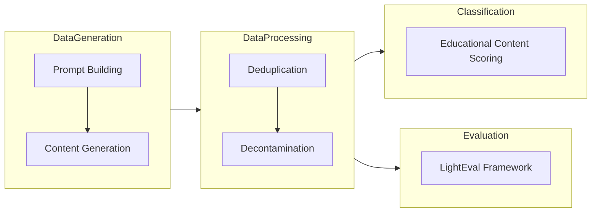
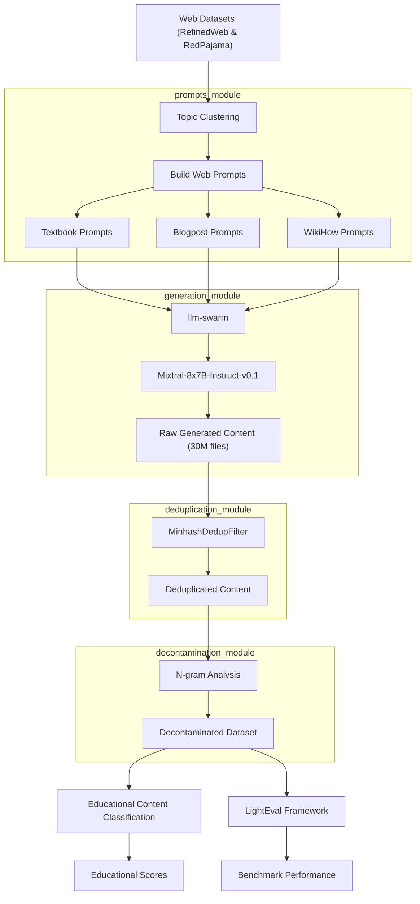

<!-- source: DeepWiki mcp.deepwiki.com · repo huggingface/cosmopedia · page 1 Overview · fetched 2026-10-26 -->

# Overview

Relevant source files

The following files were used as context for generating this wiki page:

- [LICENSE](LICENSE)
- [README.md](README.md)

This document provides an introduction to the Cosmopedia repository, a comprehensive system for generating, processing, and evaluating synthetic data for training language models. Cosmopedia represents a large-scale effort to create high-quality synthetic textbooks, blogposts, stories, and guides that cover a wide range of world knowledge.

For specific details about the dataset itself, see [Dataset Overview](#1.1).

## Purpose and Scope

Cosmopedia aims to create a massive, high-quality synthetic dataset that maps world knowledge present in web datasets such as RefinedWeb and RedPajama. The project encompasses the entire pipeline from prompt generation to content evaluation:

1. **Data Generation**: Creating prompts from web data and generating synthetic content
2. **Data Processing**: Ensuring quality through deduplication and decontamination
3. **Content Classification**: Scoring content for educational value
4. **Evaluation**: Benchmarking the quality of the generated data

The resulting dataset contains over 30 million files and 25 billion tokens, making it the largest open synthetic dataset to date.

Sources: [README.md:13-16]()

## System Architecture

The Cosmopedia system consists of four main components organized in a sequential pipeline.

Sources: [README.md:25-29]()

### Core Components

Cosmopedia's architecture follows a logical flow from data generation to evaluation:

1. **Data Generation**: This process starts with topic clustering from web samples to build diverse prompts. These prompts are then fed to the Mixtral-8x7B-Instruct-v0.1 model through llm-swarm infrastructure to generate the synthetic content.

2. **Data Processing**: The generated content undergoes rigorous processing, including MinHash-based deduplication using datatrove and n-gram decontamination against evaluation benchmarks.

3. **Content Classification**: Educational content scoring is performed using fine-tuned BERT models to classify and score the synthetic content.

4. **Evaluation**: The processed dataset is evaluated using the LightEval framework against benchmarks like MMLU, GSM8k, TriviaQA, and others.

Sources: [README.md:25-29]()

## Detailed System Architecture and Data Flow

The following diagram illustrates the complete data flow through the Cosmopedia system, mapping specific code components to each stage of the process:

Sources: [README.md:13-29]()

## Dataset Content and Coverage

Cosmopedia covers a diverse range of topics, attempting to map world knowledge present in large web datasets. The content is distributed across various clusters representing different domains of knowledge.

The dataset includes:
- Synthetic textbooks on academic subjects
- Blogposts on various topics
- Stories and fictional content
- WikiHow-style guides and tutorials

The content is generated through carefully crafted prompts and then processed to ensure uniqueness and quality.

Sources: [README.md:14-16]()

## Code Structure

The Cosmopedia repository is organized into the following main directories:

| Directory | Purpose |
|-----------|---------|
| `prompts` | Code for building prompts from web samples, including topic clustering |
| `generation` | Code for running large-scale synthetic generations with llm-swarm |
| `deduplication` | Scripts for MinHash deduplication using datatrove |
| `decontamination` | Code for n-gram decontamination against evaluation benchmarks |

Additional components include classification systems for scoring educational content and evaluation frameworks for benchmarking the quality of the dataset.

Sources: [README.md:25-29]()

## License and Usage

Cosmopedia is released under the Apache License 2.0, allowing for free use, modification, and distribution with proper attribution.

Sources: [LICENSE:1-201]()

## Relation to Other Components

The Overview page serves as an entry point to understanding the Cosmopedia system. For more detailed information about specific components, refer to:

- [Data Generation](#2) for details on the prompt building and content generation process
- [Data Processing](#3) for information about deduplication and decontamination
- [Content Classification](#4) for details on the educational content scoring system
- [Evaluation](#5) for information about the evaluation framework and benchmarks

---

