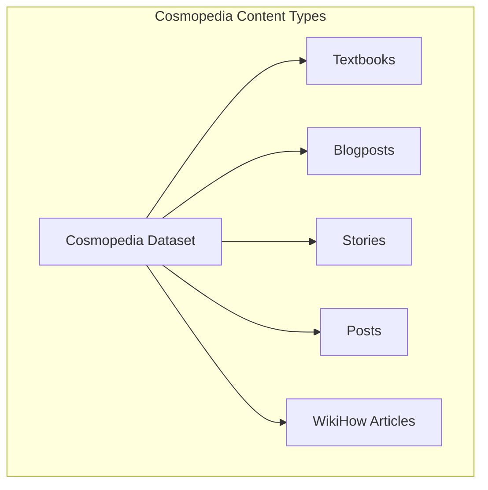
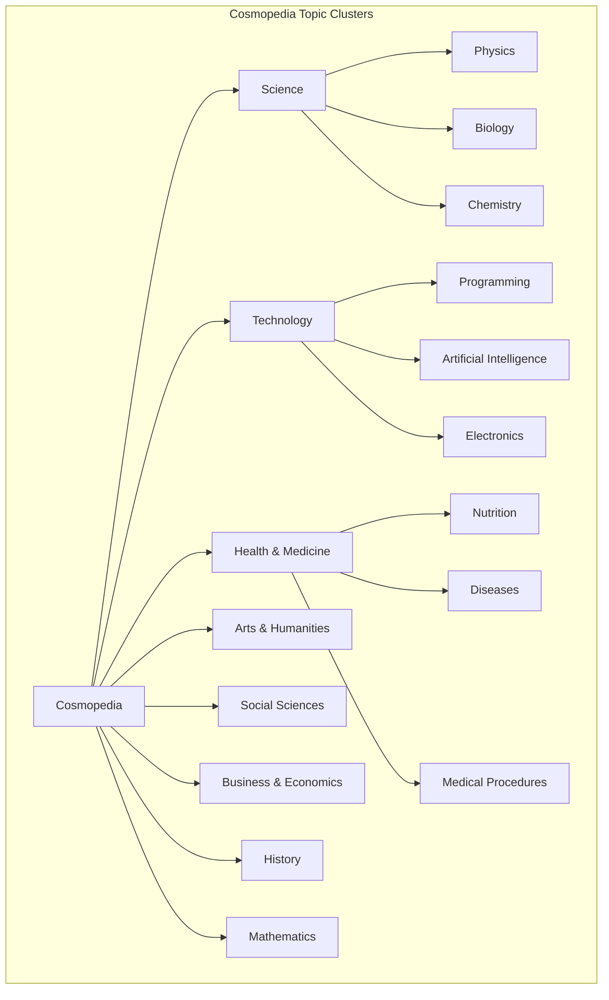
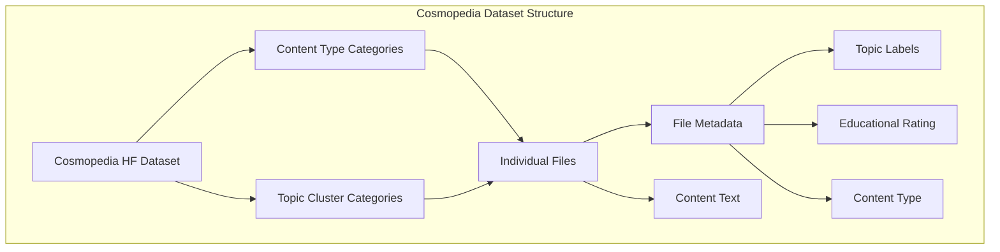
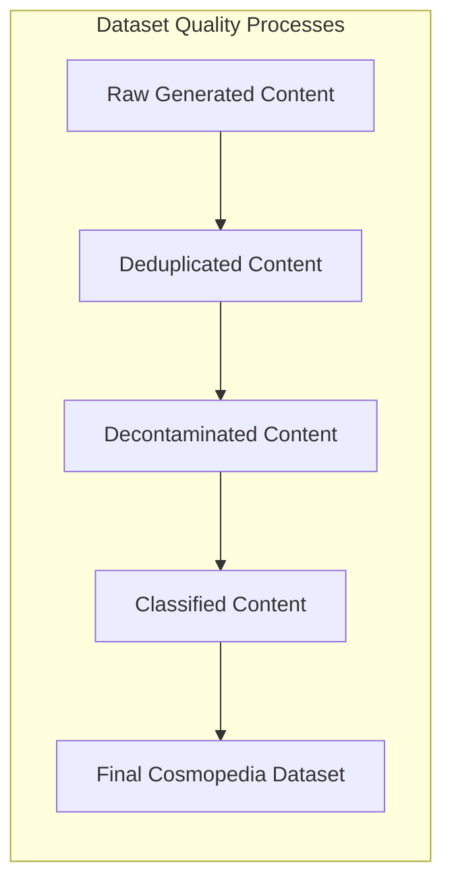

<!-- source: DeepWiki mcp.deepwiki.com · repo huggingface/cosmopedia · page 1.1 Dataset Overview · fetched 2026-10-26 -->

# Dataset Overview

<details>
<summary>Relevant source files</summary>

The following files were used as context for generating this wiki page:

- [LICENSE](LICENSE)
- [README.md](README.md)

</details>


## Purpose and Scope

This document provides a comprehensive overview of the Cosmopedia dataset, including its size, content types, and structure. It describes what the dataset contains and how it's organized, without delving into the technical details of its generation or processing, which are covered in other sections of the documentation. For information about how prompts are built for generation, see [Prompt Building](#2.1), and for details on the content generation process, see [Content Generation](#2.2).

## Dataset Description

Cosmopedia is a synthetic dataset generated by Mixtral-8x7B-Instruct-v0.1, designed to serve as a high-quality corpus for training language models. It represents one of the largest open synthetic datasets available, containing a diverse range of educational and informative content spanning numerous knowledge domains.

| Dataset Attribute | Value |
|-------------------|-------|
| Version | 0.1 |
| Total Files | >30 million |
| Total Tokens | ~25 billion |
| Generation Model | Mixtral-8x7B-Instruct-v0.1 |
| License | Apache License 2.0 |

Sources: [README.md:13-16]()

## Content Types

The Cosmopedia dataset consists of several distinct content types, each designed to capture different styles and formats of educational material:

1. **Textbooks**: Structured educational content with chapters, sections, and comprehensive topic coverage
2. **Blogposts**: More conversational informative content on specific topics
3. **Stories**: Narrative content that can include educational elements
4. **Posts**: Shorter informative pieces on specific subjects
5. **WikiHow Articles**: Instructional content formatted as step-by-step guides



Sources: [README.md:14]()

## Topical Coverage

Cosmopedia aims to map the world knowledge present in web datasets like RefinedWeb and RedPajama. The content is organized into topical clusters that span a broad range of subject areas. The dataset's clusters visualization (available in the repository at `plots/clusters_map.png`) illustrates the diverse topical coverage.



The topic distribution in the dataset is not uniform, with some topics having more representation than others. A frequency plot of single topic clusters is available in the repository at `plots/topic_distpng.png`.

Sources: [README.md:16-23]()

## Dataset Structure

The Cosmopedia dataset is structured to facilitate easy access and utilization. At the highest level, the dataset is organized by content type and topic clusters.



Each file in the dataset contains the synthetic content along with metadata that can include topic labels, educational rating scores (for classified content), and content type information. This structure allows for efficient filtering and selection of specific content types or topics for downstream applications.

Sources: [README.md:14-16]()

## Dataset Access

The Cosmopedia dataset is publicly available through the Hugging Face Datasets Hub. It can be accessed at [huggingface.co/datasets/HuggingFaceTB/cosmopedia](https://huggingface.co/datasets/HuggingFaceTB/cosmopedia).

The dataset can be loaded using the Hugging Face Datasets library:

```python
from datasets import load_dataset

dataset = load_dataset("HuggingFaceTB/cosmopedia")
```

Additionally, a 1B parameter language model trained on Cosmopedia is available at [huggingface.co/HuggingFaceTB/cosmopedian-1b](https://huggingface.co/HuggingFaceTB/cosmopedian-1b).

Sources: [README.md:8-9]()

## Dataset Processing

While the detailed processing is covered in other sections of the documentation, it's worth noting that the Cosmopedia dataset has undergone rigorous quality assurance, including:

1. **Deduplication**: Removal of near-duplicate content using MinHash algorithms and datatrove
2. **Decontamination**: Protection against contamination with evaluation benchmarks through n-gram analysis
3. **Educational Content Classification**: Assessment of the educational value of content

For more detailed information about these processes, see [Deduplication](#3.1), [Decontamination](#3.2), and [Content Classification](#4).



Sources: [README.md:27-29]()

## Use Cases

The Cosmopedia dataset is designed to support various research applications in natural language processing and machine learning, including:

1. **Language Model Training**: As demonstrated by cosmopedian-1b, the dataset can be used to train language models from scratch
2. **Fine-tuning Existing Models**: The dataset provides high-quality synthetic data for fine-tuning pretrained models
3. **Synthetic Data Research**: Investigating the properties and effectiveness of synthetic data for NLP tasks
4. **Educational Content Generation**: Studying how language models can generate educational material

The dataset's v0.1 designation indicates it's an initial version with room for improvement and expansion, making it a valuable resource for ongoing research in synthetic data generation and utilization.

Sources: [README.md:16]()

---

