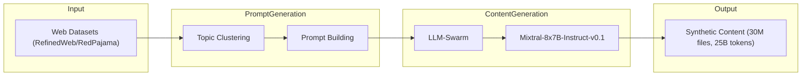
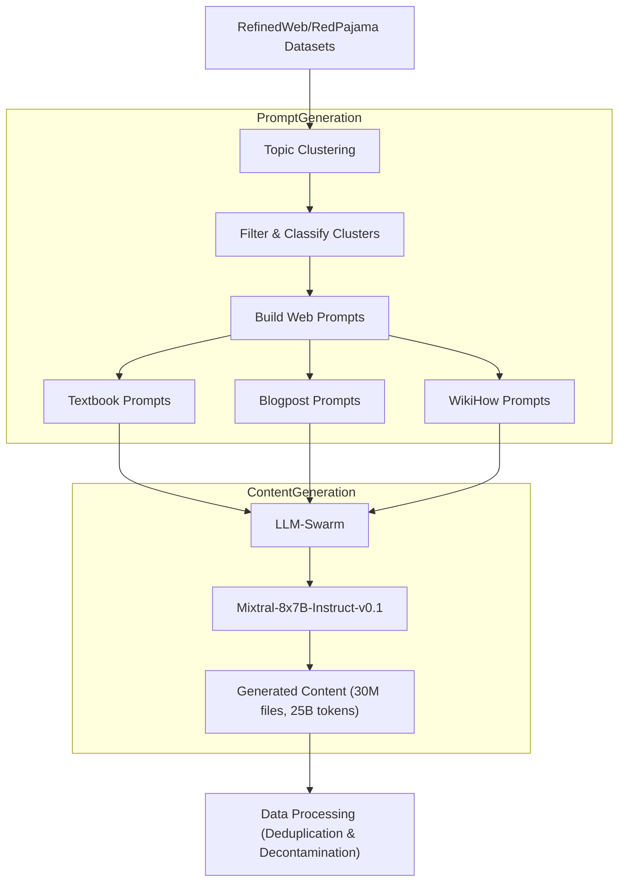
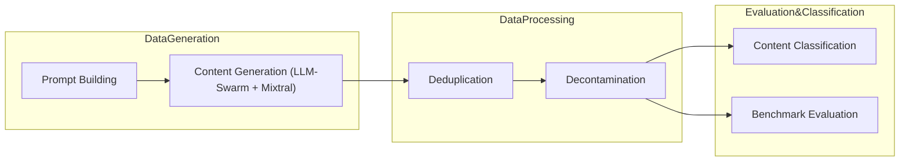

<!-- source: DeepWiki mcp.deepwiki.com · repo huggingface/cosmopedia · page 2 Data Generation · fetched 2026-10-26 -->

# Data Generation

<details>
<summary>Relevant source files</summary>

The following files were used as context for generating this wiki page:

- [LICENSE](LICENSE)
- [README.md](README.md)
- [generation/README.md](generation/README.md)

</details>


## Purpose and Scope

This page documents the synthetic data generation system in Cosmopedia, which is responsible for creating high-quality synthetic textbooks, blogposts, stories, and WikiHow articles. The Data Generation system takes input from web datasets, creates prompts through topic clustering, and uses large language models to generate content at scale. This page provides an overview of the entire generation process, while detailed information about specific components can be found in [Prompt Building](#2.1) and [Content Generation](#2.2).

## Overview of Data Generation Process

The Cosmopedia Data Generation system transforms web data into a large-scale synthetic dataset (30M files, 25B tokens) through a multi-stage pipeline. The process begins with topic clustering of web samples, followed by prompt creation, and finally large-scale content generation using advanced language models.



Sources: [README.md:14-16](), [generation/README.md:4]()

## Generation System Architecture

The Data Generation system consists of two main components: Prompt Generation and Content Generation. The following diagram illustrates the detailed architecture of the generation process:



Sources: [README.md:25-27](), [generation/README.md:2-8]()

## Prompt Generation

The Prompt Generation component takes web samples from datasets like RefinedWeb and RedPajama and processes them into effective prompts for content generation. The process involves:

1. **Topic Clustering**: Web samples are clustered by topics to identify knowledge domains to cover
2. **Filtering and Classification**: Clusters are filtered and classified to organize content types
3. **Prompt Building**: Different types of prompts are created for textbooks, blogposts, and WikiHow articles

For detailed information about prompt building, see the [Prompt Building](#2.1) page.

Sources: [README.md:26]()

## Content Generation

The Content Generation component uses the `llm-swarm` system to deploy multiple instances of the Mixtral-8x7B-Instruct-v0.1 model across a distributed computing environment. This enables efficient, large-scale generation of synthetic content based on the prompts created in the previous stage.

### Generation Scale and Resource Requirements

Content generation for Cosmopedia was a substantial computational undertaking:
- Used over 10,000 H100 GPU hours
- Generated 30 million files
- Produced 25 billion tokens of synthetic content

### Generation Process with LLM-Swarm

The `llm-swarm` tool orchestrates the deployment of Text Generation Inference (TGI) or vLLM instances on Slurm clusters. Below is an example of how content generation is executed:

```
python generate_syntehtic_textbooks.py \
    --model mistralai/Mixtral-8x7B-Instruct-v0.1 \
    --instances 2 \
    --prompts_dataset "HuggingFaceTB/cosmopedia-100k" \
    --prompt_column prompt \
    --max_samples 2000 \
    --checkpoint_path "./synthetic_data" \
    --checkpoint_interval 1000
```

For more detailed information about the content generation process, see the [Content Generation](#2.2) page.

Sources: [generation/README.md:4-21]()

## Data Types and Coverage

Cosmopedia's Data Generation system produces a variety of content types to cover a broad range of knowledge domains:

| Content Type | Description | Purpose |
|-------------|-------------|---------|
| Textbooks | Educational content structured as textbook chapters | Comprehensive coverage of academic subjects |
| Blogposts | Informal articles on various topics | Coverage of practical knowledge and contemporary topics |
| Stories | Narrative content | Creative and entertainment content |
| WikiHow Articles | Step-by-step instructional content | Procedural knowledge and how-to information |

The generated content attempts to map the world knowledge present in web datasets, though the creators note that version 0.1 has "ample room for improvement and topics to be more comprehensively covered."

Sources: [README.md:14-16]()

## Integration with Downstream Systems

After generation, the synthetic content flows into subsequent processing systems:



The output from Data Generation feeds into the Data Processing system ([Deduplication](#3.1) and [Decontamination](#3.2)) to ensure high-quality, unique content before being used for model training, classification, and evaluation.

Sources: [README.md:28-29]()

---

