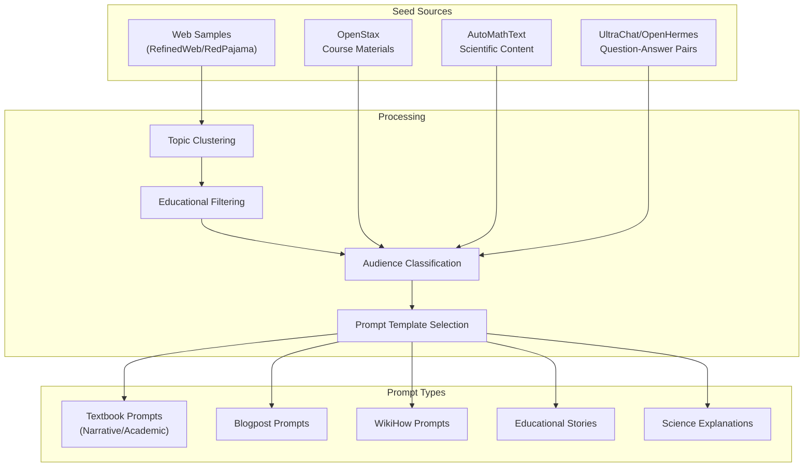
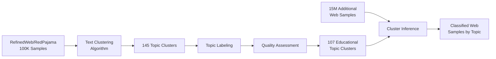
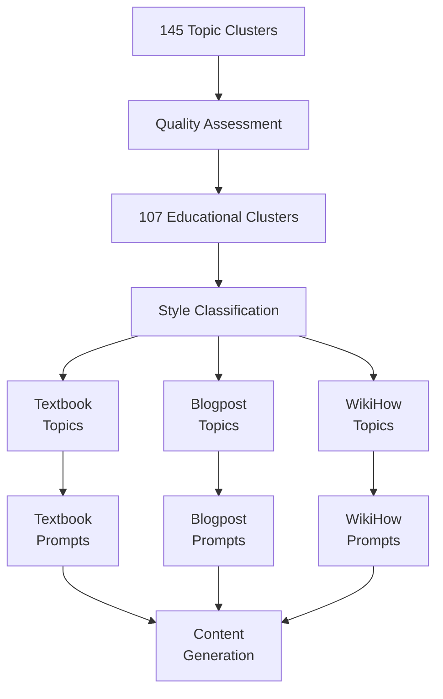
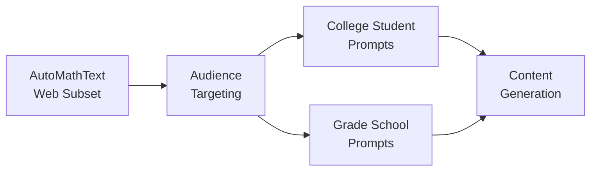
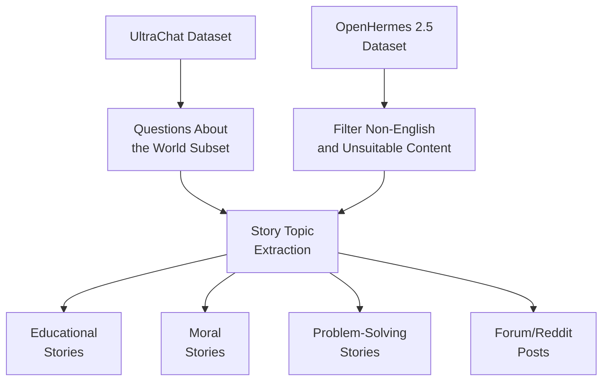
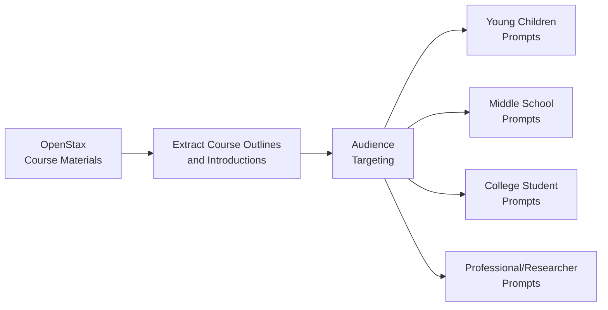
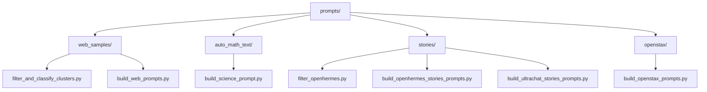
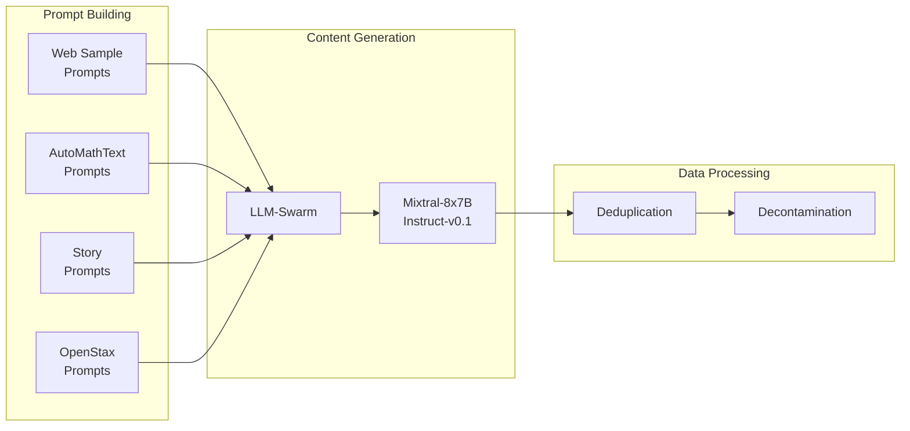

<!-- source: DeepWiki mcp.deepwiki.com · repo huggingface/cosmopedia · page 2.1 Prompt Building · fetched 2026-10-26 -->

# Prompt Building

Relevant source files

The following files were used as context for generating this wiki page:

- [prompts/README.md](prompts/README.md)
- [prompts/auto_math_text/README.md](prompts/auto_math_text/README.md)
- [prompts/openstax/README.md](prompts/openstax/README.md)
- [prompts/stories/README.md](prompts/stories/README.md)
- [prompts/web_samples/README.md](prompts/web_samples/README.md)

## Purpose and Scope

This document details the prompt building process within the Cosmopedia project, which is a crucial first step in the synthetic data generation pipeline. Prompt building involves transforming various seed data sources into structured prompts that guide the language model to generate high-quality, educational content. For information about how these prompts are used in the actual content generation process, see [Content Generation](#2.2).

## Prompt Building Process Overview

Prompt building in Cosmopedia involves creating tailored prompts from multiple seed data sources, each following a specific workflow designed to maximize the educational quality and diversity of the generated content.

Sources: [prompts/README.md](), [prompts/web_samples/README.md]()

## Web Sample-Based Prompts

The majority of prompts in Cosmopedia are derived from web samples through a clustering and topic-based approach.

### Clustering and Topic Identification

The process begins by clustering 100,000 samples from web datasets like RefinedWeb to identify distinct topics and content types.

Sources: [prompts/web_samples/README.md:3-9]()

### Filtering and Classification

The clustering process resulted in 145 clusters, of which 38 were excluded based on quality assessment. Each remaining cluster was then classified for potential generation styles.

Sources: [prompts/web_samples/README.md:7-16]()

### Implementation

The web sample prompt building process is implemented in two main scripts:

1. `filter_and_classify_clusters.py` - Filters out non-educational clusters and classifies the remaining ones by content type
2. `build_web_prompts.py` - Constructs the actual prompts based on the classified clusters

Sources: [prompts/web_samples/README.md:11-19]()

## Other Prompt Sources

In addition to web samples, Cosmopedia uses several other data sources to create a diverse set of prompts.

### AutoMathText Prompts

AutoMathText serves as a source for science and mathematics prompts, with tailored versions created for two distinct audience levels:
- College students
- Grade school students

The script `build_science_prompt.py` handles the creation of these prompts, with options to generate for specific audiences or all styles at once.

Sources: [prompts/auto_math_text/README.md]()

### Story-Based Prompts

Story-based prompts are created from:
- UltraChat (specifically the "Questions about the world" subset)
- OpenHermes 2.5 (filtered for English content and suitable categories)

These sources are used to create four types of narratives:
1. Educational stories for young children
2. Stories involving morals and principles
3. Stories involving problem solving
4. Posts found on forums and Reddit

The key scripts for this process are:
- `filter_openhermes.py` - Filters OpenHermes dataset
- `build_openhermes_stories_prompts.py` - Creates prompts from OpenHermes
- `build_ultrachat_stories_prompts.py` - Creates prompts from UltraChat

Sources: [prompts/stories/README.md]()

### OpenStax Prompts

OpenStax educational materials are used to create textbook-style prompts for four different audience levels:
1. Young children
2. Middle school students
3. College students
4. Professionals and researchers

The script `build_openstax_prompts.py` handles this process, with each prompt tailored to its target audience.

Sources: [prompts/openstax/README.md]()

## Prompt Structure and Implementation

The overall organization of the prompt building process is represented in the file structure below:

Sources: [prompts/README.md](), [prompts/web_samples/README.md](), [prompts/auto_math_text/README.md](), [prompts/stories/README.md](), [prompts/openstax/README.md]()

### Integration with Data Generation Pipeline

After prompt building, the created prompts feed into the content generation system as shown below:

Sources: [prompts/README.md]()

## Summary

The prompt building system in Cosmopedia transforms various seed data sources into structured prompts that guide the generation of diverse, educational content. The process involves clustering web samples to identify topics, filtering for educational value, and classifying content types to create appropriate prompts. Additional sources like AutoMathText, OpenStax, and story datasets further enhance the diversity of the generated content.

Key aspects of the prompt building process include:
- Topic-based clustering of web samples
- Educational quality filtering
- Audience targeting for different knowledge levels
- Multiple content types (textbooks, blogposts, WikiHow, stories)
- Specialized prompts for scientific, narrative, and educational content

This systematic approach to prompt building ensures that the generated Cosmopedia dataset contains high-quality, diverse educational content covering a wide range of topics and formats.

---

